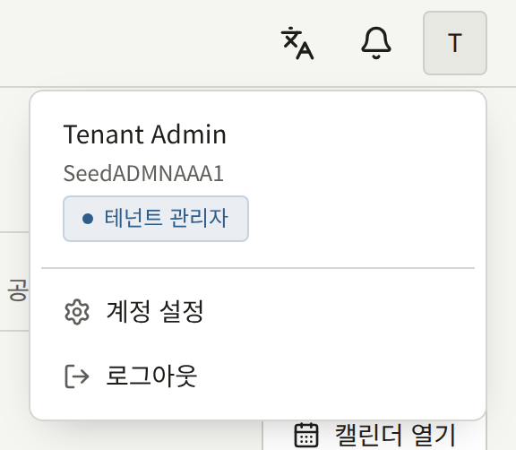
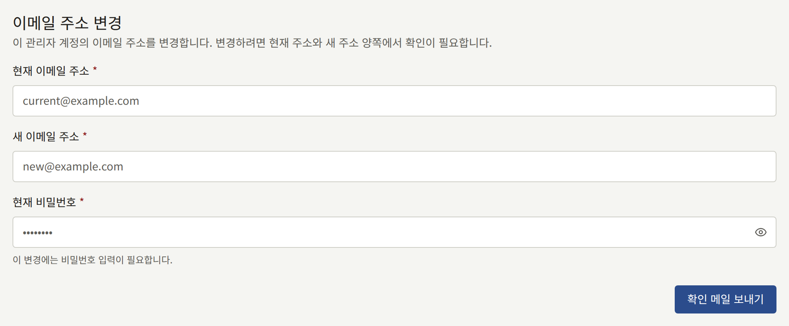
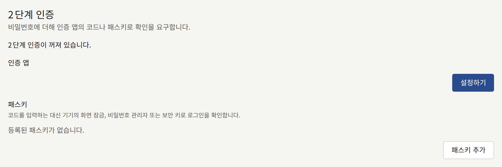
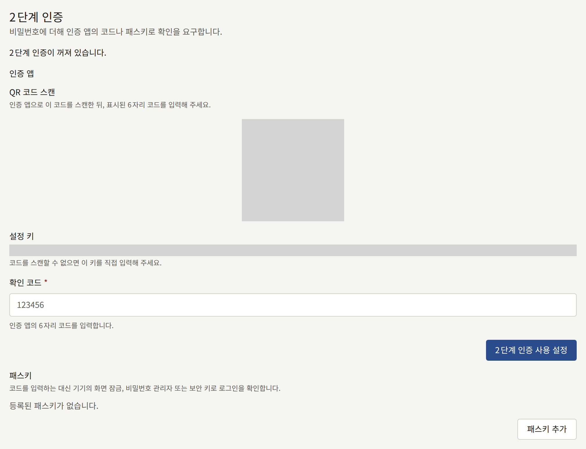
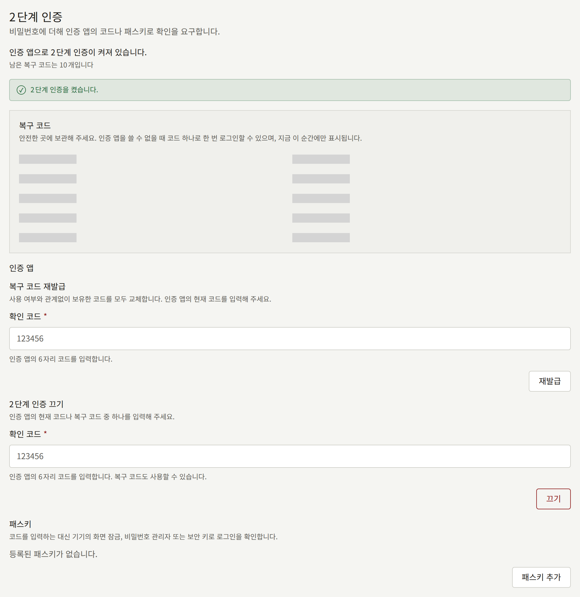

모든 스태프는 역할과 관계없이 콘솔 상단의 계정 메뉴에 있는 **계정 설정**에서 자신의 콘솔 계정을 관리합니다. 여기에는 **이메일 주소 변경**과 **2단계 인증** 두 개의 카드가 있습니다.

콘솔에는 비밀번호를 바꾸는 화면이 없습니다. 로그아웃한 다음 로그인 화면의 **비밀번호를 잊으셨나요?** 링크를 사용하세요. 새 비밀번호를 설정하는 링크가 메일로 전송됩니다.

## 이메일 주소 변경하기

**이메일 주소 변경**에서 **현재 이메일 주소**, **새 이메일 주소**, **현재 비밀번호**를 입력하고 **확인 메일 보내기**를 선택하세요.

두 주소 모두에 확인 메일이 전송되며, 변경하려면 각각 24시간 안에 두 링크를 모두 열어야 합니다. 현재 주소를 요구하므로, 비밀번호만 알고 있는 사람이 계정을 자기 주소로 옮길 수 없습니다. 두 링크를 모두 열기 전까지는 계속 현재 주소로 로그인합니다. 두 링크를 모두 열면 새 주소로 로그인하게 되며, 이전 주소로 주소가 변경되었다는 알림이 갑니다.

새 주소는 독자를 포함해 테넌트의 다른 계정의 주소여서는 안 됩니다. 두 번째 요청은 첫 번째 요청을 대체하며, 첫 번째 요청의 링크는 더 이상 작동하지 않습니다.

콘솔 계정은 사이트의 계정이기도 하므로, 변경은 양쪽에 적용됩니다.

## 2단계 인증

2단계 인증은 비밀번호 다음에 두 번째 증명을 요구하므로, 비밀번호를 도난당해도 그것만으로는 로그인할 수 없습니다. 증명은 휴대폰의 인증 앱에 표시되는 코드나 패스키입니다. 많은 비밀번호 관리자에 내장된 것을 포함해, QR 코드를 읽을 수 있는 인증 앱이라면 무엇이든 사용할 수 있습니다. 패스키는 기기의 화면 잠금, 비밀번호 관리자, 또는 보안 키로 잠금을 해제하며, 아무것도 입력할 필요가 없습니다.

**2단계 인증** 카드에는 두 가지 각각에 대한 부분이 있습니다. **인증 앱**과 **패스키**입니다. 둘 중 하나만 써도, 둘 다 써도 되며, 카드 상단의 줄에 어느 것이 켜져 있는지 표시됩니다. 둘 중 하나라도 있으면 2단계 인증이 켜진 상태입니다.

운영자는 설치 환경의 모든 테넌트 관리자에게 2단계 인증을 필수로 할 수 있습니다. 그러면 2단계 인증을 설정하지 않은 테넌트 관리자는 비밀번호를 입력한 직후, 콘솔을 사용하기 전에 설정하도록 요청받으며, **2단계 인증**에는 "이 테넌트는 관리자에게 2단계 인증을 필수로 하고 있습니다."라고 표시됩니다. [패스키로 로그인하기](#패스키로-로그인하기)에서 설명하듯이 인증 앱이나 패스키 중 하나로 응할 수 있습니다. 편집 담당과 감사 담당에게는 필수가 아니지만, 스스로 켤 수 있습니다.

### 인증 앱 설정하기

1. **인증 앱** 아래에서 **설정하기**를 선택하세요.
2. 인증 앱으로 QR 코드를 스캔하세요. 스캔할 수 없다면, 옆에 표시된 **설정 키**를 직접 입력하세요.
3. 앱에 표시된 6자리 코드를 **확인 코드**에 입력하고, **2단계 인증 사용 설정**을 선택하세요.
4. 앱이 첫 번째 2단계 인증 수단이라면, 콘솔에 **복구 코드** 10개가 표시됩니다. 비밀번호 관리자나 종이처럼 휴대폰이 아닌 곳에 보관하세요. 복구 코드는 이때 한 번만 표시됩니다.

그 뒤로는 로그인할 때마다 콘솔이 앱의 코드를 요구합니다. 비밀번호를 입력한 뒤 5분 안에 코드를 입력해야 합니다. 잘못된 코드를 다섯 번 입력하면 계정이 15분 동안 잠깁니다.

### 패스키 추가하기

1. **패스키** 아래에서 **패스키 추가**를 선택하세요.
2. 브라우저가 콘솔용 패스키를 만들도록 요청합니다. 기기의 화면 잠금, 비밀번호 관리자, 또는 보안 키로 확인하세요.
3. 패스키가 첫 번째 2단계 인증 수단이라면, 인증 앱과 마찬가지로 콘솔에 **복구 코드** 10개가 표시됩니다. 같은 방식으로 보관하세요. 이때 한 번만 표시됩니다.
4. **패스키 이름**에서 기기나 비밀번호 관리자처럼 패스키를 보관한 곳을 알 수 있는 **이름**을 입력하고 **저장**을 선택하세요. **건너뛰기**를 선택하면 이름 없이 둡니다.

각 패스키는 이름, 추가한 일시, 마지막으로 로그인에 사용한 일시와 함께 나열됩니다. **이름 변경**으로 이름을 바꿀 수 있습니다. 예를 들어 휴대폰에 하나, 보안 키에 하나처럼 여러 개를 추가할 수 있으며, 그중 어느 것으로든 로그인할 수 있습니다. 동기화되는 비밀번호 관리자에 보관한 패스키는 다른 기기에도 저절로 전달되므로, 한 번만 추가하면 됩니다.

브라우저는 이미 이 계정의 패스키를 가진 인증기에 두 번째 패스키를 만드는 것을 거부하며, 콘솔에 그렇게 표시됩니다.

### 패스키 삭제하기

패스키 옆의 **삭제**를 선택하고 확인하세요. 그 패스키로는 더 이상 콘솔에 로그인할 수 없습니다. 패스키는 기기나 비밀번호 관리자에서도 삭제할 때까지 그곳에 남아 있습니다.

마지막 패스키였고 인증 앱이 없다면 2단계 인증이 꺼지며, 복구 코드도 함께 사라집니다. 운영자가 테넌트 관리자에게 2단계 인증을 필수로 했다면, 콘솔은 테넌트 관리자의 마지막 2단계 인증 수단을 삭제하는 것을 거부합니다. 먼저 다른 패스키를 추가하거나 인증 앱을 설정하세요.

### 패스키로 로그인하기

**계정 설정**에서든 로그인할 때든 패스키를 추가하면, 비밀번호 다음 화면에서 패스키로 응할 수 있습니다. 운영자가 테넌트 관리자에게 2단계 인증을 필수로 했는데 아직 설정하지 않았다면, 그 화면에 **인증 앱 설정**과 **패스키 설정**이 표시됩니다. **패스키 설정**을 선택하면 브라우저가 콘솔용 패스키를 만들며, 기기의 화면 잠금, 비밀번호 관리자, 또는 보안 키로 확인합니다. 그러면 인증 앱과 마찬가지로 콘솔에 **복구 코드** 10개가 표시되며, 보관을 마치면 콘솔로 진행합니다.

그 뒤로는 비밀번호 다음 화면에 **패스키 사용**이 먼저 표시됩니다. 이를 선택하고 브라우저가 요청하면 패스키의 잠금을 해제하세요. 코드를 입력하지 않고 로그인됩니다. **대신 코드 입력**은 인증 앱의 코드나 복구 코드를 입력하는 필드를 표시하고, **대신 패스키 사용**은 원래대로 돌아갑니다. 패스키가 유일한 2단계 인증 수단이라면 링크는 **대신 복구 코드 입력**으로 표시됩니다.

패스키도 코드와 같은 5분 안에 응해야 하며, 콘솔이 거부한 패스키는 잘못된 코드와 같은 잠금 횟수에 포함됩니다. 브라우저가 패스키를 사용할 수 없다고 할 때, 확인 창을 닫았거나 시간이 초과되었을 때, 콘솔이 알아보지 못하는 패스키일 때는 각각 화면에 메시지가 표시되며, 코드 입력 필드는 여전히 클릭 한 번으로 열 수 있습니다.

콘솔이 테넌트의 도메인이나 `admin.<domain>`처럼 그 하위에서 제공될 때 패스키는 테넌트의 도메인에 속하고, 그렇지 않으면 콘솔 자체의 호스트에 속합니다. 운영자가 테넌트의 도메인을 바꾸거나, 콘솔을 그 도메인 안으로 또는 밖으로 옮기면, 콘솔은 그전에 만든 패스키를 더 이상 제시하지 않습니다. 인증 앱도 있다면 인증 앱이나 복구 코드로 로그인하세요. 패스키가 유일한 2단계 인증 수단이었다면, 콘솔은 비밀번호만으로 로그인시키거나, 운영자가 2단계 인증을 필수로 한 테넌트 관리자라면 다시 설정하도록 요청합니다.

### 복구 코드

복구 코드는 휴대폰이나 패스키를 보관한 기기가 없을 때 앱이나 패스키를 한 번 대신합니다. 콘솔이 앱의 코드를 요구하는 곳에 입력하거나, 패스키로 로그인할 때는 **대신 복구 코드 입력**에서 입력하세요. 그러면 콘솔이 남은 코드 수를 알려 줍니다. 코드 10개는 앱과 계정의 모든 패스키가 함께 사용합니다.

**복구 코드 재발급**은 새 코드 10개를 발급하고, 사용 여부와 관계없이 이전 코드를 모두 쓸 수 없게 만듭니다. 재발급에는 복구 코드를 사용할 수 없습니다. 앱을 설정했다면 **인증 앱** 아래에 있으며 앱의 코드를 요구합니다. 패스키가 유일한 2단계 인증 수단이라면 대신 **패스키** 아래에 있습니다. **패스키로 재발급**을 선택하고 브라우저가 요청하면 패스키 중 하나의 잠금을 해제하세요. 콘솔이 거부한 패스키로는 코드가 발급되지 않고, 가지고 있는 코드도 그대로이며, 잘못된 코드와 같은 잠금 횟수에 포함됩니다. 복구 코드를 사용한 뒤 휴대폰이나 패스키를 되찾았을 때, 또는 코드가 노출되었을 수 있다고 생각될 때마다 재발급하세요.

### 끄기

**인증 앱** 아래의 **2단계 인증 끄기**는 인증 앱을 제거합니다. 앱의 코드나 복구 코드를 요구합니다. 패스키는 그대로 남으며, 패스키가 있다면 2단계 인증은 패스키로 계속 켜져 있습니다. 완전히 끄려면 패스키도 하나씩 삭제하세요. 운영자가 테넌트 관리자에게 2단계 인증을 필수로 했다면, 패스키가 하나도 남지 않은 상태로 2단계 인증을 끈 테넌트 관리자는 다음 로그인 때 다시 설정하도록 요청받습니다.

### 새 기기 또는 분실한 기기

인증 앱이 있는 휴대폰을 바꾸기 전에, 이전 휴대폰의 코드로 로그인하고, 2단계 인증을 끈 다음, 새 휴대폰으로 다시 켜세요. 일부 인증 앱은 코드를 새 휴대폰으로 직접 옮길 수도 있습니다.

패스키를 보관한 기기를 바꾸기 전에, 새 기기에 패스키를 추가하고 목록에서 이전 패스키를 삭제하세요. 동기화되는 비밀번호 관리자의 패스키는 비밀번호 관리자와 함께 옮겨지므로, 아무것도 할 필요가 없습니다.

기기를 분실했다면, 남아 있는 수단으로 로그인하세요. 다른 패스키, 인증 앱, 또는 복구 코드입니다. 그런 다음 분실한 기기의 패스키를 삭제하거나 그 기기에 있던 인증 앱을 꺼서 더 이상 내 것으로 인정되지 않도록 하고, 새 기기를 추가하세요. 기기를 주운 사람도 로그인하려면 여전히 비밀번호가 필요하지만, 삭제해 두면 두 번째 단계까지 갈 수조차 없습니다.

모든 2단계 인증 수단과 모든 복구 코드를 잃어버렸다면, 더 이상 콘솔에 로그인할 수 없으며, 비밀번호로도 다른 스태프도 계정에서 2단계 인증을 제거할 수 없습니다. 설치 환경의 운영자에게 요청하세요. [테넌트의 스태프](../../3-operations/3-tenant-staff.md#잃어버린-2단계-인증)에서 설명하듯이 운영자가 2단계 인증을 제거할 수 있으며, 그 뒤 비밀번호로 로그인해 다시 설정하면 됩니다.

2단계 인증 설정, 패스키의 등록, 이름 변경, 삭제, 2단계 인증 끄기, 복구 코드 재발급, 그리고 코드, 패스키, 복구 코드를 사용한 각 로그인은 테넌트의 [감사 로그](./8-audit-log.md)에 기록됩니다.
