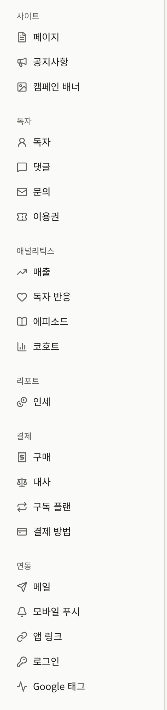

새 테넌트는 아무것도 없는 사이트로 시작합니다. 언어와 시간대는 운영자가 선택한 그대로이고, 색상은 Publira의 기본값이며, 로고도 페이지도 없고, 댓글도 받지 않으며, 관리자는 운영자가 초대한 사람뿐입니다. 이 섹션에서는 테넌트 관리자가 이 사이트를 출판사의 사이트로 만들어 가는 과정을 설명합니다. 사용하는 화면의 대부분은 사이드바의 **관리** 그룹에 있습니다. 사이트의 페이지, 공지사항, 캠페인 배너는 **사이트** 아래에 있고, 테넌트 자체 메일 서버는 **연동** › **메일**에 있습니다.

사이트는 운영자가 테넌트를 만든 순간부터 해당 도메인에서 공개되며, 작업하는 동안 사이트를 숨기는 스위치는 콘솔에 없습니다. 도메인을 일찍 발견한 독자는 그때까지 저장된 내용을 그대로 보게 되므로, 사이트를 알리기 전에 아래 단계를 마치세요.

## 처음 할 일, 순서대로

1. 콘솔이 아직 요구하지 않았다면, 계정 메뉴의 **계정 설정**에서 **자신의 2단계 인증을 켭니다**. [내 계정](./9-your-account.md)을 참고하세요.
2. **설정**에서 **언어와 시간대를 확인합니다**. 콘솔과 사이트의 모든 날짜는 이 시간대로 표시됩니다. [설정](./1-settings.md#시간대)을 참고하세요.
3. **브랜딩**에서 **사이트의 디자인을 정합니다**. 로고, 브라우저 아이콘, 색상, 서체입니다. [브랜딩](./2-branding.md)을 참고하세요.
4. **페이지**에서 **이용약관과 개인정보 처리방침을 작성해 공개한** 다음, **설정** › **이용약관 및 개인정보 처리방침**에서 선택합니다. 그러면 독자가 회원가입할 때 이에 동의하게 됩니다. [페이지](./3-pages.md#이용약관과-개인정보-처리방침)를 참고하세요.
5. **나머지 일반 설정을 채웁니다**. 사이트 푸터와 로그인 화면의 문구, 독자의 댓글 허용 여부, 나이 증명이 필요한 연령 등급, 독자가 회원가입에 사용할 수 없는 이메일 주소입니다. [설정](./1-settings.md)을 참고하세요.
6. **테넌트의 메일을 누구의 메일 서버로 보낼지 정합니다.** **연동** › **메일**에서 자체 서버를 설정할 때까지는 플랫폼의 메일 서버가 사용됩니다. [메일](./7-email.md)을 참고하세요.
7. **멤버**에서 **나머지 스태프를 초대합니다**. [멤버](./6-members.md)를 참고하세요.

카탈로그, 결제, Apple 및 Google 로그인, Google 태그, 앱은 각각의 페이지에서 설정합니다. 이 섹션의 [작품 공개하기](../1-catalog/index.md), [에피소드 판매](../4-selling-episodes.md), [Apple 및 Google로 로그인](../7-sign-in.md), [Google 태그](../8-google-tag.md), 그리고 [모바일 앱](../../5-mobile-app/index.md)을 참고하세요.

## 누가 무엇을 변경할 수 있는지

테넌트 관리자는 이 섹션에서 설명하는 모든 설정을 변경할 수 있고, 편집 담당은 사이트의 페이지, 공지사항, 캠페인 배너를 변경할 수 있습니다. 그 밖에는 편집 담당과 감사 담당이 일부 화면은 볼 수만 있고 저장할 수 없으며, 나머지 화면은 아예 보이지 않습니다.

| 화면 | 테넌트 관리자 | 편집 담당 | 감사 담당 |
| --- | --- | --- | --- |
| **페이지**, **공지사항**, **캠페인 배너** | 변경 | 변경 | 보기 |
| **브랜딩**, **설정** | 변경 | 보기 | 보기 |
| **멤버**, **감사 로그**, **연동** › **메일** | 변경 | 표시되지 않음 | 표시되지 않음 |
| **계정 설정** | 본인 계정 | 본인 계정 | 본인 계정 |

## 이 섹션의 내용

- [설정](./1-settings.md): 사이트의 문구, 시간대, 기본 언어, 독자 댓글, 연령 확인, 이용약관과 개인정보 처리방침, 받지 않는 이메일 주소, 테넌트가 더 엄격하게 할 수 있는 커뮤니티 제한과 보존 기간, 독자가 아이콘으로 표시할 수 있는 것.
- [브랜딩](./2-branding.md): 로고, 아이콘, 테마 색상, 서체, 미리보기.
- [페이지](./3-pages.md): 사이트 자체의 페이지와 그 버전 및 번역, 그리고 독자가 동의하는 이용약관과 개인정보 처리방침.
- [공지사항](./4-announcements.md): 모든 독자에게 공지하는 방법과, 사이트의 모든 페이지 위에 표시되는 배너.
- [캠페인 배너](./5-campaign-banners.md): 사이트 첫 페이지 상단과 앱 카탈로그 상단에 표시되는 이미지 배너의 일정과 순서.
- [멤버](./6-members.md): 스태프 초대, 역할 변경, 삭제.
- [메일](./7-email.md): 테넌트 자체 SMTP 서버로 테넌트의 메일을 보내는 방법과, 문의 메시지에 대한 독자의 답장을 콘솔에서 받는 방법.
- [감사 로그](./8-audit-log.md): 콘솔이 스태프의 작업에 대해 기록하는 내용.
- [내 계정](./9-your-account.md): 이메일 주소 변경과 2단계 인증.
