사이트에서 에피소드를 판매하려면 서로 맞아떨어져야 하는 세 가지가 필요합니다. 테넌트 콘솔에서 매기는 에피소드의 가격, 결제 제공자의 계정, 그리고 독자가 결제했다는 사실을 결제 제공자가 설치 환경에 알려 주는 웹훅입니다. 독자에게 요금을 청구하는 것은 결제 제공자이지만, 에피소드를 열어 주는 것은 웹훅뿐입니다. 따라서 세 가지 중 하나라도 잘못 설정되어 있으면 독자의 돈은 받으면서 에피소드는 잠긴 채로 남습니다. 이 페이지에서는 세 가지를 설정하는 순서대로 설명하고, 마지막에 세 가지가 맞아떨어지는지 확인하는 테스트 구매로 마무리합니다.

테넌트의 앱은 사이트와 같은 결제 제공자로 판매하거나, App Store와 Google Play 자체의 결제로 판매합니다. 스토어 결제에는 결제 제공자가 필요 없으며, 대신 스토어를 통해 구매를 검증합니다. 어느 쪽을 고를지는 [앱에서의 판매](#앱에서의-판매)에서 설명합니다. 앱에서만, 스토어 결제로 판매하는 테넌트는 결제 제공자에 관한 절을 건너뛰어도 됩니다.

여기서 다루는 **결제** › **결제 방법**과 **결제** › **프로모션 코드**의 모든 내용은 **테넌트 관리자**를 위한 것입니다. 편집 담당이나 감사 담당에게는 이 화면들이 보이지 않습니다. 에피소드의 가격은 그 에피소드를 만드는 사람이 매깁니다.

## 독자가 에피소드를 구매하는 방법

### 가격과 열람 가능 기간

에피소드의 **가격**과 **열람 가능 기간**은 에피소드를 만드는 폼에서 처음 입력합니다.

- **가격**은 필드에 표시된 테넌트의 통화로, 그 통화가 가진 소수 자릿수 이내로 입력합니다. 500엔이면 `500`, 4.99미국 달러면 `4.99`입니다. `0`이면 무료 에피소드가 되고, 그 밖의 값이면 유료 에피소드가 됩니다.
- **열람 가능 기간**은 구매 후 에피소드를 읽을 수 있는 시간(시간 단위)입니다. `0`이면 기한 없이 읽을 수 있습니다.

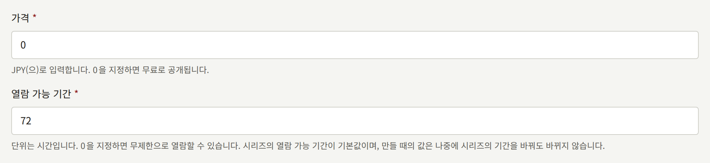

유료 에피소드는 대여로도 판매할 수 있습니다. **가격**보다 싸게, 정해진 시간 동안만 판매하는 방식입니다. **열람 가능 기간** 아래의 두 필드가 대여를 설정하며, **대여 가격**에 금액이 들어 있는 동안에만 에피소드를 대여합니다.

- **대여 가격**은 **가격**과 마찬가지로 테넌트의 통화로 입력하며, **가격**보다 낮아야 합니다. 따라서 무료 에피소드는 대여할 수 없습니다. 대여하지 않으려면 비워 둡니다.
- **대여 기간**은 대여 후 에피소드를 읽을 수 있는 시간(시간 단위)이며, `1` 이상이어야 합니다. **대여 가격**이 비어 있는 동안에는 사용되지 않습니다.

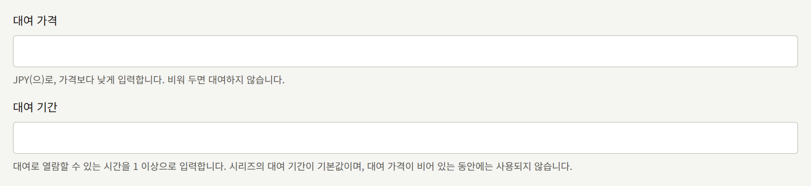

폼은 **가격** 이상으로 매긴 대여와, **대여 가격**은 있지만 **대여 기간**이 없는 대여를 거부하고, 어느 필드를 고쳐야 하는지 알려 줍니다. 대여가 소장 구매를 대신하지는 않습니다. 에피소드를 대여한 독자도 그 에피소드를 구매할 수 있습니다.

유료 에피소드는 구매하기 전에 앞쪽 페이지를 공개할 수도 있습니다. 대여 아래의 **미리보기 페이지 수**는 첫 페이지부터 센 공개 페이지 수입니다. 초기값인 `0`이면 어떤 페이지도 공개하지 않습니다. 무료 에피소드는 모든 페이지가 공개되므로, 이 필드는 **가격**이 `0`보다 클 때만 표시됩니다. 자세한 내용은 [미리보기 페이지](./1-catalog/2-episodes.md#미리보기-페이지)에서 설명합니다.

다섯 필드는 모두 나중에 에피소드 편집 화면의 **가격 및 열람 가능 기간**에서 바꿀 수 있으며, 방법은 [에피소드](./1-catalog/2-episodes.md#가격과-열람-가능-기간-바꾸기)에서 설명합니다. 가격을 바꾸지 않고 기간 한정으로 싸게 판매하려면 에피소드에 [캠페인 가격](./1-catalog/2-episodes.md#캠페인-가격)을 예약합니다. 변경 사항은 저장한 뒤의 구매부터 적용되며, 이미 이루어진 구매나 대여는 지불한 가격과 만료 시각이 그대로 유지됩니다. 새 에피소드의 **열람 가능 기간**은 시리즈의 **열람 가능 기간**에서, **대여 기간**은 시리즈의 **대여 기간**에서 시작합니다. 따라서 시리즈에서 한 번 설정해 두면, 이후에 만드는 모든 에피소드는 폼에서 바꾸지 않는 한 같은 기간을 갖습니다. 시리즈의 기간을 바꿔도 이미 만든 에피소드에는 반영되지 않습니다.

### 구매와 열람

유료 에피소드에서는 사이트에 가격과 **결제 진행하기**가 표시됩니다. 대여할 수 있는 에피소드에서는 그 대신 두 가지 판매 방식이 각각의 금액과 함께 표시됩니다. 가격으로 소장하는 **¥500에 구매**와, 대여 가격으로 대여 기간 동안 읽는 **72시간 대여 (¥300)** 같은 버튼입니다. 로그인한 독자가 둘 중 하나를 고르면 결제 제공자의 결제 페이지로 이동해 그곳에서 결제하고, 에피소드로 돌아옵니다. 돌아온 에피소드에는 결제를 확인하는 중이라고 표시됩니다. 에피소드는 결제 제공자의 결제 알림이 설치 환경에 도착하면 열리며, 보통 몇 초 안에 도착합니다. 결제 페이지에서 돌아오는 것만으로는 아무것도 열리지 않습니다.

[미리보기 페이지](./1-catalog/2-episodes.md#미리보기-페이지)가 있는 유료 에피소드에서는, 아직 에피소드를 열 수 없는 독자가 로그인 여부와 관계없이 사이트에서도 앱에서도 그 페이지를 먼저 읽습니다. 뷰어는 에피소드의 나머지 부분과 같아서, 에피소드의 읽는 방향대로 넘기고 레이아웃에 따라 펼침면으로 짝지어 보여 줍니다. 페이지 표시와 진행 슬라이더는 사이트에서는 `Page 3 of 3`, 앱에서는 `3 / 3`처럼 미리보기 페이지만 셉니다. 마지막 미리보기 페이지를 넘기면 **미리보기는 여기까지입니다**가 표시되고, 구매를 비롯해 에피소드가 제공하는 다른 열람 방법이 함께 표시됩니다. 미리보기 페이지가 없는 유료 에피소드는 페이지 대신 같은 방법들을, 앞쪽 페이지를 흐리게 처리한 화면 위에 표시합니다. 미리보기를 어디까지 읽었는지도, 끝까지 읽었는지도 기록되지 않으므로, 구매한 에피소드는 첫 페이지부터 열립니다.

구매한 에피소드는 다음과 같이 다뤄집니다.

- 구매가 기록된 시점부터 열람 가능 기간 동안, 대여라면 대여 기간 동안 열려 있습니다.
- 독자 계정의 **구매 목록**에 구매인지 대여인지 표시된 채로 나타나며, 대여는 남은 시간도 함께 표시됩니다. 기간이 끝나면 **구매 내역**에 나타납니다.
- 같은 계정이라면 어디서 구매했든 사이트에서도 테넌트의 앱에서도 열립니다.
- 열려 있는 동안에는 다시 구매할 수 없습니다. 열람 가능 기간이 끝나면 다시 구매할 수 있습니다. 대여 중인 독자는 소장 구매는 할 수 있지만, 대여가 끝날 때까지 다시 대여할 수는 없습니다.

**구매 목록**의 **CSV로 다운로드**는 목록에 있는 모든 구매를, 모든 페이지의 구매와 환불된 구매까지 포함해 하나의 CSV 파일로 저장합니다. 테넌트의 앱에서는 **구매 목록**의 **CSV로 내보내기**가 같은 파일을 만들어 기기의 공유 시트로 넘기며, 독자는 그곳에서 파일을 저장하거나 보냅니다.

독자가 사이트에서 구매한 테넌트의 코인 팩은 **구매 내역**에 나타납니다. 이름은 `1,100 Points (보너스 100 포함)`처럼 지급된 코인 수에 테넌트가 정한 코인의 호칭을 붙인 것이며, 지불한 금액과 환불 여부도 함께 표시됩니다. 코인 팩은 아무것도 열지 않으며 열람 가능 기간도 없습니다. 코인에는 코인 자체의 유효기간이 있습니다. CSV에는 `item` 열에 `coin_pack`이 기록되고, 보너스를 포함해 지급된 코인이 `coins`와 `bonus_coins`에 기록됩니다.

### 코인으로 결제

테넌트가 자체 코인을 판매하는 경우, 즉 플랫폼이 테넌트의 코인 발행을 허용하고 테넌트가 [코인](./9-coins.md)에서 설명하는 대로 코인을 켜 둔 경우에는 유료 에피소드에 코인 가격도 매겨집니다. 코인 가격은 에피소드의 가격(캠페인 가격이 적용 중이면 캠페인 가격)을 코인 1개의 가치로 나누고 올림한 값이며, 대여도 같은 방식으로 계산합니다. 사이트에서는 에피소드가 로그인한 독자에게 보유한 코인 수를 테넌트가 정한 호칭으로 알려 주고, 코인으로 가격을 낼 수 있으면 **300 포인트로 구매** 같은 코인을 사용하는 버튼을 표시합니다. 이 버튼은 결제 페이지를 거치지 않고 그 자리에서 에피소드를 엽니다.

코인이 부족한 독자에게는 구매 옆에, 판매 중인 팩 가운데 부족분을 채울 수 있는 가장 작은 팩이 그 가격, 코인을 사용할 수 있는 일수, 테넌트의 고지 사항과 함께 표시됩니다. 이 팩을 구매하면 결제 제공자의 결제 페이지로 이동했다가 에피소드로 돌아오며, 결제 제공자의 알림으로 코인이 지급되면 그 코인으로 결제합니다. 부족분을 채울 만큼 큰 팩이 판매되고 있지 않으면, 에피소드는 대신 독자의 코인 페이지로 연결되는 링크를 표시합니다. 앱에서만 판매하는 에피소드는 사이트에서 코인으로 결제할 수 없습니다.

코인으로 결제한 에피소드도 다른 구매와 똑같은 구매입니다. 열람 가능 기간 동안, 대여라면 대여 기간 동안 열려 있으며, **구매 목록**에는 가격 대신 사용한 코인과 함께 나타납니다. CSV에는 `price`가 `0`으로, 사용한 코인이 `coins_spent`에 기록됩니다.

**마이페이지**에는 테넌트가 정한 코인의 호칭을 제목으로 한 섹션이 있으며, 독자의 잔액과 가장 먼저 만료되는 코인의 만료 시점, 독자의 코인 페이지로 가는 링크가 표시됩니다. 코인 페이지에는 판매 중인 팩이 각각의 가격, 코인을 사용할 수 있는 일수와 함께, 그 아래에 테넌트의 고지 사항과 함께 나열되고, 추가·사용·회수·만료된 모든 코인이 한 페이지씩 표시됩니다. 그곳에서 팩을 구매하면 독자는 다시 코인 페이지로 돌아옵니다. 플랫폼이나 테넌트가 코인을 꺼 두면 이 중 아무것도 표시되지 않습니다.

### 시리즈의 남은 에피소드

독자는 시리즈의 유료 에피소드 중 아직 갖고 있지 않은 모든 에피소드를 한 번의 결제로 구매할 수도 있습니다. 시리즈 페이지의 에피소드 목록 위에 **남은 3화를 ¥900에 구매**처럼 에피소드 수와 합계 금액을 담은 버튼이 표시되며, 테넌트 앱의 시리즈 화면도 마찬가지입니다. 이 구매는 각 에피소드를 하나씩 구매했을 때와 같이, 각자의 열람 가능 기간 동안 에피소드를 엽니다.

합계 금액은 에피소드 가격의 합계에서 시리즈의 **묶음 할인**을 뺀 금액입니다. [캠페인 가격](./1-catalog/2-episodes.md#캠페인-가격)이 적용된 에피소드는 캠페인 기간 동안 그 가격으로 계산합니다. **묶음 할인**은 [시리즈](./1-catalog/1-series.md#묶음-할인)에서 설명하는 대로 시리즈의 폼에서 설정하며, `99`까지의 정수 퍼센트, 또는 가격 합계 그대로 판매하는 `0`(새 시리즈의 초기값)입니다. 할인이 있으면 버튼에 하나씩 살 때보다 얼마나 싼지가 표시되고, 결제 페이지에는 에피소드 옆에 할인이 표시됩니다. 할인된 가격은 통화의 최소 단위로 내림하며, 할인 결과 낼 금액이 없어지면 결제를 제공하지 않습니다. 할인을 바꾸면 다음 결제부터 적용됩니다. 그 전에 결제 제공자의 결제 페이지를 연 독자는 그 페이지에 표시된 금액을 냅니다.

### 무료 공개 기간과 기다리면 무료

가격은 다른 어떤 방법으로도 에피소드가 열리지 않을 때 독자가 내는 금액입니다. 에피소드를 열 수 있는 방법이 두 가지 더 있으며, 둘 중 하나로 에피소드가 독자에게 열려 있는 동안에는 사이트가 그 독자에게 구매를 제안하지 않습니다.

- 에피소드에 설정하는 **무료 공개 기간**은 두 날짜 사이에 로그인 여부와 관계없이 모든 사람에게 에피소드를 엽니다. 기간이 끝나면 다시 가격이 적용됩니다. 그 전에 에피소드를 구매한 독자는 구매를 그대로 유지하며, 무료 공개 기간 중에도 구매의 열람 가능 기간은 계속 흘러갑니다. 시리즈의 [공개 후 무료](./1-catalog/1-series.md#공개-후-무료) 규칙은 시리즈의 각 유료 에피소드에 대해, 에피소드가 공개되고 정해진 일수가 지난 뒤 이런 기간을 추가합니다.
- 시리즈에 설정하는 **기다리면 무료**는 로그인한 독자마다 무료 이용권을 줍니다. 이 이용권은 시리즈의 유료 에피소드 하나를 **에피소드를 읽을 수 있는 시간** 동안 열며, 이용권을 사용하면 **다음 이용권까지의 시간**이 지난 뒤 새 이용권을 줍니다. **이용권으로 읽을 수 없는 최신화 수**는 최신 에피소드를 구매자의 몫으로 남겨 둡니다. 무료 공개 기간 중인 에피소드나 독자가 이미 가진 에피소드에는 이용권을 사용할 수 없습니다.

스태프가 **이용권**에서 발급하는 [이용권](./2-readers/4-access-tickets.md)도 같은 방식으로, 결제 없이 에피소드를 엽니다. 에피소드에 크레딧된 작가는 그 에피소드를 무료로 읽으며 구매 제안을 받지 않습니다. 테넌트의 [스태프](../3-operations/3-tenant-staff.md#멤버와-사용자)는 세 역할 중 어느 역할이든, 그 역할을 가진 계정으로 사이트나 앱에 로그인해 있는 동안 공개된 모든 에피소드를 무료로 읽습니다.

### 가격에 포함된 세금

모든 가격은 세금 포함 가격입니다. 독자가 내는 금액은 입력한 가격 그대로이며, 결제할 때 아무것도 더해지지 않습니다. 테넌트 관리자가 [설정 › 세금 및 청구서](./3-setup/1-settings.md#세금-및-청구서)에서 **세율 (%)** 필드를 설정하면, 각 구매에는 구매 시점에 적용 중인 세율과 그 가격에 포함된 세금이 기록됩니다. 포함된 세금은 가격에서, 통화의 최소 단위로 내림한 세전 가격을 뺀 금액입니다. 10%일 때 ¥1,100 구매에는 ¥100, ¥500 구매에는 ¥46의 세금이 포함됩니다. 나중에 세율이 바뀌어도 구매는 기록한 내용을 그대로 유지하며, 세율이 설정되지 않은 동안 이루어진 구매에는 세금이 기록되지 않습니다.

- **코인으로 결제한 에피소드**는 그 코인에 지불된 금액, 즉 [인세](./6-reports-and-royalties.md#작가가-받아야-할-금액)에서 설명하는 대로 인세 명세서가 반영하는 금액에 대해 세금을 기록합니다.
- **코인 팩**은 세금을 기록하지 않습니다. 팩의 코인은 선불이며, 세금은 그 코인으로 결제하는 구매에 기록됩니다.
- **앱에서 App Store나 Google Play를 통해 이루어진 구매**는 다른 구매와 마찬가지로 세금을 기록합니다. 독자에게 요금을 청구하고 영수증을 발행하는 것은 스토어입니다.
- **구독 결제**는 Stripe가 대금을 받은 시점에 적용 중인 세율로 세금을 기록합니다.

[메일](./3-setup/7-email.md#이-서버로-보내는-메일)에서 설명하듯이, 테넌트가 사이트의 구매에 대해 보내는 영수증에는 "포함된 세금 (10%): ¥100"처럼 세금과 세율이 표시되며, 입력되어 있으면 테넌트의 **명의**와 **등록번호**도 표시됩니다.

세율이 설정되어 있는 동안에는 사이트가 제시하는 모든 가격에 `¥1,100 세금 포함`처럼 세금이 포함되어 있다고 표시됩니다. 대상은 에피소드의 가격과 캠페인 가격, 에피소드를 구매하거나 대여하는 버튼에 표시되는 가격, 권의 가격, 시리즈의 남은 에피소드 가격, 구독 플랜의 가격입니다. 코인 팩에는 세금에 관해 아무것도 표시되지 않습니다. 독자 계정의 **구매 목록**에서 세금을 기록한 구매에는 `¥100 (10%)`처럼 세율과 함께 **포함된 세금**이 표시되고, 입력되어 있으면 테넌트의 **명의**가 **발행자**로, **등록번호**가 **등록번호**로 표시됩니다. App Store나 Google Play를 통해 이루어진 구매에는 세금만 표시됩니다. 영수증을 발행한 것이 스토어이기 때문입니다. **CSV로 다운로드**로 저장하는 파일에는 세금을 기록한 구매가 들어 있을 때 `tax_rate_percent` 열과 `tax_amount` 열이 추가됩니다.

앱에서도 앱이 직접 표시하는 가격에 똑같이 세금 포함이라고 나타납니다. 에피소드의 가격, 구매와 대여 버튼의 가격, 권의 가격, 시리즈의 남은 에피소드 가격입니다. 스토어의 결제 시트에 나타나는 구독 플랜이나 팁의 가격처럼 스토어가 표시하는 가격에는 세금에 관한 표시가 없습니다. 독자의 국가에서 청구할 금액은 스토어가 정하기 때문입니다. 앱의 **구매 목록**에서는 세금을 기록한 구매에 `포함된 세금 ¥100 (10%)`처럼 세금이 표시되고, 입력되어 있으면 테넌트의 **명의**와 **등록번호**도 표시됩니다. App Store나 Google Play를 통한 구매에는 세금만 표시되며, 둘 중 어느 쪽이 영수증을 발행했는지도 표시됩니다. **CSV로 내보내기**가 만드는 파일에도 사이트와 같은 두 열이 추가됩니다.

## 결제 제공자 선택

테넌트는 **결제** › **결제 방법**의 **결제 설정**에서 추가한 결제 제공자로 사이트에서 결제를 받습니다. 결제 제공자는 다음 중 하나 이상을 추가합니다.

| 결제 제공자 | 독자가 사용할 수 있는 결제 수단 |
| --- | --- |
| Stripe | 카드나 편의점 결제 등 Stripe Dashboard에서 계정에 켜 둔 결제 수단. 편의점 결제처럼 나중에 지불하는 수단으로 구매한 에피소드는 대금이 입금되면 열립니다. |
| PAY.JP | 카드. 모든 결제에 3-D Secure 인증을 거칩니다. |

**제공자 추가**는 테넌트가 아직 보유하지 않은 결제 제공자를 하나 추가하며, 다른 결제 제공자는 그대로 둡니다. 그러면 테넌트가 보유한 결제 제공자마다 **결제 설정** 아래에 자체 카드가 생깁니다. 카드에는 그 결제 제공자의 상태, 판매하는 대상, 자격 증명, 결제 제공자에 등록할 **웹훅 URL**, **저장**, **삭제**가 있습니다.

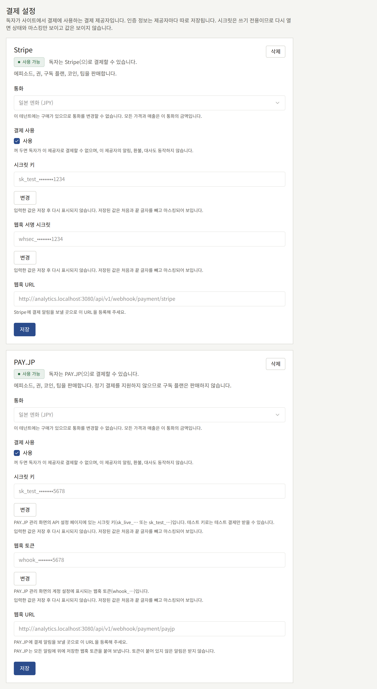

모든 결제 제공자는 에피소드, 권, 시리즈의 남은 에피소드, 코인, 팁을 판매합니다. 구독 플랜은 정기 결제를 받는 결제 제공자를 통해 판매되는데, Stripe는 정기 결제를 받고 PAY.JP는 받지 않습니다. 테넌트가 그런 결제 제공자를 둘 이상 보유하고 있으면, 그중 화면에서 가장 앞에 있는 **사용 가능** 결제 제공자를 통해 판매됩니다. 무엇을 판매하는지는 각 카드에 표시됩니다.

결제는 테넌트의 통화로 받으며, 통화는 어느 카드에서든 **통화**에서 고릅니다. 모든 가격은 콘솔에서와 마찬가지로 사이트와 앱에서도 이 통화로 입력하고 표시하며, 테넌트가 보유한 모든 결제 제공자가 이 통화로 청구합니다. **통화**에는 그 결제 제공자와 테넌트가 보유한 다른 모든 결제 제공자가 청구할 수 있는 통화가 표시되며(PAY.JP는 엔화만 청구합니다), 결제 제공자를 저장하기 전까지는 설치 환경의 운영자가 정한 플랫폼의 기본 통화가 선택되어 있습니다. 다른 결제 제공자가 청구하는 통화로 청구할 수 없는 결제 제공자는 그 옆에 추가할 수 없으며, 그 결제 제공자의 폼에 그렇게 표시됩니다. 통화는 첫 판매 전에 고르세요. 테넌트에 구매가 생기면 모든 가격과 판매가 그 통화의 금액이 되므로, 더 이상 **통화**를 바꿀 수 없습니다.

각 카드의 상태는 그 결제 제공자가 어디까지 준비되었는지 보여 줍니다.

- **설정 부족**: 이 결제 제공자를 통한 결제는 켜져 있지만 필요한 자격 증명이 빠져 있어, 이 결제 제공자로는 아무것도 청구되지 않습니다.
- **사용 안 함**: **결제 사용**이 꺼져 있습니다.
- **사용 가능**: 독자가 이 결제 제공자로 결제할 수 있습니다.
- **삭제됨**: [결제 제공자 삭제](#결제-제공자-삭제)에서 설명하는 대로, 새 결제를 시작하지 않습니다.

**사용 가능**인 결제 제공자가 생기기 전까지 유료 에피소드는 구매할 방법 없이 가격만 표시하며, 지금은 사이트에서 구매할 수 없다고 독자에게 알립니다. 결제 제공자를 하나도 추가하지 않은 테넌트에는 **제공자 추가** 위에 **미설정**이 표시됩니다.

아래 설정은 [운영 전 테스트](#운영-전-테스트)에서 설명하는 대로 먼저 결제 제공자의 테스트 키로 진행하고, 테스트 구매가 성공한 뒤 라이브 키로 바꾸세요.

### Stripe

Stripe Dashboard에서 다음을 진행합니다.

1. API 키 페이지에서 **secret key**를 복사합니다. 테스트 키는 `sk_test_`로, 라이브 키는 `sk_live_`로 시작합니다.
2. 웹훅 엔드포인트를 추가합니다. URL은 **제공자 추가**에서 Stripe를 고르면 콘솔의 **결제 설정**에, 추가한 뒤에는 Stripe의 카드에 표시되는 **웹훅 URL**로, 테넌트 자체 사이트 도메인의 `https://<tenant-domain>/api/v1/webhook/payment/stripe`입니다. 다음 이벤트를 선택하고, 테넌트가 구독 플랜을 판매한다면 [구독 플랜](./5-subscription-plans.md#시작하기-전에)에 나열된 이벤트도 추가로 선택합니다.
   - `checkout.session.completed`
   - `checkout.session.async_payment_succeeded`
   - `checkout.session.expired`
   - `charge.refunded`
   - `refund.updated`
   - `charge.dispute.created`
   - `charge.dispute.closed`
3. 엔드포인트를 열고 `whsec_`로 시작하는 **signing secret**을 복사합니다.

그런 다음 콘솔의 **제공자 추가**에서 다음을 진행합니다.

1. **결제 제공자**로 Stripe를 고릅니다.
2. **시크릿 키**와 **웹훅 서명 시크릿**을 입력합니다.
3. **결제 사용**에서 **사용**을 체크하고 **제공자 추가**를 선택합니다.

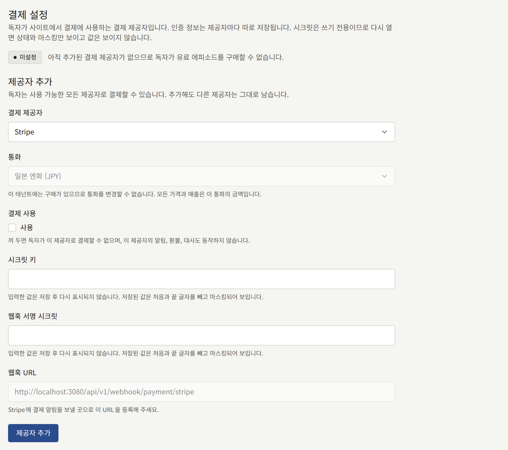

나중에 키를 바꾸려면 Stripe의 카드에서 그 키 옆의 **변경**을 선택하고, 새 값을 입력한 뒤 **저장**을 선택합니다.

Stripe는 테스트 모드와 라이브 모드의 웹훅 엔드포인트를 따로 관리하며, 각각 고유한 signing secret을 가집니다. 라이브 키로 전환할 때는 라이브 모드에서 엔드포인트를 다시 추가하고, 그 signing secret을 라이브 secret key와 함께 입력하세요.

#### Stripe 프로모션 코드

독자는 Stripe의 결제 페이지에서도 프로모션 코드를 입력할 수 있습니다. 이 코드는 Stripe Dashboard에서 secret key와 같은 계정·같은 모드의 쿠폰 아래에 만들며, 콘솔에서는 아무것도 설정하지 않습니다. 에피소드나 권의 모든 결제에서 코드를 받습니다. 다만 할인된 가격으로 판매하는 시리즈의 남은 에피소드 결제와, 테넌트 자체의 [프로모션 코드](#프로모션-코드)로 시작한 결제에서는 받지 않습니다. Stripe는 하나의 결제에 할인을 하나만 적용하고, 두 가지를 적용하지 않기 때문입니다.

구매에는 코드의 할인을 뺀 뒤 독자가 실제로 낸 금액과, 그 옆에 코드를 적용하기 전의 가격이 기록됩니다. 독자가 낸 금액은 독자의 **구매 내역**에 표시되는 금액이자 전액 환불 시 돌려주는 금액이고, 코드를 적용하기 전의 가격은 에피소드의 작가에게 인세를 지급하는 기준이 되는 매출입니다. 프로모션을 제공한 것은 테넌트이므로 할인은 테넌트가 부담합니다. 가격 전체를 빼 주는 코드는 결제 없이 에피소드를 열므로, 환불할 것이 없습니다. PAY.JP의 결제 페이지는 자체 코드를 받지 않습니다. 테넌트 자체의 코드는 Stripe와 마찬가지로 PAY.JP에서도 사용할 수 있습니다.

### PAY.JP

PAY.JP 대시보드에서 다음을 진행합니다.

1. API 설정 페이지에서 **secret key**를 복사합니다. 테스트 키는 `sk_test_`로, 라이브 키는 `sk_live_`로 시작하며, 테스트 키로는 테스트 결제만 받을 수 있습니다.
2. 계정 설정에서 `whook_`로 시작하는 **webhook token**을 복사합니다.
3. **제공자 추가**에서 PAY.JP를 고르면 콘솔의 **결제 설정**에, 추가한 뒤에는 PAY.JP의 카드에 표시되는 **웹훅 URL** `https://<tenant-domain>/api/v1/webhook/payment/payjp`를 PAY.JP가 알림을 보낼 URL로 등록합니다. 운영을 시작하기 전에 라이브 모드에도 등록하세요.

그런 다음 콘솔의 **제공자 추가**에서 다음을 진행합니다.

1. **결제 제공자**로 PAY.JP를 고릅니다.
2. **시크릿 키**와 **웹훅 토큰**을 입력합니다.
3. **결제 사용**에서 **사용**을 체크하고 **제공자 추가**를 선택합니다.

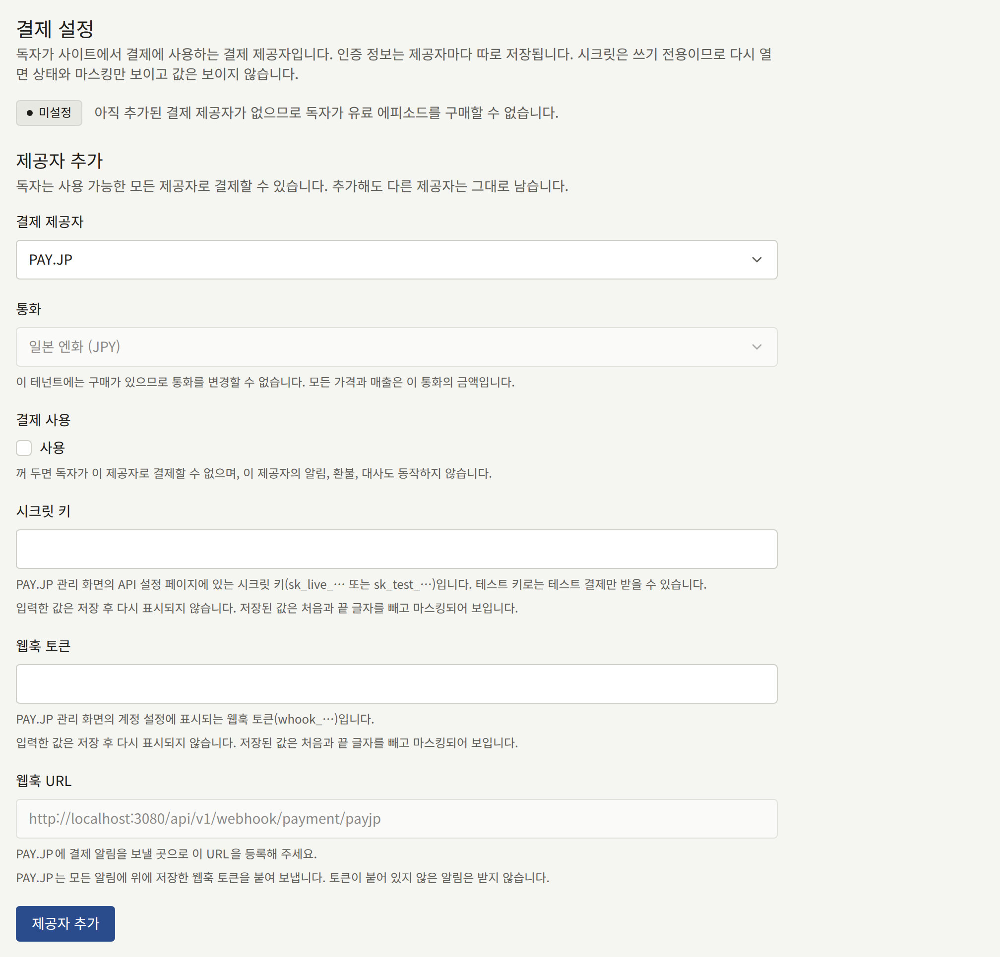

PAY.JP는 알림에 서명하지 않습니다. 설치 환경은 webhook token이 담긴 알림을 신뢰하고 담기지 않은 알림을 거부하므로, 토큰을 secret key만큼 비밀로 지키세요.

### 결제 제공자 삭제

결제 제공자 카드의 **삭제**를 선택하고 확인하면 그 결제 제공자를 통한 새 결제가 즉시 멈추고, 다른 결제 제공자는 그대로 남습니다. 결제 제공자는 자격 증명과 함께 **삭제됨**으로 화면에 남습니다. 삭제하기 전에 독자가 시작한 결제는 여전히 대금을 낼 수 있고, 그 결제 제공자의 알림, **구매**에서 하는 환불, 그 결제 제공자가 받은 결제의 대사도 계속 동작하며, 그 결제 제공자가 청구하는 구독도 마찬가지입니다. 카드의 **되돌리기**를 선택하면 그 결제 제공자로 다시 판매합니다.

삭제된 결제 제공자 카드의 **완전히 삭제**는 삭제한 지 90일이 지났고, 그 결제 제공자가 받은 결제 중 아직 환불될 수 있는 것이 없고, 그 결제 제공자가 청구하는 구독이 없을 때 결제 제공자와 그 자격 증명을 삭제합니다. 그때까지는 **삭제됨**으로 남으며, **완전히 삭제**도 그렇게 알려 줍니다. 90일은 결제와 대조할 수 없는 은행 이체를 Stripe가 기다린다고 문서에 밝힌 가장 긴 기간입니다.

### 결제했는데 에피소드가 열리지 않을 때

결제 제공자의 대시보드에는 웹훅으로 보낸 전송 기록이 설치 환경이 응답한 상태와 함께 나열됩니다. 각 상태는 하나의 원인을 가리킵니다.

| 상태 | 원인 | 조치 |
| --- | --- | --- |
| 2xx | 수락되었습니다. 수락된 알림이 모두 에피소드를 여는 것은 아닙니다. 편의점 결제의 경우 Stripe는 독자가 대금을 내기 전에 `checkout.session.completed`를 보내며, 에피소드는 대금 지불 후에 오는 `checkout.session.async_payment_succeeded`로만 열립니다 | 대시보드에서 이벤트 유형과 결제 상태를 확인합니다. 결제가 완료되었는데도 에피소드가 잠겨 있다면, 독자가 다른 계정으로 구매했을 수 있습니다. |
| 400 | 콘솔의 서명 시크릿이나 웹훅 토큰이 결제 제공자의 값과 일치하지 않습니다 | 결제 제공자가 알림을 보내는 엔드포인트의 값을 입력합니다. |
| 404 | 경로가 결제 제공자를 가리키지 않습니다 | 콘솔에 표시된 그대로 URL을 등록합니다. |
| 503 | URL이 가리키는 결제 제공자가 **사용 가능** 상태가 아니거나, 테넌트가 그 결제 제공자를 추가하지 않았습니다 | 위의 설정을 마칩니다. 결제 제공자가 전송을 재시도합니다. |
| 전송 없음 | 웹훅이 등록되지 않았거나, 다른 모드에 등록되어 있습니다 | 키가 속한 모드에 등록합니다. |

두 결제 제공자 모두 실패한 전송을 일정 시간 동안 재시도하며, 대시보드에서 다시 보낼 수도 있습니다. 설정을 고친 뒤 알림이 도착한 결제는 그 결제로 산 에피소드를 엽니다.

## 에피소드를 판매하는 곳

같은 화면의 **판매 위치**는 독자가 유료 에피소드를 어디서 구매할 수 있는지 정합니다. **판매 위치**에서 고를 수 있는 값은 다음과 같습니다.

- **웹과 앱**: 사이트와 테넌트의 앱에서 판매합니다.
- **웹 전용**: 사이트에서 판매합니다. 앱은 에피소드를 웹사이트에서 판매한다고 표시하고, 그곳에서 구매하면 에피소드를 엽니다.
- **앱 전용**: 앱에서 판매합니다. 사이트는 에피소드를 앱에서 판매한다고 표시하고, 앱에서 구매한 독자에게는 에피소드를 열며, **App Store 주소**와 **Google Play 주소**에 입력한 각 스토어의 앱 페이지로 연결합니다.

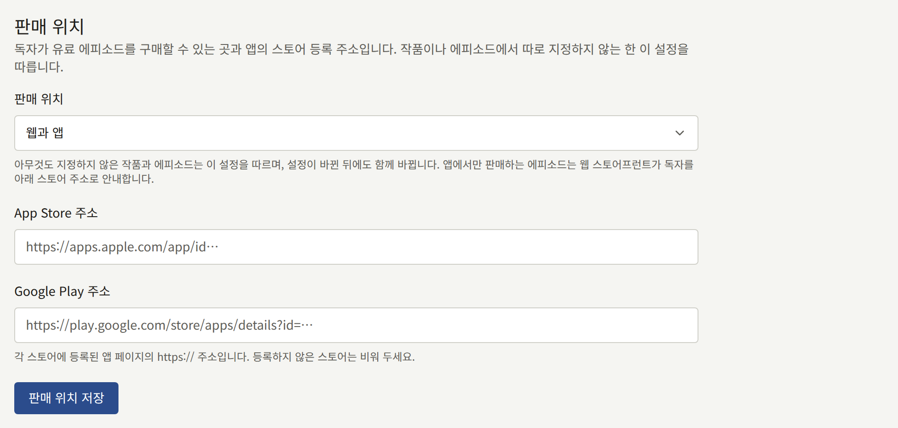

시리즈나 에피소드는 자체 **판매 위치**를 설정할 수 있으며, 아무것도 설정하지 않은 시리즈나 에피소드는 시리즈나 테넌트의 설정을 따릅니다. 시리즈나 테넌트의 설정이 바뀐 뒤에도 마찬가지입니다. 에피소드는 표시되는 곳에서만 판매됩니다.

이 선택지가 있는 것은 앱 스토어 때문입니다. Apple과 Google은 각각 앱이 디지털 콘텐츠를 판매하는 방법에 규칙을 두고, 앱이 그 규칙을 따르는지 심사에서 판단하며, 앱이 스토어를 통해 판매한 금액에서 수수료를 가져갑니다. 다음 절에서 설명하는 대로 앱이 스토어 자체의 결제로 판매하는 테넌트는 앱에서 구매된 모든 에피소드에 그 수수료를 내며, **웹 전용**으로 시리즈를 사이트에서만 판매할 수 있습니다. 앱이 없거나 앱에서 판매하지 않는 테넌트는 모든 에피소드에 **웹 전용**을 고릅니다.

## 앱에서의 판매

**인앱 결제** 섹션의 **앱의 판매 방식**은 테넌트의 앱이 판매할 수 있는 에피소드를 어떤 방식으로 판매할지 정합니다.

- **웹 결제**는 위의 결제 제공자를 통한 사이트의 결제를 휴대폰의 브라우저에서 열고, 결제가 끝나면 독자를 에피소드로 돌려보냅니다.
- **인앱 결제**는 App Store와 Google Play 자체의 결제 시트로 판매합니다. 독자에게 청구하고 수수료를 가져가는 것은 스토어이며, 위의 결제 제공자는 관여하지 않습니다.

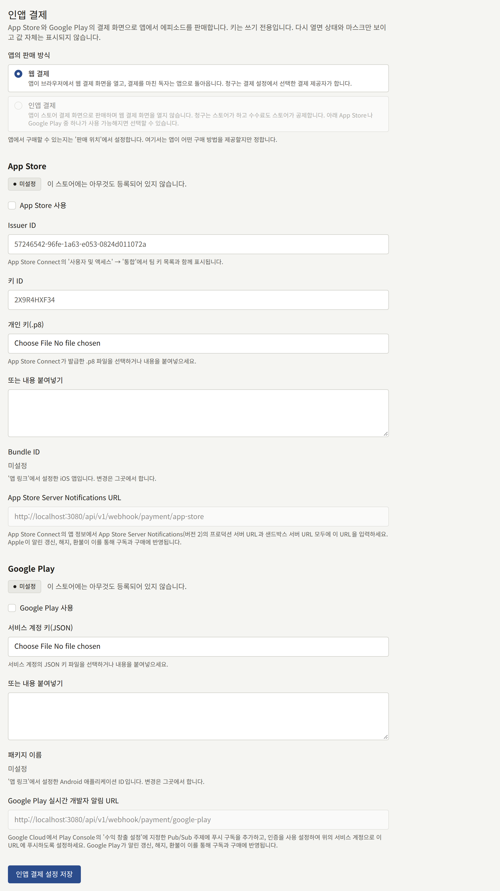

**인앱 결제**를 고르면 앱에는 [결제 제공자 선택](#결제-제공자-선택)의 결제 제공자가 필요 없습니다. 앱은 스토어를 통해 구매하고, 설치 환경이 스토어에 구매를 검증합니다.

**앱 전용**으로 판매하는 에피소드는 앱이 그 에피소드를 판매할 수 있는 동안에만 사이트에서 앱에서 판매한다고 표시하고 스토어로 연결합니다. **웹 결제**라면 결제 제공자가 **사용 가능**인 동안, **인앱 결제**라면 스토어가 **사용 가능**인 동안이며, 이때도 **사용 가능**인 스토어의 앱 페이지로만 연결합니다. 그 전까지 사이트는 에피소드의 가격만 보여 주고 구매할 수 없다고 독자에게 알립니다. **웹과 앱**으로 판매하는 에피소드는 결제 제공자가 **사용 가능**인 동안 사이트에서 구매할 수 있습니다. **사용 가능**인 결제 제공자가 없고 앱이 판매할 수 있는 동안에는, 사이트는 이 에피소드를 **앱 전용**으로 판매하는 에피소드와 똑같이 다룹니다.

**인앱 결제**는 스토어가 하나 이상 **사용 가능**일 때 고를 수 있습니다. **App Store 사용**이나 **Google Play 사용**으로 켜고, 키를 입력하고, **연동** › **앱 링크**에서 앱을 지정한 스토어가 **사용 가능**이 됩니다.

앱은 각 에피소드를 가격에 따라 이름 붙인 스토어 상품으로 구매합니다. 예를 들어 ¥300 에피소드는 `episode_300`이므로, 스토어는 상품이 있는 가격만 판매합니다. [캠페인 가격](./1-catalog/2-episodes.md#캠페인-가격)이 적용 중인 동안에는 캠페인 가격이 가격이 됩니다. ¥500에서 ¥300으로 할인 중인 에피소드는 `episode_300`으로 구매되고 ¥300으로 기록됩니다. [프로모션 코드](#프로모션-코드)도 마찬가지입니다. ¥500 에피소드를 10% 할인 코드로 구매하면 `episode_450`으로 구매됩니다. 화면 맨 아래의 **스토어 상품**에는 앱이 판매하는 모든 가격에 필요한 상품 ID가 나열됩니다. 예약되었거나 적용 중인 모든 캠페인의 가격과, 그 각 가격에서 에피소드에 적용되는 모든 코드의 할인을 뺀 가격도 포함됩니다. 여기서 코드는 일시 중지되거나 삭제되지 않았고 종료 시점이 지나지 않은 코드이며, 아직 시작되지 않은 코드도 포함됩니다. 각 가격에 해당하는 에피소드 수도 함께 표시됩니다. 에피소드는 각 가격마다 셉니다. 각 상품을 App Store Connect와 Play Console에서 그 가격의 소모성 상품으로 만들고, 목록에 새 가격이 나타날 때마다 상품을 추가하세요. 캠페인의 가격은 예약하는 즉시, 코드의 가격은 코드를 만드는 즉시 목록에 나타나므로, 시작되기 전에 상품을 준비할 수 있습니다. 가격 전체를 빼 주는 코드에는 상품이 필요 없습니다. 그런 구매는 스토어를 거치지 않고 기록되기 때문입니다. 앱은 할인된 가격이 목록에 없는 코드를 거부합니다.

[팁](#팁)을 받는 동안에는 팁 금액도 각각 가격 아래에 `tip_` 뒤에 금액을 붙인 ID로 이 목록에 나타납니다. 예를 들어 ¥300 팁은 `tip_300`입니다. 같은 방식으로 그 금액의 소모성 상품으로 만드세요.

판매 중인 코인 팩도 각각 `coins_` 뒤에 팩의 ID를 붙인 이름으로, 지급하는 코인과 보너스 코인과 함께 이 목록에 나타납니다. 팩도 같은 방식으로 팩의 가격의 소모성 상품으로 만듭니다. 스토어는 Publira가 보내는 이름이 아니라 App Store Connect와 Play Console에서 붙인 이름으로 상품을 표시하므로, 각 팩의 상품 이름에는 앱이 등록된 모든 언어로 테넌트가 정한 코인의 호칭을 넣으세요.

그 아래의 **구독 플랜**에는 **App Store 상품 ID**나 **Google Play 상품 ID**를 지정한 [구독 플랜](./5-subscription-plans.md#플랜-만들기)이 매 주기 청구하는 금액과 각 스토어의 상품 ID와 함께 나열되며, 상품 ID를 지정하지 않은 스토어에는 **판매 안 함**이 표시됩니다. 플랜은 소모성 상품이 아닙니다. App Store Connect에서는 구독 그룹 안에 자동 갱신 구독으로, Play Console에서는 기본 요금제가 있는 정기 결제로, 플랜의 요금과 청구 주기에 맞춰 만드세요. ID는 플랜에서 입력하며, 목록은 그 ID를 따라갑니다.

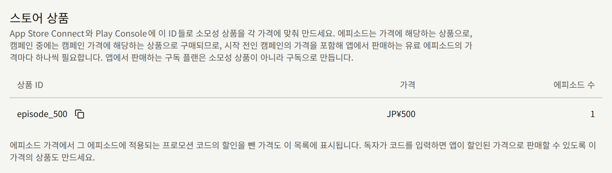

설치 환경이 구매를 검증하는 데 쓰는 키부터 스토어의 테스트 구매자로 테스트하는 방법까지 각 스토어에 필요한 것은, 앱 자체의 설정과 함께 [인앱 결제와 로그인](../5-mobile-app/5-purchases-and-sign-in.md#앱에서-에피소드-판매하기)에서 설명합니다. App Store 샌드박스나 Play 라이선스 테스터의 구매는 에피소드를 열지만 테스트로 기록되며, 인세 명세서와 콘텐츠 통계에서 제외됩니다.

독자가 앱에 저장한 에피소드는 앱이 마지막으로 온라인에서 연 뒤 최대 7일 동안 그 기기에서 네트워크 없이도 계속 열립니다. 따라서 저장된 에피소드는 환불되어도 즉시가 아니라 그 기간 안에 닫히며, 자세한 내용은 [오프라인 읽기](../5-mobile-app/7-offline-reading.md#유료-에피소드-설치-환경-없이-7일)에서 설명합니다. 다음에 앱이 온라인에서 그 에피소드를 열면 에피소드는 잠기고 기기에서 삭제됩니다.

### 앱에서 코드 입력

독자는 사이트와 같은 곳에서 코드를 입력합니다. 잠긴 에피소드와 시리즈의 권 섹션이며, 권 섹션에서는 한 번 입력하면 아직 구매할 수 있는 모든 권에 적용됩니다. 일시 중지, 삭제, 종료 중 어느 것에도 해당하지 않는 코드를 테넌트가 가지고 있는 동안, 로그인한 독자에게는 이곳에 **프로모션 코드**와 **적용**이 표시됩니다. 게스트에게는 로그인하면 표시됩니다. **인앱 결제**에서는 스토어가 권을 판매하지 않으므로 권 섹션에 입력란이 표시되지 않으며, 시리즈의 나머지를 한꺼번에 구매하는 안내에는 코드를 사용할 수 없습니다.

코드가 적용되는 각 버튼에는 할인된 가격이 표시되고 그 옆에 할인 전 가격이 취소선과 함께 표시되며, 코드가 적용되지 않는 버튼은 가격이 그대로입니다. **웹 결제**에서는 버튼이 휴대폰의 브라우저에서 사이트의 결제를 이 가격으로 엽니다. **인앱 결제**에서는 이 가격의 상품으로 스토어의 결제 시트를 열며, 가격 전액을 할인하는 코드는 결제 시트를 열지 않습니다. 앱은 화면이 열려 있는 동안 코드를 유지하지만, 할인의 기준이 된 캠페인 가격이 끝나면 해제됩니다. 입력란을 비우고 **적용**을 선택해도 해제됩니다.

사용할 수 없는 코드는 [코드가 거부되는 경우](#코드가-거부되는-경우)의 이유를 입력란 아래에 표시하며 거부되고, 버튼은 가격이 그대로입니다. **인앱 결제**에서는 할인된 가격의 상품이 스토어에 없는 코드도 거부되며, 앱은 코드를 사용할 수 있는 웹사이트에서 사용하도록 독자에게 안내합니다.

앱의 **구매 목록**에는 결제한 금액 옆에 할인 전 가격이 취소선과 함께 표시되고 적용한 코드도 표시됩니다.

## 팁

에피소드를 다 읽은 독자는 에피소드 마지막에서 테넌트가 정한 금액 중 하나를 그 작가에게 팁으로 보낼 수 있습니다. 사이트와 앱 모두에서 보낼 수 있습니다. 팁을 받을지와 보낼 수 있는 금액은 **인앱 결제**와 **스토어 상품** 사이에 있는 **팁** 섹션에서 설정합니다.

- **작가에게 보내는 팁 받기**를 켜면 모든 에피소드 마지막에 금액을 보여 줍니다. 끄면 팁이 표시되지 않으며, 금액은 다시 켤 때를 위해 유지됩니다.
- **팁 금액**에는 테넌트의 통화로 0보다 큰 금액을 한 칸에 하나씩 최대 6개 입력합니다. **금액 추가**로 칸을 추가하고, 칸 옆의 버튼으로 그 칸을 삭제합니다. 한 칸에 여러 줄을 붙여 넣으면 한 줄마다 칸이 추가됩니다. 독자에게는 작은 금액부터 순서대로 표시되며, **팁 설정 저장**도 그 순서로 저장합니다.

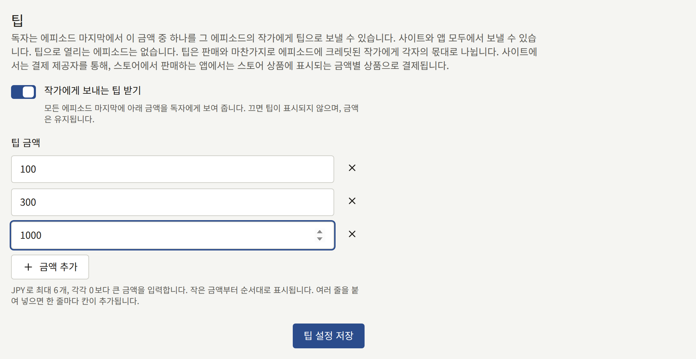

일곱 번째 금액, 두 번 입력한 금액, 0은 받지 않으며, 금액 없이 팁을 켤 수도 없습니다. 이런 경우 양식은 저장하지 않고 **팁 금액** 아래에 고칠 점을 보여 줍니다. 저장할 때마다 **감사 로그**에 **팁 설정 변경**으로 기록됩니다.

팁으로 열리는 에피소드는 없습니다. 팁은 에피소드 판매와 마찬가지로 에피소드에 크레딧된 작가에게 각자의 몫대로 나뉘며, 정산서에는 판매와 별도의 줄로 실리므로 팁과 판매를 구분할 수 있습니다. [프로모션 코드](#프로모션-코드)는 팁에 적용되지 않습니다.

팁은 그 에피소드를 구매할 때와 같은 방법으로 결제됩니다.

- **사이트**에서는 결제 제공자를 통해 결제됩니다. 따라서 사이트는 [결제 제공자 선택](#결제-제공자-선택)에서 설명한 결제 제공자가 **사용 가능**인 동안에만 팁을 받습니다.
- **앱**에서는 **웹 결제**라면 휴대폰 브라우저에서 같은 결제 제공자를 통해, **인앱 결제**라면 **스토어 상품**에 나타나는 금액별 상품으로 스토어를 통해 결제됩니다. 스토어에 상품이 없는 금액은 앱에서 보낼 수 없다고 앱이 독자에게 알리므로, 금액을 추가하면 그 상품을 App Store Connect와 Play Console에서 만드세요.

사이트에서는 독자가 에피소드의 마지막 페이지를 넘기면 반응 버튼 옆에 **작가에게 팁 보내기**가 나타납니다. 이 버튼은 에피소드의 작가 이름과 테넌트의 금액별 버튼이 있는 대화상자를 열고, 금액 버튼을 누르면 결제 제공자의 결제 페이지로 이동합니다. 로그인하지 않은 독자는 로그인한 뒤 에피소드로 돌아옵니다. 결제 페이지에서 돌아오면 에피소드에 감사 인사가 표시되고, 팁은 결제 제공자의 알림이 설치본에 도착할 때 기록됩니다. 독자는 무엇을 보유하고 있든 같은 에피소드에 다시 팁을 보낼 수 있습니다. 에피소드에 크레딧된 독자에게는 팁이 제안되지 않으며, 보내려고 해도 거부됩니다.

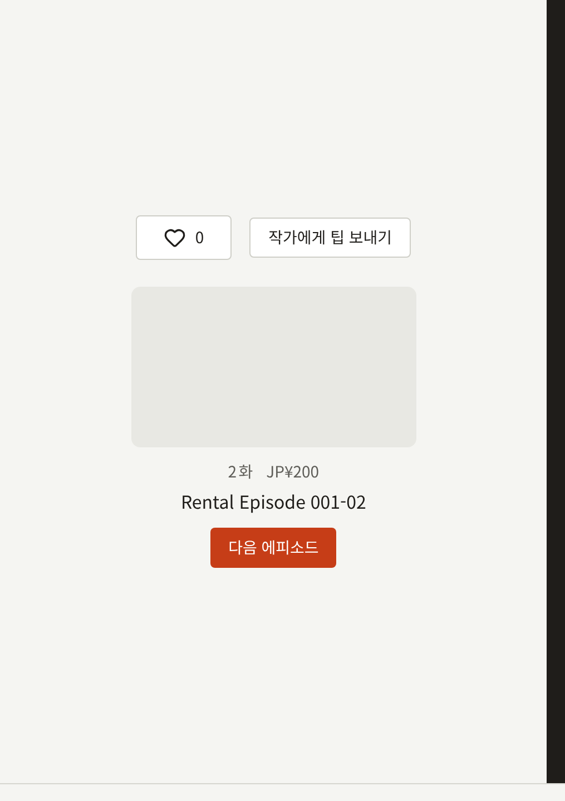

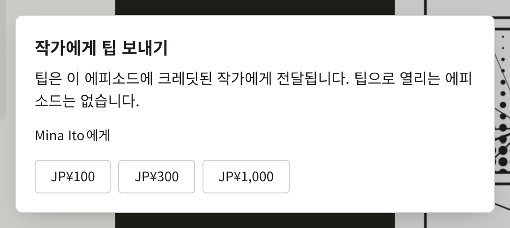

**구매 내역**에는 팁이 보낸 에피소드 아래에 **팁**으로 표시되고, 보낸 금액이 실리며 읽기 기간은 없습니다. **CSV로 다운로드**는 `item` 열에 `tip`을 쓰고 그 에피소드의 열을 채웁니다.

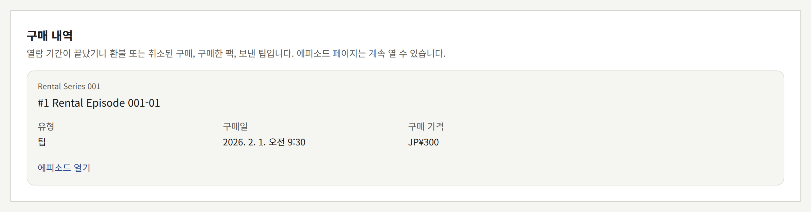

**결제** › **구매**에는 팁이 에피소드 아래에 **팁**으로 표시되며, [콘솔에서 환불](#콘솔에서-환불)에서 설명하는 대로 구매와 같은 방법으로 환불합니다. 환불된 판매가 작가의 판매에서 빠지듯이, 환불된 팁은 작가의 팁에서 빠집니다.

결제 제공자의 테스트 모드, App Store 샌드박스, Play 라이선스 테스터로 결제한 팁은 구매와 마찬가지로 테스트로 기록되고 정산서에서 제외됩니다.

## 프로모션 코드

테넌트 자체의 프로모션 코드는 독자가 에피소드나 권을 구매할 때 입력해 할인을 받는 문자열입니다. 설치 환경은 결제 제공자나 스토어에 닿기 전에 할인을 빼므로, 결제 제공자나 스토어는 코드에 대해 전달받지 않은 채 할인된 가격을 청구합니다. 따라서 코드는 Stripe, PAY.JP, App Store, Google Play 어디에서나 똑같이 사용할 수 있으며, 그중 어느 곳에서도 코드를 위해 설정할 것이 없습니다. 코드는 **결제** › **프로모션 코드**에서 발급하며, 이 화면은 테넌트 관리자에게만 보입니다.

### 코드에 담기는 내용

- **코드**는 독자가 입력하는 문자열로, 공백 없이 영문자와 숫자 1~32자입니다. 독자는 대소문자를 구분하지 않고 입력할 수 있으며, 콘솔에는 대문자로 표시됩니다. 테넌트의 삭제되지 않은 코드 두 개는 대소문자와 관계없이 같은 철자일 수 없습니다.
- 할인은 **정률 할인** 또는 **정액 할인**입니다. **정률 할인**은 가격의 1~100% 중 정수 비율이며, 그 금액은 통화의 최소 단위로 내림합니다. **정액 할인**은 테넌트의 통화로 정한 금액입니다. 할인은 독자가 구매할 때 에피소드나 권이 판매되는 가격, 즉 [캠페인 가격](./1-catalog/2-episodes.md#캠페인-가격)이 적용 중이면 그 캠페인 가격에서 빼며, 가격을 0 아래로 내리지는 않습니다. 할인율 `100`이나 가격 이상의 금액이면 구매가 무료가 됩니다.
- **적용 대상**은 **전체 작품**, 레이블, 시리즈, 권, 에피소드 중 하나입니다. 코드는 에피소드 구매, 에피소드 대여, 권 구매에 적용되며, 시리즈의 남은 에피소드, 구독 플랜, 코인 팩, 팁에는 적용되지 않습니다. 레이블이나 시리즈에 적용한 코드는 그 에피소드와 권에 똑같이 적용됩니다. 권에 적용한 코드는 그 권의 구매에 적용되며, 그 권의 에피소드를 하나씩 구매할 때는 적용되지 않습니다. 에피소드에 적용한 코드는 그 에피소드에 적용되며, 그 에피소드가 들어 있는 권에는 적용되지 않습니다. 나중에 레이블, 시리즈, 권, 에피소드가 삭제된 코드는 어디에도 적용되지 않습니다.
- **시작 일시**와 **종료 일시**는 코드를 사용할 수 있는 기간이며, 테넌트 시간대 기준입니다. 어느 쪽이든 비워 두면 그쪽에는 제한이 없습니다.
- **총 사용 횟수**는 이 코드로 할인할 수 있는 구매의 총 건수이고, **독자당 사용 횟수**는 독자 한 명이 이 코드로 할 수 있는 구매의 건수입니다. 어느 쪽이든 비워 두면 제한이 없습니다.

코드, 할인, 적용 대상은 코드를 만든 뒤에는 바꿀 수 없습니다. 바꾸려면 코드를 삭제하고 다른 코드를 만드세요. 새 코드에는 같은 이름을 쓸 수 있습니다. **시작 일시**, **종료 일시**, 두 가지 제한은 언제든지 바꿀 수 있습니다.

### 코드 만들기

1. **결제** › **프로모션 코드**를 열고 **프로모션 코드 만들기**를 선택합니다.
2. **코드**를 입력합니다.
3. **정률 할인**을 고르고 **할인율**을 입력하거나, **정액 할인**을 고르고 **할인 금액**을 입력합니다.
4. **적용 대상**에서 코드를 적용할 대상을 고릅니다. 레이블이나 시리즈는 그 레이블이나 시리즈를 고르고, 권이나 에피소드는 먼저 그 시리즈를 고른 다음 권이나 에피소드를 고릅니다.
5. 코드에 필요하면 **시작 일시**, **종료 일시**, **총 사용 횟수**, **독자당 사용 횟수**를 설정하고 **프로모션 코드 만들기**를 선택합니다.

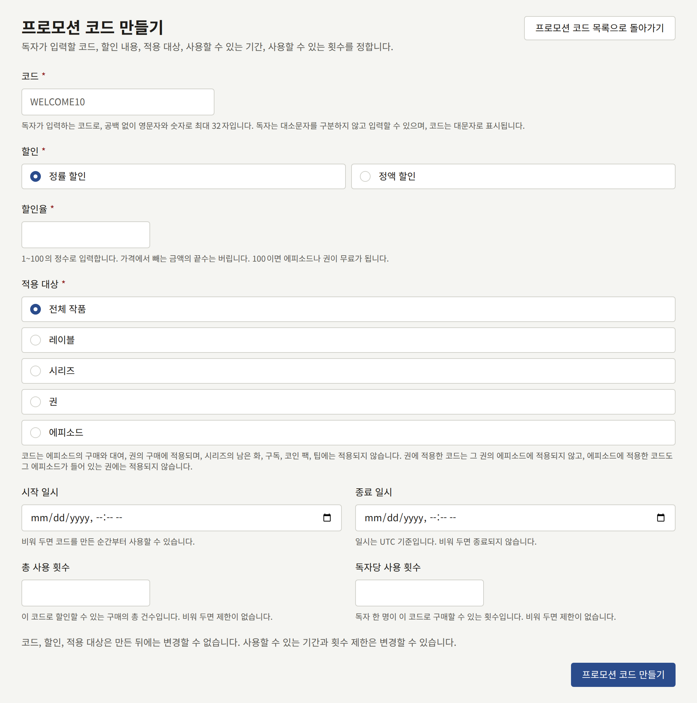

폼은 다음 경우에 코드를 만들지 않고, 해당 필드 옆에 그 이유를 표시합니다. 테넌트의 다른 코드와 같은 철자의 코드, 영문자와 숫자 이외의 문자가 들어간 코드, 1~100을 벗어난 할인율, 0인 금액, **시작 일시**와 같거나 그보다 앞선 **종료 일시**, 그리고 폼을 연 뒤 삭제된 레이블, 시리즈, 권, 에피소드입니다. 코드를 만들면 목록 옆에 그 코드가 열립니다.

### 코드 확인, 일시 중지, 삭제

목록에는 각 코드가 최신순으로, 할인, 적용 대상, 유효 기간, 제한 대비 할인한 구매 수, 상태와 함께 표시됩니다.

- **유효**: 독자가 사용할 수 있습니다.
- **예정**: **시작 일시**가 아직 오지 않았습니다.
- **일시 중지됨**: 일시 중지되었으며, 재개할 때까지 거부됩니다.
- **종료**: **종료 일시**가 지났습니다. 일시 중지 여부와는 관계없습니다.

**보기**는 목록 옆에 코드를 열어 그 조건을 보여 주고, 그 아래에 **사용 기록**을 보여 줍니다. 사용 기록에는 코드가 할인한 모든 구매가 최신순으로, 독자, 구매한 것, 코드를 적용하기 전의 **가격**, 독자의 **지불 금액**, 일시와 함께 나열됩니다. 제목을 선택하면 **구매**에서 그 구매가 열리며, 같은 **가격**과 **지불 금액**, 그리고 적용된 **프로모션 코드**가 표시됩니다.

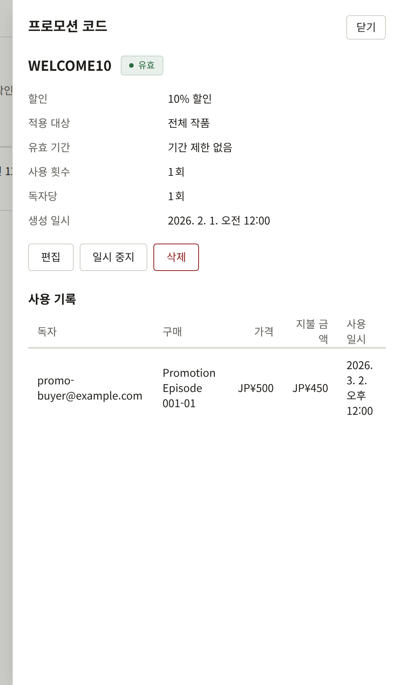

- **편집**은 **시작 일시**, **종료 일시**, **총 사용 횟수**, **독자당 사용 횟수**만 바꾸며, 그 밖의 것은 바꾸지 않습니다.
- **일시 중지**는 **재개**로 다시 열 때까지, 존재하지 않는 코드와 마찬가지로 모든 독자에게 코드를 거부합니다. 일시 중지한 코드도 이름은 그대로 유지됩니다.
- **삭제**는 확인하면 그때부터 코드를 거부하고, 그 이름을 다른 코드가 쓸 수 있게 합니다. 코드가 할인한 구매와 사용 기록에는 코드 이름이 그대로 남습니다. 삭제한 코드는 복원할 수 없습니다.

코드의 생성, 편집, 일시 중지, 재개, 삭제는 각각 **감사 로그**에 기록됩니다.

### 사이트에서 코드 입력

독자는 구매하려는 에피소드 페이지에서 코드를 입력합니다. 시리즈의 권 섹션에서도 한 번 입력할 수 있으며, 이 코드는 목록의 모든 권에 적용됩니다. 일시 중지, 삭제, 종료 중 어느 것에도 해당하지 않는 코드를 테넌트가 가지고 있는 동안, 로그인한 독자에게는 에피소드 구매 버튼 아래와 권 목록 위에 **프로모션 코드**가 표시됩니다. 게스트에게는 로그인하면 표시되며, 그런 코드가 없는 테넌트에서는 입력란이 표시되지 않습니다. 시리즈의 나머지를 한꺼번에 구매하는 안내에는 코드를 사용할 수 없습니다.

독자가 코드를 입력하고 **적용**을 선택하면, 코드가 적용되는 각 버튼에 할인된 가격이 표시되고 그 옆에 할인 전 가격이 취소선과 함께 표시됩니다. 그 버튼은 이 가격으로 결제를 시작하며, 결제 페이지는 이 금액을 청구하고 자체 코드 입력란을 표시하지 않습니다. 코드가 적용되지 않는 버튼은 가격이 그대로입니다. 적용한 코드는 페이지를 새로 고쳐도 유지되며, 입력란을 비우고 다시 **적용**을 선택하면 해제됩니다.

에피소드의 결제 페이지에서 돌아오면 에피소드 페이지에 결제한 금액이 취소선이 그어진 할인 전 가격, 적용한 코드와 함께 표시됩니다. **구매 목록**의 **구매 내역**에는 에피소드든 권이든 같은 내용이 표시됩니다.

### 코드가 거부되는 경우

사용할 수 없는 코드는 독자가 결제하기 전에 거부되며, 입력란 아래에 그 이유가 표시됩니다.

- 테넌트에 그 철자의 코드가 없거나, 코드가 삭제 또는 일시 중지되었거나, 아직 시작되지 않았습니다.
- 코드가 종료되었습니다.
- 독자가 구매하려는 것에 코드가 적용되지 않습니다.
- 코드가 **총 사용 횟수**에 이르렀거나, 독자가 이 코드로 **독자당 사용 횟수**에서 허용하는 만큼 이미 구매했습니다.
- 독자가 짧은 시간에 코드를 너무 많이 입력했습니다. 이 경우 잠시 후 다시 시도하라는 안내가 표시됩니다.

### 코드가 사용되는 시점

코드는 독자가 결제를 시작할 때가 아니라 그 구매가 기록될 때 사용된 것으로 처리되므로, 독자가 도중에 그만둔 결제는 아무것도 소모하지 않습니다. 제한은 결제를 시작할 때 확인하므로, 코드가 제한에 이른 시점에 이미 시작된 결제는 그대로 완료할 수 있으며, 그 결과 코드가 제한보다 많이 사용될 수 있습니다.

가격 전체를 빼 주는 코드는 결제도 결제 페이지도 없이 즉시 구매를 기록합니다. 독자가 확인하자마자 에피소드나 권이 열리며, 그 구매는 **구매**에 **결제 없음**으로 표시됩니다. 환불할 것은 없습니다.

에피소드의 작가에게는 [인세](./6-reports-and-royalties.md#작가가-받아야-할-금액)에서 설명하는 대로 코드를 적용하기 전의 가격에 대해 인세를 지급합니다. 프로모션을 제공한 것은 테넌트이므로 할인은 테넌트가 부담합니다. 앱에서 코드로 하는 구매도 다른 구매와 똑같은 구매이며, 그 할인된 가격에 필요한 스토어 상품은 [앱에서의 판매](#앱에서의-판매)에서 설명합니다.

## 환불

사이트에서의 구매는 [콘솔에서 환불](#콘솔에서-환불)에서 설명하는 대로 콘솔에서, 또는 Stripe나 PAY.JP의 대시보드에서 환불합니다. 어느 쪽이든 결제 제공자가 환불을 알려 오면, 사이트는 영수증과 마찬가지로 테넌트의 이름으로, 독자의 알림 설정과 관계없이 독자에게 메일을 보냅니다. 메일에는 구매한 것, 환불 금액, 이전에 환불이 있었다면 결제 금액 대비 누적 환불 금액, 그리고 환불로 에피소드가 닫히는지가 적힙니다. App Store나 Google Play를 통한 구매는 Apple이나 Google이 환불하고 독자에게도 직접 알리므로, 사이트는 메일을 보내지 않습니다.

- **전액 환불**은 독자에게서 에피소드를 닫습니다. 구매는 **환불됨**으로 표시된 채 독자의 **구매 내역**에 남으며, 독자는 에피소드를 다시 구매할 수 있습니다.
- **부분 환불**은 결제에 대한 환불의 합계가 독자가 낸 금액에 이를 때까지 에피소드를 열어 둡니다. 그래도 에피소드의 작가에게 인세를 지급하는 기준이 되는 매출은 줄어듭니다.

[프로모션 코드](#프로모션-코드)로 할인된 구매는 테넌트의 코드든 [Stripe의 결제 페이지](#stripe-프로모션-코드)에서 입력한 코드든, 독자가 낸 금액까지만 환불됩니다. 작가에게는 코드를 적용하기 전의 가격에 대해 지급하므로, 일부를 환불하면 그 가격에서 같은 비율만큼 작가의 매출이 줄어듭니다. 독자가 낸 금액의 절반을 환불하면 코드를 적용하기 전 가격의 절반이 빠집니다. 코드로 무료가 된 구매는 결제가 없었으므로 환불할 것이 없으며, 콘솔에서도 환불을 제공하지 않습니다.

각 환불은 그 구매가 들어온 경로로 설치 환경에 도착합니다.

- **Stripe와 PAY.JP**는 위의 웹훅으로 알립니다. Stripe의 엔드포인트에 `charge.refunded`가 필요한 이유입니다. 결제 제공자가 수락한 환불도, 예를 들어 독자의 카드가 해지되었을 때처럼 나중에 실패할 수 있습니다. 결제 제공자는 이것도 알려 주며(Stripe에서는 `refund.updated`), 환불로 남은 금액의 합계가 여전히 독자가 낸 금액에 이르지 않는 한 에피소드는 다시 독자에게 열립니다.
- **App Store**는 콘솔의 **App Store** 섹션에 표시되는 **App Store Server Notifications URL**로 알립니다. 이 URL은 App Store Connect에 Production Server URL과 Sandbox Server URL 양쪽으로 등록합니다.
- **Google Play**는 콘솔의 **Google Play** 섹션에 표시되는 **Google Play 실시간 개발자 알림 URL**로, [인앱 결제와 로그인](../5-mobile-app/5-purchases-and-sign-in.md#인앱-결제를-위해-각-스토어에-필요한-것)에서 설명하는 Pub/Sub 푸시 구독을 통해 알립니다. 설치 환경은 또한 1시간에 한 번 최근 30일 동안 Google Play에서 무효화된 구매를 읽어, 알림이 도착하지 않은 환불을 적용합니다. 알림이 없으면 환불된 구매가 최대 1시간 동안 에피소드를 열어 둘 수 있습니다. 이 읽기는 [개요](../2-deployments/1-overview.md)에서 설명하는 대로 운영자가 계속 실행해 두는 `publira worker`에서 실행됩니다.

되돌릴 구매보다 먼저 도착한 환불은 보관되었다가, 구매가 기록될 때 적용됩니다.

### 콘솔에서 환불

**결제** › **구매**에는 테넌트의 구매가 최신순으로 나열되며, 독자의 이메일 주소, 시리즈, 에피소드, 그리고 테넌트 시간대 기준으로 구매한 날짜로 범위를 좁힐 수 있습니다. **보기**는 목록 옆에 구매를 열어 독자가 낸 금액, 결제한 곳, 지금까지 환불된 금액을 보여 줍니다. [세금](#가격에-포함된-세금)을 기록한 구매는 목록에서는 금액 아래에 **세금 ¥100 포함**처럼, 목록 옆에서는 세율과 함께 **포함된 세금**으로 그 세금을 보여 줍니다. 대여는 에피소드 아래에 **대여**로, [팁](#팁)은 **팁**으로 표시됩니다.이 화면은 테넌트 관리자에게만 보입니다.

코인 팩의 구매는 이 목록에, 지급된 코인 수에 테넌트의 기본 언어로 정한 코인의 호칭을 붙여 나타나며, 시리즈가 없습니다. 따라서 목록을 시리즈나 에피소드로 좁히면 나타나지 않습니다. 코인 팩도 다른 구매처럼 환불하지만, 항상 전액 환불하므로 대화 상자에서 금액을 묻지 않습니다. 결제 제공자가 전액 환불이나 결제에 대한 이의 제기를 알려 오기 전까지 코인은 독자에게 그대로 남습니다. 알림이 오면 팩에 남은 코인은 회수되고, 독자가 이미 사용한 코인은 미납분으로 기록되어 독자가 다음에 구매하는 팩에서 차감됩니다. 사용한 코인으로 산 에피소드는 계속 열려 있으며, 각 구매에는 그 코인의 가치가 환불액으로 표시됩니다.

코인으로 결제한 에피소드의 구매는 다른 구매에서 결제 제공자가 표시되는 자리에 **코인으로 결제**를 표시하고, 가격으로는 사용한 코인의 가치를 표시합니다. 이 금액이 [인세](./6-reports-and-royalties.md#작가가-받아야-할-금액)에서 설명하는 대로 그 에피소드의 작가에게 인세를 지급하는 기준이 되는 매출입니다. 독자에게는 사용한 코인만 보이고 가격은 보이지 않습니다.

**환불**은 사유를 입력하면, 독자가 결제한 결제 제공자에게 테넌트의 통화로 된 **환불할 금액**을 돌려주도록 요청합니다. 사유는 환불과 함께 감사 로그에 기록됩니다. 금액의 초기값은 환불할 수 있는 남은 금액 전부이며, 금액을 바꾸면 대화 상자가 에피소드가 독자에게 계속 열려 있을지 닫힐지를 알려 줍니다.

- **남은 금액 전부**를 환불하면 즉시 독자에게서 에피소드를 닫고, 결제 제공자가 웹훅으로 환불을 알려 올 때까지 구매에 **환불 요청됨**이 표시되며, 알림이 오면 **환불됨**이 표시됩니다. 결제 제공자가 거부한 환불이나, 결제 제공자가 수락한 뒤 실패한 환불은 에피소드를 다시 독자에게 엽니다.
- **그보다 적은 금액**을 환불하면 에피소드는 독자에게 계속 열려 있습니다. 결제 제공자가 환불을 알려 올 때까지 구매에 **환불 요청됨**이 금액과 함께 표시되며, 알림이 오면 **부분 환불**이 표시되고 그 금액이 환불된 금액에 더해집니다. 그때까지는 같은 금액으로만 다시 환불할 수 있으며, 요청이 결제 제공자에게 닿지 않았을 때 다시 요청하는 방법이 이것입니다. 결제 제공자가 거부한 환불은 요청을 되돌립니다. 결제 제공자가 환불을 알려 온 뒤 에피소드를 닫으려면, 위와 같이 나머지를 환불합니다.

콘솔은 앱에서 이루어진 구매, 독자가 카드사에 이의를 제기한 구매, 테넌트가 더 이상 결제를 받지 않는 결제 제공자로 결제한 구매에는 환불을 제공하지 않습니다. 이런 구매는 독자가 결제한 곳에서 환불하세요. 코인으로 결제한 구매에도 환불을 제공하지 않습니다. 결제가 이루어지지 않았기 때문입니다. 돈은 팩에 속한 것이며, 팩을 환불해야 돌려받습니다.

## 이의 제기

독자가 Stripe 결제에 대해 카드사에 이의를 제기하면, Stripe는 같은 웹훅으로 이를 알립니다. 엔드포인트에 `charge.dispute.created`가 필요한 이유입니다. 카드사가 나중에 어떻게 판단하든, 이의 제기가 접수되는 즉시 에피소드는 독자에게서 닫히며, 구매는 **취소됨**으로 표시된 채 독자의 **구매 내역**에 남습니다. 이의 제기에는 Stripe Dashboard에서 대응하며, 콘솔에서는 아무것도 하지 않습니다.

카드사의 판단은 인세 명세서만 바꾸며, 인세 명세서는 `charge.dispute.closed`로 판단 결과를 알게 됩니다.

- 테넌트에 유리하게 판단된 이의 제기는 결제를 테넌트에 남기므로, 구매는 매출로 남습니다. 에피소드는 독자에게서 닫힌 채로 있습니다.
- 테넌트에 불리하게 판단된 이의 제기는 결제를 독자에게 돌려주므로, 전액 환불과 마찬가지로 구매는 매출에서 빠집니다. 구매한 달이 이미 마감되었다면, [인세](./6-reports-and-royalties.md#마감-후의-환불)에서 환불에 대해 설명하는 대로 다음 명세서가 조정으로 이를 회수합니다.

## 중단된 결제

결제 페이지를 결제하지 않고 떠난 독자는 언제든지 다시 구매를 시작할 수 있습니다. Stripe가 중단된 결제가 만료되었다고 알려 오면(엔드포인트에 `checkout.session.expired`가 필요한 이유입니다), 독자가 다음에 시도할 때 만료된 결제 페이지 대신 새 결제 페이지가 열립니다.

## 결제 제공자와의 대사

인세 명세서와 **매출**은 설치 환경이 기록한 구매만 셉니다. 도착하지 않은 알림, 어떤 구매와도 맞지 않은 환불, 앱이 확인하지 못한 스토어 구매가 있으면, 그 수치는 결제 제공자나 스토어가 실제로 청구한 금액과 어긋납니다. 대사는 테넌트 기준 날짜로 정한 기간에 대해 양쪽을 비교하고, 반대편의 어떤 것과도 맞지 않는 모든 항목을 나열합니다. 대사는 **결제** › **결제 방법**에 저장된 자격 증명으로 결제 제공자와 스토어의 기록을 읽으며, 그 기록에서도 구매에서도 아무것도 바꾸지 않습니다. 각 항목을 어떻게 처리할지는 결제 제공자의 대시보드나 콘솔에서 직접 판단하세요.

대사는 **결제** › **대사**에서 시작하고 확인하며, 이 화면은 테넌트 관리자에게만 보입니다. **시작일**과 **종료일**로 날짜를 고르고(초기값은 지난 한 달 전체이며, 종료일은 늦어도 오늘까지입니다) **대사하기**를 선택합니다.

기간에 대한 대사는 테넌트에서 **사용 가능**인 모든 대사 대상, 즉 결제 제공자, App Store, Google Play에 대해 각각 별도의 실행으로 진행됩니다. 워커는 몇 초 안에 실행을 시작하고, 대사 대상의 그 기간 기록을 다 읽으면 실행을 마칩니다. 거래가 많은 테넌트의 긴 기간이라면 시간이 좀 걸립니다. 같은 기간을 다시 대사하면 그 기간의 마지막 실행을 대체합니다. 단, 그 실행이 아직 끝나지 않았다면 대체하지 않습니다.

목록에는 각 실행이 **대기 중**, **실행 중**, **완료**, **실패** 중 하나의 상태와 함께 표시되며, 끝나지 않은 실행이 있는 동안에는 목록이 저절로 새로 고쳐집니다. 완료된 실행은 그 기간에 대사 대상이 기록한 결제 수, 그 기간에 기록된 구매 수, 그중 일치한 수, 그리고 남은 결과 항목 수를 셉니다. 실패한 실행은 이유를 알려 줍니다. 대사 대상의 자격 증명이 저장되어 있지 않거나 거부된 경우에는 **결제** › **결제 방법**에서 고친 뒤 다시 대사하고, 대사 대상을 읽을 수 없었던 경우에는 그 기간을 나중에 다시 실행하면 해결될 수 있습니다.

각 대사 대상은 기록을 보관하는 곳에서 읽습니다.

- **Stripe**: 계정의 balance transaction을 읽고, 각각을 구매에 기록된 payment intent로 맞춥니다. [구독 플랜](./5-subscription-plans.md)의 인보이스를 지불한 결제는 구매가 아니므로 제외합니다.
- **PAY.JP**: 계정의 결제 흐름과 그에 대한 환불을 읽습니다.
- **App Store**: 기간 중 테넌트가 App Store 구매를 받은 모든 고객의 거래 내역을 읽습니다. Apple은 고객별 내역만 보관하고 앱 전체의 내역은 보관하지 않으므로, 앱이 모든 구매를 기록하지 못한 고객의 구매는 대사로 볼 수 없습니다.
- **Google Play**: 기간 중 테넌트의 각 Google Play 구매와 그 주문, 그리고 Google Play에서 무효화된 구매를 읽습니다. Google Play는 그 밖의 구매를 나열하지 않으며, 무효화된 구매는 30일 동안만 보관하므로, 앱이 기록하지 못한 구매는 그 기간 안에 환불되어야만 드러납니다.

실행은 다음 항목을 결과로 나열합니다.

- **구매가 없는 결제**: 대사 대상은 결제를 받았지만 그 결제를 기록한 구매가 없습니다. 알림이 설치 환경에 도착하지 않은 결제가 이렇게 보입니다. 이 항목에는 대사 대상 자체의 결제 ID가 표시되므로(Stripe에서는 payment intent, PAY.JP에서는 결제 흐름, App Store에서는 거래, Google Play에서는 구매 토큰), 대사 대상의 대시보드에서 찾을 수 있습니다.
- **결제가 없는 구매**: 기간 중의 구매인데 대사 대상에 기록이 없습니다.
- **금액 불일치**: 구매와 그 결제가 금액, 통화, 또는 환불된 금액에서 일치하지 않습니다. 스토어는 독자에게 독자의 통화로 청구하므로, 스토어의 경우 테넌트의 통화로 청구했을 때만 금액을 비교하고, 그렇지 않으면 결제가 환불되었는지만 비교합니다.
- **보류 중인 환불** 또는 **보류 중인 이의 제기**: 어떤 구매도 가리키지 않는 결제에 대해 도착한 환불이나 이의 제기로, 기간이 시작되기 전부터 해당 구매를 기다리고 있는 것입니다. 구매를 찾은 환불이나 이의 제기는 [환불](#환불)에서 설명하는 대로 그때 적용되므로, 아직 기다리고 있는 항목은 기록되지 않은 구매를 가리킵니다.

구매의 날짜는 설치 환경이 구매를 기록한 시점이며, 이는 알림이 도착하는 데 걸린 시간만큼 결제보다 늦습니다. 그래서 각 대사 대상은 기간 하루 전부터 하루 후까지 읽습니다. 기간의 마지막 날 늦게 받은 결제도 다음 날 아침에 기록된 구매와 맞춰지며, 기간 밖에 있는 양쪽의 항목은 나열되지 않습니다.

결제 제공자의 테스트 모드나 스토어의 샌드박스에서 이루어진 결제는 테스트 구매하고만 맞추며, 실제 결제와 따로 나열됩니다. 보류 중인 환불이나 이의 제기에는 모드가 없으므로 실제 항목과 함께 나열됩니다.

실행의 **보기**는 목록 옆에 결과를 열며, 결과는 한 가지 종류와 **실제** 또는 **테스트**로 좁힐 수 있습니다. 각 결과에는 **대사 대상의 결제 ID**, **구매 금액**, **대사 대상의 금액**이 각각 그중 환불된 금액과 함께 표시됩니다. 구매에 관한 결과에는 **구매 열기**가 있으며, 이를 누르면 **구매**에서 그 구매가 열립니다.

### 구매 다운로드

**결제** › **구매**의 **CSV 다운로드**는 **시작일**과 **종료일** 필터로 지정한 기간의 구매를 회계용 CSV로 저장합니다. 기간 중에 이루어진 구매마다 한 행, 기간 안의 날짜가 붙은 환불마다 한 행이 있으며, 각 행에는 구매에 기록된 결제 제공자와 스토어의 ID가 담깁니다. 한 파일은 최대 366일을 다루므로, **종료일**이 없으면 오늘에서 끝나고, **시작일**이 없으면 끝나는 날의 366일 전부터 시작합니다. 독자, 시리즈, 에피소드 필터는 적용되지 않습니다. 전액 환불은 설치 환경에 도착한 시점의 날짜가 붙습니다. 부분 환불에는 자체 날짜가 없으므로, 그 구매가 이루어진 기간에 나열됩니다. 코인으로 결제한 구매나 결제 없이 지급된 구매는 독자에게 아무것도 청구하지 않았으므로 파일에 들어가지 않습니다. 모든 다운로드는 **감사 로그**에 기록됩니다.

## 운영 전 테스트

독자가 결제할 수 있게 되기 전에 결제 제공자의 테스트 키로 전체 설정을 테스트하세요. 가장 자주 문제가 생기는 곳이 웹훅이며, 웹훅이 동작하는지는 구매를 해 봐야만 알 수 있습니다.

결제 제공자의 테스트 모드에서 이루어진 구매는 에피소드를 열지만 테스트로 기록되며, 인세 명세서와 콘텐츠 통계에서 제외됩니다. 독자에게는 여전히 영수증 메일이 가며, 메일에는 테스트 모드에서 이루어진 구매이고 돈은 청구되지 않았다고 적혀 있습니다. 구매가 있는 에피소드는 테스트 구매라도 삭제할 수 없으므로, 테스트는 별도의 시리즈에서 진행하고 나중에 그 시리즈를 숨기세요.

1. 결제 제공자를 **테스트** secret key로 설정하고, 위와 같이 테스트 모드에서 웹훅을 등록합니다. **결제 설정**에서 그 결제 제공자의 카드에 **사용 가능**이 표시되는지 확인합니다. 결제 제공자를 둘 이상 보유한 테넌트는 하나씩 차례로 테스트합니다. 사이트가 테스트 결제를 테스트 중인 결제 제공자로 보내도록 다른 결제 제공자의 카드에서 **결제 사용**을 끄고 저장하며, 모든 결제 제공자가 통과하면 다시 켭니다.
2. 테스트용 시리즈를 **웹과 앱** 또는 **웹 전용**에 표시되도록, 지금 공개로 만듭니다. 그 안에 **가격**을 `100` 정도, **열람 가능 기간**을 `1` 정도로 하고, 지금 공개하며 웹에서 판매하는 에피소드를 만듭니다.
3. 사이트에서 콘솔 역할이 없는 독자 계정으로 로그인하고, 에피소드를 열어 **결제 진행하기**를 고릅니다.
4. 테스트 카드로 결제합니다. `4242 4242 4242 4242`에 미래의 아무 유효기간과 아무 세 자리 보안 코드를 넣으면 두 결제 제공자 모두에서 동작합니다. PAY.JP에서는 이어서 테스트용 3-D Secure 화면이 나오며, 그곳에서 결과를 고릅니다.
5. 에피소드로 돌아오면 에피소드가 열릴 때까지 기다린 뒤, **구매 목록**에 나타나는지 확인합니다. 1분 안에 열리지 않으면 [결제했는데 에피소드가 열리지 않을 때](#결제했는데-에피소드가-열리지-않을-때)에서 설명하는 대로 결제 제공자의 대시보드에서 전송 기록을 확인합니다.
6. **결제** › **구매**에서 구매를 환불하거나, 결제 제공자의 대시보드에서 결제를 전액 환불해 환불도 설치 환경에 도착하는지 확인합니다. 에피소드를 다시 불러오면 에피소드가 다시 잠기고 **결제 진행하기**가 돌아와 있습니다.

둘 다 통과하면 테스트 시리즈의 **표시 위치**를 **표시되지 않음**으로 설정합니다. 그런 다음 테스트 secret key를 라이브 키로 바꾸고, 라이브 모드에서 웹훅을 등록하고, 그 signing secret이나 token을 입력해 저장합니다.

인앱 결제를 테스트하려면 [구매 테스트하기](../5-mobile-app/5-purchases-and-sign-in.md#구매-테스트하기)에서 설명하는 대로 스토어 자체의 테스트 구매자를 사용합니다. 이 구매도 테스트로 기록됩니다.
