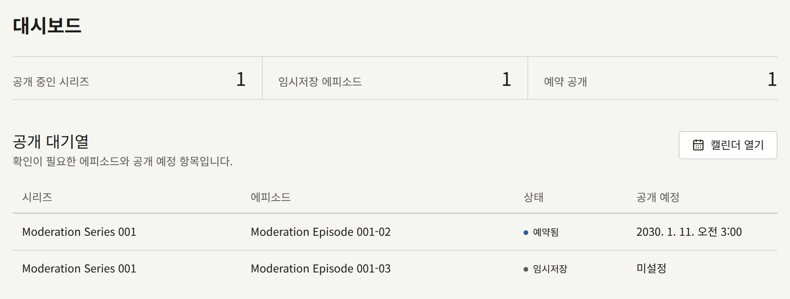
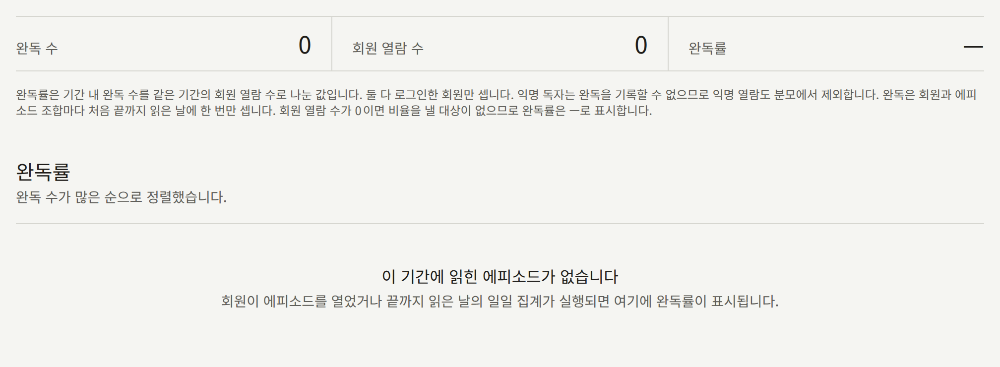
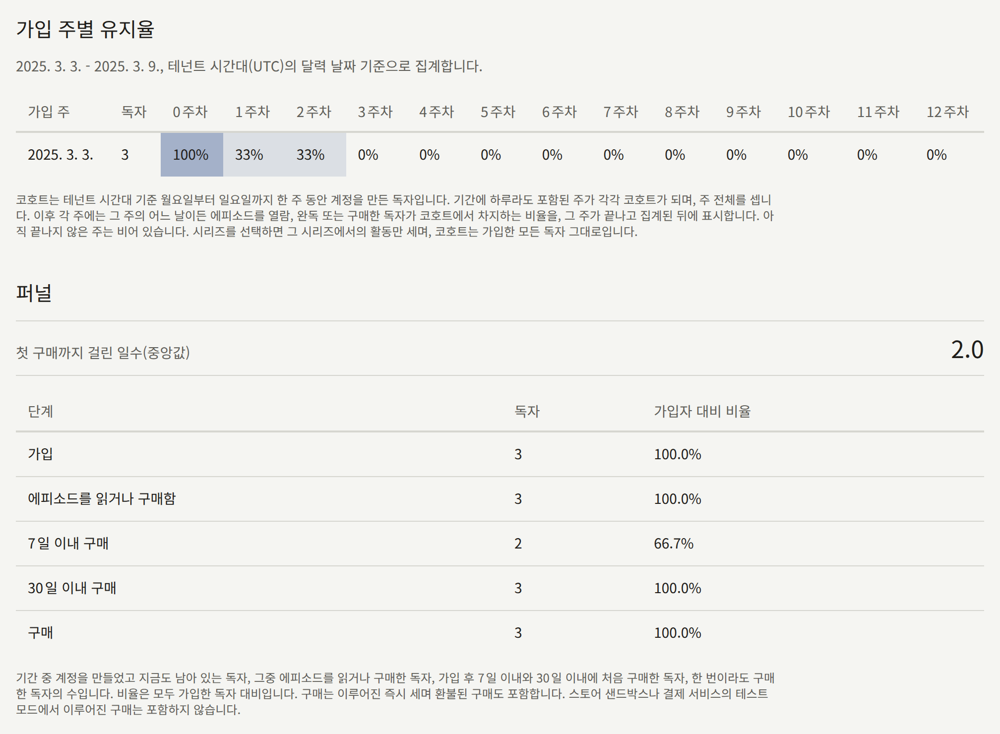
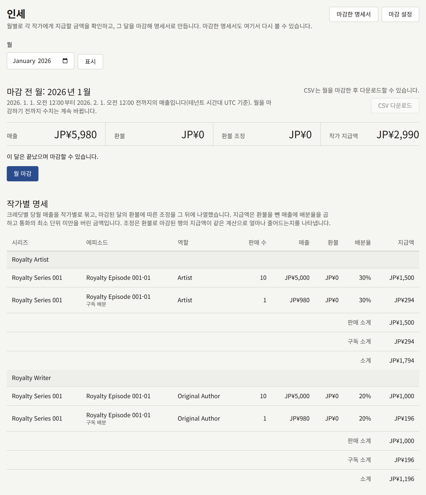
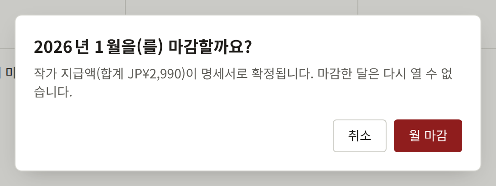
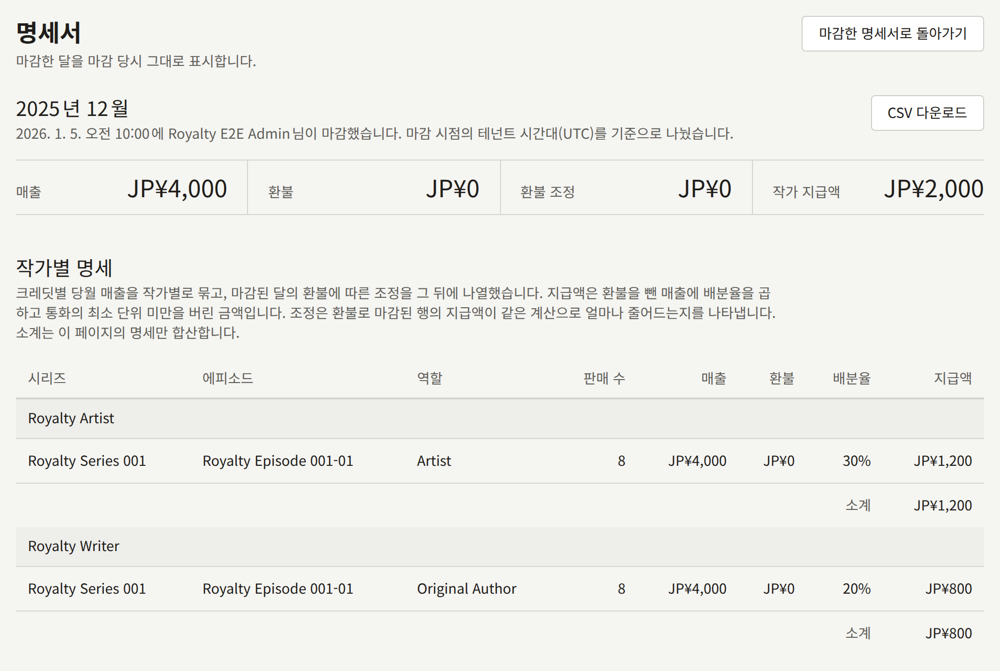
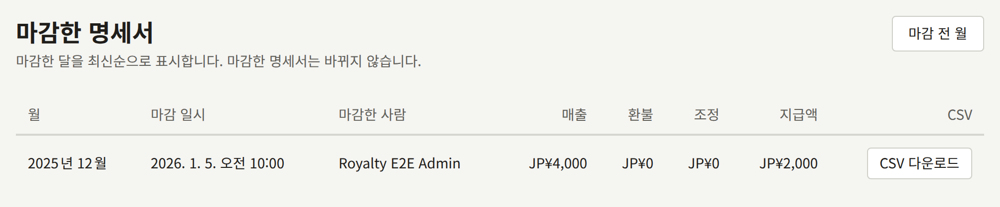
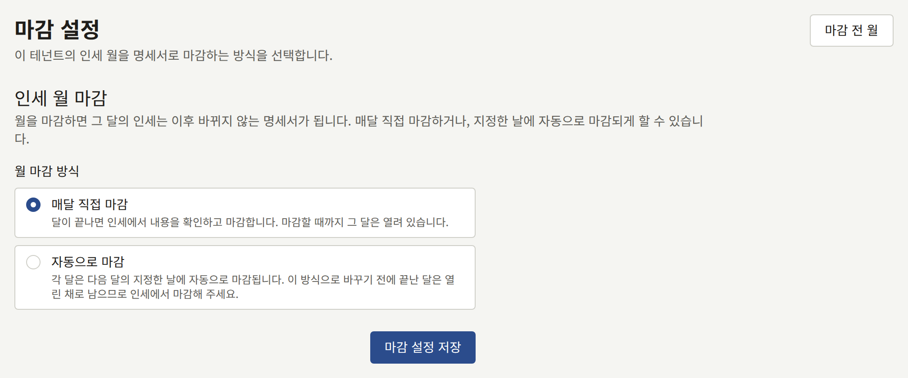

콘솔의 여러 화면은 사이트에서 일어나는 일을 수치로 바꿔 보여 줍니다. **대시보드**는 작품의 공개 진행 상황을 보여 줍니다. **애널리틱스** 아래에서 **매출**은 무엇이 팔렸는지, **독자 반응**은 독자가 각 시리즈를 어떻게 팔로우하고 읽고 반응했는지, **에피소드**는 회원이 각 에피소드를 어디까지 읽었는지와 독자가 어느 페이지에서 이탈하는지, **코호트**는 매주 가입한 독자가 얼마나 다시 찾아왔고 그중 몇 명이 구매했는지를 보여 줍니다. **리포트** 아래의 **인세**는 한 달 동안의 매출에 대해 테넌트가 각 작가에게 지급해야 할 금액을 계산하고, 그 달을 다시는 바뀌지 않는 명세서로 마감합니다.

스태프는 누구나 **대시보드**, **독자 반응**, **에피소드**, **코호트**를 볼 수 있습니다. **매출**, **인세**, **코호트**의 **퍼널**을 보고, 리포트나 명세서를 CSV로 다운로드하고, 월을 마감하고, 월 마감 방식을 바꾸는 것은 **테넌트 관리자**만 할 수 있습니다. 그 밖의 사람에게는 이 화면과 컨트롤이 표시되지 않습니다.

## 매출이나 열람이 집계되는 날

이 화면들이 기준으로 삼는 날짜는 모두 테넌트 시간대의 달력상 날짜이며, 시간대는 **설정** › **기본 정보** › **시간대**에서 설정합니다. 한 번도 설정하지 않은 테넌트는 운영자가 정한 설치 환경의 기본값을 사용합니다. 하루는 그 시간대의 자정부터 자정까지이고, 한 달은 첫날 00:00부터 다음 달 첫날 00:00까지입니다. 도쿄에서 4월 1일 08:30에 이루어진 매출은 `Asia/Tokyo` 테넌트에서는 4월에 속하고, 아직 3월 31일 23:30인 `UTC` 테넌트에서는 3월에 속합니다.

- 매출은 구매가 기록된 시점에 집계됩니다. 편의점 결제처럼 나중에 정산되는 결제는 대금이 입금된 시점입니다.
- 열람은 회원이 에피소드를 열거나 완독한 날에 집계됩니다.
- 팔로우는 팔로우한 시점에 집계되고, 독자가 팔로우를 취소하거나 계정을 삭제한 시점에 끝납니다.
- 명세서는 그 달을 나눈 시간대를 계속 유지하며, 월 아래에 **마감 시점의 테넌트 시간대(UTC)를 기준으로 나눴습니다.** 같은 안내를 표시합니다.

명세서를 마감한 뒤 시간대를 바꿔도, 그 명세서는 마감한 그대로 남습니다. 그다음 달은 명세서가 끝난 지점, 즉 이전 시간대의 자정에 시작해 새 시간대의 자정에 끝납니다. 따라서 두 자정 사이의 시간에 이루어진 매출은 이전 시간대 기준으로 속한 달에 한 번만 집계됩니다. 그 이후의 모든 달은 새 시간대의 자정부터 자정까지입니다. **독자 반응**과 **에피소드**가 읽는 일별 통계는 이미 집계한 날을 다시 집계하지 않으며, 변경 사항은 다음에 집계하는 날부터 적용됩니다. **매출**과 **독자 반응**의 팔로워는 매출과 팔로우 자체에서 읽으므로 즉시 새 시간대를 따릅니다.

## 대시보드

콘솔의 첫 메뉴인 **대시보드**는 매출이나 열람이 아니라 작품의 공개 진행 상황을 한눈에 보여 줍니다. 수치는 날짜 범위 없이 테넌트 전체를 셉니다.

| 수치 | 세는 대상 |
| --- | --- |
| **공개 중인 시리즈** | 공개된 시리즈 |
| **임시저장 에피소드** | 임시저장된 에피소드 |
| **예약 공개** | 공개일이 아직 오지 않은 에피소드 |
| **검토 대기** | 테넌트 관리자의 결정을 기다리는 예약된 에피소드. 테넌트가 [검토를 요구](./1-catalog/2-episodes.md#공개-전-검토)하는 동안에만 표시됩니다 |

**공개 대기열**에는 이 에피소드들이 최대 10개 나열됩니다. 예약된 에피소드가 공개일이 빠른 순서로 먼저 나오고, 그다음 임시저장 에피소드가 최신순으로 나옵니다. **공개 예정**은 테넌트의 시간대로 표시되며, 날짜가 없는 임시저장 에피소드에는 **미설정**이 표시됩니다. 테넌트가 검토를 요구하는 동안에는 결정을 기다리는 예약된 에피소드의 상태 옆에 **검토 중**이, 반려된 에피소드에는 **반려됨**이 표시됩니다. 옆에 있는 **캘린더 열기**는 예약되었거나 공개된 모든 에피소드를 공개일별로 보여 주는 [캘린더](./1-catalog/2-episodes.md#언제-무엇이-공개되는지)를 엽니다.

화면은 스태프가 시리즈나 에피소드를 저장하는 즉시, 그리고 예약된 에피소드가 저절로 공개되는 즉시 갱신되며, 공개된 에피소드는 대기열에서 빠집니다.

## 애널리틱스

**매출**, **독자 반응**, **코호트**, 그리고 에피소드의 이탈은 각각 테넌트 기준 날짜의 한 기간을 보고합니다. 기간은 **시작일**과 **종료일**을 고르고 **적용**을 눌러 정하며, 최대 366일입니다. 고르지 않으면 어제까지(어제 포함) 28일을 다루며, 날짜 아래의 줄에 기간과 시간대가 표시됩니다. **초기화**는 이 28일로 되돌립니다.

화면은 기간의 합계와 그 일별 차트로 시작하고, 그 아래에 표가 있습니다. **일별**, **시리즈별**, **에피소드별**은 표의 행을 무엇으로 할지 고르며, 열 제목을 고르면 그 열로 표를 정렬하고, 다시 고르면 반대 순서로 정렬합니다. 기간, 행, 정렬은 모두 페이지 주소에 담기므로, 북마크나 링크로 같은 리포트를 다시 열 수 있습니다.

일별 통계에서 나오는 수치는 그날이 끝나야 반영됩니다. `publira worker`는 테넌트 시간대의 자정이 지난 뒤 다음 매시 실행에서 각 날을 집계하므로, 오늘의 열람은 내일 나타납니다. 워커가 멈춰 있는 동안에는 새로운 날이 집계되지 않으며, 다시 시작하면 놓친 날을 따라잡습니다. `publira worker`를 계속 실행해 두는 방법은 [개요](../2-deployments/1-overview.md)에서 설명합니다.

### 매출

**매출**은 기간 동안 팔린 것을 테넌트의 통화로 보여 줍니다.

| 수치 | 세는 대상 |
| --- | --- |
| **구매 수** | 기간 중 이루어진 구매. 환불된 구매 포함 |
| **총매출** | 그 구매에 지불된 금액 |
| **환불액** | 그 구매의 독자에게 돌아간 금액. 환불과, 테넌트가 패한 이의 제기 |
| **구독** | 기간 중 구독자가 테넌트의 [구독 플랜](./5-subscription-plans.md)에 지불한 금액 |
| **구독 환불액** | 그 결제에서 돌아간 금액. 환불과, 테넌트가 패한 이의 제기 |
| **순매출** | **총매출**에서 **환불액**을 뺀 금액과 **구독**에서 **구독 환불액**을 뺀 금액. 테넌트에 남은 금액 |

**구독**과 **구독 환불액**은 구독 결제가 있었던 기간에만 표시되므로, 플랜을 판매하지 않는 테넌트에게는 나머지 네 수치만 보입니다. 그런 기간의 차트는 각 날의 구독 결제에서 환불을 뺀 금액을, 구매의 순매출 위에 차트 아래에 이름이 표시된 옅은 색으로 쌓아 보여 주며, **일별** 표에는 두 수치 각각의 열이 있습니다. 결제는 Stripe가 대금을 받은 날에 집계되고, 그 결제에서 돌아간 금액은 구매의 환불과 마찬가지로 그날에서 뺍니다. 테넌트가 패한 이의 제기는 결제 전체를 되돌리며, 아직 진행 중이거나 테넌트가 이긴 이의 제기는 아무것도 되돌리지 않습니다. 결제는 어떤 시리즈에도 속하지 않으므로 **시리즈별**과 **에피소드별** 표에서는 제외되며, 그 표의 **순매출**은 구매의 순매출입니다. Stripe의 테스트 키로 이루어진 결제는 어떤 수치에도 들어가지 않습니다.

차트는 각 날의 순매출입니다. 매출은 구매한 날에 집계되고, 거기서 돌아간 금액은 언제 돌아갔든 같은 날에서 뺍니다. 따라서 이미 보고된 날의 금액이 나중에 줄어들 수 있으며, 판매액보다 돌아간 금액이 많은 날은 기준선 아래로 그려집니다. 아직 진행 중인 이의 제기는 패하기 전까지 아무것도 되돌리지 않습니다. 권이나 시리즈의 남은 에피소드의 구매는, 그 구매로 열린 각 에피소드가 가격에서 차지하는 부분(인세 명세서가 반영하는 부분)만큼 각 에피소드의 매출로 집계되고, 그 시리즈에는 전액이 매출로 집계됩니다. 테넌트의 현재 통화가 아닌 통화로 결제된 구매는 어떤 수치에도 들어가지 않습니다. 테넌트의 코인으로 결제한 에피소드는 그 코인에 지불된 금액(인세 명세서가 반영하는 금액)의 매출이 되고, 코인 팩의 구매는 어떤 수치에도 들어가지 않습니다. 팩의 돈은 코인이 사용될 때 집계되며, 팩의 전액 환불이나 팩에 대한 이의 제기는 사용된 코인이 만든 매출에서 뺍니다. 매출 화면은 구매 자체를 읽으므로, 방금 이루어진 매출도 이미 반영되어 있습니다.

### 독자 반응

**독자 반응**은 기간 동안 독자가 테넌트의 시리즈를 어떻게 팔로우하고 읽고 반응했는지 보여 줍니다.

| 수치 | 세는 대상 |
| --- | --- |
| **팔로워** | 기간 말에 팔로우하고 있는 독자. 팔로우는 하는 즉시 집계되고, 독자가 팔로우를 취소하거나 계정을 삭제하면 끝납니다 |
| **열람 수** | 로그인 여부와 관계없이 모든 독자가 시리즈 페이지와 그 에피소드를 본 횟수 |
| **완독 수** | 회원이 그 시리즈의 에피소드를 처음으로 완독한 횟수 |
| **반응** | 에피소드의 반응 컨트롤을 눌러 그 에피소드에 대한 독자의 점수가 늘어난 횟수 |

차트는 각 날의 마지막 시점의 팔로워입니다. **시리즈별**에는 모든 시리즈가 기간 중 생긴 팔로우와 끝난 팔로우, 그리고 **평점**과 **평가한 독자**와 함께 나열됩니다. 평점은 기간의 반응이 아니라 지금까지 모은 모든 반응에 대한, 시리즈 페이지에 표시되는 현재 평점입니다. 아무 독자도 평가하지 않은 시리즈에는 `—`가 표시됩니다.

### 에피소드

**에피소드**는 회원이 연 에피소드를 얼마나 완독하는지 보여 줍니다. 다른 화면이 보여 주는 기간과 관계없이, 수치는 테넌트 시간대 기준으로 어제까지(어제 포함) 최근 28일을 다루며, 제목 아래의 줄에 날짜와 시간대가 표시됩니다.

| 수치 | 세는 대상 |
| --- | --- |
| **완독 수** | 회원이 에피소드를 완독한 횟수. 회원은 에피소드마다 한 번, 처음 완독한 날에 집계되며, 몇 번을 다시 읽어도 마찬가지입니다 |
| **회원 열람 수** | 로그인한 회원이 에피소드를 연 횟수. 한 회원이 한 에피소드를 연 것은 시계 기준 30분 단위(:00부터 :29까지, :30부터 :59까지)마다 한 번으로 집계됩니다. 따라서 같은 30분 안에 다시 열어도 늘어나지 않지만, 10:29에 열고 10:30에 다시 열면 두 번으로 집계됩니다 |
| **완독률** | **완독 수**를 **회원 열람 수**로 나눈 값. 열람이 없으면 `—`로 표시됩니다 |

로그인한 회원만 집계됩니다. 로그인하지 않은 독자는 에피소드를 완독했다고 기록할 수 없으므로, 그 열람도 제외됩니다. 회원이 어떤 방법으로 에피소드를 읽게 되었는지는 상관없습니다. 구매한 에피소드, 이용권으로 연 에피소드, 무료 에피소드가 모두 똑같이 집계되며, 구매만으로는 아무것도 집계되지 않습니다.

**완독률**에는 기간 중 읽힌 각 에피소드가 완독 수가 많은 순서로, 한 페이지에 20개씩 나열됩니다. 맨 위의 합계는 어느 페이지를 보든 기간 전체를 다룹니다.

#### 이탈

**완독률**에서 에피소드를 고르면 그 에피소드의 **이탈**이 열립니다. 기간 동안 독자가 그 에피소드를 어디까지 읽었는지 페이지별로 보여 줍니다.

| 수치                       | 세는 대상                              |
| -------------------------- | -------------------------------------- |
| **독자**                   | 첫 페이지에 도달한 독자                |
| **마지막 페이지까지 도달** | 에피소드의 마지막 페이지에 도달한 독자 |
| **페이지 수**              | 현재 에피소드에 있는 페이지            |

차트는 첫 페이지에서 마지막 페이지로 계단처럼 내려갑니다. 표에는 페이지마다 그 페이지에 도달한 독자, 그 독자가 첫 페이지에 도달한 독자 중에서 차지하는 비율, 그리고 그 페이지에서 떠난 독자, 즉 그 페이지에는 도달했지만 다음 페이지에는 도달하지 않은 독자가 표시됩니다. **여기서 이탈**로 정렬하면 가장 많은 독자가 떠나는 페이지가 맨 위로 옵니다. 독자는 하루가 끝날 때 에피소드 안에서 읽던 위치가 있는 페이지에서 집계되므로, 기간 중 여러 날에 걸쳐 읽은 독자는 각 날마다 한 번씩 집계됩니다. 에피소드의 마지막 페이지보다 뒤에 있고 **(삭제됨)** 표시가 붙은 페이지는, 에피소드에서 페이지를 뺀 시점 이전에 도달된 페이지입니다.

### 코호트와 퍼널

**코호트**는 기간의 각 주에 가입한 독자를 추적합니다. 여기서 독자란 테넌트 사이트의 계정이며, 스태프 자신의 계정은 제외됩니다.

**가입 주별 유지율**에는 기간에 하루라도 포함된 주마다 행이 있습니다. 한 주는 테넌트 시간대 기준 월요일부터 일요일까지이므로, 첫 행은 **시작일**보다 앞에서 시작하고 마지막 행은 **종료일**보다 뒤에서 끝날 수 있습니다. 각 행에는 그 주, 그 주에 계정이 만들어진 독자 수, 그리고 **0주차**부터 **12주차**까지의 열에 가입한 주와 그 뒤 12주 각각에서 어느 날이든 에피소드를 열람, 완독 또는 구매한 독자의 비율이 표시됩니다. 독자는 한 주에 며칠을 다시 찾아와도 한 번으로 집계됩니다. 칸의 색이 진할수록 비율이 큽니다. 주는 끝나고 그 주의 날들이 집계된 뒤에 표에 반영되므로, 아직 진행 중인 주는 비어 있습니다. 아무도 가입하지 않은 주의 행에는 `—`가 표시됩니다.

**시리즈**에서 시리즈를 고르면 그 시리즈의 열람과 구매만 셉니다. 행은 여전히 가입한 모든 독자이므로, 비율은 그 주의 새 독자 중 몇 명이 그 시리즈로 이어졌는지를 보여 줍니다.

**테넌트 관리자**에게 표시되는 **퍼널**은 기간 중 가입한 독자와 그 독자가 어디까지 나아갔는지를 셉니다.

| 단계 | 세는 대상 |
| --- | --- |
| **가입** | 기간 중 계정이 만들어졌고 아직 존재하는 독자 |
| **에피소드를 읽거나 구매함** | 그중 집계된 날 가운데 어느 날이든 에피소드를 열람, 완독 또는 구매한 독자 |
| **7일 이내 구매** | 그중 계정이 만들어진 뒤 7일이 지나기 전에 첫 구매를 한 독자 |
| **30일 이내 구매** | 같은 기준으로 30일 이내 |
| **구매** | 그중 한 번이라도 구매한 독자 |

**가입자 대비 비율**은 각 수를 **가입**으로 나눈 값입니다. **첫 구매까지 걸린 일수(중앙값)** 항목은 구매한 독자를 대상으로, 계정이 만들어진 뒤 첫 구매까지 기다린 일수의 중앙값이며, 구매한 독자가 생기기 전까지는 `—`입니다. 구매는 이루어지는 즉시 집계되며 환불된 구매도 포함되지만, 스토어의 샌드박스나 결제 제공자의 테스트 모드에서 이루어진 구매는 집계되지 않습니다.

삭제된 계정은 그 즉시 해당 행과 그 계정에 대한 모든 집계에서 빠집니다. 이 화면들이 세는 열람과 구매는 설치 환경이 보관을 시작한 날부터 보관됩니다. **코호트**가 추가된 릴리스로 업그레이드한 설치 환경이라면, 업그레이드 시점에 아직 보관되어 있던 가장 오래된 애널리틱스 이벤트의 날부터입니다. 그보다 앞선 주에는 그 주에 가입한 독자는 표시되지만 그 독자의 활동은 전혀 표시되지 않으며, 나중에 채워지지도 않습니다.

### 리포트를 CSV로 다운로드

**매출**, **독자 반응**, **이탈**의 표 옆에 있는 **CSV 다운로드**는 화면에 표시된 기간에 대해 그 표의 리포트를 다운로드합니다. 표와 마찬가지로 일별, 시리즈별, 에피소드별입니다. 파일에는 표의 정렬과 관계없이 리포트의 모든 행이 리포트 자체의 순서대로 담깁니다. 날짜는 날짜순, **매출**의 시리즈와 에피소드는 순매출이 높은 순, **독자 반응**의 시리즈는 팔로워가 많은 순, 이탈의 페이지는 페이지 순서입니다. **에피소드**의 **완독률**과 **코호트**에는 다운로드가 없습니다.

파일 이름은 `revenue-by-series-<tenant>-2025-03-03--2025-03-09.csv`처럼 리포트, 테넌트, 기간을 따르며, 이탈은 `drop-off-<tenant>-<episode>-<from>--<to>.csv`입니다. 파일은 Excel이 올바르게 읽도록 바이트 순서 표시가 붙은 UTF-8이며, 머리글 행 아래에 리포트의 행마다 한 행이 있고, 합계 행은 없습니다. 열은 다음과 같습니다.

| 리포트 | 열 |
| --- | --- |
| 일별 매출 | `date`, `purchase_count`, `gross_amount`, `refunded_amount`, `net_amount`, `subscription_amount`, `subscription_refunded_amount`, `currency` |
| 시리즈별 매출 | `start_date`, `end_date`, `series_id`, `series_title`, `purchase_count`, `gross_amount`, `refunded_amount`, `net_amount`, `currency` |
| 에피소드별 매출 | `start_date`, `end_date`, `series_id`, `series_title`, `episode_id`, `episode_title`, `purchase_count`, `gross_amount`, `refunded_amount`, `net_amount`, `currency` |
| 일별 독자 반응 | `date`, `follower_count`, `followed_count`, `unfollowed_count`, `view_count`, `complete_count`, `reaction_count`, `reaction_points` |
| 시리즈별 독자 반응 | `start_date`, `end_date`, `series_id`, `series_title`, `follower_count`, `followed_count`, `unfollowed_count`, `view_count`, `complete_count`, `reaction_count`, `reaction_points`, `rating_average`, `rating_count` |
| 이탈 | `start_date`, `end_date`, `episode_id`, `page_index`, `reader_count` |

`date`, `start_date`, `end_date`는 테넌트 기준 날짜이며 `YYYY-MM-DD` 형식입니다. 뒤의 두 열은 다운로드한 기간이며 모든 행에서 같습니다. `subscription_amount`는 그날 구독자가 테넌트의 [구독 플랜](./5-subscription-plans.md)에 지불한 금액으로, 구매와는 별도입니다. `subscription_refunded_amount`는 그 결제에서 돌아간 금액으로, 환불이나 테넌트가 패한 이의 제기(결제 전체로 계산합니다)이며, 구매의 환불과 마찬가지로 결제된 날에서 뺍니다. Stripe의 테스트 키로 이루어진 결제는 두 열 어디에도 들어가지 않습니다. 결제는 어떤 시리즈에도 속하지 않으므로, 시리즈별과 에피소드별 리포트에는 들어가지 않습니다. 화면의 **순매출**과 달리, `net_amount`는 구매의 순매출만 담습니다. 금액은 통화의 최소 단위(JPY는 엔, USD는 센트)이며, `currency`는 테넌트의 통화입니다. `rating_average`는 소수점 이하 한 자리이며, 아무 독자도 평가하지 않은 시리즈는 `0.0`입니다. `page_index`는 첫 페이지를 `0`으로 해서 세며, `reader_count`는 그 페이지에 도달한 독자 수입니다. 제목은 테넌트의 기본 언어로 기록되며, ID는 이름이 바뀌어도 행을 해당 시리즈나 에피소드와 연결해 줍니다. 스프레드시트가 수식으로 읽을 만한 셀은 텍스트로 남도록 기록됩니다.

리포트는 다운로드할 때 읽으므로, 오늘이 포함된 기간은 나중에 다운로드하면 수치가 다를 수 있습니다. 모든 다운로드는 **감사 로그**에 **애널리틱스 CSV 다운로드**로 기록됩니다.

## 인세

**인세**는 각 작가가 크레딧된 에피소드의 매출과, 그 에피소드들에 나눠진 구독 결제에 대해 받아야 할 금액을 월별로 계산합니다. 월은 마감될 때까지 열려 있으며, 그 수치는 모든 매출, 환불, 몫의 변경을 따라 움직입니다. 월을 마감하면 다시는 바뀌지 않는 명세서가 작성됩니다. 테넌트는 이 명세서를 근거로 작가에게 지급합니다. Publira는 누구에게도 지급하지 않으며, 명세서는 지급해야 할 금액의 기록입니다.

### 작가가 받아야 할 금액

작가는 자신이 크레딧된 각 에피소드에서 몫을 받습니다. 몫은 크레딧에 에피소드 매출에 대한 비율로 설정하며, 에피소드의 몫을 다 빼고 남은 부분은 출판사의 몫입니다.

- **시리즈의 폼**에서는 **작가**의 **작가 1의 몫** 같은 필드로 각 크레딧의 몫을 설정합니다. 이 크레딧은 새 에피소드를 만들 때 쓰는 기본 틀이며, 바꿔도 기존 에피소드는 그대로입니다.
- **에피소드**에서는 **작가**로 그 에피소드 자체의 크레딧과 몫을 바꾸고, **작가 저장**으로 저장합니다.
- **시리즈의 에피소드 목록**에서는 **크레딧** › **몫 설정**으로 여러 에피소드에서 한 크레딧의 몫을 한꺼번에 바꿉니다.

몫은 0에서 100퍼센트 사이이며 소수점 이하 두 자리까지 쓸 수 있고, 한 에피소드의 몫을 모두 더해도 100을 넘을 수 없습니다. 몫이 0이면 작가를 크레딧하되 지급하지는 않습니다. 편집 담당은 작품을 편집하므로 몫도 설정할 수 있습니다.

크레딧마다 한 달의 지급액은 다음과 같습니다.

> (그 달의 에피소드 매출 − 그 매출에 대한 환불) × 몫. 테넌트 통화의 최소 단위(엔이나 센트 등)로 내림합니다

한 달의 매출은 다음과 같습니다.

- 사이트에서 Stripe나 PAY.JP를 통해 이루어진 에피소드 구매. 독자가 Stripe의 결제 페이지에서 입력한 [프로모션 코드](./4-selling-episodes.md#프로모션-코드)를 적용하기 전의 가격으로 계산합니다. 프로모션을 제공한 것은 테넌트이므로 할인은 테넌트가 부담합니다. 코드로 무료가 된 구매도 그 가격의 매출입니다. 설치 환경이 코드를 적용하기 전의 가격을 기록하기 전에 기록된 구매는 독자가 지불한 가격의 매출입니다.
- 사이트에서 그 에피소드가 들어 있는 권을 구매한 경우. 각 구매는 프로모션 코드를 적용하기 전의 권 가격 중 그 에피소드의 부분만큼 에피소드의 매출이 됩니다. 이 가격은 구매가 기록된 시점의 권에 든 에피소드들의 가격에 비례해 나누며, 어느 에피소드에도 가격이 없으면 균등하게 나눕니다. 따라서 가격이 있는 에피소드와 함께 권에 든 무료 에피소드는 몫을 받지 않으며 매출도 없습니다. 각 부분은 구매 시점에 정해지므로, 나중에 에피소드의 가격을 바꾸거나 권의 구성을 바꿔도 달라지지 않습니다. 권의 부분 환불도 같은 비율로 나누며, 각 에피소드의 부분은 내림합니다.
- 사이트에서 시리즈의 남은 에피소드를 구매한 경우. 각 구매는 독자가 지불한 가격 중 각 에피소드의 부분만큼, 그 구매로 열린 모든 에피소드의 매출이 됩니다. 각 에피소드의 부분은 독자가 결제를 시작할 때 정해집니다. 묶음 할인은 에피소드들이 판매된 가격(캠페인 기간 중이면 캠페인 가격)에 비례해 나눠지므로, 나중에 에피소드의 가격이나 시리즈의 할인을 바꿔도 달라지지 않습니다. 부분 환불도 가격과 같은 비율로 나누며, 각 에피소드의 부분은 내림합니다.
- 테넌트의 앱에서 App Store나 Google Play를 통해 이루어진 구매. 에피소드의 가격으로 계산하며, 스토어 수수료는 빼지 않습니다.
- 사이트나 앱에서 테넌트의 코인으로 에피소드를 구매한 경우. 사용한 코인에 지불된 금액으로 계산합니다. 팩의 코인 하나하나는 보너스 코인을 포함해 독자가 팩에 지불한 금액을 똑같이 나눈 가치를 가지므로, 보너스는 테넌트가 주는 할인입니다. 예를 들어 그중 100개가 보너스인 1,100코인 팩을 ¥1,000에 샀다면 코인 하나의 가치는 ¥0.909이고, 100코인짜리 에피소드는 통화의 최소 단위로 내림한 ¥90의 매출이 됩니다. 결제 없이 지급된 코인은 가치가 없으며, 테스트 구매의 코인이나 테넌트의 현재 통화가 아닌 통화로 결제한 팩의 코인도 마찬가지입니다. 매출의 가치는 코인을 사용할 때 정해지므로, 나중에 팩을 수정해도 달라지지 않습니다.

모든 금액은 테넌트의 통화이며, 마감된 명세서는 마감 당시의 통화를 유지합니다. 다른 통화로 결제된 구매는 테넌트가 통화를 바꾸기 전에 시작한 결제를 독자가 완료한 경우에만 생기며, 에피소드는 열지만 명세서의 매출이 되지는 않습니다.

그 밖에는 매출이 아닙니다. 코인 팩의 구매는 매출이 아니며, 그 돈은 코인이 사용될 때 만드는 매출이 됩니다. 이용권, **기다리면 무료**, 무료 공개 기간, 작가가 자신의 에피소드를 읽는 경우는 매출 없이 에피소드를 엽니다. App Store 샌드박스나 Play 라이선스 테스터의 구매, 그리고 Stripe나 PAY.JP의 테스트 키로 이루어진 구매는 테스트이므로 제외됩니다.

전액 환불된 구매는 구매한 달에서 빠집니다. 부분 환불은 매출을 남겨 두고, 그 금액을 **환불**로 계산해 뺍니다. 프로모션 코드로 할인된 구매에서는, 환불액이 독자가 낸 금액에서 차지하는 비율만큼 코드를 적용하기 전의 가격에서 뺍니다. ¥500 에피소드에 ¥400을 낸 결제의 절반을 환불하면, 통화의 최소 단위로 내림해 ¥250을 뺍니다. 어느 경우든 구매한 달이 열려 있는 동안에는 환불이 환불한 달이 아니라 구매한 달에 반영됩니다.

독자의 카드사가 테넌트에 불리하게 판단한 Stripe 결제의 [이의 제기](./4-selling-episodes.md#이의-제기)는, Stripe가 판단 결과를 알려 온 시점부터 마감 전후와 관계없이 전액 환불된 것으로 계산합니다. 아직 진행 중이거나 테넌트에 유리하게 판단된 이의 제기는 매출을 그대로 남깁니다.

전액 환불되었거나 이의 제기된 코인 팩은, 사용된 코인으로 결제한 각 구매에 대해 그 코인의 가치만큼 환불합니다. 독자는 연 에피소드를 그대로 가지므로 각 구매는 매출로 남고, 그 금액이 **환불**에 들어갑니다. 구매에 사용된 코인이 모두 그 팩에서 나왔다면 가격 전체, 일부가 다른 팩에서 나왔다면 그 팩의 몫만큼입니다. 다른 환불과 마찬가지로, 구매한 달이 열려 있는 동안에는 그 달에 반영되고, 마감 후에는 다음 명세서에서 뺍니다.

### 구독 결제

Stripe가 테넌트의 [구독 플랜](./5-subscription-plans.md)에 대해 받은 결제는, 결제가 대금을 낸 기간이 끝나는 달에 구독자가 읽은 것의 작가들에게 나눠집니다. 결제는 그 기간 동안 구독자가 완독한 플랜의 에피소드들에 균등하게 나눠지고, 각 에피소드의 부분은 에피소드의 매출과 마찬가지로 그 에피소드의 작가에게 각자의 몫에 따라 지급됩니다. 각 부분은 합계가 정확히 결제 금액이 되도록 내림하며, 내림 결과 받을 것이 없는 에피소드는 몫을 받지 않습니다.

- 에피소드는 구독자마다, 구독자가 처음 완독한 기간에 한 번만 집계됩니다. 나중 기간에 다시 읽은 에피소드는 그 기간의 결제에서 몫을 받지 않습니다.
- 구독자가 그 기간에 플랜의 에피소드를 하나도 완독하지 않은 결제는 누구에게도 나눠지지 않습니다. 명세서에 나타나지 않으며, 전액이 출판사의 몫입니다. 구독자가 이후 계정을 삭제한 결제도 마찬가지입니다.
- 결제가 나눠질 에피소드는 월을 마감할 때 정해집니다. 기간 안이더라도 마감 후에 구독자가 완독한 에피소드는 마감된 달을 바꾸지 않습니다.
- 완독은 콘텐츠 이벤트에서 읽으며, 콘텐츠 이벤트는 [설정 › 제한 및 보존](./3-setup/1-settings.md#제한-및-보존)에서 설정한 기간 동안 보관됩니다. 이 기간을 플랜의 청구 주기와 월 마감까지의 시간보다 길게 두세요. 그렇지 않으면 마감 전에 삭제된 완독은 집계되지 않습니다. 연간 플랜에는 1년보다 긴 기간이 필요합니다.
- 결제의 부분 환불은 같은 비율로 에피소드들에 나누며 각 부분은 내림하고, 전액 환불된 결제는 구매와 마찬가지로 빠집니다. Stripe의 테스트 키로 이루어진 결제나, 테넌트의 현재 통화가 아닌 통화로 이루어진 결제는 제외됩니다.
- 독자의 카드사가 테넌트에 불리하게 판단한 이의 제기의 결제는, 전액 환불된 결제와 마찬가지로 전액 환불된 것으로 계산해 빠집니다. 마감 후에 패한 이의 제기는 전액 환불로 회수됩니다. 아직 진행 중이거나 테넌트에 유리하게 판단된 이의 제기는 결제를 그대로 남깁니다.

결제의 각 부분은 에피소드의 매출 줄과는 별도의 줄로, 같은 작가, 시리즈, 에피소드, 역할 아래에 나타납니다. 그런 줄의 **판매 수**는 그 에피소드에 나눠진 결제의 수이고, **매출**은 그 에피소드가 받은 부분의 합계입니다.

### 마감 후의 환불

구매한 달이 마감된 뒤에 기록된 환불은 그 명세서를 바꿀 수 없습니다. 대신 그 뒤에 마감되는 다음 명세서에서 조정 줄로 뺍니다. 조정 줄은 매출을 집계한 마감된 줄과 같은 작가, 시리즈, 에피소드, 역할 아래에 놓이며, 조정하는 마감된 달을 표시합니다. 조정은 그 달 자체의 줄 뒤에 오며, 수치가 변화량이므로 매출 줄에서 양수인 곳이 음수가 됩니다.

- **판매 수**는 전액 환불된 구매 수에 마이너스를 붙인 값이고, **매출**은 그 가격에 마이너스를 붙인 값입니다.
- **환불**은 아직 매출로 남아 있는 구매의 환불액 변화량입니다. 마감 시점에 일부 환불되었던 구매가 그 뒤 전액 환불되면 음수가 됩니다. 그 구매는 이제 **매출**로 빠지기 때문입니다.
- **지급액**은 환불이 마감된 줄의 지급액에서 빼는 금액입니다. 마감된 달이 적용한 몫으로, 이전과 같이 내림해서 남은 매출에 대해 줄의 지급액을 다시 계산하고, 거기서 원래 지급액을 뺀 값입니다. 마감 후에 바뀐 몫이나 마감 후에 크레딧된 작가는 아무것도 바꾸지 않습니다. 마감된 줄과 그 조정을 합하면, 환불이 마감 전에 이루어졌을 때 그 줄이 지급했을 금액이 되므로, 그 줄의 모든 매출이 환불되면 지급액은 0이 됩니다.

프로모션 코드로 할인된 구매의 환불은 마감 전과 마찬가지로 코드를 적용하기 전의 가격에서 같은 비율로 빼므로, 그 구매가 전액 환불되면 마감된 줄과 그 조정을 합한 지급액은 여전히 0이 됩니다.

마감 후의 구독 결제 환불도 같은 방식으로, 마감된 달이 결제를 나눠 준 에피소드들의 구독 줄에서 각각 환불에서 차지하는 부분만큼 뺍니다. 마감 후에 이의 제기에서 패한 결제는 전액 환불로 뺍니다.

환불의 각 부분은 한 번만 뺍니다. 한 번의 마감 후에 일부 환불되고 다음 마감 후에 전액 환불된 구매는 두 번의 조정으로 빼며, 두 번째 조정은 첫 번째 조정이 다루지 않은 부분을 뺍니다. 명세서들을 합하면 그 구매에 대해서는 아무것도 지급하지 않습니다.

조정은 조정 대상보다 나중의 달에만 반영됩니다. 이전 달보다 먼저, 순서를 바꿔 마감한 달에는 그 이전 달의 환불이 반영되지 않으며, 둘 다 마감된 뒤 다음에 마감하는 달에 반영됩니다. 한 달의 조정이 그 달 자체의 매출보다 크면 그 달의 **작가 지급액**은 음수가 되며, 작가의 조정이 그 작가의 매출 줄보다 크면 그 작가의 소계도 음수가 됩니다.

### 마감 전 월 보기

**인세**는 가장 최근에 마감한 명세서의 다음 달을, 아직 아무것도 마감하지 않았다면 지난달을 엽니다. **월**에서 다른 달을 고르고 **표시**를 누르면, 마감되지 않았고 이미 시작된 다른 달을 열 수 있습니다.

**마감 전 월**에는 네 가지 합계가 표시됩니다.

| 합계 | 내용 |
| --- | --- |
| **매출** | 그 달의 모든 매출(크레딧된 작가가 없는 에피소드의 매출 포함)을 가격으로 계산한 값과, 그 달이 나누는 모든 [구독 결제](#구독-결제) |
| **환불** | 그 매출과 결제에 대한 환불 |
| **환불 조정** | [마감 후의 환불](#마감-후의-환불)에서 설명하는 대로, 마감 후에 환불된 마감된 달의 매출과 구독 결제 중 그 달이 회수하는 금액. 각각 한 번만 계산하며, 0이거나 음수입니다 |
| **작가 지급액** | 그 달이 작가에게 지급해야 할 금액으로, 조정을 포함한 아래 줄들의 합계. **매출**에서 **환불**과 **환불 조정**을 뺀 나머지는 출판사의 몫입니다 |

**작가별 명세**는 그 달을 작가별로 묶어, 그 달에 팔린 에피소드의 크레딧마다 한 줄과 작가의 **소계**를 보여 줍니다. 각 줄에는 **시리즈**, **에피소드**, 크레딧의 **역할**, **판매 수**, **매출**, **환불** 금액, **배분율**, **지급액**이 표시됩니다. 같은 에피소드에 두 역할로 두 번 크레딧된 작가는 각각 한 줄을 가지며, 그 달이 구독 결제를 나눠 준 에피소드는 매출 줄 옆에 구독 결제 줄을 가지고, 이 줄에는 에피소드 아래에 **구독 배분**이 표시됩니다. 조정은 작가의 그룹에서 그 달 자체의 줄 뒤에 오며, 에피소드 아래에 **2025-12분 환불 조정**처럼 마감된 달이 표시되고, 작가의 **소계**에 포함됩니다. 구독 결제 줄이 있는 작가는 **소계** 위에 **판매 소계**와 **구독 소계**가 있으며, 각각 해당 종류의 줄과 그 조정을 합산합니다.

합계 위에는 그 달의 상태가 표시됩니다.

- **이 달은 아직 진행 중입니다.** 테넌트 시간대 기준으로 마지막 날이 끝나면 마감할 수 있습니다.
- **이 달은 끝났으며 마감할 수 있습니다.** **월 마감**으로 마감합니다.
- **이 달은 …에 자동으로 마감됩니다.** 그 날짜에 `publira worker`가 그 달을 마감하며, 콘솔에서는 직접 마감하는 방법을 제공하지 않습니다.

### 월을 마감하기 전에

월을 마감하면 그 시점의 상태로 고정되며, 그 뒤에 일어나는 일은 반영되지 않습니다. 마감하기 전에 다음을 확인하세요.

- **크레딧과 몫.** 명세서는 에피소드가 팔린 시점이 아니라 월을 마감한 시점의 몫을 사용합니다. 마감 전에 몫을 바꾸면 그 달 전체가 새 몫으로 지급되고, 마감 후에 바꾸면 열려 있는 달만 새 몫으로 지급됩니다.
- **예상되는 환불.** 마감 후에 기록된 환불은 [마감 후의 환불](#마감-후의-환불)에서 설명하는 대로 마감된 달이 아니라 다음 명세서에서 빼므로, 작가는 먼저 매출에 대해 지급받고 지급액은 나중 달에서 회수됩니다. 들어올 것을 아는 환불은 기다렸다가 해당 달에 반영되게 하세요.
- **그 달이 끝났는지.** 마지막 날 늦게 이루어진 매출은 테넌트의 시간대 기준으로 집계되며, 이는 내 시간대와 다를 수 있습니다.

월은 순서대로 마감하세요. 콘솔이 가장 최근 명세서의 다음 달을 보여 주는 것은 이 때문이며, 건너뛴 달은 나중에 마감하려면 **월**에서 골라야 합니다.

### 월 마감

1. **리포트** › **인세**를 엽니다. 표시된 달이 다음에 마감할 달입니다.
2. **이 달은 끝났으며 마감할 수 있습니다**가 표시되는지 확인하고, **작가별 명세**를 꼼꼼히 읽습니다.
3. **월 마감**을 고릅니다. 대화 상자에 고정될 **작가 지급액**이 표시됩니다. 확인하려면 **월 마감**을 다시 고릅니다.

그러면 콘솔이 그 달의 **명세서**를 엽니다. 명세서에는 **2026-01-05에 관리자님이 마감했습니다.** 같은 문구로 마감 일시와 마감한 사람이 표시되고, 마감 전 월과 같은 합계와 줄이 표시됩니다. 마감은 **감사 로그**에 **인세 월 마감**으로 기록됩니다.

마감된 명세서는 각 작가, 시리즈, 에피소드, 역할의 이름을 마감 시점 그대로 유지합니다. 그 뒤에 작가의 이름을 바꾸거나, 몫을 수정하거나, 구매를 환불하거나, 크레딧을 삭제해도 명세서는 그대로입니다. 그 뒤에 기록된 환불은 대신 다음 명세서에서 뺍니다. 마감된 달은 스태프도 운영자도 다시 열 수 없습니다. 나중에 발견한 실수는 Publira 밖에서, 테넌트가 지급하는 금액으로 바로잡습니다.

**마감한 명세서**에는 마감된 모든 달이 최신순으로, 마감 일시, 마감한 사람, 합계와 함께 나열됩니다. 자동으로 마감된 달은 **마감한 사람**에 `—`가 표시됩니다.

### 명세서를 CSV로 내보내기

**CSV 다운로드**는 마감된 명세서를 다운로드합니다. **명세서** 화면 자체나 **마감한 명세서**의 해당 행에 있습니다. 마감 전 월은 수치가 아직 바뀌고 있으므로 다운로드할 수 없습니다.

파일 이름은 `royalties-<tenant>-<YYYY-MM>.csv`입니다. 파일은 Excel이 올바르게 읽도록 바이트 순서 표시가 붙은 UTF-8이며, 머리글 행 아래에 명세서의 줄마다 한 행이 있고, 합계 행은 없습니다. 열은 다음과 같습니다.

| 열 | 내용 |
| --- | --- |
| `period` | 월, `YYYY-MM` |
| `creator_id`, `creator_name` | 작가 |
| `role_id`, `role_name` | 크레딧의 역할. 역할이 없는 크레딧은 비어 있습니다 |
| `series_id`, `series_title` | 시리즈 |
| `episode_id`, `episode_title` | 에피소드 |
| `sale_count` | 판매 수 |
| `gross_amount` | 매출. 명세서 통화의 최소 단위(JPY는 엔, USD는 센트) |
| `refunded_amount` | 그 매출에 대한 환불. 같은 단위 |
| `share_percent` | 몫. `12.50`처럼 소수점 이하 두 자리 |
| `payout_amount` | 지급액. 같은 단위 |
| `currency` | `USD` 같은 명세서의 통화. 그 달을 마감할 때의 테넌트 통화이며, 그 통화의 매출만 집계합니다 |
| `adjusted_period` | 그 달 자체의 매출 줄에서는 비어 있습니다. 조정에서는 환불을 회수하는 마감된 달(`YYYY-MM`)이며, 금액은 [마감 후의 환불](#마감-후의-환불)에서 설명하는 음수 변화량입니다 |
| `source` | 매출 줄은 `sale`, [구독 결제](#구독-결제) 줄은 `subscription`. 조정은 조정 대상 줄과 같은 값을 가집니다 |

이름은 마감 시점 그대로이며, ID는 이름이 바뀌어도 줄을 해당 작가와 에피소드에 연결해 줍니다. 스프레드시트가 수식으로 읽을 만한 셀은 텍스트로 남도록 기록됩니다. 명세서는 언제 다운로드해도 같은 파일이며, 모든 다운로드는 **감사 로그**에 **인세 명세서 CSV 다운로드**로 기록됩니다.

### 연결된 작가가 보는 명세서

[작가와 작가 역할](./1-catalog/4-authors.md#작가를-독자-계정에-연결하기)에서 설명하는 대로 계정이 작가에 연결된 독자는, 테넌트가 작가 페이지를 켜고 작가에게 매출을 보여 주도록 설정하면 마감된 모든 명세서에서 그 작가의 부분을 볼 수 있습니다. 볼 수 있는 내용은 다음과 같습니다.

- 마감된 각 달에 대해, 작가 자신의 줄의 판매 수, 매출, 환불, 지급액을 조정을 포함해 각각 합산한 값. 작가에게 아무것도 크레딧하지 않은 달은 0으로 표시됩니다.
- 한 달의 작가 자신의 줄. 명세서의 순서대로, 각 줄의 시리즈, 에피소드, 역할, 판매 수, 매출, 환불, 몫, 지급액과 함께, 매출 줄인지 [구독 결제](#구독-결제) 줄인지, 그리고 조정이라면 조정하는 달이 표시됩니다.

명세서의 합계, 다른 작가의 줄, 마감 전 월은 볼 수 없습니다. 줄은 명세서의 다른 모든 것과 마찬가지로 마감 시점 그대로입니다.

어느 달의 **CSV로 다운로드**는 그 달의 작가 자신의 줄을 [명세서를 CSV로 내보내기](#명세서를-csv로-내보내기)에서 설명하는 파일로 저장하되, 세 열을 뺍니다. 모든 행에서 같은 작가를 가리키게 되는 `creator_id`와 `creator_name`, 그리고 `role_id`입니다. `series_id`와 `episode_id`에는 콘솔의 파일에 담기는 내부 ID가 아니라 사이트의 주소에 쓰이는 ID가 들어갑니다. 파일 이름은 작가의 공개 ID와 월을 따라 `royalties-<author>-<YYYY-MM>.csv`입니다. 앱에서는 어느 달의 **CSV 공유**가 같은 파일을 기기의 공유 시트로 넘깁니다.

### 월 자동 마감

**인세**의 **마감 설정**에서 월을 마감하는 방식을 고릅니다.

- **매달 직접 마감**(기본값): 테넌트 관리자가 위와 같이 마감할 때까지 월이 열려 있습니다.
- **자동으로 마감**: 각 달은 다음 달의 **마감일**에 마감됩니다. 마감일은 테넌트 시간대 기준 1일부터 28일 사이의 날입니다.

선택을 적용하려면 **마감 설정 저장**을 고릅니다. 변경은 **감사 로그**에 **인세 마감 설정 변경**으로 기록됩니다.

자동 마감은 마감일 자정이 지난 뒤 `publira worker`의 첫 매시 실행에서 이루어지며, **월 마감**과 똑같이 월을 마감하고, **마감한 사람**에는 아무도 기록하지 않습니다. 마감일에 워커가 멈춰 있었다면, 다시 시작할 때 마감해야 할 달을 오래된 순서로 마감합니다. `publira worker`가 실행되고 있지 않으면 어떤 달도 자동으로 마감되지 않습니다.

**자동으로 마감**은 이를 고른 뒤에 끝나는 달에 적용됩니다. 전환할 때 이미 끝난 달은 직접 마감해야 하므로, 위와 같이 **인세**에서 마감하세요. 마감 전에 아무에게도 확인을 구하지 않으므로, [월을 마감하기 전에](#월을-마감하기-전에)의 확인 사항을 처리할 시간이 있도록 **마감일**을 고르고, 몫은 마감일 이후가 아니라 그 전에 고치세요.
