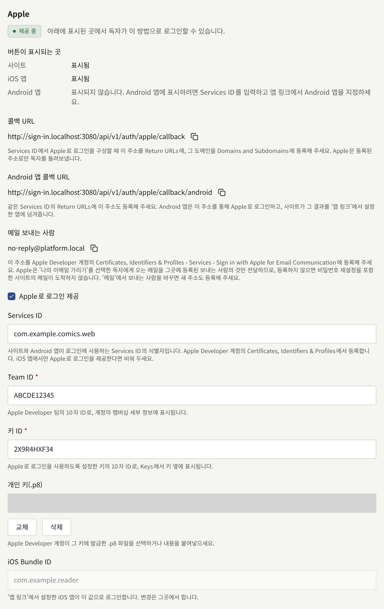
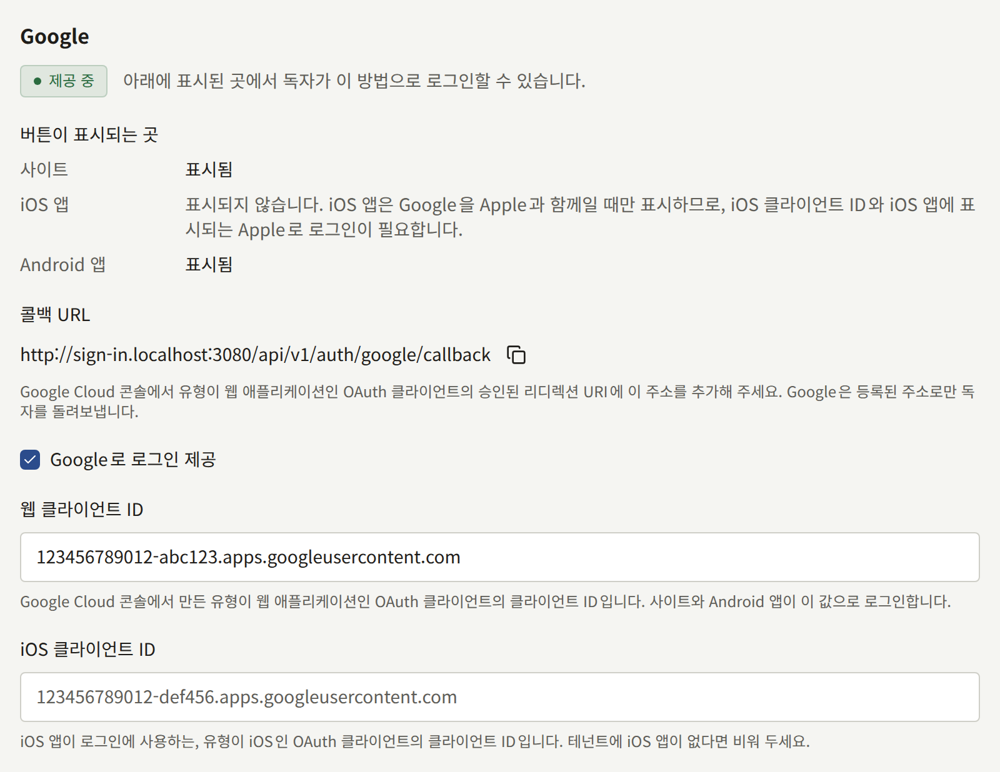

독자는 이메일 주소와 비밀번호로 테넌트의 사이트에 로그인합니다. **연동** › **로그인**은 그 양식 옆에 **Apple로 계속하기**와 **Google로 계속하기** 두 버튼을 추가하여, 독자가 이미 가진 계정으로 회원가입하고 로그인할 수 있게 합니다. 이 페이지는 테넌트 관리자가 사이트를 위해 두 제공자를 설정하는 과정을 안내하고, 설정이 켜진 뒤 독자에게 무엇이 보이는지 설명합니다. 앱도 같은 설정을 공유합니다. 앱에만 필요한 것은 [인앱 결제와 로그인](../5-mobile-app/5-purchases-and-sign-in.md#apple-및-google로-로그인)에 있습니다.

**로그인**은 테넌트 관리자에게만 보이며, 저장할 때마다 **감사 로그**에 **로그인 방법 설정 변경**으로 기록됩니다.

## 시작하기 전에

- **사이트가 자체 도메인에서 HTTPS로 제공되어야 합니다.** Apple과 Google은 자신에게 등록된 HTTPS 주소로만 독자를 돌려보내며, 그 주소는 콘솔 호스트가 아니라 테넌트의 공개 사이트 도메인에 있습니다.
- **Apple의 경우 Apple Developer Program 멤버십**이 필요합니다. 독자가 로그인하는 상대로 보게 될 조직의 이름으로 가입한 것이어야 합니다. 테넌트에 앱이 있다면 앱을 게시한 것과 같은 멤버십입니다.
- **Google의 경우 Google Cloud 프로젝트**가 필요하며, 이것도 출판사가 소유한 것이어야 합니다. [푸시 알림](../5-mobile-app/3-push-notifications.md)을 위해 만든 Firebase 프로젝트도 Google Cloud 프로젝트이므로 사용할 수 있습니다.
- **테넌트에 앱이 있다면** [앱 링크](../5-mobile-app/4-app-links.md)에서 설명하는 대로 **연동** › **앱 링크**를 먼저 입력하세요. Apple로 로그인은 그곳에 지정된 앱을 신뢰합니다.

**연동** › **로그인**을 열어 둔 채로 진행하세요. 각 제공자의 섹션에는 **콜백 URL**과 이를 복사하는 버튼이 표시되며, 아래 단계에서 이 주소를 제공자에게 등록합니다. 이 주소는 사이트의 도메인을 바탕으로 만들어집니다.

| 제공자 | 콜백 URL                                                 |
| ------ | -------------------------------------------------------- |
| Apple  | `https://comics.example.com/api/v1/auth/apple/callback`  |
| Google | `https://comics.example.com/api/v1/auth/google/callback` |

Apple 섹션에는 두 번째 주소인 **Android 앱 콜백 URL**도 표시되며, 이는 Android 앱만 사용합니다.

나중에 운영자가 테넌트를 다른 도메인으로 옮기면 이 주소들도 함께 바뀌며, [테넌트](../3-operations/2-tenants.md)에서 언급하듯 새 주소를 두 제공자 모두에 등록해야 합니다.

## Apple로 로그인

Apple 쪽에서 필요한 것은 모두 Apple Developer 계정의 **Certificates, Identifiers & Profiles**에서 만듭니다.

### Apple Developer 계정에서 만들 것

1. **Sign in with Apple이 켜진 App ID.** **Identifiers**에서 테넌트 iOS 앱의 App ID를 열거나, 테넌트에 앱이 없다면 새로 등록하고, **Sign in with Apple** 기능을 켭니다. 나머지 두 식별자는 이 App ID 아래에 묶이며, Apple은 이를 기본 App ID(primary App ID)라고 부릅니다.
2. **Services ID.** **Identifiers**에서 Services ID를 등록합니다. 설명에는 사이트 이름처럼 독자가 볼 수 있는 내용을, 식별자에는 `com.example.comics.web` 같은 값을 입력합니다. 이 Services ID에 **Sign in with Apple**을 켜고 **Configure**를 선택합니다.
   - **Primary App ID**: 1단계의 App ID.
   - **Domains and Subdomains**: `comics.example.com`처럼 사이트의 도메인만.
   - **Return URLs**: 콘솔에 표시되는 Apple의 **콜백 URL**. 테넌트에 Android 앱이 있다면 **Android 앱 콜백 URL**도 여기에 추가합니다.
3. **키.** **Keys**에서 **Sign in with Apple**을 켜고 같은 기본 App ID로 구성한 키를 등록합니다. 제공되는 `.p8` 파일을 다운로드하세요. Apple은 이 파일을 한 번만 제공하므로 안전한 곳에 보관하세요. 키를 잃어버리면 새 키를 등록하여 교체합니다. **Key ID**는 키 옆에 표시됩니다.
4. **Team ID.** 계정의 멤버십 세부 정보에 표시됩니다.

### 콘솔에 입력하기

**연동** › **로그인**의 **Apple** 섹션에서 다음을 입력합니다.

- **Services ID**: `com.example.comics.web` 같은 Services ID의 식별자. 이 값이 입력되어 있을 때만 사이트에 Apple 버튼이 표시됩니다. iOS 앱에서만 Apple을 제공하려는 경우에만 비워 두세요.
- **Team ID**와 **키 ID**: 4단계와 3단계의 10자 ID.
- **개인 키(.p8)**: 다운로드한 파일을 선택하거나 그 내용을 붙여넣습니다.
- **iOS Bundle ID**는 여기서 입력하지 않습니다. **앱 링크**에서 지정한 iOS 앱이 표시됩니다.

**Apple로 로그인 제공**을 켜고 **로그인 방법 저장**을 선택합니다.

키는 다시 읽을 수 없습니다. 나중에 다시 열면 콘솔에는 키가 저장되어 있다는 사실만 표시됩니다. **교체**는 새 키로 바꾸고, **삭제**는 저장할 때 키를 삭제합니다.

## Google로 로그인

Google 쪽에서 필요한 것은 모두 Google Cloud 콘솔에서 출판사의 프로젝트 안, **Google Auth Platform** 아래에 만듭니다.

### Google Cloud 콘솔에서 만들 것

1. **동의 화면.** **Branding**에서 독자가 계정을 선택할 때 보는 이름, 지원 이메일, 그리고 **Authorized domains**에 사이트의 도메인을 입력합니다. **Audience**에서는 어떤 Google 계정이든 로그인할 수 있도록 **External**을 선택하고, 앱을 프로덕션으로 게시합니다. 게시하기 전까지는 그곳에 등록된 테스트 사용자만 로그인할 수 있습니다. Publira가 Google에 요청하는 것은 독자의 신원, 이메일 주소, 이름뿐이며, Google은 이를 민감하지 않은 정보로 분류하므로 게시할 때 이에 대한 심사를 기다리지 않아도 됩니다.
2. **웹 애플리케이션 클라이언트.** **Clients**에서 유형이 **Web application**인 OAuth 클라이언트를 만들고, 콘솔에 표시되는 Google의 **콜백 URL**을 **Authorized redirect URIs**에 추가합니다. **Authorized JavaScript origins**에는 아무것도 넣지 않습니다.

Google은 새 클라이언트의 클라이언트 보안 비밀(client secret)을 보여 줍니다. Publira는 이를 사용하지 않으며, 콘솔에도 입력할 곳이 없습니다.

### 콘솔에 입력하기

**연동** › **로그인**의 **Google** 섹션에서 다음을 입력합니다.

- **웹 클라이언트 ID**: 웹 애플리케이션 클라이언트의 클라이언트 ID로, `.apps.googleusercontent.com`으로 끝납니다. 이 값이 입력되어 있을 때만 사이트에 Google 버튼이 표시되며, Android 앱도 같은 클라이언트로 로그인합니다.
- **iOS 클라이언트 ID**: iOS 앱만 사용하는 iOS 클라이언트의 클라이언트 ID. 테넌트에 iOS 앱이 없다면 비워 두세요.

**Google로 로그인 제공**을 켜고 **로그인 방법 저장**을 선택합니다.

## 작동하는지 확인하기

각 제공자의 섹션에는 상태가 표시됩니다.

| 상태 | 의미 |
| --- | --- |
| **제공 중** | 켜져 있고 필요한 정보가 모두 있음. 독자가 이 방법으로 로그인할 수 있습니다 |
| **미완료** | 켜져 있지만 필요한 정보가 없어 독자에게 제공되지 않음 |
| **사용 안 함** | 저장되어 있지만 꺼져 있음 |
| **미설정** | 아무것도 저장되어 있지 않음 |

**제공 중**인 제공자에는 **버튼이 표시되는 곳** 아래에 독자가 그 버튼을 만날 수 있는 곳, 즉 **사이트**, **iOS 앱**, **Android 앱**이 나열됩니다. 각 항목에는 **표시됨**이라고 나오거나, 그곳에 버튼이 표시되기 전에 아직 필요한 것이 나옵니다.

|  | Apple | Google |
| --- | --- | --- |
| 사이트 | **Services ID** | **웹 클라이언트 ID** |
| iOS 앱 | **앱 링크**에서 지정한 iOS 앱 | **iOS 클라이언트 ID**, 그리고 iOS 앱에 표시되는 Apple. 앱은 Google을 Apple과 함께일 때만 제공하기 때문입니다 |
| Android 앱 | **Services ID**, 그리고 **앱 링크**에서 지정한 Android 앱 | **웹 클라이언트 ID** |

따라서 제공자가 **제공 중**이면서도 사이트에는 표시되지 않는다고 나올 수 있습니다. **Services ID**가 없는 Apple이나 **웹 클라이언트 ID**가 없는 Google은 앱 전용으로 설정된 것입니다. 앱에 대해 **표시됨**이라고 나오는 것은 설정이 그 앱을 포괄한다는 뜻이며, [앱 페이지](../5-mobile-app/5-purchases-and-sign-in.md#apple-및-google로-로그인)에서 설명하듯 앱 자체도 그에 맞게 빌드되어 있어야 합니다. iOS 앱의 Google은 다른 경우보다 빌드에 더 크게 좌우됩니다. 앱은 같은 **iOS 클라이언트 ID**로 빌드되었을 때만 Google을 표시하므로, 그 행에는 대신 **이 iOS 클라이언트 ID로 빌드한 iOS 앱에 표시됩니다**라고 나옵니다.

사이트는 저장 직후 변경 사항을 반영합니다. 비공개 창에서 사이트의 로그인 페이지를 열고 **Apple로 계속하기** 또는 **Google로 계속하기**를 선택하여 로그인해 보세요. 제공자가 자체 오류 페이지로 돌려보낸다면 대개 주소가 일치하지 않는 것입니다. 제공자가 알려 주는 주소와 **콜백 URL**을 한 글자씩 비교하세요.

## 독자에게 보이는 것

사이트의 **로그인** 페이지와 회원가입 페이지에는 이메일 양식 아래에 **또는**으로 구분되어 **Apple로 계속하기**와 **Google로 계속하기**가 표시됩니다. 이 방법으로 회원가입하는 독자는 비밀번호를 정하지 않으며 이메일 주소를 확인하지도 않습니다. 제공자가 이미 확인했기 때문입니다. 사이트가 독자에게 이용약관이나 개인정보 처리방침 동의를 요구한다면, 처음 로그인할 때 계정이 만들어지기 전에 **회원가입 완료**에서 멈추어 동의를 받습니다.

사이트의 **로그인** 페이지에는 그 옆에 **패스키로 로그인**도 표시됩니다. 패스키를 사용할 수 있는 모든 브라우저에서 표시되며, 이를 위해 **로그인**에서 설정할 것은 없습니다. 사이트용 패스키를 가진 독자는 이메일 주소나 비밀번호를 입력하지 않고 패스키만으로 로그인합니다. 버튼을 선택하거나, 브라우저가 이메일 입력란의 추천 항목으로 패스키를 제시할 때 그것을 고르면 됩니다. 테넌트의 콘솔용으로 만든 패스키는 별개의 것이므로 사이트에 로그인할 수 없습니다. 독자가 확인 창을 닫거나 사이트가 패스키를 받아들이지 않으면 페이지에 그렇게 표시되고 이메일 양식은 그대로 유지됩니다. 계정이 정지되었거나 이메일 주소를 한 번도 확인하지 않은 독자도 패스키로 로그인할 수 없습니다.

앱에는 [앱 페이지](../5-mobile-app/5-purchases-and-sign-in.md#apple-및-google로-로그인)에서 설명하듯 설정이 포괄하는 각 휴대폰에 같은 Apple 및 Google 버튼이 표시되고, 그곳의 [패스키로 로그인](../5-mobile-app/5-purchases-and-sign-in.md#패스키로-로그인)에서 설명하듯 **앱 링크**에서 지정한 앱이라면 **패스키로 로그인**도 표시됩니다. 계정은 양쪽에서 모두 작동합니다. 사이트에서 Apple로 회원가입한 독자는 앱에서도 Apple로 로그인하고, 사이트에서 추가한 패스키로 앱에 로그인할 수 있으며, 그 반대도 마찬가지입니다.

### 기존 계정과 Apple 또는 Google 로그인

Apple 또는 Google 계정은 테넌트에서 한 독자의 계정에 연결됩니다. 어느 계정에 연결될지는 독자가 그것을 처음 사용할 때 정해집니다.

- **독자에게 이미 같은 이메일 주소의 계정이 있는 경우.** Apple 또는 Google 계정이 그 계정에 연결되고, 독자는 구매 내역과 이력이 그대로 있는 기존 계정으로 로그인합니다. 확인 단계는 없습니다. Apple과 Google이 그 주소를 이미 확인했으며, 이는 사이트 자체의 확인 메일이 요구하는 것과 같은 증명입니다.
- **독자에게 그 주소의 계정이 있지만 한 번도 확인하지 않은 경우.** Apple 또는 Google 계정이 그 계정을 넘겨받습니다. 계정이 연결되고, 주소는 확인된 것으로 처리되며, 계정을 만들 때 설정한 비밀번호는 삭제됩니다. 주소를 확인하지 못한 채 계정을 만든 사람은 그 계정을 주소의 실제 소유자에게 잃게 됩니다.
- **그 주소의 계정이 없는 경우.** 제공자가 알려 준 주소로, 비밀번호 없이 새 계정이 만들어집니다.

Apple에서 **나의 이메일 가리기**를 선택한 독자는 자신의 주소 대신 `privaterelay.appleid.com`의 주소를 사이트에 알려 줍니다. 이 주소는 기존 계정과 일치하지 않으므로 새 계정이 만들어지며, 독자의 계정과 다른 주소의 Google 계정도 마찬가지입니다. 이미 계정이 있고 그것을 계속 쓰고 싶은 독자는 이메일 주소로 로그인한 뒤, 아래에서 설명하듯 **연결된 계정**에서 Apple 또는 Google 계정을 그 계정에 연결합니다.

**설정**에서 지정한 테넌트의 거부 이메일 주소는 이 로그인에는 적용되지 않습니다. 주소를 제공자가 제공하기 때문입니다. 계정이 정지된 독자는 Apple이나 Google로도 로그인할 수 없습니다.

### 독자가 관리할 수 있는 것

사이트의 **설정** › **보안**과 앱의 계정 화면에 있는 **연결된 계정**에는 독자가 로그인에 사용할 수 있는 Apple 및 Google 계정이 각각 **연결 해제**와 함께 나열되며, 사이트나 앱이 제공하는 제공자 중 아직 연결된 계정이 없는 것마다 **연결**이 표시됩니다. **연결**을 선택하면 독자는 그 제공자로 로그인하게 되고, 로그인한 계정이 어떤 주소를 가지고 있든 연결되므로 **나의 이메일 가리기** 주소도 독자 자신의 주소와 마찬가지로 연결됩니다. 이후로는 그 계정으로 로그인하면 사이트와 앱 모두에서 같은 계정이 열립니다.

연결은 다음 경우에 거부되며, 그 이유가 화면에 표시됩니다. Apple 또는 Google 계정이 이미 사이트의 다른 계정에 로그인하는 데 쓰이고 있는 경우에는 그쪽에서 먼저 연결을 해제해야 합니다. 독자의 계정에 이미 그 제공자의 계정이 연결되어 있는 경우에는 그것을 해제한 뒤 다른 계정을 연결합니다.

사이트의 같은 화면에는 독자의 **패스키**도 각각 추가한 시점, 마지막으로 로그인에 사용한 시점, **삭제**와 함께 나열됩니다. **패스키 추가**는 브라우저에 새 패스키를 요청합니다. 패스키는 기기의 화면 잠금, 비밀번호 관리자 또는 보안 키에 보관되며, 이어서 구별하기 위한 이름을 묻는데 독자는 이를 건너뛸 수 있습니다. 이후로는 **패스키로 로그인**으로 그 패스키를 사용해 로그인합니다. 이 섹션은 **로그인**에서 무엇을 설정했든 패스키를 사용할 수 있는 모든 브라우저에 표시되며, 독자는 패스키를 최대 20개까지 가질 수 있습니다. 앱 계정 화면의 **패스키**에는 같은 패스키가 나열되며, 패스키를 추가하고 각각의 이름을 바꾸거나 삭제할 수 있습니다.

Apple 또는 Google로 만든 계정에는 비밀번호가 없습니다. 같은 화면에는 **비밀번호 설정**이 표시되며, 비밀번호를 설정할 링크를 메일로 보냅니다. 설정한 뒤에는 이메일 주소로도 로그인할 수 있습니다. 그전까지는 다음과 같습니다.

- 계정은 로그인 방법을 하나는 유지합니다. 패스키가 없는 동안에는 마지막으로 연결된 계정을 해제할 수 없고, 연결된 계정이 없는 동안에는 마지막 패스키를 삭제할 수 없습니다.
- 계정 삭제와 이메일 주소 변경은 비밀번호 대신 **Apple로 확인** 또는 **Google로 확인**으로 Apple이나 Google에 다시 로그인하거나, **패스키로 확인**으로 독자의 패스키 중 하나를 사용해 확인합니다. 사이트와 앱 모두 마찬가지입니다.

### 나의 이메일 가리기 주소로 보내는 메일

Apple은 `privaterelay.appleid.com` 주소로 보내는 메일을 출판사가 Apple에 등록한 보내는 사람의 것만 전달합니다. 그 밖의 보내는 사람의 메일은 사이트 자체의 비밀번호 재설정 메일을 포함해 독자에게 도착하지 않습니다.

**연동** › **로그인**의 **Apple** 섹션에는 테넌트의 메일을 보내는 주소가 **메일 보내는 사람**으로 복사 버튼과 함께 표시됩니다. 테넌트가 자체 서버로 메일을 보내는 동안에는 **연동** › **메일**의 **보내는 사람 이메일 주소**이고, 그렇지 않으면 플랫폼의 발신 주소입니다. 이 주소를 Apple Developer 계정의 **Certificates, Identifiers & Profiles** › **Services** › **Sign in with Apple for Email Communication**에 등록하세요. Apple은 그곳에서 설명하듯 발신 도메인이 SPF를 통과하는지도 확인합니다. 나중에 테넌트가 자체 서버로 메일을 보내기 시작하거나 중단하거나 주소를 바꾸어 보내는 사람이 바뀌면 새 주소도 등록하세요.

## 제공자 끄기

**Apple로 로그인 제공** 또는 **Google로 로그인 제공**을 끄면 사이트와 앱에서 그 버튼이 사라지지만, 저장된 내용은 모두 유지되므로 다시 켜면 그대로 돌아옵니다. 독자의 연결도 유지됩니다.

비밀번호가 있는 독자는 계속 이메일 주소로 로그인합니다. 그 제공자로 회원가입한 독자에게는 비밀번호가 없으므로, 비밀번호를 설정하기 전까지는 로그인할 수 없습니다. 로그인 페이지의 **비밀번호를 잊으셨나요?** 링크를 선택하면 링크를 메일로 받습니다. 제공자를 끄기 전에 공지 등으로 그런 독자에게 알리세요. 나의 이메일 가리기 주소를 가진 독자는 위에서 설명한 대로 보내는 사람이 Apple에 등록되어 있을 때만 그 메일을 받습니다.
