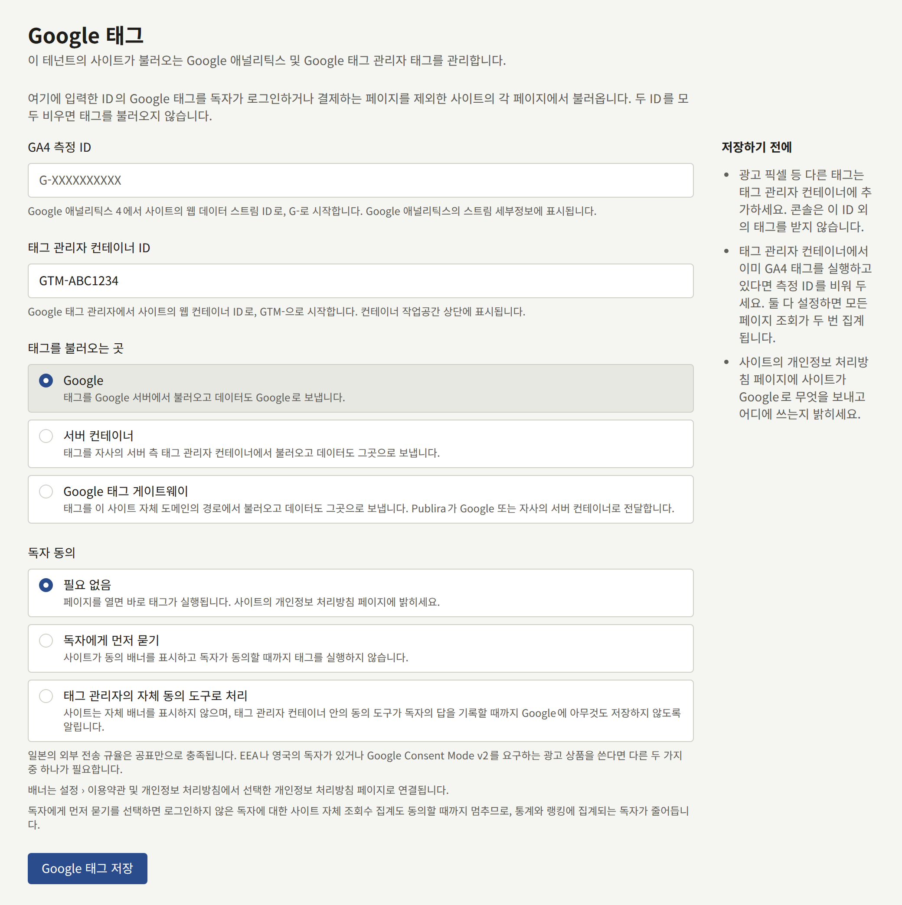
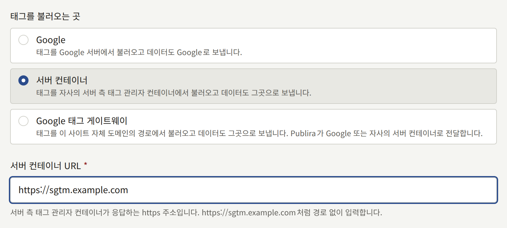
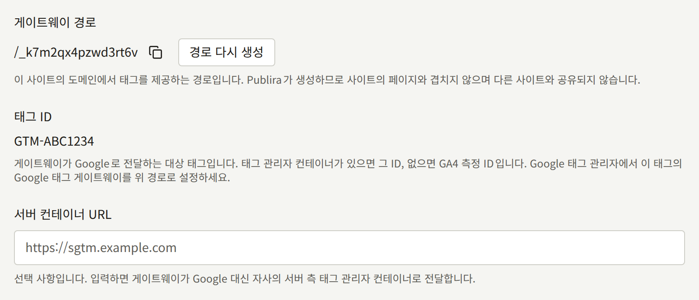
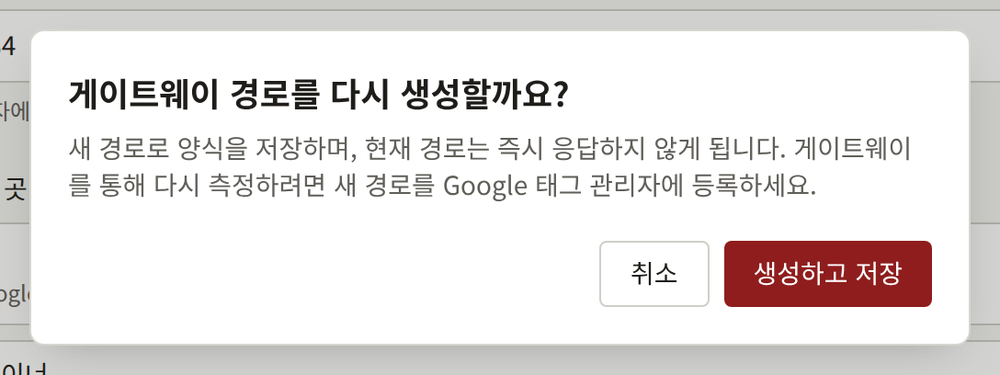
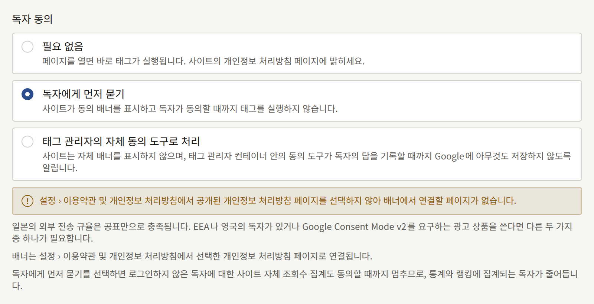

**연동** › **Google 태그**는 테넌트의 사이트가 Google 태그를 불러오게 합니다. 측정 ID를 입력하면 Google Analytics 4를, 컨테이너 ID를 입력하면 Google Tag Manager를, 또는 둘 다를 불러옵니다. 이 페이지는 테넌트 관리자에게 ID, 태그를 불러올 수 있는 세 곳, 각각에 대해 Google Analytics와 Google Tag Manager에서 설정해야 하는 것, 그리고 태그가 실행되기 전에 독자에게 물을지를 안내합니다.

**Google 태그**는 테넌트 관리자에게만 보이며, 저장한 변경은 모두 **감사 로그**에 **Google 태그 변경**으로 기록됩니다. 이 설정은 브라우저에서 보는 사이트에 적용됩니다. 테넌트의 앱은 Google 태그를 불러오지 않습니다.

## 시작하기 전에

- 출판사가 소유한 **사이트용 웹 데이터 스트림이 있는 Google Analytics 4 속성** 또는 **Google Tag Manager의 웹 컨테이너**. 아래에서 설명하듯 Google Analytics 이외의 모든 태그는 컨테이너에 둡니다.
- **태그를 다루는 개인정보 처리방침.** 태그는 자체 쿠키를 설정하고 수집한 내용을 Google로 보내며, 이는 사이트가 저장하는 것에 대한 Publira 자체 목록에 포함되지 않습니다. [페이지](./3-setup/3-pages.md#사이트가-독자의-브라우저에-저장하는-것)에서 설명하듯 태그를 적용하기 전에 이를 개인정보 처리방침에 적어 두세요.

## ID

- **GA4 측정 ID**: 사이트 웹 데이터 스트림의 ID로, `G-`로 시작합니다. Google Analytics의 **Admin** › **Data collection and modification** › **Data streams**에서 스트림의 세부 정보에 표시됩니다. `UA-`로 시작하는 Universal Analytics ID는 Google이 더 이상 데이터를 수집하지 않으므로 거부됩니다.
- **태그 관리자 컨테이너 ID**: 사이트 웹 컨테이너의 ID로, `GTM-`으로 시작합니다. Google Tag Manager에서 컨테이너 작업공간 상단에 표시됩니다.

사이트를 측정하는 데 쓰는 쪽을 입력합니다.

- Google Analytics를 컨테이너 안에서 설정했다면 **컨테이너만** 입력합니다. GA4 태그를 실행하는 컨테이너와 **GA4 측정 ID**를 함께 두면 모든 페이지 조회가 두 번 집계되며, **저장하기 전에**가 이를 경고합니다.
- 사이트에 컨테이너가 없다면 **측정 ID만** 입력합니다.
- **둘 다**는 광고 태그만 담은 컨테이너처럼 컨테이너가 GA4를 직접 실행하지 않을 때만 입력합니다.

콘솔은 이 두 ID 외에 자체 태그를 받지 않습니다. 광고 픽셀, 전환 태그 등 그 밖의 태그는 태그 관리자 컨테이너에 넣으며, 사이트는 그 컨테이너를 안의 내용과 함께 불러옵니다. 태그를 더 이상 불러오지 않으려면 두 ID를 모두 비우고 저장하세요.

사이트는 페이지를 다시 불러오지 않고 페이지 사이를 이동하므로, 첫 페이지 이후의 페이지 조회는 브라우저가 방문 기록에 남기는 변경을 바탕으로 집계됩니다. GA4의 향상된 측정은 GA4 태그를 사이트가 불러오든 컨테이너에서 실행하든 기본적으로 이를 집계합니다. 스트림에서 브라우저 방문 기록 이벤트 기반의 페이지 조회가 꺼져 있으면, 한 번의 방문에서는 첫 페이지만 집계됩니다.

## 태그를 불러오는 곳

**태그를 불러오는 곳**은 독자의 브라우저가 태그의 스크립트를 어디서 가져오는지, 그리고 태그가 수집한 내용을 어디로 보내는지를 정합니다.

| 모드 | 태그를 불러오는 곳 | 데이터를 보내는 곳 | 필요한 것 |
| --- | --- | --- | --- |
| **Google** | Google 서버 | Google | 추가로 필요한 것 없음 |
| **서버 컨테이너** | 테넌트의 서버 측 Tag Manager 컨테이너 | 서버 컨테이너 | **서버 컨테이너 URL**, 그리고 Tag Manager 컨테이너의 Google 태그에 설정한 서버 컨테이너 URL |
| **Google 태그 게이트웨이** | 사이트 자체 도메인의 경로 | 같은 경로. Publira가 Google 또는 서버 컨테이너로 전달합니다 | Google Tag Manager에서 게이트웨이 설정 |

**Google**이 기본값이며, ID 외에는 설정할 것이 없습니다.

### 서버 컨테이너

**서버 컨테이너**는 출판사가 운영하는 서버 측 Tag Manager 컨테이너에서 태그를 불러오며, 태그는 데이터를 Google이 아니라 그곳으로 보냅니다. 컨테이너는 Publira가 운영하지 않습니다.

**서버 컨테이너 URL**은 컨테이너가 응답하는 `https` 주소로, `https://sgtm.example.com`처럼 경로 없이 입력합니다. 도메인 이름이어야 하며 IP 주소는 거부됩니다. 사이트 자체 도메인의 하위 도메인에서 컨테이너를 제공하면 태그가 퍼스트 파티로 유지되며, 이는 Google이 [Map a custom domain](https://developers.google.com/tag-platform/tag-manager/server-side/custom-domain)에서 권장하는 구성입니다.

사이트는 그 주소에서, Google이 제공하는 경로 그대로 `gtm.js`와 `gtag.js`를 불러옵니다. 따라서 컨테이너는 Google의 [Load Google scripts first-party](https://developers.google.com/tag-platform/tag-manager/server-side/dependency-serving)가 태깅 서버에 대해 설명하듯 데이터를 받는 것뿐 아니라 Google의 스크립트도 제공해야 합니다. 스크립트를 제공하지 않는 컨테이너라면 사이트에서 태그가 불러와지지 않으며, 제공할 때까지 사이트는 아무것도 측정하지 않습니다.

데이터가 어디로 가는지는 어느 ID가 Google Analytics를 불러오는지에 따라 다릅니다.

- **GA4 측정 ID**: 사이트가 불러오는 GA4 태그에 데이터를 서버 컨테이너로 보내도록 알려 줍니다. 추가로 필요한 것은 없습니다.
- **태그 관리자 컨테이너 ID**: 사이트는 서버 컨테이너에서 컨테이너를 불러오지만, 그 안의 태그는 컨테이너가 지시하는 곳으로 데이터를 보내며, 이를 바꾸기 전까지는 Google입니다. Google의 [Send data to server-side Tag Manager](https://developers.google.com/tag-platform/tag-manager/server-side/send-data?option=GTM)에서 설명하듯 웹 컨테이너의 Google 태그에 `server_container_url`을 **서버 컨테이너 URL**로 설정하고 컨테이너를 게시하세요. 그전까지 사이트는 이전처럼 측정하며, 모든 히트가 Google로 직접 갑니다.

### Google 태그 게이트웨이

**Google 태그 게이트웨이**는 Google이 Google tag gateway for advertisers라고 부르는 것입니다. 태그는 사이트 자체 도메인의 경로에서 불러와지고 데이터도 그곳으로 보내며, Publira가 그곳에 도착한 것을 Google로 전달합니다. 보통은 사이트 소유자가 자신의 CDN이나 로드 밸런서에서 이를 설정합니다. Publira 사이트의 도메인은 Publira가 제공하므로 그 부분은 Publira가 맡으며, 남은 일은 Google Tag Manager에 경로를 알려 주는 것입니다.

- **게이트웨이 경로**는 태그를 제공하는 경로로, `/_k7m2qx4pzwd3rt6v`와 같은 형태입니다. 이 모드에서 양식을 처음 저장할 때 Publira가 생성하므로 사이트의 페이지와 겹치지 않으며 다른 사이트와 공유되지 않습니다. 테넌트가 다른 모드로 바꾸어도 유지되므로, 다시 돌아오면 이전과 같은 곳에서 태그가 제공됩니다.
- **태그 ID**는 게이트웨이가 Google로 전달하는 대상 태그입니다. **태그 관리자 컨테이너 ID**가 설정되어 있으면 그것이고, 그렇지 않으면 **GA4 측정 ID**입니다. 컨테이너는 그것이 실행하는 모든 태그를 포괄하므로, 둘 다 있는 사이트는 컨테이너에 대해 한 번만 설정합니다.
- **서버 컨테이너 URL**은 여기서는 선택 사항입니다. 입력하면 게이트웨이가 Google 대신 출판사의 서버 컨테이너로 전달합니다. 이 경우 Google의 [Load Google scripts first-party](https://developers.google.com/tag-platform/tag-manager/server-side/dependency-serving)에서 설명하듯 컨테이너가 게이트웨이 경로에 직접 응답해야 합니다. Publira는 그 이름이 공개 주소로 해석될 때만 연결하므로, 사설 네트워크에 있는 컨테이너에는 연결되지 않습니다.

Publira는 게이트웨이 경로로 온 요청을 경로와 쿼리를 포함해 받은 그대로 `https://<Tag ID>.fps.goog` 또는 서버 컨테이너로 전달합니다. 독자의 쿠키 중에서는 `_ga`, `_gcl_au`, `FPID` 같은 Google 자체의 측정 쿠키만 넘기고, 돌아오는 쿠키도 그것만 허용합니다. 독자의 사이트 로그인과 사이트의 다른 모든 쿠키는 Publira 밖으로 나가지 않습니다. 독자의 IP 주소는 Google의 게이트웨이가 기대하는 대로 전달됩니다. 독자의 국가와 지역은 설치 환경의 엣지가 이를 조회하는 경우에 전달되며, Google은 이를 지역별 보고와 지역별 동의 기본값에 사용합니다. 이를 조회하지 않는 엣지 뒤에서는 Google이 게이트웨이를 거친 사이트의 트래픽을 지역 없이 보고합니다. 어느 쪽인지는 설치 환경을 운영하는 사람에게 문의하세요.

#### Google Tag Manager에서 설정하기

1. **Google 태그 게이트웨이** 모드로 양식을 저장하고, 표시되는 **게이트웨이 경로**를 복사합니다.
2. 컨테이너라면 Google Tag Manager에서 컨테이너를 열고 **Admin** › **Google tag gateway**로 이동합니다. 컨테이너 없이 측정 ID만 쓴다면 대신 Google 태그의 설정을 엽니다. Google Analytics에서 **Admin** › **Data collection and modification** › **Data streams**, 사이트의 스트림, **Configure tag settings**를 차례로 연 뒤 **Admin** › **Google tag gateway**로 이동합니다.
3. **Continue**를 선택하고, **Scan your site**에 사이트의 주소를 입력합니다.
4. Publira는 Google이 대신 연결해 주는 CDN 중 어디에도 해당하지 않습니다. **More ways to set up**에서 **Guided**를 선택하고, 측정 경로로 **게이트웨이 경로**를 입력합니다. 이어지는 안내가 설명하는 경로에서 `fps.goog`로의 라우팅은 Publira가 이미 하고 있으므로, 직접 할 일은 없습니다.

Google의 [setup guide](https://developers.google.com/tag-platform/tag-manager/gateway/setup-guide)는 라우팅을 직접 하는 사이트를 위해 그 라우팅을 설명하며, Publira가 대신 하는 일을 보여 줍니다.

#### 작동하는지 확인하기

- **경로가 응답하는지.** 사이트의 도메인과 **게이트웨이 경로**로 `https://comics.example.com/<gateway path>/healthy`를 브라우저에서 엽니다. 게이트웨이가 Google에 연결되면 `ok`라고 표시됩니다. Google의 두 번째 확인인 `?validate_geo=healthy`는 앞에서 설명한 대로 독자의 국가와 지역을 조회하는 엣지 뒤에서만 `ok`라고 표시됩니다. 이를 조회하지 않는 엣지 뒤에서는 `ok`라고 표시되지 않으며, Google은 게이트웨이를 거친 트래픽을 지역 없이 보고합니다.
- **히트가 경로를 거치는지.** Tag Assistant에서 컨테이너를 미리 보기하고 사이트를 둘러봅니다. **Summary** › **Output** › **Hits Sent**에서 히트가 게이트웨이 경로로 보내지는지 확인합니다.
- **Google이 인식하는지.** Google Tag Manager의 **Google tag gateway** 화면에는 Google이 경로를 통해 데이터를 받기 전까지 사이트의 도메인이 **Pending**으로, 받은 뒤에는 **First-party**로 표시됩니다.

#### 새 경로 생성하기

**경로 다시 생성**은 **게이트웨이 경로**를 교체합니다. 새 경로로 양식을 저장하며, 현재 경로는 즉시 응답하지 않게 되므로, 새 경로를 Google Tag Manager에 대신 설정할 때까지 사이트는 게이트웨이를 통해 아무것도 측정하지 않습니다.

## 독자 동의

**독자 동의**는 태그가 실행되기 전에 사이트가 독자에게 물을지를 정합니다. 어디에서 읽든 사이트의 모든 독자에게 적용됩니다.

| 선택지 | 사이트의 동작 | 필요한 것 |
| --- | --- | --- |
| **필요 없음** | 페이지를 열면 바로 태그를 실행합니다 | 개인정보 처리방침 페이지에 태그를 밝히는 것 |
| **독자에게 먼저 묻기** | 동의 배너를 표시하고, 독자가 동의할 때까지 태그를 실행하지 않습니다 | 배너가 연결할 개인정보 처리방침 페이지 |
| **태그 관리자의 자체 동의 도구로 처리** | 자체 배너를 표시하지 않으며, 출판사의 동의 도구가 독자의 답을 기록할 때까지 Google에 아무것도 저장하지 않도록 알립니다 | **태그 관리자 컨테이너 ID**, 그리고 그 컨테이너 안의 동의 도구 |

**필요 없음**이 기본값입니다. 어느 것이 맞는지는 누가 사이트를 읽는지에 따라 다릅니다.

- **일본의 독자만 있는 경우**: 개인정보 처리방침 페이지에 태그를 밝히면 일본 전기통신사업법의 외부 전송 규율을 충족하므로 **필요 없음**으로 충분합니다.
- **EEA나 영국의 독자가 있는 경우**, 또는 **Google Consent Mode v2가 필요한 광고 제품을 쓰는 경우**: 나머지 두 가지 중 하나를 선택하세요. 둘 다 독자의 답에 따른 Google Consent Mode v2 신호를 보냅니다.

### 독자에게 먼저 묻기

독자가 처음 방문하면 창 하단에 배너가 표시됩니다. 배너는 사이트가 조회수를 집계한다는 것과 Google이 출판사를 위해 사이트를 측정한다는 것을 알리고, **동의**와 **동의 안 함**을 어느 쪽도 더 눈에 띄지 않게 나란히 제시합니다. 배너가 열려 있는 동안에도 페이지의 나머지 부분은 그대로 사용할 수 있으며, 독자가 **동의**를 선택하기 전까지 Google의 어떤 것도 불러오지 않습니다.

답은 [페이지](./3-setup/3-pages.md#사이트가-독자의-브라우저에-저장하는-것)에 나열된 쿠키로 독자의 브라우저에 6개월 동안 보관되며, 만료될 때까지 배너는 다시 표시되지 않습니다. 푸터 링크 끝에 있는 **쿠키 설정**을 선택하면 배너가 다시 표시되므로, 독자는 답을 바꿀 수 있습니다. 동의를 철회하면 Google에 더 이상 아무것도 저장하지 않도록 알리지만, Google의 태그가 이미 설정한 쿠키는 만료될 때까지 남으며, 배너가 이를 독자에게 알립니다. Global Privacy Control을 보내는 브라우저는 거부한 것으로 처리되어 배너도 **쿠키 설정**도 표시되지 않으며, 아무것도 저장되지 않습니다.

배너는 [설정 › 이용약관 및 개인정보 처리방침](./3-setup/1-settings.md#이용약관-및-개인정보-처리방침)에서 개인정보 처리방침으로 선택한 페이지로 연결됩니다. 그곳에서 공개된 페이지를 선택하지 않은 동안 **독자에게 먼저 묻기**를 선택하면, 양식은 배너가 연결할 페이지가 없다고 경고합니다. 공개된 페이지를 선택하면 경고가 사라지며, 어느 경우든 설정은 저장할 수 있습니다.

로그인하지 않은 독자가 동의하기 전까지는 사이트가 그 독자의 조회수도 집계하지 않습니다. 평소에는 [페이지](./3-setup/3-pages.md#사이트가-독자의-브라우저에-저장하는-것)에 나열된 로그인하지 않은 독자용 식별자로 집계합니다. 로그인한 독자의 조회수는 답에 관계없이 그 계정으로 집계됩니다. 그렇게 해도 독자의 브라우저에 새로 남는 것이 없기 때문입니다. 따라서 먼저 묻는 사이트의 통계와 랭킹은 묻지 않는 같은 사이트보다 적은 독자를 집계합니다.

### 태그 관리자의 자체 동의 도구로 처리

이 선택지는 이미 Tag Manager 컨테이너 안에서 동의 관리 플랫폼(CMP)을 태그로 운영하고 있는 출판사를 위한 것입니다. 사이트는 컨테이너를 불러오기 전에 모든 Consent Mode v2 신호를 `denied`로 설정하며, 컨테이너 안의 동의 도구가 자체 배너를 표시하고 독자의 답에 따라 신호를 갱신합니다.

동의 도구를 실행할 다른 곳이 없으므로 이 선택지는 **태그 관리자 컨테이너 ID**가 입력되어 있을 때만 제공되며, 입력되기 전까지 양식은 선택지 아래에 그 사실을 표시합니다. 이 선택지가 저장된 상태에서 컨테이너 ID를 지우는 것도 같은 방식으로 ID 옆에서 거부됩니다.

## 태그를 불러오지 않는 페이지

사이트는 독자가 비밀번호, 패스키 또는 메일의 링크를 입력하는 페이지를 제외한 모든 페이지에서 태그를 불러옵니다.

- **로그인** 페이지와 회원가입 페이지.
- 계정 관련 메일이 안내하는 단계: 이메일 주소 확인, 비밀번호 재설정, 확인 메일 재전송.
- **설정**과 그 아래의 모든 페이지.

결제는 결제 제공자의 결제 페이지에서 이루어지며, 그 페이지는 사이트의 태그를 하나도 불러오지 않습니다. 독자는 그곳에서 평소처럼 태그를 불러오는 사이트의 페이지로 돌아오므로, 구매는 돌아온 페이지에서 측정할 수 있습니다.

이 페이지들 중 어디에도 동의 배너는 표시되지 않습니다. 이 페이지 중 하나를 직접 열거나 새로 고치면 태그를 불러오지 않습니다. 독자가 사이트의 다른 페이지에서 이 페이지로 이동할 때 이미 실행 중인 태그는 계속 실행됩니다. 그 사이에 사이트가 페이지를 다시 불러오지 않기 때문입니다.

## 개인정보 처리방침에 적어야 할 것

**저장하기 전에**는 사이트의 개인정보 처리방침 페이지에 사이트가 Google로 무엇을 보내고 어디에 쓰는지 밝히도록 요청합니다. 태그는 Google의 쿠키를 설정하고 수집한 내용을 Google 또는 서버 컨테이너로 보내며, 컨테이너가 실행하는 모든 태그도 마찬가지입니다. [페이지](./3-setup/3-pages.md#사이트가-독자의-브라우저에-저장하는-것)에는 Publira 자체가 독자의 브라우저에 보관하는 것이 나열되어 있으며, 개인정보 처리방침은 그 목록에 더해 태그에 대해서도 Google의 문서와 컨테이너 안 각 태그의 문서를 바탕으로 다룹니다.

[독자 동의](#독자-동의)에서 어느 것을 선택하든 개인정보 처리방침에는 태그가 무엇을 보내는지 적습니다. 먼저 묻는 것은 태그가 언제 실행되는지를 정할 뿐, 무엇을 보내는지를 정하지 않습니다.

## 변경이 사이트에 반영되는 시점

사이트는 저장된 변경을 저장 직후 다음 페이지 로드에서 반영합니다. 다시 생성한 게이트웨이 경로의 이전 경로는 다음 요청부터 응답하지 않습니다.
