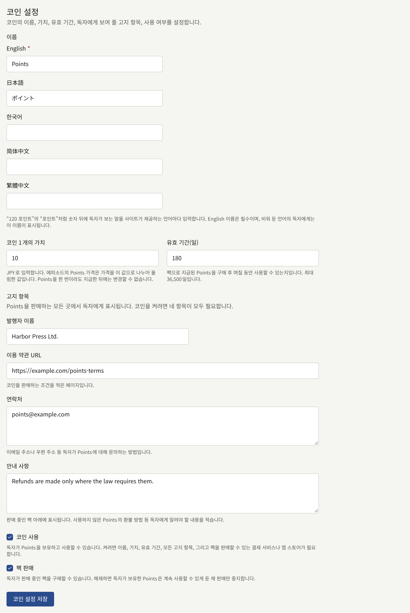
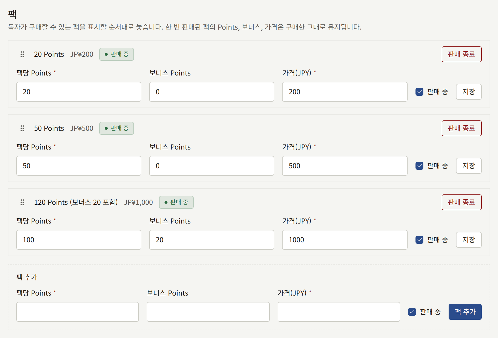
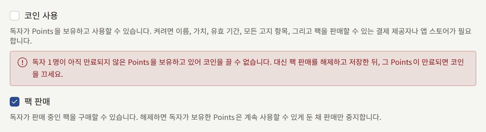

코인을 사용하면 독자가 에피소드 대금을 미리 지불할 수 있습니다. 독자는 테넌트의 코인 팩을 한 번 구매하고 에피소드마다 코인을 조금씩 사용하므로, 에피소드마다 결제 페이지를 거치지 않아도 됩니다. 코인은 테넌트가 발행하며, 이름을 붙이고, 테넌트의 통화로 코인 1개의 가치, 유효 기간, 판매할 팩을 정합니다. 코인을 켠 뒤 사이트와 앱에서 독자에게 무엇이 보이는지는 [에피소드 판매](./4-selling-episodes.md#코인으로-결제)에 있습니다.

**결제** › **코인**은 **테넌트 관리자**용입니다. 편집 담당이나 감사 담당에게는 이 화면이 보이지 않습니다.

## 시작하기 전에

코인은 선불 지급수단이며, 코인을 판매하는 테넌트가 그 발행자입니다. 테넌트와 독자가 있는 지역에 따라 선불 지급수단, 전자화폐, 송금, 상품권에 관한 법령이 적용될 수 있으며, 그러한 법령은 테넌트에게 신고, 보증금 예치, 미사용 잔액 환불, 또는 코인을 판매하는 곳에 특정 정보를 표시하도록 요구할 수 있습니다. 테넌트가 코인을 발행할 수 있는지, 무엇을 해야 하는지는 테넌트가 직접 확인해야 합니다. 화면은 스위치와 고지 항목 입력란을 제공할 뿐, 법령에 대해서는 그 이상 아무것도 말하지 않습니다.

먼저 두 가지가 갖추어져 있어야 합니다.

- **플랫폼이 테넌트의 코인 발행을 허용해야 합니다.** 새 설치 환경에서는 꺼져 있습니다. 꺼져 있는 동안에는 사이드바에 **코인**이 없으며, 주소로 화면을 열면 플랫폼이 테넌트의 코인 발행을 허용하지 않는다고 표시됩니다. 운영자가 [플랫폼 정책](../3-operations/9-platform-policies.md#테넌트가-발행하는-코인)에서 설명하는 대로 이를 켭니다.
- **팩을 판매할 수 있어야 합니다.** [에피소드 판매](./4-selling-episodes.md)에서 설명하듯 **결제** › **결제 방법**에서 결제 제공자가 **사용 가능**이거나 App Store 또는 Google Play가 **사용 가능**일 때만 코인을 켤 수 있습니다. 화면의 나머지 항목은 그전에 채워 둘 수 있습니다.

## 세 가지 상태

화면 상단에는 테넌트의 코인이 어떤 상태인지 표시됩니다.

| 상태 | 독자에게 보이는 것 |
| --- | --- |
| **꺼짐** | 코인에 관한 내용은 아무것도 보이지 않습니다. 모든 에피소드는 코인 없이 그대로 판매됩니다 |
| **켜짐, 판매 중** | 코인으로 매긴 에피소드 가격, 독자의 잔액, 판매 중인 팩 |
| **켜짐, 판매 중지** | 위와 같지만 팩을 구매할 수 없습니다. 독자는 보유한 코인을 계속 사용합니다 |

**코인 설정**의 **코인 사용**과 **팩 판매**로 테넌트의 상태를 바꿉니다. [중지하기](#중지하기)에서 설명하듯 테넌트는 **켜짐, 판매 중지**를 거쳐 코인을 끝냅니다. 코인을 끄면 독자가 대금을 지불한 코인이 사라지기 때문입니다.

## 코인 설정

- **이름**은 `120 Points`의 `Points`처럼 숫자 뒤에 독자가 보는 말로, 사이트가 제공하는 언어마다 입력합니다. 사이트 기본 언어의 이름은 필수이며, 이 이름 없이 저장하면 해당 입력란 아래에 거부 사유가 표시됩니다. 비워 둔 언어의 독자에게는 기본 언어의 이름이 표시됩니다. 이름을 저장하면 화면도 콘솔을 보고 있는 언어로 그 이름을 사용하므로, 팩 입력란은 **팩당 Points**와 **보너스 Points**가 됩니다.
- **코인 1개의 가치**는 테넌트의 통화로 나타낸 코인 1개의 가치로, 10엔이라면 `10`처럼 입력합니다. 에피소드의 코인 가격은 에피소드 가격(캠페인 판매 중이라면 캠페인 가격)을 이 값으로 나누어 올림한 값이므로, 300엔짜리 에피소드는 1개에 10엔인 코인 30개입니다. 별도의 가격표는 없습니다. 에피소드 가격을 바꾸면 코인 가격도 따라 바뀝니다. 어느 독자에게든 코인이 한 번이라도 지급되면 모든 잔액이 이 가치로 계산되므로 더 이상 변경할 수 없습니다.
- **유효 기간(일)**: 팩을 구매한 뒤 그 코인을 며칠 동안 사용할 수 있는지로, 최대 36,500일입니다. 사용하지 않고 만료된 코인은 사라지며, 독자의 이력에 그렇게 표시됩니다.
- **고지 항목**은 코인을 판매하는 모든 곳에서 팩 아래에 독자에게 표시됩니다. **발행자 이름**, **이용 약관 URL**(코인을 판매하는 조건을 적은 페이지), **연락처**(독자가 코인에 대해 문의하는 방법), **안내 사항**(미사용 코인의 환불 방법 등 독자에게 알려야 할 그 밖의 내용)입니다.

**코인 사용**은 코인을 켜며, 기본 언어의 이름, 가치, 유효 기간, 네 가지 고지 항목 모두, 그리고 팩을 판매할 방법이 필요합니다. 그중 하나라도 없이 저장하면 거부되며, 빠진 입력란이 각각 표시됩니다. **팩 판매**는 팩을 판매 상태로 만들며, 코인을 켠 채로 해제할 수 있습니다.

## 팩

**팩**에는 독자가 구매할 수 있는 팩이 사이트에 표시되는 순서대로 나열됩니다. 각 행에는 `120 Points (보너스 20 포함)`처럼 독자에게 보이는 팩의 모습과 함께 가격과 판매 중인지 여부가 표시됩니다.

- 목록 아래의 **팩 추가**에는 팩이 지급하는 코인, 그 위에 더해 주는 보너스 코인, 그리고 테넌트의 통화로 나타낸 가격을 입력하며, 가격은 0보다 커야 합니다. 새 팩은 목록 끝에 추가됩니다. 테넌트가 제공할 수 있는 팩은 최대 20개입니다.
- 팩의 입력란은 해당 행에서 편집하고 그 행의 **저장**으로 저장합니다. **판매 중**은 다른 팩에 영향을 주지 않고 팩 하나를 판매 중지하거나 다시 판매합니다.
- 팩이 한 번 판매되면 그 코인, 보너스, 가격은 그 팩을 구매한 독자가 지불한 그대로 유지됩니다. 그러면 행에는 이 값들이 텍스트로 표시되고 그 이유가 나오며, **판매 중**만 남습니다. 다른 팩을 판매하려면 새 팩을 추가하고 기존 팩의 판매를 종료하세요.
- **판매 종료**는 확인을 거쳐 팩의 판매를 영구히 종료합니다. 팩은 목록에서 빠지며, 독자는 그 팩으로 구매한 코인을 그대로 보유합니다.
- 순서는 행의 핸들을 드래그하거나 키보드로 바꿉니다. 핸들에 포커스를 두고 Space 키를 누른 뒤 화살표 키로 옮기고, 다시 Space 키를 누릅니다.

보너스는 테넌트가 제공하는 할인이며, 인세는 [리포트와 인세](./6-reports-and-royalties.md#작가가-받아야-할-금액)에서 설명하듯 코인을 구매한 금액을 기준으로 지급됩니다.

### 앱의 팩

테넌트의 앱이 App Store와 Google Play를 통해 판매하는 경우, 각 팩은 `coins_` 뒤에 팩의 id를 붙인 이름의 개별 스토어 상품으로 구매됩니다. **결제** › **결제 방법** 하단의 **스토어 상품**에는 에피소드 가격에 필요한 상품과 함께 모든 팩의 상품이 나열됩니다. [앱에서의 판매](./4-selling-episodes.md#앱에서의-판매)에서 에피소드에 대해 설명하는 것처럼, 각 상품을 팩의 가격으로 소모성 상품으로 만드세요.

## 중지하기

**팩 판매**를 해제하고 저장하면 사이트와 앱에서 모든 팩의 판매가 즉시 중지되며, 모든 독자는 보유한 코인을 계속 사용할 수 있습니다. 상태는 **켜짐, 판매 중지**가 됩니다.

만료되지 않은 코인을 보유한 독자가 있는 동안에는 **코인 사용**을 해제할 수 없습니다. 화면에는 그런 독자가 몇 명인지와 대신 판매를 중지하라는 안내가 표시됩니다. 그 코인이 모두 만료될 때까지, 즉 마지막 팩이 판매된 뒤 최대 **유효 기간(일)** 동안 기다린 다음 코인을 끄세요.

운영자가 테넌트의 코인을 더 이상 허용하지 않으면, 테넌트가 무엇을 저장했든 모든 테넌트의 코인이 즉시 멈춥니다. 아무것도 판매되거나 사용되지 않으며, 독자는 잔액을 그대로 유지합니다. 테넌트의 설정은 보존되며, 운영자가 코인을 다시 허용하면 다시 적용됩니다.

설정을 저장할 때마다, 그리고 팩을 추가하거나 변경하거나 판매 종료할 때마다 이를 수행한 테넌트 관리자와 함께 [감사 로그](./3-setup/8-audit-log.md)에 기록됩니다.
