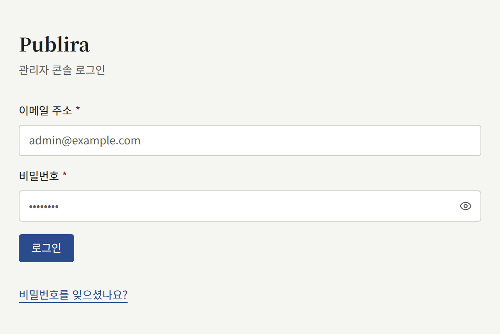
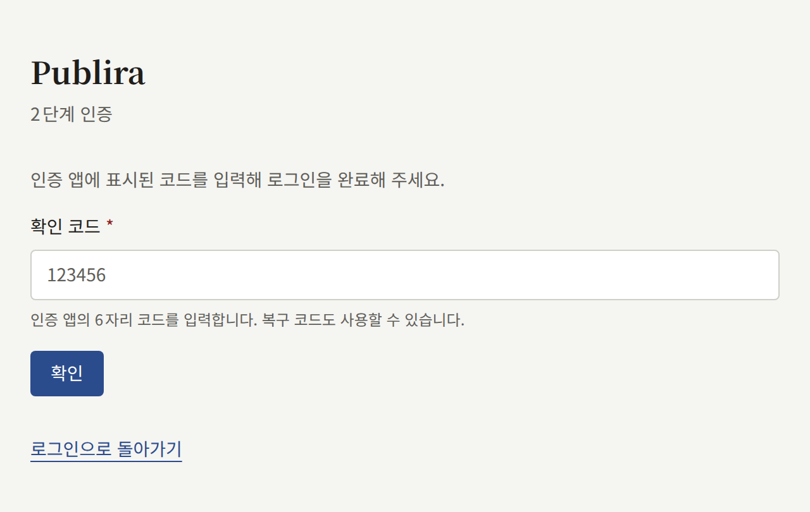
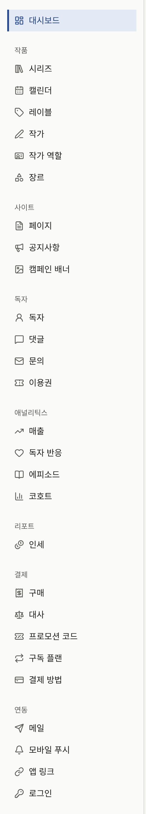

모든 테넌트에는 자체 콘솔이 있으며, 출판사의 스태프는 이곳에서 사이트의 작품과 독자, 사이트 설정을 관리합니다. 이 섹션의 페이지는 그런 스태프를 위한 것입니다. 테넌트가 이미 존재하고, 여러분이 그 테넌트에 대한 접근 권한을 받았다는 것을 전제로 합니다. 운영자 쪽에서 본 내용은 [테넌트의 스태프](../3-operations/3-tenant-staff.md)에서 설명합니다.

## 로그인

콘솔은 테넌트의 콘솔 호스트에서 제공됩니다. 운영자가 다른 호스트를 지정하지 않았다면, 콘솔 호스트는 공개 사이트의 도메인 앞에 `admin.`을 붙인 것입니다. 예를 들어 사이트가 `comics.example.com`에 있다면 콘솔은 `admin.comics.example.com`에 있습니다. 그곳에서 계정의 이메일 주소와 비밀번호로 로그인하세요. 같은 화면에서 **비밀번호를 잊으셨나요?** 링크를 선택하면 새 비밀번호를 설정하는 링크가 메일로 전송됩니다.

계정에 2단계 인증이 켜져 있으면, 콘솔은 이어서 인증 앱의 코드를 요구합니다. 운영자는 설치 환경의 모든 테넌트 관리자에게 2단계 인증을 의무화할 수 있으며, 이 경우 아직 인증 앱을 등록하지 않은 테넌트 관리자는 다음으로 진행하기 전에 인증 앱을 등록하라는 요청을 받습니다. 2단계 인증을 켜는 방법과 휴대폰을 잃어버렸을 때 해야 할 일은 [내 계정](./3-setup/9-your-account.md)에서 다룹니다.

콘솔 계정은 테넌트 사이트의 계정이기도 합니다. 같은 이메일 주소와 비밀번호로 사이트에서 작품을 읽고 구매할 수 있으며, 콘솔은 여러분의 역할이 그 계정에 더해 주는 기능일 뿐입니다.

## 역할

스태프의 각 구성원은 세 가지 역할 중 하나를 가지며, 콘솔은 각자에게 사용할 수 있는 부분만 보여 줍니다.

| 역할 | 할 수 있는 일 |
| --- | --- |
| **테넌트 관리자** | 콘솔의 모든 것: 스태프, 테넌트의 모든 설정, 메일·결제·푸시 알림·로그인·Google 태그, 그리고 API 키와 웹훅을 통한 자체 시스템과의 연동, 독자의 계정, 구매와 그 환불, 결제 제공자와의 대사, 구독 플랜, 코인, 인세, 감사 로그 |
| **편집 담당** | 카탈로그와 사이트의 페이지, 공지, 캠페인 배너 작성, 그리고 댓글 관리 |
| **감사 담당** | 편집 담당이 작업하는 내용과 테넌트의 설정을 변경하지 않고 열람 |

테넌트 관리자는 **멤버**에서 다른 스태프에게 역할을 부여합니다. 역할에 대한 자세한 설명은 [테넌트의 스태프](../3-operations/3-tenant-staff.md#세-가지-역할)에 있습니다.

## 이 섹션의 내용

- [작품 공개하기](./1-catalog/index.md): 비어 있는 카탈로그에서 시작해 독자가 열 수 있는 첫 에피소드까지, 그리고 그것을 이루는 시리즈, 에피소드, 레이블, 작가, 작가 역할, 장르.
- [독자, 댓글, 문의](./2-readers/index.md): 독자 계정의 정지와 삭제, 댓글 승인 대기열과 신고 대기열 처리, 문의에 대한 답변, 이용권으로 유료 에피소드를 독자에게 열어 주기.
- [테넌트 설정하기](./3-setup/index.md): 새 테넌트를 출판사다운 디자인과 법적 고지 페이지, 스태프를 갖춘 사이트로 만들기까지. 설정, 브랜딩, 페이지, 공지, 캠페인 배너, 멤버, 메일 서버, 감사 로그, 내 계정.
- [에피소드 판매](./4-selling-episodes.md): 에피소드의 가격 설정, Stripe 또는 PAY.JP를 통한 결제, 에피소드를 판매하는 곳, 인앱 결제, 환불, 서비스 시작 전 설정 테스트.
- [구독 플랜](./5-subscription-plans.md): Stripe를 통해 기간마다 청구되며 카탈로그 전체나 일부 레이블, 일부 시리즈를 열어 주는 플랜을 독자에게 판매하기, Stripe에 필요한 Price와 웹훅 이벤트, 구독자가 사이트에서 하는 일.
- [리포트와 인세](./6-reports-and-royalties.md): 대시보드와 애널리틱스 화면이 집계하는 내용, 각 작가의 인세 계산 방법, 월을 마감해 명세서로 만들기, CSV로 내보내기.
- [Apple 및 Google로 로그인](./7-sign-in.md): 독자가 Apple 또는 Google 계정으로 사이트와 앱에 로그인할 수 있게 하기, 이를 위해 Apple과 Google의 콘솔에서 만들어야 할 것.
- [Google 태그](./8-google-tag.md): Google Analytics 또는 Google Tag Manager로 사이트 측정하기, 태그를 불러올 수 있는 세 곳, 게이트웨이를 위해 Google Tag Manager에서 설정할 것.
- [코인](./9-coins.md): 독자가 미리 구매하는 코인의 이름 정하기, 코인에 따르는 표시 사항, 코인을 판매하는 팩, 코인을 켜고, 판매를 멈추고, 끄기.
- [API 키와 웹훅](./10-api-keys-and-webhooks.md): 테넌트 자체 시스템에 관리 API용 읽기 전용 키 주기, 판매·환불·가입·구독에 대한 서명된 이벤트 보내기, 서명 검증하기, 포기된 전송 다시 보내기.

Publira가 무엇인지 아직 읽지 않았다면 [시작하기](../1-getting-started.md)부터 읽으세요.
