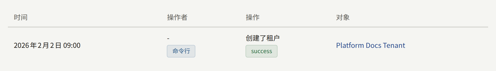
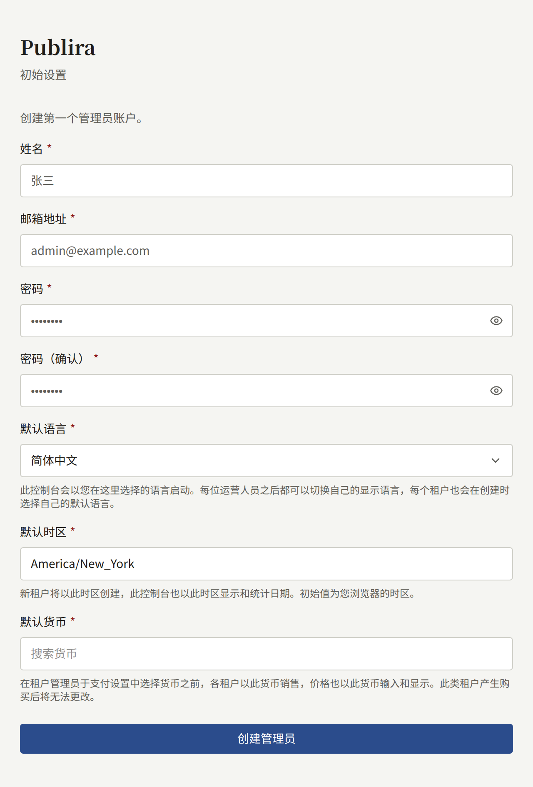
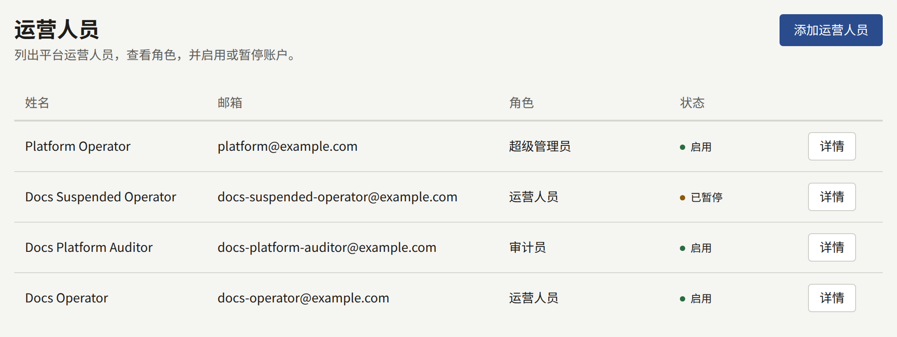
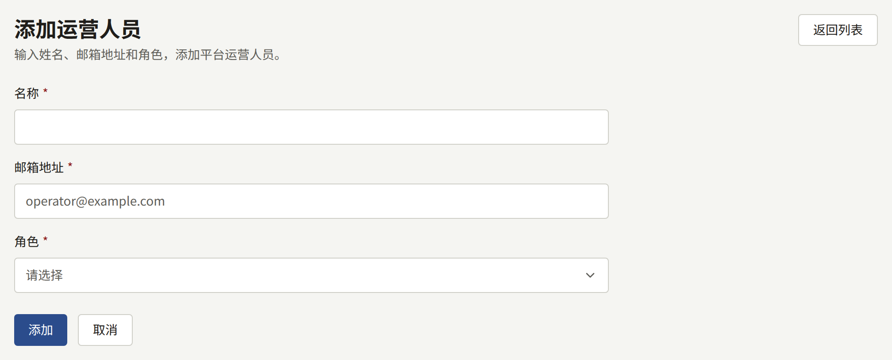
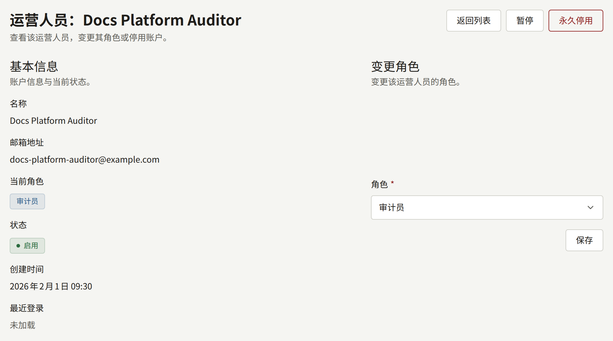
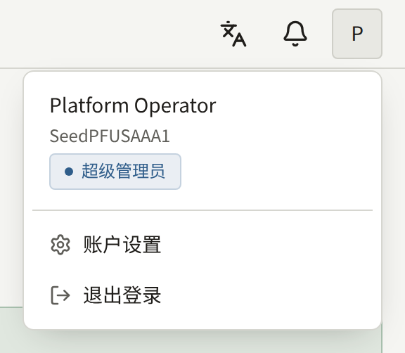
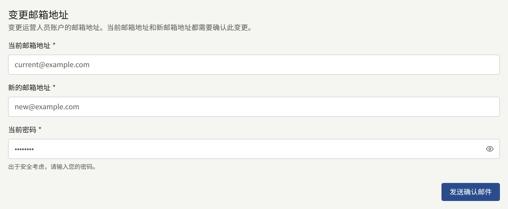
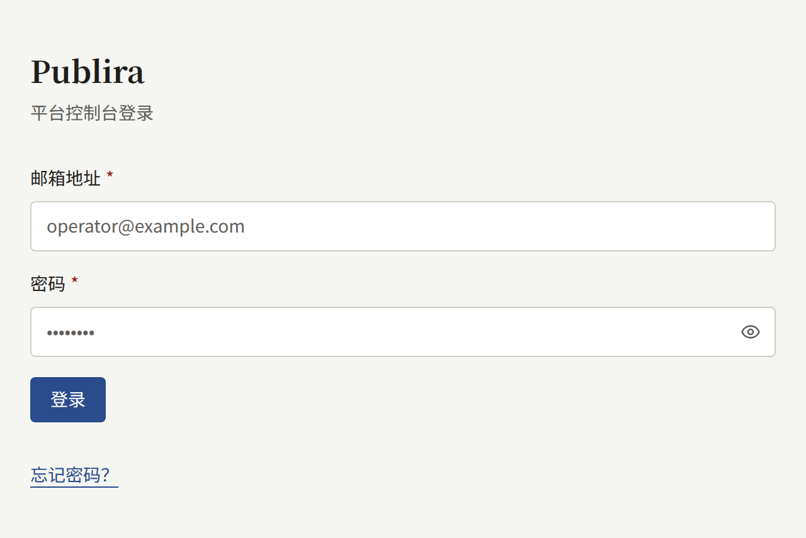

安装实例可以从两个地方之一进行管理，大多数任务两者都能完成。本页说明两者的区别、平台控制台如何获得第一个运营人员，以及之后如何添加运营人员并为其分配角色。

## 在两者之间进行选择

`publiractl`是一条命令，您可以像[安装](../2-deployments/2-installing.md)中那样使用安装实例所运行版本的镜像来运行它，在[Docker Compose](../2-deployments/3-docker-compose.md)安装实例上则用`docker compose run --rm publiractl`运行。它以`publira_platform`身份直接连接数据库，因此在不运行平台控制台的安装实例上也能使用，而且除了这个连接之外不需要任何东西：不需要账户、不需要浏览器，也不需要运行其他进程。

平台控制台是`web-platform`，一个供运营人员登录的Web应用。它有自己的账户，每个账户都有一个角色，因此您可以让某人查看所有租户而不允许其更改任何内容，而且它会记录每项更改是由哪个运营人员做出的。

两者都通过相同的代码写入，因此从一方创建的租户与从另一方创建的租户完全相同，您也可以在同一个安装实例上同时使用两者。不同之处在于各自提供的任务：

| 任务                               | `publiractl` | 平台控制台 |
| ---------------------------------- | ------------ | ---------- |
| 创建、更改和暂停租户               | 是           | 是         |
| 租户的成员和管理员邀请             | 是           | 是         |
| 使用密码创建控制台账户，不发送邮件 | 是           | 否         |
| 平台运营人员                       | 否           | 是         |
| 移除运营人员丢失的两步验证         | 是           | 否         |
| 平台的默认值、策略和保留期限       | 是           | 是         |
| 所有租户的读者                     | 否           | 是         |
| 查看审计日志                       | 否           | 是         |
| 运行维护任务                       | 是           | 否         |

两者中任何一方对租户或其工作人员所做的每项更改，都会记录在平台控制台的**审计日志**中。从`publiractl`做出的更改在那里不会写明运营人员：其操作者为**命令行**。



如果您不运行平台控制台，仅用`publiractl`就足以运行安装实例。您放弃的是查看审计日志，以及跨租户处理读者的账户；每个租户的管理员仍然可以在租户控制台中管理自己的读者。

## 第一个运营人员

按照[安装](../2-deployments/2-installing.md#使用web-platform提供平台控制台)中的说明运行`web-platform`并打开它。在它拥有运营人员之前，其中的每个地址都会进入**初始设置**页面，该页面要求填写：

- **姓名**、**邮箱地址**和**密码**，以及**密码（确认）**：第一个运营人员的账户。
- **默认语言**：平台控制台启动时使用的语言。它也会成为平台的默认语言，取代`publiractl setup`保存的语言。每个运营人员之后都可以切换自己看到的语言，每个租户在创建时也会选择自己的语言。
- **默认时区**：在创建时未指定时区的租户所使用的时区，也是平台控制台显示和计算日期所用的时区。它的初始值是您浏览器的时区，保持不变就会保存该时区，取代`publiractl setup`保存的时区；要选择其他时区，请搜索地区或城市。已经存在的租户保留它们自己的时区。
- **默认货币**：每个租户在其管理员保存自己的**支付设置**之前用于销售的货币。它的初始值是`publiractl setup`保存的货币，因此保持不变就会保留该货币；要查找其他货币，请输入名称或ISO 4217代码，例如`EUR`。一旦以该货币销售的某个租户产生了购买，该字段就会变为只读并加以说明，因为该租户的价格是以这种货币表示的金额。如果无法读取已保存的货币，该字段也会变为只读并加以说明，初始设置会保持货币不变；之后请在**常规设置**中更改它。[平台默认值](./9-platform-policies.md#平台默认值)说明了货币会影响到哪些方面。



**创建管理员**会创建具有**超级管理员**角色的账户，并把您带到登录页面。从那以后，设置页面就不再出现：不会有第二个“第一个运营人员”，`publiractl`中也没有任何命令可以创建运营人员。之后的每个运营人员都由超级管理员从**运营人员**中添加。

平台控制台的账户是它自己的。`publiractl setup`创建的租户管理员无法登录平台控制台，运营人员也无法用其运营人员账户登录租户的控制台。

## 运营人员的角色

每个运营人员拥有以下三种角色之一：

| 角色 | 可以做什么 |
| --- | --- |
| **审计员** | 查看所有内容：仪表盘、租户及其成员、用户、审计日志以及平台的设置。除了自己的账户之外不能更改任何内容 |
| **运营人员** | 审计员可以做的一切，以及更改租户、其成员和邀请、读者的账户，以及平台的设置和服务 |
| **超级管理员** | 运营人员可以做的一切，以及添加运营人员、更改他们的角色、暂停或永久停用他们 |

平台控制台向审计员显示与运营人员相同的页面和表单，并在提交时拒绝更改。完整的表格见[`publira server`参考](https://github.com/publira/publira/blob/main/server/cmd/publira/README.md#platform-console-role-permissions)。

## 管理运营人员

侧边栏**治理**下的**运营人员**列出每个运营人员及其角色和状态。只有超级管理员才能在那里更改任何内容。



### 添加运营人员

**添加运营人员**要求填写运营人员的**名称**、**邮箱地址**和**角色**，并立即创建账户。新的运营人员会收到一封邮件，其中的链接用于设置账户的第一个密码，设置之后即可用该密码登录。该链接在24小时内有效；超过之后，可以在登录页面选择“**忘记密码？**”获取新的链接。这封邮件与平台控制台发送的每封邮件一样，由`publira worker`使用平台保存的SMTP设置、以平台的默认语言发送。

如果该地址已经有一个不具有任何角色的平台控制台账户，则会为该账户分配角色，而不是创建新账户。它保留原有的密码，因此发给它的邮件不带密码链接，只告知它现在可以登录了。



已经属于某个运营人员的地址（包括已永久停用的运营人员）无法再次添加。

### 更改运营人员的角色

从**运营人员**中打开该运营人员，在**变更角色**下选择新的角色。任何人都不能更改自己的角色，因此超级管理员永远无法将自己降级，安装实例也始终会保留正在操作的那名超级管理员。



### 暂停和永久停用

在同一页面上：

- **暂停**会阻止该运营人员登录，并结束其已打开的会话。**重新启用**让其可以再次登录。
- **永久停用**会永久结束该账户。已永久停用的账户再也无法使用，其地址也无法作为新的运营人员添加；它所做的更改会以其名义保留在审计日志中。

两者都不能对您自己的账户执行。

## 运营人员自己的账户

控制台页眉的账户菜单中的**账户设置**用于更改您的邮箱地址。确认链接会同时发送到当前地址和新地址，两个链接都被打开后更改才会生效。





### 两步验证

同一页面上的**两步验证**会在您每次登录时，在输入密码之后要求输入身份验证器应用中的代码。**开始设置**会显示一个供应用扫描的二维码，并为无法扫描的应用以文本形式显示同一个密钥；输入应用随后显示的六位代码，然后选择**启用两步验证**。之后页面会显示十个恢复码，只显示一次：请把它们保存在安全的地方，并与手机分开。在无法使用身份验证器时，每个恢复码都可以在登录要求输入代码的任何地方让您登录一次。


从那以后，登录会在输入密码之后停在**两步验证**处并要求输入代码。使用恢复码登录时会显示还剩多少个。开启期间，同一张卡片上有两个表单：

- **重新生成恢复码**会用十个新的恢复码替换您持有的所有恢复码，无论是否已使用。它需要身份验证器中的代码，而不是恢复码。
- **关闭两步验证**需要身份验证器中的代码或一个恢复码。您可以随时重新设置，如果有新的身份验证器也可以使用新的。

平台可以要求所有运营人员都使用两步验证，详见[安全](./12-security/2-two-step-verification.md#平台运营人员)。这样您在下次登录时会被要求进行设置，设置完成后登录才会完成。

没有可以在登录状态下更改密码的表单。请退出登录，在登录页面选择**忘记密码？**，然后通过邮件中的链接设置新密码；该链接在24小时内有效。



### 丢失两步验证

开启了两步验证、之后又同时丢失了身份验证器和所有恢复码的运营人员无法登录平台控制台，其他运营人员也无法在那里从其账户中移除两步验证。请用`publiractl`移除它：

```bash
publiractl operator reset-mfa --email operator@example.com
```

可以用`--user <public ID>`代替`--email`来指定账户。该命令会移除账户的身份验证器和所有恢复码，不做其他任何事：它的密码、角色和状态都保持不变。之后该运营人员只用密码登录，并从**账户设置**重新设置两步验证。如果平台要求所有运营人员都使用两步验证，登录会在完成之前要求其进行设置。

当丢失两步验证的运营人员是安装实例唯一的**超级管理员**时，这也是重新进入的方法，因为运行`publiractl`不需要账户。

移除两步验证后，账户就只受密码保护，而这正是持有被盗密码的人会提出的请求。在运行该命令之前，请通过您已经知道属于该运营人员的渠道（而不是请求到达的那个渠道）确认请求确实来自该运营人员。

这次移除会记录在平台控制台的**审计日志**中，操作者为**命令行**。
