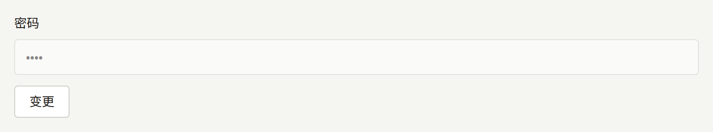
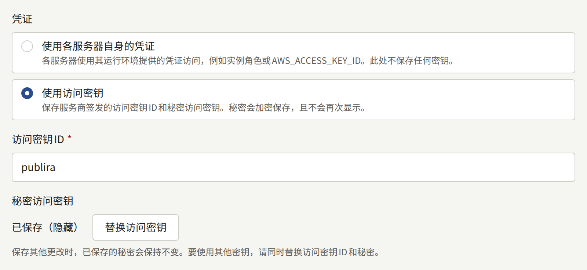

这些步骤用于替换[每个密钥可以放在哪里](./index.md#每个密钥可以放在哪里)中列出的每个密钥。请在需要之前就读一遍——每个步骤在平静的日子里执行都比在事故中执行容易。

首次生成密钥是[安装](../../2-deployments/2-installing.md#生成密钥)的一部分，妥善保管密钥则是[备份与恢复](../../2-deployments/9-backup-and-restore.md#密钥加密密钥)的一部分。

## 轮换密钥加密密钥

安装实例保存的每个凭据都用加密密钥加密，每个加密后的值都注明了加密它的密钥。`PUBLIRA_SECRET_ENCRYPTION_KEYS`列出进程可以用来解密值的所有密钥，`PUBLIRA_SECRET_ENCRYPTION_PRIMARY_KEY_ID`指定用来加密新值的密钥。轮换就是添加一个密钥、用它加密，并将已保存的值迁移到它上面；如果某个值的密钥已不在列表中，就完全无法解密。

### 1. 添加新密钥

生成一个密钥，并为它指定一个列表中尚未使用的ID，例如`k2`。将它添加到旧密钥旁边，主密钥保持不变：

```text
PUBLIRA_SECRET_ENCRYPTION_KEYS=k1:<old key>,k2:<new key>
PUBLIRA_SECRET_ENCRYPTION_PRIMARY_KEY_ID=k1
```

以此设置重启`publira server`和`publira worker`，之后的每个`publiractl`命令也都使用它。请立即将新密钥保存到您的密钥存储中并与备份放在一起：从下一步开始，值就会用它加密。

### 2. 将其设为主密钥

所有进程都以两个密钥运行后，将主密钥改为`k2`，再次重启它们。此后保存的每个值都用`k2`加密，而用`k1`加密的每个值仍然可以解密。

两次重启是有意分开的。尚未拥有`k2`的进程无法解密其他进程已经用它加密的值，因此当`publira server`或`publira worker`运行多个实例，或者逐个重启时，如果在同一步中切换主密钥，就会出现一段邮件发送失败或登录被拒绝的时间窗口。

在[Docker Compose](../../2-deployments/3-docker-compose.md)安装实例上，每一步都是编辑`.env`中的这两个变量，然后运行`docker compose up -d`，它会重启`server`以及随之运行的worker进程，其余部分继续运行。

### 3. 重新加密已保存的值

使用管理登录名的连接，并带上进程现在使用的这两个变量，运行`publiractl db reseal`：

```bash
publiractl db reseal
```

它会用列表中的密钥解密数据库中每个加密的值，并将注明了主密钥以外密钥的每个值用主密钥重新加密：平台和每个租户的凭据、每位工作人员和运营人员的两步验证密钥、每个“通过Apple登录”关联所持有的令牌、Web Push私钥，以及发件箱条目携带给worker进程的值。值本身保持不变，因此没有人会被退出登录，也没有人需要重新输入任何内容；运行期间安装实例照常提供服务：期间到达的保存操作会等待它完成，或者它等待保存完成，两者都不会丢失。

它会为已保存的值所注明的每个密钥ID输出一行：

```text
KEY ID        RESEALED  ON PRIMARY  UNREADABLE
k1            42        0           0
k2 (primary)  0         3           0
```

`RESEALED`统计该密钥曾加密、现在由主密钥加密的值，`ON PRIMARY`统计已经由主密钥加密的值，`UNREADABLE`统计列表中没有任何密钥能解密的值。要在不写入任何内容的情况下查看同样的表格，请运行`publiractl db reseal --dry-run`。

在[Docker Compose](../../2-deployments/3-docker-compose.md)安装实例上，`publiractl`服务已经带有管理连接和`.env`中的密钥：

```bash
docker compose run --rm publiractl db reseal
```

### 4. 只有在没有任何值使用旧密钥时才将其删除

只有在`db reseal`以`0`退出，并且`UNREADABLE`列中没有剩余的值时，才从列表中删除`k1`。此时再次运行它，只会为主密钥输出一行，它统计的每个值都无需`k1`即可解密。

当列表中没有任何密钥能解密某个值时，`db reseal`会保持该值原样，重新加密其他所有值，并以`1`退出。其日志会注明每个这样的值，包括其列、行以及它注明的密钥ID，表格也会将其计入该密钥ID之下。这个值是用一个已不在列表中的密钥加密的，或者是用同一ID下的其他密钥材料加密的：请将该密钥放回列表中，然后再次运行命令。如果已经没有人持有某个值的密钥，就必须像丢失密钥时那样，在保存它的地方重新输入。

密钥已不存在的值无法解密：如果在租户管理员的身份验证器密钥仍用`k1`加密时删除了`k1`，该管理员的登录会在两步验证步骤失败并显示错误页面，服务器会记录`secretcrypto: unknown key id: k1`，租户的审计日志会记录一次失败的**登录时的两步验证**，原因为`secret_undecryptable`。需要使用以缺失密钥加密的密码的邮件也不会发送。将该密钥放回列表并重启，就能恢复这一切。

当密钥已经泄露时，仅重新加密是不够的。持有旧密钥以及轮换之前任何数据库备份的人，都能打开该备份中的每个值，因此请在签发凭据的地方替换凭据本身——新的SMTP密码、新的存储桶访问密钥、新的支付服务商密钥——并保存新凭据。在平台控制台中，新的SMTP密码通过**邮件**下**密码**旁的**变更**输入，新的访问密钥通过**存储**下的**替换访问密钥**输入，详见[邮件](../6-email.md#更改账户)和[对象存储](../5-object-storage.md#轮换访问密钥)。





## 轮换数据库角色的密码

一个角色同一时间只有一个密码，因此轮换就是在PostgreSQL中更改密码，然后立即重启以该角色连接的每个进程：

| 角色 | 连接方 |
| --- | --- |
| `publira_public`、`publira_admin` | `publira server` |
| `publira_platform` | `publira server`，以及更改平台设置的`publiractl`命令 |
| `publira_outbox`、`publira_ticker` | `publira worker` |
| `publira_content_stats` | `publira worker`和`publiractl job` |

1. 使用`openssl rand -hex 32`生成新密码。连接URL中直接携带密码而不转义，这就是使用十六进制的原因。
2. 使用管理登录名的连接，只带上该角色的选项运行`publiractl db roles`。其他所有角色都保留原来的密码：

   ```bash
   publiractl db roles --admin-password-file /run/secrets/publira-admin-db-password
   ```

   它会为每个角色输出一行，您指定的角色为`set its password`，其他角色为`kept its password`。

3. 将上表中每个进程的连接URL改为新密码，然后重启它们。

进程已经打开的连接仍保持登录状态，因此密码更改的那一刻不会有任何失败。但此后它打开的任何连接都会被拒绝，因此不要在这两步之间留下间隔。以旧密码重启的进程根本无法启动：其日志会反复出现`password authentication failed for user "publira_admin"`；它重新运行后，其`GET /readyz`会为每个角色列出一项检查，因此不匹配的情况会在那里显示出来。以进程所持有的密码再次运行`db roles`即可纠正。

要一次轮换所有角色，请为`db roles`提供全部六个选项，然后重启`publira server`和`publira worker`。

在Docker Compose安装实例上，密码是`.env`中的`PUBLIRA_*_DB_PASSWORD`变量，Compose文件会据此构建每个连接URL。更改变量后：

```bash
docker compose run --rm publiractl db roles --admin-password-file /run/secrets/admin-db-password
docker compose up -d
```

`docker compose up -d`只会重启连接URL发生变化的进程。

### 管理登录名的密码

`publiractl`不管理管理登录名。请在PostgreSQL中更改其密码，可以在`psql`中执行`ALTER ROLE postgres PASSWORD '<new password>'`，也可以通过数据库服务商更改，然后更改运行`db`命令时所用的`PUBLIRA_DB_URL`。没有任何长期运行的进程使用它，因此不需要重启任何东西。

在Docker Compose安装实例上，PostgreSQL只在创建其卷时读取`PUBLIRA_POSTGRES_PASSWORD`，因此只更改`.env`不会改变任何东西。请使用`docker compose exec postgres psql -U postgres -d publira`运行`ALTER ROLE`，然后在`.env`中设置相同的值。下一次`docker compose up -d`会因为`postgres`容器的变量发生了变化而重启它，这会使所有进程中断几秒钟。

## 轮换签名密钥和令牌

这些值在进程启动时读取。轮换其中一个，就是将新值交给持有它的每个进程并同时重启它们；它们都不保存在数据库中，替换后也都无需保留。

| 值 | 更改位置 | 更改的影响 |
| --- | --- | --- |
| `PUBLIRA_AUTH_JWT_SECRET` | `publira server` | 让所有人退出登录：每个租户网站及其移动应用中的读者、每个租户控制台中的工作人员，以及平台控制台中的运营人员 |
| 某个Web应用的`PUBLIRA_AUTH_SECRET` | 该Web应用 | 只让该应用的用户退出登录 |
| 缓存重新验证令牌 | `publira server`、`publira worker`以及每个Web应用 | 不会让任何人退出登录 |
| Web服务令牌 | `publira server`、`web-admin`和`web-platform` | 不会让任何人退出登录 |

在Docker Compose安装实例上，这些变量是`.env`中的`PUBLIRA_AUTH_JWT_SECRET`、`PUBLIRA_WEB_STOREFRONT_AUTH_SECRET`、`PUBLIRA_WEB_ADMIN_AUTH_SECRET`、`PUBLIRA_WEB_PLATFORM_AUTH_SECRET`、`PUBLIRA_REVALIDATE_TOKEN`和`PUBLIRA_WEB_SERVICE_TOKEN`。更改其中一个后，`docker compose up -d`会恰好重启读取它的那些进程。

### 访问令牌签名密钥

每个会话都是用这个密钥签名的访问令牌，因此新的密钥会一次性终止所有会话。打开页面的读者或工作人员会被带到登录页面，并看到“您的会话已过期。请重新登录。”租户移动应用的会话也是同一种令牌，因此同样会终止。正在进行两步验证登录的工作人员需要从输入密码重新开始。

章节图片的链接带有一个用同一密钥签名的短期令牌。租户的网站会将免费章节的页面连同链接最多缓存一小时，因此在该页面重新生成之前，免费章节的图片可能无法加载。

只要它可能已经泄露，或者某个会话密钥可能已经泄露，就请轮换它：会话Cookie携带的访问令牌在一天内有效，只有新的签名密钥才能让它提前失效。

### Web应用的会话密钥

每个Web应用都用自己的`PUBLIRA_AUTH_SECRET`加密其会话Cookie。新的密钥会让它加密的每个Cookie都无法读取，因此其用户会被带到登录页面，不显示任何消息，而其他应用的会话保持不变。轮换`web-storefront`的密钥会让读者退出网站的登录，但不会退出移动应用的登录，并会取消正在进行的“通过Apple或Google登录”；轮换`web-admin`的密钥还会取消正在进行的两步验证登录。

该值必须至少为32字节，并且只使用其前32字节，因此请使用`openssl rand -base64 32`生成一个全新的值，而不是修改旧值的末尾。

### 缓存重新验证令牌

`publira server`和`publira worker`在每个丢弃Web应用缓存页面的请求中都会发送它，每个Web应用都会拒绝令牌与自身不一致的请求。在两边不一致期间，每次丢弃都会以`401`被拒绝，worker进程会将每次尝试记录为`outbox event retry scheduled`，并带有`revalidate endpoint returned status=401`。worker进程会对每次丢弃持续尝试约九分钟，因此只要在这段时间内以新令牌重启所有进程，就不会丢失任何内容；用完尝试次数的丢弃操作会让其指定的页面保持原样，详见[定时任务与维护任务](../10-scheduled-jobs.md#查看被放弃的内容)。

### Web服务令牌

`web-admin`和`web-platform`在读取对其所有工作人员都相同的内容时发送它。当`publira server`持有不同的令牌时，这些读取会被拒绝，两个控制台都会在仪表盘上显示“会话已失效。请重新登录。”重新登录也无济于事：请以相同的令牌重启这三者。
