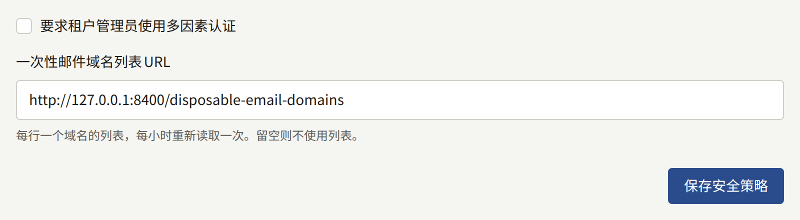
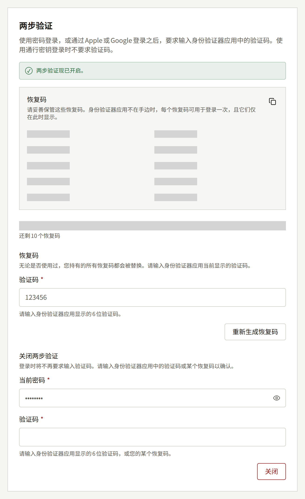

本页面向运营人员：说明租户工作人员、读者和平台控制台运营人员如何用第二因素保护自己的账户、如何要求工作人员和运营人员使用，以及丢失时该怎么办。

## 租户工作人员

租户的每位工作人员都可以在控制台的**账户设置**中，用身份验证器应用和十个恢复码保护自己的控制台账户，详见面向他们的[您的账户](../../4-console/3-setup/9-your-account.md)。

工作人员也可以用通行密钥或安全密钥完成两步验证，详见[使用通行密钥登录](../../4-console/3-setup/9-your-account.md#使用通行密钥登录)。通行密钥与身份验证器应用一样满足下面的要求：登录时被要求设置两步验证的租户管理员，可以改为注册通行密钥。账户的通行密钥和身份验证器共用同样的十个恢复码，被拒绝的通行密钥与错误的验证码一样计入同一个锁定计数。

通行密钥绑定到控制台的主机，无论该主机在哪里提供服务，而绝不绑定到租户的域名，即使控制台像`admin.<domain>`那样位于该域名之下也是如此。因此，[将控制台迁移到另一个主机](../2-tenants.md#把租户迁移到另一个主机名)——为其指定新的管理域名，或者更改控制台位于`admin.<domain>`的租户的域名——会使其工作人员注册的所有通行密钥都无法使用。拥有身份验证器应用或恢复码的工作人员可以用它们登录。唯一的第二因素是通行密钥的工作人员，如果要求覆盖其角色，就会被要求重新设置两步验证；如果不覆盖，则仅凭密码登录。将控制台迁移回原来的主机，旧的通行密钥就能再次使用。

您可以要求安装实例上的每位租户管理员都使用它：在平台控制台**策略**下的**安全**中勾选**要求租户管理员使用多因素认证**，然后选择**保存安全策略**，或者运行：

```bash
publiractl policy set --mfa-required-for-tenant-admin
```



`--mfa-required-for-tenant-admin=false`会取消这项要求。该要求在租户管理员登录时检查，因此从每个人的下一次登录起生效，而不影响已打开的会话；它的作用和覆盖范围请参阅[平台默认值与策略](../9-platform-policies.md#租户管理员的两步验证)。

丢失了所有第二因素——身份验证器及其通行密钥——以及所有恢复码的工作人员，在其账户的两步验证被移除之前将无法再次登录。租户的其他租户管理员可以在控制台中将其移除，详见[丢失两步验证](../../4-console/2-readers/1-accounts.md#丢失两步验证)；您也可以使用`publiractl tenant member reset-mfa`移除，详见[租户的工作人员](../3-tenant-staff.md#丢失两步验证)，这是租户唯一的租户管理员恢复访问的途径。

每个身份验证器的密钥都用加密密钥加密，这就是[删除旧密钥](./1-rotating-secrets.md#4-只有在没有任何值使用旧密钥时才将其删除)可能会让工作人员无法登录的原因。通行密钥则不然：安装实例只保存每个通行密钥的公钥，读取它的人无法凭此证明任何东西，因此轮换或删除密钥不会影响它们的使用。

## 读者

读者也可以用同样的方式，在网站**账户设置**的**安全**中，通过**两步验证**用身份验证器应用和十个恢复码保护自己的网站账户，详见[读者的两步验证](../../4-console/2-readers/1-accounts.md#读者的两步验证)。开启后，在网站上使用密码或通过Apple或Google登录时也会要求输入验证码。通行密钥本身就是第二因素，因此使用通行密钥登录时不要求。



租户的应用也可以在**账户**页面的**两步验证**中同样设置，在应用中登录时也会同样要求输入验证码。

丢失了身份验证器和所有恢复码的读者需要联系租户：租户管理员会在控制台的读者页面上将其移除，详见[丢失两步验证](../../4-console/2-readers/1-accounts.md#丢失两步验证)。

不会要求读者使用两步验证，本页上的任何设置都不会改变这一点：本页介绍的要求只针对租户管理员和运营人员。无论在哪里登录，一个账户只有一个第二因素，因此在控制台设置了第二因素的工作人员在网站上也会被要求，成为工作人员的读者在控制台上也会被要求输入在网站上设置的那个。

与工作人员的一样，读者的身份验证器密钥也用加密密钥加密，因此[删除旧密钥](./1-rotating-secrets.md#4-只有在没有任何值使用旧密钥时才将其删除)同样可能让读者无法登录。

## 平台运营人员

每位运营人员都可以用同样的方式，在**账户设置**的**两步验证**中，用身份验证器应用和十个恢复码保护自己的平台控制台账户，详见[运营人员自己的账户](../1-platform-console.md#运营人员自己的账户)。

您可以要求每位运营人员都使用它，无论其角色如何：在**策略**下的**安全**中勾选**要求平台控制台的所有运营人员使用两步验证**，然后选择**保存安全策略**，或者运行：

```bash
publiractl policy set --mfa-required-for-platform-operator
```

`--mfa-required-for-platform-operator=false`会取消这项要求。它在运营人员登录时检查，因此从每个人的下一次登录起生效，而不影响已打开的会话，包括您自己的会话；尚未设置的运营人员会看到什么，请参阅[平台默认值与策略](../9-platform-policies.md#平台运营人员的两步验证)。请在要求之前先设置好您自己的身份验证器，以免自己成为第一个发现登录时要求什么的人。

同时丢失了身份验证器和所有恢复码的运营人员将无法再次登录，其他运营人员也无法在平台控制台中从其账户中移除它。您可以使用`publiractl operator reset-mfa`移除，详见[丢失两步验证](../1-platform-console.md#丢失两步验证)。它不需要任何账户，因此即使丢失的运营人员是安装实例唯一的**超级管理员**，也能使用。

与租户工作人员的一样，每个身份验证器的密钥都用加密密钥加密，因此[删除旧密钥](./1-rotating-secrets.md#4-只有在没有任何值使用旧密钥时才将其删除)同样可能让运营人员无法登录。

无论您是否要求两步验证：

- 为每位运营人员设置各自的长密码，并保存在密码管理器中。
- 尽可能少地授予**超级管理员**角色，只需查看的人则授予**审计员**。
- 暂停或永久停用不再需要账户的运营人员，详见[暂停和永久停用](../1-platform-console.md#暂停和永久停用)。
- 考虑只向运营人员能够访问的网络提供平台控制台的主机名，例如通过VPN，或在TLS终止端设置地址允许列表。读者和租户工作人员永远不需要访问它。
