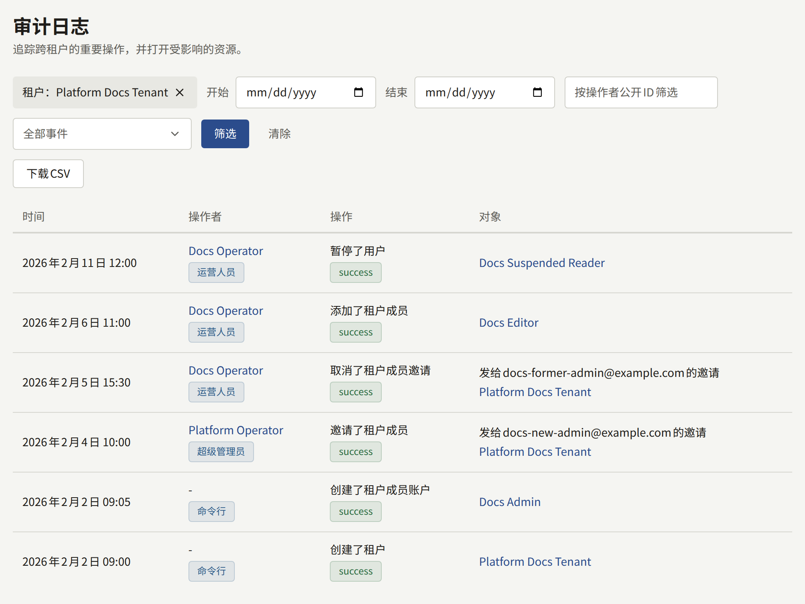

安装实例保存两种互不共享条目的审计日志：平台控制台的审计日志，记录运营人员和`publiractl`所做的更改；以及每个租户的审计日志，记录其工作人员在租户控制台中所做的更改。条目永远不会被删除，数据库会拒绝Publira进程所用的任何角色对条目的任何更改，唯一的例外是数据库自身所做的更改：当执行操作的账户被删除时，条目会以该账户的名称和公开ID代替它。任一日志都可以按期间[导出为CSV](#导出日志)。

## 平台控制台的日志

平台控制台**治理**下的**审计日志**按从新到旧列出条目，每页20条。每位运营人员都可以读取，包括**审计员**。每个条目显示**时间**、**操作者**及其角色、操作及其结果，以及**对象**。通过`publiractl`所做的更改不对应任何运营人员：其操作者为**命令行**。列表可以通过**开始**和**结束**缩小到某个期间（按平台的**默认时区**以整天计），也可以按公开ID缩小到某个操作者，或缩小到某种操作。租户页面上的**查看审计日志**会打开同样缩小到该租户的列表：即更改了该租户、其邀请或其工作人员和读者账户的条目。列表上方会显示该租户，其关闭按钮只会取消这一筛选；**清除**则取消所有筛选。

它记录：

- **运营人员**：添加、更改、暂停、重新启用和永久停用；以及每位运营人员自己的两步验证：设置、登录时要求输入验证码（无论正确与否）、使用恢复码登录、新的恢复码，以及关闭两步验证。
- **平台设置和外部服务**：每次保存常规设置、安全和社区策略、保留期限默认值、邮件、存储和搜索设置以及Web Push联系方式，以及每次测试邮件、存储和搜索连接及其结果。
- **租户及其工作人员**：创建、更改、暂停和恢复租户；邀请管理员，以及重新发送和取消邀请；添加成员、以密码创建成员、为成员指定新角色和移除成员。
- **读者**：由运营人员暂停、解除暂停和删除的账户。
- **日志本身**：每次导出日志，包括所涵盖的期间以及缩小到的租户。

## 租户的日志

每个租户控制台中**管理**下的**审计日志**记录其工作人员在那里所做的操作，包括两步验证，只有其租户管理员可以读取。它记录的内容请参阅[审计日志](../../4-console/3-setup/8-audit-log.md)。它无法从平台控制台读取，而您从平台控制台或`publiractl`为租户所做的更改，记录在平台控制台的日志中，而不是租户的日志中。

## 导出日志

能够读取日志的人可以将任一日志导出为一个最多涵盖366天的CSV文件：租户的日志由其租户管理员导出，平台控制台的日志则由每位运营人员导出，包括**审计员**。期间以整天计，租户的日志按租户的时区，平台控制台的日志按平台的**默认时区**；操作者、操作，以及平台控制台日志中的租户，会像筛选列表一样筛选文件。

文件包含该期间的每个条目，从旧到新，每个条目一行：记录时间（带有期间所在时区的偏移量）；操作者的公开ID、名称和角色；操作、其结果和原因；操作对象的类型和ID；以及客户端地址。平台控制台日志的文件还会以公开ID和名称注明每个条目所属的租户，以及条目操作对象的公开ID和名称。文件为带字节顺序标记的UTF-8，这样电子表格才会将其作为UTF-8读取；电子表格会当作公式读取的值，会在前面加上撇号写入，使其保持为文本。

导出本身也是它所读取的日志中的一个条目，因此日志会显示谁在何时复制了哪个期间。

在平台控制台中，**审计日志**上筛选条件旁的**下载CSV**会将当前显示的期间、租户、操作者和操作的条目保存为以期间命名的文件，例如`platform-audit-log-2026-04-01--2026-04-30.csv`。未指定**结束**时，期间截止到今天；未指定**开始**时，期间为截止到**结束**（或今天）的366天。超过这个长度的期间，或**开始**晚于**结束**的期间，在缩小之前无法下载。每次下载都会以**下载了审计日志CSV**出现在日志中。

## 两种日志都不记录的内容

- **以密码登录**。无论登录成功还是密码错误，都不会留下条目；租户的日志只记录之后的两步验证步骤。`publira server`会将每次登录网站、租户控制台或平台控制台的尝试记录为以`audit auth`开头的日志行，包含操作、结果、原因和客户端地址，例如`audit auth action=admin_login outcome=failure ... reason=invalid_credentials`。如果需要这份记录，请保留服务器的日志。
- **安装实例的密钥和变量**。轮换密钥、密码或令牌是在Publira之外进行的，不会在任何地方留下条目。请自行记录何时轮换了什么。

每个条目在保存之前，还会以带有`msg=audit`的行写入`publira server`的日志。大多数条目会在更改后片刻从服务器内存中的队列保存，经过几次尝试仍无法保存的条目，或在服务器停止时仍在队列中的条目，会从控制台的列表中丢失，但仍保留在那条日志行中。[监控](../11-monitoring.md#审计日志)列出了针对这类丢失应该告警的日志行和指标。
