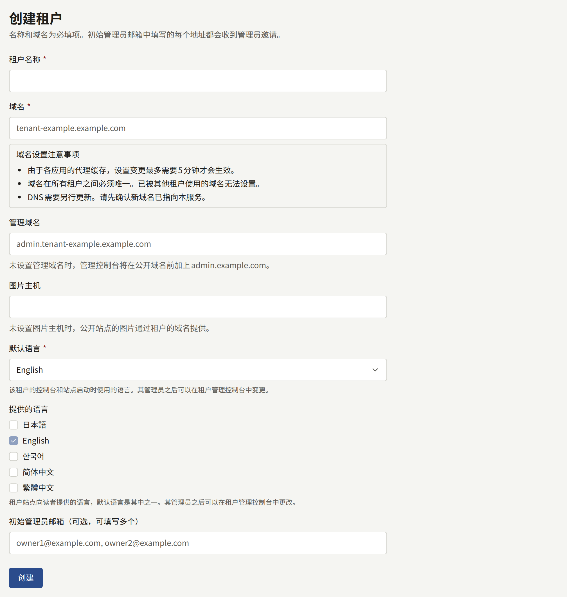
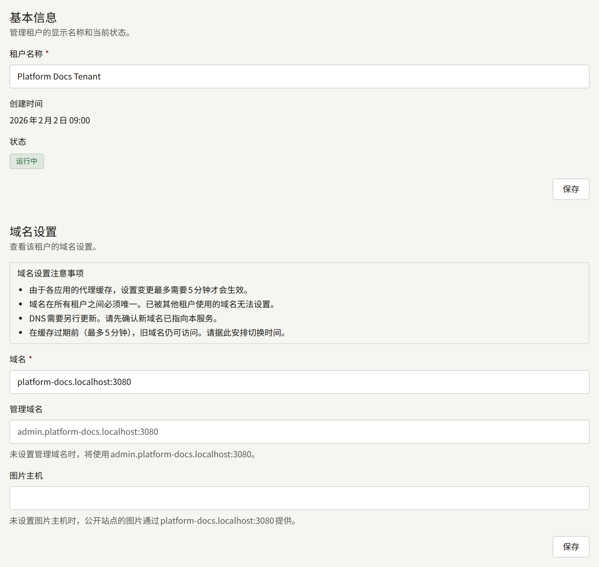
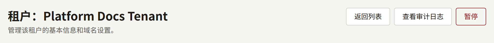
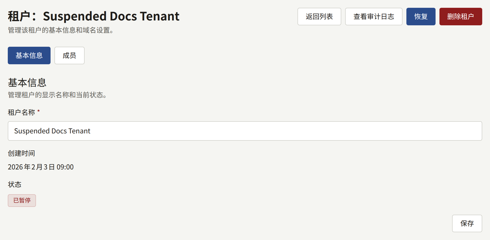
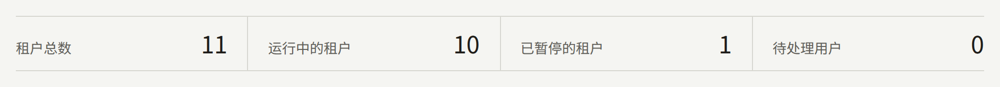
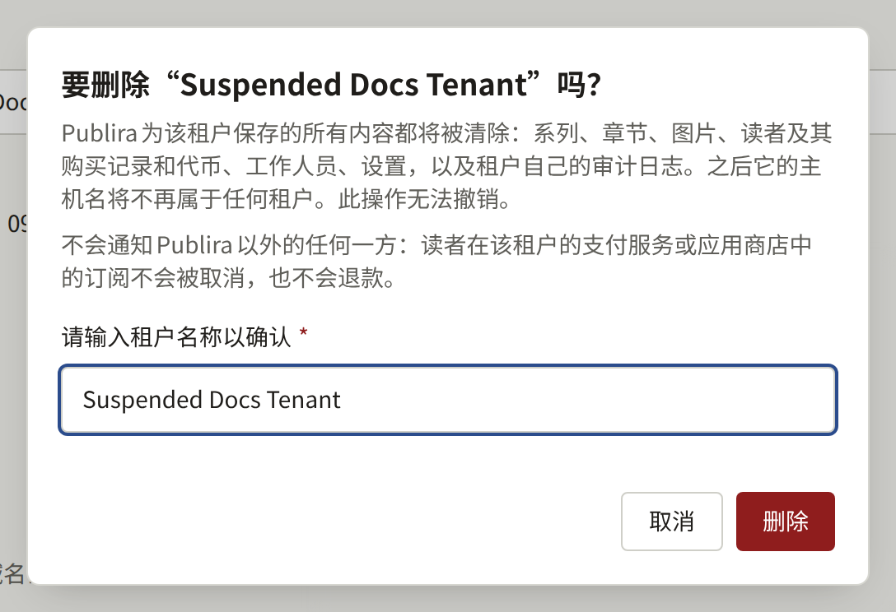

安装实例服务的每个出版社都是一个租户，它在自己的域名上拥有公开网站，并在第二个主机名上拥有控制台。`publiractl setup`创建了第一个租户。本页添加下一个租户，并介绍租户创建之后可以更改的内容。

这里的每条`publiractl`命令都只写出命令本身；请按[平台控制台与publiractl](./1-platform-console.md#在两者之间进行选择)中的说明运行它，并把`PUBLIRA_PLATFORM_DB_URL`设置为`publira_platform`的连接。它的完整标志列表见[`publiractl`参考](https://github.com/publira/publira/blob/main/server/cmd/publiractl/README.md#tenant)。

## 创建租户之前

请先决定以下内容，因为租户从创建的那一刻起就会在它的主机名上提供服务：

- **它的域名**，即提供其公开网站的主机，例如`comics.example.com`。
- **它的控制台主机**，即其工作人员登录的主机。除非您为它指定专属的主机，否则它是`admin.`加上域名，例如`admin.comics.example.com`。
- **它的图片主机**，仅当其网站的图片要在专属的主机名上提供时才需要，例如`images.comics.example.com`，详见[图片主机](#图片主机)。没有图片主机时，图片在其域名上提供。
- **它的默认语言**，即其网站和控制台初始使用的语言。不会自动为它选择。其管理员之后可以在租户控制台中更改。
- **其网站向读者提供的语言**，其中包括默认语言。保持不变时，网站只提供其默认语言。其管理员之后也可以更改这些语言。
- **它的第一个管理员**，以及他们获得访问权限的方式：通过邮件发送给他们的邀请，或您使用密码创建的账户。[租户的工作人员](./3-tenant-staff.md)比较了这两种方式。

请把每个主机名单独以小写形式写出：不带`https://`、不带路径，也不带末尾的`/`。每个主机名只属于一个租户，作为其域名、控制台主机或图片主机之一，绝不会同时作为其中两种：代理会把一个主机名发送到一个地方，因此重复使用的名称会使两者之一无法访问。Publira会拒绝另一个租户已经用作这三者中任何一种的域名、控制台主机或图片主机（包括控制台默认获得的`admin.<domain>`），拒绝与租户自身域名相同的控制台主机，也拒绝与租户自身域名或控制台主机相同的图片主机。当租户本应获得的`admin.<domain>`已被占用时，请为它指定专属的管理域名。

然后按照[添加租户](../2-deployments/4-edge/index.md#添加租户)中给出的顺序，让它的主机名能够访问安装实例：DNS、证书和边缘的路由。您可以在创建租户之前或之后完成这些工作，但在完成之前，其工作人员无法打开控制台。

### 使用专属域名的控制台主机

控制台主机不必位于租户的域名之下：位于`example.com`上的网站可以把控制台放在`admin.example.net`上，通过下文的**管理域名**或`--admin-domain`指定。如果您能为它注册第二个域名，那是更安全的选择。公共证书颁发机构签发的每张证书都会公布在证书透明度（Certificate Transparency）日志中，而crt.sh等服务允许任何人按域名搜索这些日志，因此位于网站域名之下的控制台主机，无论叫什么名字，从其证书签发的那一刻起就会与网站一起被列出。通配符证书可以让这个名称不出现在日志中，但`admin.<domain>`是任何人都会首先尝试的名称。位于另一个可注册域名上、且证书不包含网站任何主机的控制台主机，就不会以这种方式与网站关联起来。控制台仍然会要求其工作人员登录，所以这样做隐藏的是它的登录页面。`admin.<domain>`仍然是默认值，并且可以直接使用。

请在工作人员注册通行密钥之前做出选择：通行密钥绑定到控制台的主机，因此之后把控制台移到另一个主机会使已经注册的通行密钥无法使用，详见[两步验证](./12-security/2-two-step-verification.md#租户工作人员)。

边缘还可以更进一步，只接受来自工作人员IP地址的控制台主机访问；[示例配置](../2-deployments/4-edge/1-sample-configurations.md)不会替您做这件事。这涵盖的是控制台的页面。它的API不需要这样的规则：控制台通过私有网络调用它们，而按照[只有公开API经过边缘](../2-deployments/4-edge/index.md#只有公开api经过边缘)配置的边缘不会在任何主机上转发它们。

### 图片主机

租户的网站图片在其域名上提供，与其页面经过同一个边缘。图片主机则改为在专属的主机名上提供它们，例如`images.comics.example.com`，这样图片就可以通过专属的负载均衡器或CDN到达Publira，与页面和公开API分开，详见[分开提供图片和公开API](../2-deployments/7-scaling-out.md#分开提供图片和公开api)。不需要这样做的租户也就不需要图片主机。

租户一旦有了图片主机，公开API就会给出该主机上其网站图片的地址，而Publira在该主机上只响应该租户的网站图片，不响应其他任何内容：它的页面、API和控制台都不在那里提供。租户的网站和移动应用从该主机加载图片；租户控制台仍然在控制台主机上加载其图片。

图片主机必须像租户的其他主机名一样能够访问安装实例：在DNS中、带有证书，并且其上的`/images`要路由到`publira server`，详见[租户的图片主机](../2-deployments/4-edge/index.md#租户的图片主机)。示例配置会在它被加入`PUBLIRA_EDGE_IMAGE_HOSTS`后对它进行路由。请在设置它之前把它准备好，因为从那时起网站就会从它加载图片。

之后设置、更改或清除图片主机，与任何其他主机名一样属于一次迁移，详见[把租户迁移到另一个主机名](#把租户迁移到另一个主机名)：在`publira worker`把这项更改告知Web应用之前，网站在更改前准备好的页面会链接到之前那个主机上的图片，因此请让之前的主机一直提供服务到那时为止。

## 创建租户

### 从平台控制台

在侧边栏的**租户**下选择**创建租户**，然后填写：

- **租户名称**：出版社的名称，邀请和租户的其他邮件都用这个名称称呼它。
- **域名**：您选择的域名。
- **管理域名**：控制台主机，仅当它不是`admin.<domain>`时才需要。留空时，控制台在`admin.<domain>`上提供，如字段下方的说明所示。
- **图片主机**：提供租户网站图片的主机，仅当图片不在其域名上提供时才需要。留空时，图片在域名上提供，如字段下方的说明所示。
- **默认语言**。
- **提供的语言**：每种语言一个复选框，租户网站提供的每种语言都要勾选。默认语言的复选框始终处于勾选状态且无法取消，其余的初始为未勾选。
- **初始管理员邮箱（可选，可填写多个）**：要邀请为租户管理员的地址，以逗号或换行分隔。租户一创建，就会向每个地址发送邀请邮件。



**创建**会创建租户并打开其页面。它的时区是平台的默认时区，其管理员可以在租户控制台中更改。

### 从publiractl

```bash
publiractl tenant create \
  --name "Example Comics" \
  --domain comics.example.com \
  --default-locale en \
  --supported-locale en \
  --supported-locale ja \
  --initial-admin-email owner@comics.example.com
```

`--supported-locale`指定租户网站提供的一种语言，可以重复使用；默认语言必须是其中之一。省略时，网站只提供其默认语言。`--admin-domain`为控制台指定专属的主机，`--image-domain`为网站的图片指定专属的主机，`--timezone`指定平台默认时区以外的IANA时区。`--initial-admin-email`可以重复使用，每个地址都会像从平台控制台那样收到邀请。

### 创建之后

邀请邮件由`publira worker`发送，它必须在运行，并且平台的SMTP设置必须已经保存。不发送邮件的安装实例请改用`publiractl tenant admin create`为租户创建第一个管理员，详见[租户的工作人员](./3-tenant-staff.md#不通过邮件创建账户)。

管理员登录之后，租户的其余设置——它的网站、品牌形象、支付以及其他工作人员——都在其控制台中完成。

## 更改租户

租户的名称、域名、控制台主机和图片主机可以在创建后更改。它的语言和时区属于其管理员，由他们在租户控制台中更改。

### 从平台控制台

从**租户**中打开该租户。**基本信息**用于更改其**租户名称**，**域名设置**用于更改其**域名**、**管理域名**和**图片主机**。清空**管理域名**会把控制台移回`admin.<domain>`，清空**图片主机**会让网站的图片重新在域名上提供。



### 从publiractl

```bash
publiractl tenant update --tenant comics.example.com --name "Example Comics Ltd."
```

`--tenant`通过域名或公开ID指定租户。`--name`、`--domain`、`--admin-domain`和`--image-domain`各自只替换对应的值，其余保持不变；`--admin-domain ""`会把控制台移回`admin.<domain>`，`--image-domain ""`会让网站的图片重新在其域名上提供。`publiractl tenant show --tenant comics.example.com`会打印租户当前的状态。

### 把租户迁移到另一个主机名

一旦`publira worker`把更改告知Web应用，网站就会停止在旧域名上响应，其页面也会链接到新域名；没有`PUBLIRA_REVALIDATE_TOKEN`的worker进程无法做到这一点，详见[发件箱](./10-scheduled-jobs.md#发件箱邮件推送和缓存重新验证)，这时旧域名会继续响应最多五分钟。新域名会立即响应，除非有人在更改之前打开过它：网站会把不属于任何租户的主机名记住最多五分钟。控制台会把它查询过的每个主机名保留最多五分钟，因此新的控制台主机需要这么长时间才会响应，而旧的控制台主机在那之前会继续响应。

请按照[添加租户](../2-deployments/4-edge/index.md#添加租户)中的顺序进行：在更改之前把新名称加入DNS、证书和路由，在更改生效后再移除旧名称。没有专属管理域名的租户，其控制台位于`admin.<domain>`上，因此迁移其域名也会迁移其控制台，两个新名称都必须准备好。

迁移域名也会迁移建立在它之上的所有内容：

- 读者和工作人员是在一个主机名上登录的，因此他们需要在新的主机名上重新登录。
- 工作人员的通行密钥属于控制台的主机，因此改变控制台主机的迁移——新的管理域名，或控制台位于`admin.<domain>`上的租户的新域名——会使它们无法使用，详见[两步验证](./12-security/2-two-step-verification.md#租户工作人员)。
- 租户的移动应用是为一个主机构建的，并且只打开该主机上的链接。请在其[应用清单](../5-mobile-app/1-app-manifest.md)中填入新的主机，重新构建并提交。
- 租户控制台为支付显示的**Webhook URL**，以及为使用Apple和Google登录显示的返回URL，都位于该域名上。请向每个服务商注册新的URL。
- 更改之前发送的邮件链接到旧的主机。

## 暂停租户

在平台控制台的租户页面上点击**暂停**，或运行`publiractl tenant suspend --tenant comics.example.com`，会把租户标记为**已暂停**。**恢复**或`publiractl tenant resume`会把它重新标记为活动状态。平台控制台的按钮一按下就生效，不会要求确认。无论哪种方式，这项更改都会记录在**审计日志**中，并且仪表盘会把该租户计入**已暂停的租户**。







暂停会停止为该租户提供服务，除此之外不会改变它的任何内容：

- 它的网站、应用和控制台停止工作。API会拒绝该租户的每个请求（包括登录），其图片也不再提供。读者的浏览器或Publira前面的缓存已经持有的图片会在最多一小时内仍然可见，这是Publira允许保留它们的时长。
- 读者只会看到网站无法使用，仅此而已。网站的每个页面都会以一个说明这一点的页面响应，状态为`503`，它告诉搜索引擎网站是暂时离开而不是已经消失。应用会在每个页面的位置显示同样的内容，并带有**重试**；租户恢复后，当读者点击它或回到应用时，应用会重新打开。
- 工作人员会在控制台的每个页面（包括其登录页面）上看到控制台因网站已暂停而无法使用。其中不会出现任何内部细节。
- Web应用会把它们查询过的主机名保留最多五分钟。暂停之后的这段时间内，它们已经准备好的页面仍可能显示，而其他任何页面会显示应用的错误页面，而不是上面那些页面。
- 其支付服务商和入站邮件服务商发送的通知也会被拒绝。每个服务商都会按自己的计划重试被拒绝的通知，因此在租户恢复时仍在重试的通知会在那时得到处理，而服务商已经放弃的通知则不会。
- 读者和工作人员保持登录状态。在租户暂停期间他们的会话不被接受，租户恢复后又会重新生效。
- 发给其读者和工作人员的邮件和推送通知不会被发送，也不会保留到之后发送：它们链接的内容无法使用，而且等到租户恢复时它们已经过时。例外是您从平台控制台或`publiractl`发送的租户管理员邀请，它会被发出；其链接在租户恢复后有效，如果届时已经过期，**重新发送**会签发一个新的链接。
- 它的预约发布、免费阅读期、版税结算以及其他定时工作都会继续进行，因此恢复后的租户会处于它自己的计划本应达到的状态。
- 它的详细信息、成员和邀请仍然可以从平台控制台和`publiractl`更改，详见[租户的工作人员](./3-tenant-staff.md)。

暂停或恢复租户都不会删除或更改它的任何内容，并且恢复后会立即重新为它提供服务，无需做其他任何事。

## 删除租户

已暂停的租户可以删除，删除会清除安装为它保存的所有内容：系列、章节、图片、读者及其购买记录和代币、工作人员、设置，以及租户自己的审计日志。删除无法撤销，并且只有**超级管理员**可以执行。

活动租户无法删除，因此请先暂停它，并在任何内容被清除之前，让它保持暂停，时长由您决定读者和工作人员需要被拒绝多久。租户删除后就无法再恢复。

不会通知安装以外的任何一方。读者在该租户的支付服务或应用商店中的订阅会在那里继续续订，也不会退款：出版商应退的款项，需要由出版商在删除租户之前通过该服务自行退还。

### 从平台控制台

从**租户**打开已暂停的租户。**恢复**旁边的**删除租户**会打开一个对话框，说明将清除哪些内容，并要求输入租户名称。请按保存的名称准确输入；在两者一致之前，对话框中的**删除**无法使用。运营人员和审计员看不到这个按钮。



此后，租户在列表和它的页面上显示为**正在删除**。页面会说明它正在删除，并且其中的任何内容都无法更改：**恢复**和**保存**按钮均不可用。

### 从publiractl

```bash
publiractl tenant delete --tenant comics.example.com --name "Example Comics"
```

`--name`必须与租户名称完全一致，命令以此确认要删除的是哪个租户。在清除完成之前，`publiractl tenant show`会把租户显示为`deleting`。

### 之后会发生什么

`publira worker`会在一分钟内清除该租户：其在每张表中的行、存储桶中的对象、搜索引擎索引中的文档，以及留在Valkey中的转换后图片和速率限制计数器，最后删除租户本身。在此之前，它会像已暂停的租户一样被拒绝。清除完成后，它的主机名不再属于任何租户，可以从DNS、证书和边缘的路由中移除，也可以分配给其他租户。

随后，租户会从列表中消失。平台控制台会把读取过的列表保留最多一分钟，因此在这段时间内重新加载，仍可能看到租户显示为**正在删除**。每位运营人员都会在**通知**中收到标题为“租户已删除”的通知，**审计日志**会保留请求和删除各一条记录，并附有租户的名称、域名和控制台主机。

一直显示为**正在删除**的租户，是worker未能完成清除的租户；这时会发生什么，请参阅[其他定时任务](./10-scheduled-jobs.md#其他定时任务)。
