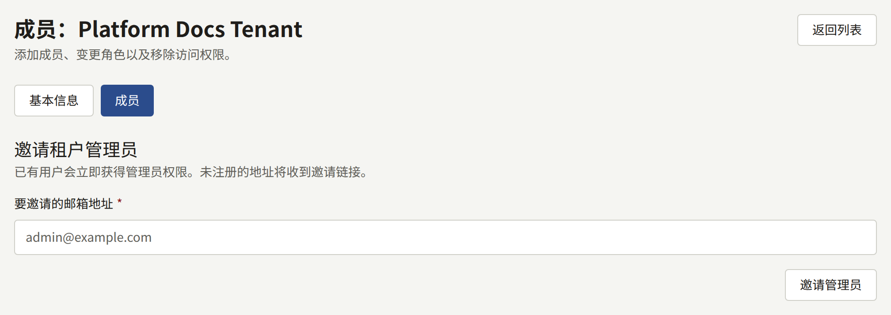
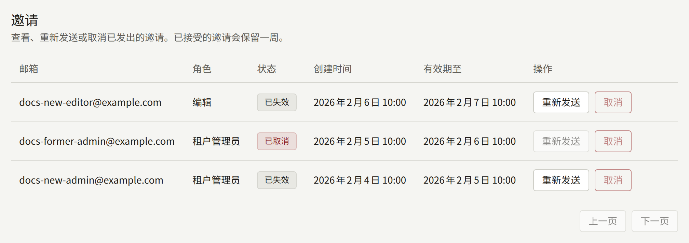
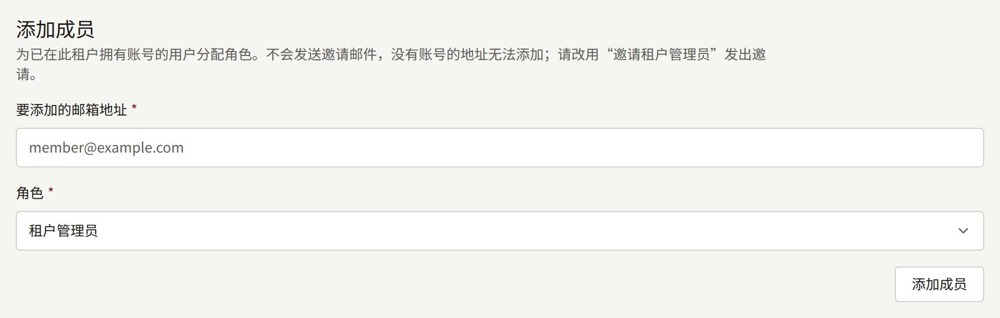
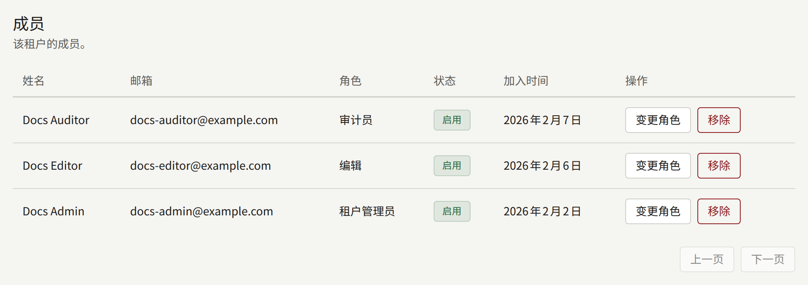

租户的工作人员是登录其控制台的人员。本页从运营人员的角度介绍他们如何获得访问权限：邀请第一个管理员、工作人员拥有的角色，以及租户没有剩下任何管理员时该怎么做。租户有了管理员之后，由该管理员在租户控制台的**成员**中管理其余的工作人员，详见[成员](../4-console/3-setup/6-members.md)，只有在出现问题时才再次需要运营人员。

这里的`publiractl`命令按照[平台控制台与publiractl](./1-platform-console.md#在两者之间进行选择)中的方式运行，每条命令都用`--tenant`通过域名或公开ID指定租户。它们的完整标志列表见[`publiractl`参考](https://github.com/publira/publira/blob/main/server/cmd/publiractl/README.md#tenant)。

## 成员与用户

每个账户都属于一个租户：在两个租户的网站上注册的读者拥有两个账户，每个租户各一个。账户是其租户的**用户**。同时拥有控制台角色的用户是租户工作人员中的**成员**，可以登录其控制台。

由此可以得出以下几点：

- 让某人成为工作人员绝不会迁移其账户。被分配了角色的租户读者，使用他们阅读时已经在用的地址和密码登录控制台。
- 收回某人的角色会保留其账户。他们仍然是该租户的读者，之后也可以再次被分配角色。
- 账户拥有角色期间，无需购买即可在网站和应用中阅读该租户已发布的每个章节，这样工作人员就能以读者看到的样子检查他们的目录。在网站上，以这种方式打开的付费章节会在其价格旁注明它是通过角色打开的，并说明没有购买它的读者会看到购买提示而不是其页面。租户的年龄确认仍然适用于它，并且它无法为章节评分，因此工作人员自己的阅读不会计入网站显示的评分。收回角色时，这一权限也会随之收回。

## 三种角色

| 角色 | 可以做什么 |
| --- | --- |
| **租户管理员** | 控制台中的一切：工作人员及其邀请、租户的所有设置、其网站和品牌形象、邮件、支付、推送通知、登录和Google代码的集成、读者的账户和咨询、阅读券、购买及其退款、版税，以及审计日志。在租户要求章节在发布之前接受审核的情况下，批准或退回章节只能由租户管理员进行 |
| **编辑** | 编写目录——系列、章节、作者、书系、题材——以及租户的页面、公告和活动横幅，并审核评论。在租户要求审核的情况下，提交章节以供审核，详见[发布前审核](../4-console/1-catalog/2-episodes.md#发布前审核) |
| **审计员** | 查看编辑所处理的内容以及租户的设置，但不能更改其中任何内容 |

每个角色都包含其下方角色可以做的一切。控制台会隐藏角色无法使用的内容：编辑在侧边栏中看不到**成员**、**读者**、**版税**或**购买记录**，审计员看不到任何会更改内容的按钮。

租户至少需要一名租户管理员，因为只有租户管理员才能为其他人分配角色。

## 授予工作人员访问权限

有三种方式，适合哪一种取决于此人在租户中是否已经有账户，以及安装实例是否发送邮件。

### 邀请租户管理员

邀请会通过邮件发送到一个地址，被接受后该地址即成为租户管理员。新租户通常通过创建时提供的地址以这种方式获得第一个管理员，之后也以这种方式添加更多管理员。

- **平台控制台**：从**租户**中打开该租户，选择**成员**，在**邀请租户管理员**下输入地址，然后选择**邀请管理员**。
- **publiractl**：`publiractl tenant invite create --tenant comics.example.com --email editor-in-chief@comics.example.com`



被邀请人会收到一封以租户默认语言发送的邮件，其中包含指向租户控制台的链接。他们在那里输入**姓名**和**密码**，选择**接受邀请**，然后登录。该链接在24小时内有效。

已经属于该租户某个用户的地址不会被邀请：它会立即成为租户管理员，并且不会发送邮件。这会取代它之前拥有的任何角色，因此以这种方式被邀请的编辑会成为租户管理员。

邀请邮件由`publira worker`发送，如果租户保存了自己的SMTP设置则使用租户的设置，否则使用平台的设置。没有运行worker进程的安装实例会创建邀请，但不会发送任何邮件。

从平台控制台或`publiractl`发送的邀请只能创建租户管理员。编辑和审计员按照[添加已有用户](#添加已有用户)中的说明被分配角色，或者由租户自己的管理员邀请，租户控制台的邀请可以授予三种角色中的任何一种。

### 跟进邀请

同一个**成员**页面上的**邀请**列出该租户的每一份邀请（包括其管理员从租户控制台发送的邀请），以及接受邀请后授予的**角色**和邀请的状态：**待处理**、**已接受**、**已取消**或**已失效**。

- 对待处理或已失效的邀请使用**重新发送**，会以新的链接再次发送邮件，新链接再有效24小时。之前的链接会失效。
- 对待处理的邀请使用**取消**会撤回邀请，其链接会失效。



在命令行中，`publiractl tenant invite list --tenant comics.example.com`会打印每份邀请及其ID，`tenant invite resend --id <ID>`和`tenant invite cancel --id <ID>`则对其中一份（包括已失效的邀请）进行操作。

租户自己的管理员会在租户控制台中看到同样的邀请，并可以在那里发送、重新发送和取消邀请。

### 添加已有用户

可以直接为租户的读者分配三种角色中的任何一种，无需邮件：

- **平台控制台**：在租户的**成员**页面上，在**添加成员**下输入地址，选择**角色**，然后选择**添加成员**。
- **publiractl**：`publiractl tenant member add --tenant comics.example.com --email reader@example.com --role tenant_editor`。`--role`是`tenant_admin`、`tenant_editor`和`tenant_auditor`之一。



这只适用于在该租户中已经有账户的地址；其他地址都会被拒绝。没有账户的人需要先在租户的网站上注册，或者被邀请为租户管理员。已经拥有角色的账户请改用**变更角色**进行更改。

### 不通过邮件创建账户

`publiractl tenant admin create`会直接创建一个控制台账户：为它设置密码，其地址视为已验证，并且可以立即登录。它不发送任何邮件，因此不发送邮件的安装实例就是通过这种方式获得第一个管理员以及之后的任何工作人员。

```bash
publiractl tenant admin create \
  --tenant comics.example.com \
  --email owner@comics.example.com \
  --name Owner \
  --generate-password
```

`--generate-password`会把密码打印一次，只打印到终端，不会出现在其他任何地方，因此请在关闭终端之前把它转交给账户的所有者。[参考](https://github.com/publira/publira/blob/main/server/cmd/publiractl/README.md#tenant)给出了设置密码的其他方式，`--role`可以改为创建编辑或审计员，而不是租户管理员。平台控制台中没有对应的功能。

该地址在租户中必须还没有账户。对于已有账户的地址，请改用`tenant member add`。

## 更改角色和移除人员

在平台控制台中租户的**成员**页面上，**变更角色**为成员分配另一个角色，**移除**则收回其所有角色。



在命令行中：

```bash
publiractl tenant member list --tenant comics.example.com
publiractl tenant member update-role --tenant comics.example.com --user <public ID> --role tenant_auditor
publiractl tenant member remove --tenant comics.example.com --user <public ID>
```

`tenant member list`会打印每个成员的公开ID，`--user`接受的就是这个ID。

控制台在每个请求时都会读取成员的角色，因此更改会立即生效，对他们已经打开的控制台也是如此。被移除的成员会保留其账户作为该租户的读者，因此他们的购买和历史记录仍然归他们所有。

## 丢失两步验证

开启了两步验证、之后又丢失了所有第二因素（身份验证器和通行密钥）以及所有恢复码的工作人员无法登录控制台。租户的其他租户管理员可以在**读者**中该成员的页面上将其移除，如[丢失两步验证](../4-console/2-readers/1-accounts.md#丢失两步验证)所述。如果没有人能这样做，例如该成员是租户唯一的租户管理员，或者其他租户管理员都联系不上，您可以这样做：

```bash
publiractl tenant member reset-mfa --tenant comics.example.com --email editor@comics.example.com
```

可以用`--user <public ID>`代替`--email`来指定账户。该命令会移除账户的身份验证器、它注册的每个通行密钥（无论是在哪个控制台地址上注册的）以及所有恢复码，不做其他任何事：它的密码和角色都保持不变。之后该成员只用密码登录，并从**账户设置**重新设置两步验证，详见[您的账户](../4-console/3-setup/9-your-account.md)。如果平台要求其角色使用两步验证，控制台会在登录时要求其进行设置。

移除两步验证后，账户就只受密码保护，而这正是持有被盗密码的人会提出的请求。在运行该命令之前，请通过您已经知道属于该成员的渠道（而不是请求到达的那个渠道）确认请求确实来自该成员。

这次移除会记录在平台控制台的**审计日志**中，操作者为**命令行**。平台控制台本身没有对应的功能。

## 恢复没有管理员的租户

租户控制台会拒绝降级或移除其最后一名租户管理员，因此租户通常总会有一名。但实际上它仍可能失去最后一名：管理员离开了出版社、无法再访问其邮箱，或者其账户被他人接管。

平台控制台和`publiractl`不会保留最后一名租户管理员，正是为了让运营人员可以介入：

- **应由工作人员中的某人接手**。使用**变更角色**或`tenant member update-role --role tenant_admin`为其账户分配租户管理员角色。
- **新的管理员在该租户中没有账户**。邀请他们；如果他们无法接收邮件，则用`publiractl tenant admin create`创建账户。
- **最后一名管理员丢失了两步验证**。按照[丢失两步验证](#丢失两步验证)中的说明用`tenant member reset-mfa`移除它，然后他们用密码重新登录。
- **最后一名管理员的账户已被盗用**。先把角色分配给其他人，然后用**移除**从被盗用的账户收回角色，这会立即把它拒之于控制台之外。该账户仍然可以作为读者登录租户的网站；新的管理员可以在租户控制台的**读者**中暂停它。

这些更改都会记录在平台控制台的**审计日志**中，并写明做出更改的运营人员；从`publiractl`做出的更改则写为**命令行**。租户自己的工作人员从租户控制台做出的更改则记录在租户的审计日志中。
