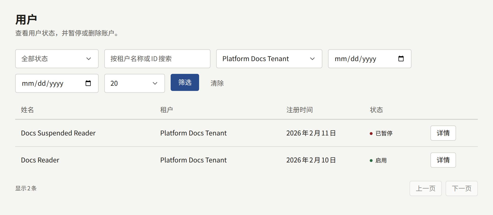
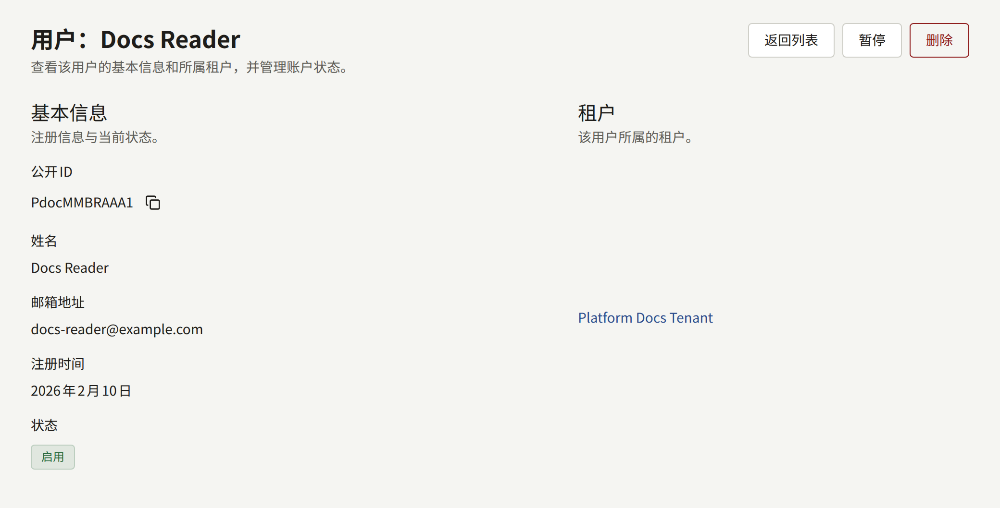
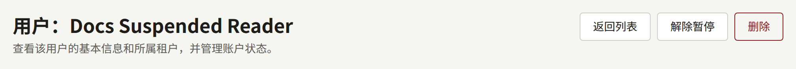

平台控制台侧边栏**治理**下的**用户**在一个地方列出所有租户的读者。它用于处理单个租户无法独自处理的事情：送达运营人员而不是出版社的投诉或法律请求，或者租户的管理员无法处理的账户。日常工作中，每个租户的管理员会在租户控制台的**读者**中照管自己的读者。`publiractl`中没有对应的功能。

## 列表显示的内容

每个账户都属于一个租户，因此在两个租户的网站上阅读的人会出现两次，每个租户各一次。列表显示每个账户的**姓名**、**租户**、**注册时间**和**状态**，并可以按状态、租户和注册日期进行筛选。它不能按姓名或邮箱地址搜索：请先筛选到账户所属的租户和注册日期来查找它。

列表只包含读者。在租户控制台中拥有角色的账户属于工作人员，在该租户的**成员**中管理，详见[租户的工作人员](./3-tenant-staff.md)。

**详情**会打开一个账户：它的**公开ID**、姓名、**邮箱地址**、注册日期、状态以及它所属的租户。

## 暂停和删除账户

运营人员或超级管理员可以在账户的页面上对其进行操作。审计员看到的页面不带这些按钮。

- **暂停**会阻止读者在网站和应用中登录，并结束其已有的会话。账户中的任何内容都不会被移除。**解除暂停**让其可以再次登录。
- **删除**会永久移除该账户，且无法撤销。想要删除自己账户的读者可以自己在租户的网站上删除，这通常是更好的途径。

两者都不能对拥有控制台角色的账户执行：请先在租户的**成员**中收回其角色。

每次操作都会记录在**审计日志**中，并写明执行操作的运营人员。
