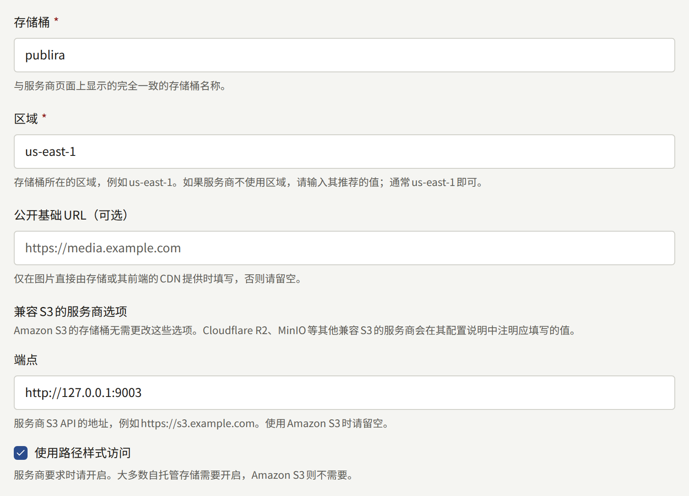
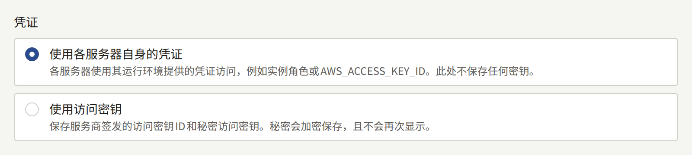
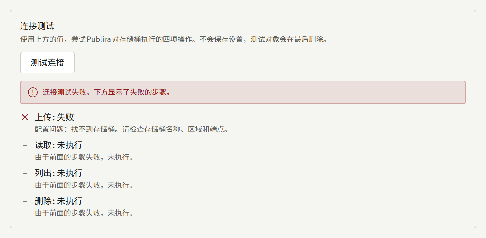
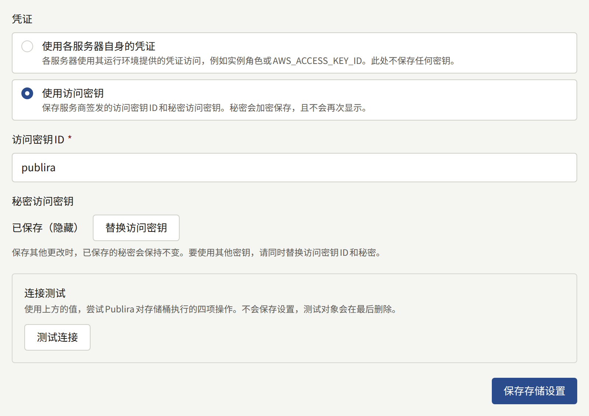

安装实例保存的每一张图片——封面、章节页面、作者照片、各租户的标志——都存放在一个兼容S3的存储桶中，由所有租户共用。`publiractl setup`已经保存了这个存储桶的设置。本页说明其中每一项设置、如何测试、以后如何更改，以及已保存的图片如何送达读者。

本页中的`publiractl`命令都只写出命令本身。请按照[平台控制台与publiractl](./1-platform-console.md#在两者之间进行选择)中的说明运行：将`PUBLIRA_PLATFORM_DB_URL`设置为`publira_platform`的连接，并使用与各进程相同的`PUBLIRA_SECRET_ENCRYPTION_KEYS`和`PUBLIRA_SECRET_ENCRYPTION_PRIMARY_KEY_ID`。所有选项都列在[`publiractl`参考](https://github.com/publira/publira/blob/main/server/cmd/publiractl/README.md#storage)中。

## 存储桶

Publira不会创建存储桶。请先在服务商处创建一个空的存储桶，并授予Publira所用凭据在其中上传、读取、列出和删除对象的权限。存储桶无需公开：读者从不直接从中获取内容。

以下设置指定存储桶及其访问方式：

| 设置 | `publiractl storage set` | 平台控制台 |
| --- | --- | --- |
| 存储桶的名称 | `--bucket` | **存储桶** |
| 存储桶所在区域 | `--region` | **区域** |
| Amazon S3以外的存储服务的地址 | `--endpoint` | **端点** |
| 在URL路径中而不是在主机名中指定存储桶 | `--force-path-style` | **使用路径样式访问** |
| 可读取已保存对象的URL | `--public-base-url` | **公开基础URL（可选）** |



如果存储桶位于Amazon S3，只需填写存储桶及其区域，其余留空。

如果使用其他兼容S3的存储服务——Cloudflare R2、MinIO、RustFS或某个服务商的对象存储——请将其S3 API地址填为端点，并在服务商要求时启用路径样式访问，大多数自托管的存储服务都有此要求。没有区域概念的存储服务也需要填写区域：填写其文档推荐的值，没有推荐值时填写`us-east-1`。

公开基础URL请留空。无论其中填写什么，图片始终经由`publira server`分发，详见[图片如何送达读者](#图片如何送达读者)。

## 凭据

Publira以下面两种方式之一为发往存储桶的每个请求签名。

**随设置一起保存的访问密钥**：由服务商签发的访问密钥ID及其秘密访问密钥。秘密访问密钥使用安装实例的加密密钥加密保存，因此所有访问存储桶的进程都必须使用这些密钥运行；保存之后它不会再次显示。对于Amazon S3以外的存储服务，这是常规选择；如果安装实例的进程没有自己的凭据，这也是唯一的选择。

**各进程自行获取的凭据**，不保存任何密钥。每个进程按照AWS SDK自身的方式签名：使用其环境中的`AWS_ACCESS_KEY_ID`和`AWS_SECRET_ACCESS_KEY`、Web身份令牌，或其所在机器的实例角色。在AWS上，这样可以让所有长期有效的密钥都不进入数据库，但`publira server`、`publira worker`以及您运行的`publiractl`都需要该凭据：服务器上传和读取图片，worker进程删除不再使用的图片，`publiractl storage test`也需要签名。

在平台控制台中，**凭证**以**使用访问密钥**和**使用各服务器自身的凭证**提供这两种方式。使用`publiractl storage set`时，指定`--access-key-id`即保存密钥，其秘密访问密钥可以通过`--secret-access-key-file`从文件读取、通过`--secret-access-key-stdin`从标准输入读取、通过不回显的提示输入，或者在平台只能以环境变量设置密钥的情况下，通过`--secret-access-key-env`从环境变量读取；省略`--access-key-id`则使用各进程自身的凭据签名，并删除已保存的密钥。



## 测试连接

测试会上传一个小对象，将其读回、列出，再删除，这涵盖了Publira对存储桶执行的所有操作，并分别报告这四个步骤的结果。

- 在平台控制台中，**存储**下的**测试连接**会在保存之前测试表单中的值。测试从`publira server`运行。
- `publiractl storage test`测试已保存的设置，从运行`publiractl`的位置执行，任一步骤失败时以`1`退出。

失败时会指出失败的步骤及原因：存储服务拒绝了凭据、密钥缺少某项操作的权限、在该名称、区域和端点下找不到存储桶，或者无法连接到端点。由于控制台的测试和命令运行在不同的机器上，如果防火墙只允许其中一方访问存储服务，就会出现一方测试通过、另一方失败的情况；真正需要访问存储服务的是`publira server`和`publira worker`。



## 更改设置

### 在平台控制台中

在侧边栏的**外部服务**下选择**存储**。页面显示已保存的设置，已保存的密钥显示为**已保存（隐藏）**。修改值后选择**测试连接**，再点击**保存存储设置**保存。要使用其他访问密钥，请选择**替换访问密钥**，并同时输入访问密钥ID和秘密访问密钥；已保存的秘密访问密钥只与保存时的ID搭配使用。



运营人员或超级管理员可以保存。审计员可以查看该页面，但不能保存。

### 使用publiractl

```bash
publiractl storage set \
  --bucket publira-images \
  --region ap-northeast-1 \
  --access-key-id AKIA... \
  --secret-access-key-file /run/secrets/aws-secret-access-key
publiractl storage test
publiractl storage show
```

`storage set`会用所给的选项替换所有已保存的设置，因此每次都要写全所有选项：省略的选项会清除对应的设置。使用相同的`--access-key-id`且不提供秘密访问密钥运行时，会保留已保存的秘密访问密钥。

### 更改何时生效

每个进程每30秒重新读取一次设置，因此保存后一分钟内所有进程都会采用新设置，无需重启。每次保存和每次测试都会记录在**审计日志**中。

### 迁移到另一个存储桶

保存新的存储桶并不会将任何内容复制过去。之前上传的图片仍留在旧存储桶中，而安装实例会到新存储桶中查找，在那里找不到它们。请在保存之前保持对象键不变，将对象复制过去，然后保存，再复制一次，以补上第一次复制期间上传的内容。使用AWS CLI或服务商提供的等效工具：

```bash
aws s3 sync s3://publira-images s3://publira-images-new
publiractl storage set --bucket publira-images-new --region ap-northeast-1 ...
aws s3 sync s3://publira-images s3://publira-images-new
```

保存之后，安装实例中没有任何部分会再访问旧存储桶。请保留它，直到安装实例从新存储桶提供服务一段时间后，再自行删除。

### 轮换访问密钥

在服务商处签发新密钥，通过`storage set`或**替换访问密钥**保存并测试，确认无误后再吊销旧密钥。各进程会在一分钟内切换到新密钥，过早吊销旧密钥会在这段时间内导致上传和图片读取失败。

## 图片如何送达读者

读者的浏览器和应用从租户自身主机名下的`/images`获取图片，边缘按照[路由](../2-deployments/4-edge/index.md#路由)的要求将其转发给`publira server`。对于每个请求，服务器会：

1. 检查读者是否可以查看该图片。章节页面只向该章节对其免费或已解锁该章节的读者显示，未发布章节的页面只向租户在控制台中的工作人员显示。
2. 从存储桶读取原图，转换为浏览器支持的WebP或AVIF，并调整为页面请求的尺寸。
3. 将转换结果保存在转换缓存中，这样下次以相同尺寸请求同一图片时，无需再次读取存储桶或重新转换。
4. 向读者发送章节页面前对其加密，因此浏览器收到的并不是可以另存并在别处打开的图片文件。封面、标志和其他图片按原样发送。

正因如此，存储桶无需公开访问，前面无需CDN，也无需预先生成缩放后的副本：每张图片只需保存一份原图。

### 转换缓存

转换缓存保存在通过`PUBLIRA_REDIS_URL`提供给`publira server`的Valkey或Redis服务器中，由服务器的所有实例共用。没有它时，缓存保存在各实例的内存中：单个实例可以正常工作，但每增加一个实例，就要重新转换所有图片。

转换后的图片默认保留一小时，除非`publira server`上的`PUBLIRA_IMAGE_CACHE_TTL`另有设置，其值为`6h`这样的时长或秒数。时间越长，读取存储桶和转换的次数越少，但会占用Valkey的内存；时间越短则相反。每个图片响应都带有`X-Publira-Image-Cache: hit`或`miss`，可以据此判断缓存是否在发挥作用。

其他图片相关变量，以及如何使用转换所需的libvips库构建服务器，请参阅[`publira server`参考](https://github.com/publira/publira/blob/main/server/cmd/publira/README.md#image-delivery)。
