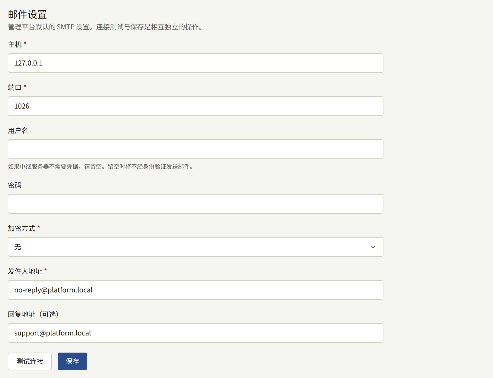
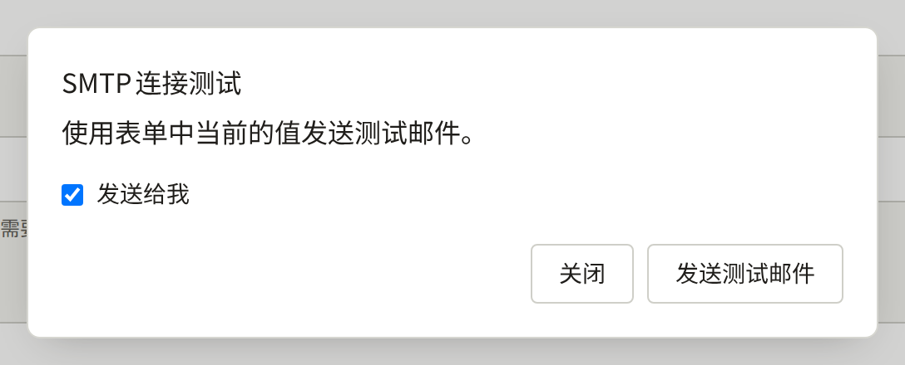
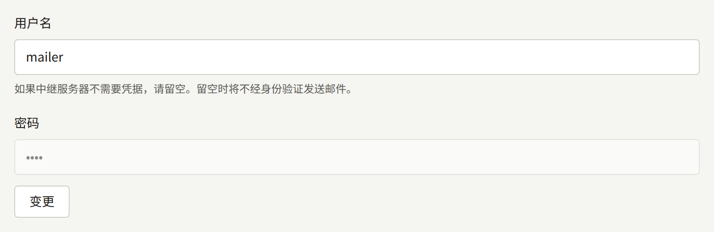

安装实例会向读者、各租户的工作人员以及平台控制台的运营人员发送邮件。所有邮件都由`publira worker`通过您提供的SMTP服务器发送：`publiractl setup`已经保存了平台的SMTP账户，租户也可以保存自己的账户。本页介绍这两种账户、如何测试它们，以及决定邮件外观和链接去向的设置。

本页中的`publiractl`命令都只写出命令本身。请按照[平台控制台与publiractl](./1-platform-console.md#在两者之间进行选择)中的说明运行：将`PUBLIRA_PLATFORM_DB_URL`设置为`publira_platform`的连接，并使用与各进程相同的`PUBLIRA_SECRET_ENCRYPTION_KEYS`和`PUBLIRA_SECRET_ENCRYPTION_PRIMARY_KEY_ID`。所有选项都列在[`publiractl`参考](https://github.com/publira/publira/blob/main/server/cmd/publiractl/README.md#smtp)中。

## 安装实例发送的邮件

| 收件人 | 邮件 |
| --- | --- |
| 租户的读者 | 确认新账户邮箱地址的链接；密码重置，以及密码已更改的通知；确认新邮箱地址，以及发给旧地址的已更改通知；有人试图用已有账户的地址注册时的通知；工作人员对联系留言的回复；所关注系列或作者的新章节、租户发布的公告，以及其评论获得批准的通知 |
| 租户的工作人员 | 管理该租户的邀请；密码重置；确认新邮箱地址，以及发给旧地址的通知；读者发来的新联系留言 |
| 平台运营人员 | 密码重置；确认新邮箱地址，以及发给旧地址的通知 |

每封邮件都使用租户的默认语言撰写，发给运营人员的邮件则使用平台的默认语言。

最后三种邮件按照读者的通知偏好发送：每种通知都有各自的邮件设置，除非读者关闭，否则默认开启，并且只有已确认的地址才会收到。租户向所有人发送的公告会发给每一位拥有已确认地址的读者，不论其设置如何，因此读者众多的租户会通过其SMTP账户一次发送同样多的邮件。

worker进程会将每封邮件排入队列，并重试发送失败的邮件，每次失败后的等待时间加倍：先是一秒，然后两秒，再是四秒。第十次尝试失败后，即第一次尝试约九分钟后，该邮件会被永久放弃，不会再被发送。因此，SMTP服务器的故障（或启用`email-renderer`后它的故障）如果持续更久，期间排队的邮件会丢失，而不只是延迟。`publira worker`上的`PUBLIRA_OUTBOX_MAX_ATTEMPTS`设置尝试次数；由于等待时间会不断加倍，两次尝试之间最长可达一小时，因此只需增加几次尝试，就能覆盖长得多的故障。

每封被放弃的邮件都会由worker进程以`outbox event dead`记录在日志中，当worker进程导出OpenTelemetry指标时，还会计入`publira.outbox.events.dead`指标，请针对其中任一项设置告警。安装实例无法重新发送这类邮件：读者需要重新申请密码重置或确认邮件，管理员邀请则需重新发送，详见[租户的工作人员](./3-tenant-staff.md)。

没有运行worker进程的安装实例不会发送任何邮件。

## 由哪个SMTP账户发送

| 邮件 | 发送途径 |
| --- | --- |
| 租户发给其读者和工作人员的邮件 | 如果租户保存并启用了自己的SMTP账户，则使用该账户，否则使用平台的账户 |
| 平台控制台的邮件 | 始终使用平台的SMTP账户 |

平台的账户是必需的：没有它，运营人员无法重置密码，所有没有自己账户的租户也无法发送任何邮件。租户自己的账户是可选的，适用于希望邮件从自己的域名、通过自己的服务商发出的出版社。

## 平台的SMTP账户

| 设置 | `publiractl smtp set` | 平台控制台 |
| --- | --- | --- |
| SMTP服务器 | `--host`、`--port` | **主机**、**端口** |
| 连接的加密方式 | `--encryption`：`tls`、`starttls`或`none` | **加密方式**：**TLS**、**STARTTLS**或**无** |
| 用于登录的用户 | `--username` | **用户名** |
| 其密码 | `--password-file`、`--password-stdin`、不回显的提示输入，或者在平台只能以环境变量设置密钥的情况下使用`--password-env` | **密码** |
| 邮件的发件地址 | `--from-address` | **发件人地址** |
| 回复地址（与发件地址不同时） | `--reply-to` | **回复地址（可选）** |



请使用邮件服务商为SMTP提交提供的值。端口587几乎都是STARTTLS，端口465则从一开始就使用TLS。只有在使用自己私有网络中的中继时才选择**无**。

对于无需登录即可接收邮件的中继，请将用户名留空；此时worker进程不进行认证就发送邮件，也不会保存密码。密码使用安装实例的加密密钥加密保存，因此`publira worker`必须使用与保存时相同的密钥运行。

发件地址必须是服务商允许该账户使用的地址，并且您的域名应发布服务商要求的SPF和DKIM记录。否则，大量邮件会被归入垃圾邮件，或被读者的邮件服务器拒收。

### 测试账户

测试会通过该账户发送一封简短的邮件，并报告服务器是否接收。

- 在平台控制台中，**邮件**下的**测试连接**会打开**SMTP连接测试**，在保存之前使用表单中的值发送测试邮件，可以通过**发送给我**发给自己，也可以发到另一个**收件人邮箱地址**。测试邮件从`publira server`发送。
- `publiractl smtp test --to operator@example.com`使用已保存的设置，从运行`publiractl`的位置发送，服务器拒收时以`1`退出。



服务器接收了测试邮件，也仍可能将其投递到垃圾邮件中，请检查收件箱。此外，测试邮件由`publira server`或`publiractl`发送，而实际邮件由`publira worker`发送，因此请确认worker进程同样能连接到SMTP服务器。

### 更改账户

在平台控制台中，在侧边栏的**外部服务**下选择**邮件**，修改值后选择**保存**。已保存的密码会被保留，除非您选择其旁边的**变更**；之后将该字段留空保存，就会删除密码。运营人员或超级管理员可以保存，审计员只能查看该页面。



使用`publiractl`：

```bash
publiractl smtp set \
  --host smtp.example.com --port 587 --encryption starttls \
  --username mailer --password-file /run/secrets/smtp-password \
  --from-address no-reply@example.com
publiractl smtp test --to operator@example.com
publiractl smtp show
```

`smtp set`会用所给的选项替换所有已保存的设置，因此每次都要写全所有选项；省略`--reply-to`会清除已保存的回复地址。使用相同的`--username`且不提供密码运行时，会保留已保存的密码。

worker进程每发送一封邮件都会读取设置，因此保存后从下一封邮件起生效，无需重启。每次保存和每次测试都会记录在**审计日志**中。

## 租户自己的SMTP账户

租户的管理员在租户控制台的**集成** › **邮件**中设置自己的账户。他们通过**启用覆盖设置**开启**使用该租户自己的SMTP服务器**，并填写与平台账户相同的值，另外还有**发件人名称（可选）**。**测试连接**会使用表单中的值发送一封测试邮件，**保存**则保存设置。只有租户管理员可以更改，[邮件](../4-console/3-setup/7-email.md)会引导他们完成设置。

从下一封邮件起，该租户的所有邮件都通过其账户发送，包括发给新管理员的邀请。关闭覆盖设置后，邮件将重新通过平台的账户发送。

运营人员无需为此进行任何设置，平台控制台和`publiractl`都不会更改租户的账户。如果某个租户的邮件不再送达，而平台的测试却能通过，首先应检查该租户自己的账户。

## 纯文本与HTML

没有`email-renderer`时，所有邮件都是纯文本。启用后，每封邮件除相同的文本外还附带HTML版本，读者的邮件应用会显示其偏好的版本。启用方法是运行它，并通过`PUBLIRA_EMAIL_RENDERER_URL`让`publira worker`指向它，详见[使用email-renderer发送HTML邮件](../2-deployments/2-installing.md#使用email-renderer发送html邮件)。

启用后，渲染器就成为发送邮件的一部分：它停止运行期间，worker进程会重试每封邮件，而不是只发送文本版本，重试次数与SMTP故障时相同，因此渲染器停止时间超过这个范围时同样会丢失邮件。要恢复为纯文本，请删除该变量并重启worker进程。

## 邮件中链接的去向

大多数邮件都带有链接——用于确认地址、重置密码或接受邀请。worker进程在构建链接时并不知道请求来自哪个主机，因此主机和协议取自安装实例的设置，由`publira worker`读取：

| 邮件 | 链接指向 |
| --- | --- |
| 发给读者 | 租户的域名，例如`https://comics.example.com` |
| 发给租户的工作人员 | 租户的控制台主机，除非为该租户指定了其他主机，否则为`admin.<domain>` |
| 发给平台运营人员 | `PUBLIRA_PLATFORM_APP_URL`中的地址，例如`https://platform.example.com` |

租户链接的协议由`PUBLIRA_TENANT_URL_SCHEME`决定，未设置时为`https`；只有当浏览器确实通过HTTP打开租户时，才将其设置为`http`。任何运行平台控制台的安装实例都必须在`publira worker`上设置`PUBLIRA_PLATFORM_APP_URL`：否则，运营人员收到的链接会指向本地开发机器的地址。

租户的链接跟随其域名，因此租户迁移到另一个主机名后，此后发送的邮件会指向新主机名，而之前发送的邮件仍指向旧主机名，详见[把租户迁移到另一个主机名](./2-tenants.md#把租户迁移到另一个主机名)。
