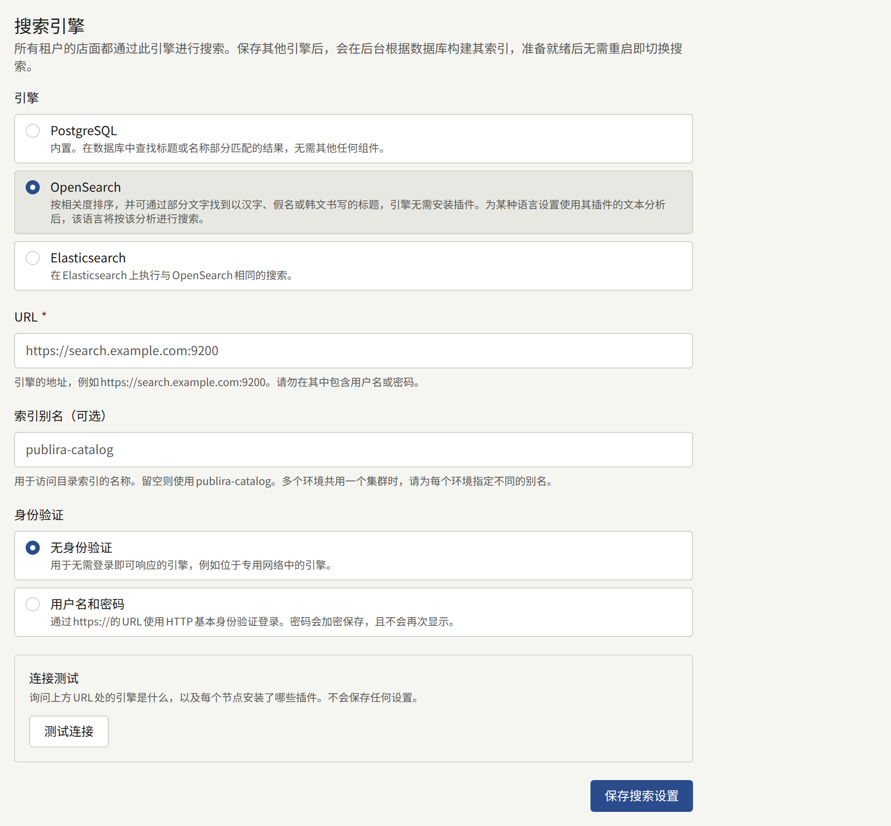
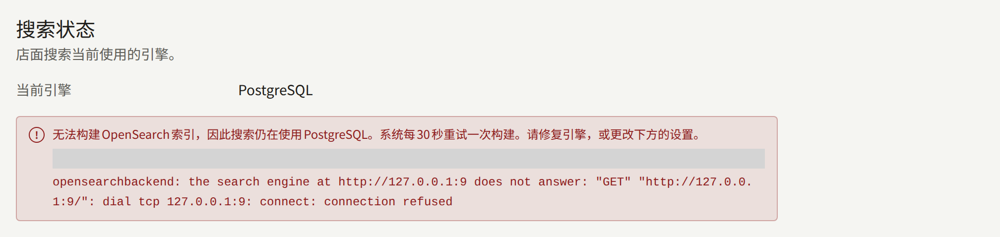
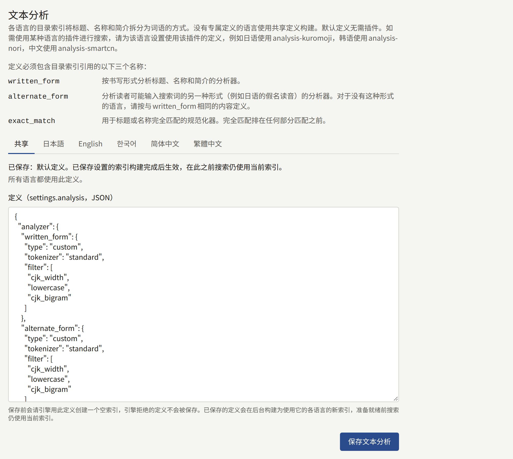

每个租户网站上的搜索都通过同一个引擎查找系列、作者和品牌，该引擎由所有租户共用。安装实例一开始直接使用数据库本身，无需任何额外组件；希望按相关性对结果排序的安装实例可以选择OpenSearch或Elasticsearch。本页比较各个引擎，介绍如何将搜索从一个引擎迁移到另一个引擎，以及引擎所维护的索引。

本页中的`publiractl`命令都只写出命令本身。请按照[平台控制台与publiractl](./1-platform-console.md#在两者之间进行选择)中的说明运行：将`PUBLIRA_PLATFORM_DB_URL`设置为`publira_platform`的连接，并使用与各进程相同的`PUBLIRA_SECRET_ENCRYPTION_KEYS`和`PUBLIRA_SECRET_ENCRYPTION_PRIMARY_KEY_ID`。所有选项都列在[`publiractl`参考](https://github.com/publira/publira/blob/main/server/cmd/publiractl/README.md#search)中。

## 选择引擎

| 引擎 | `--engine` | 搜索方式 | 所需条件 |
| --- | --- | --- | --- |
| **PostgreSQL** | `sql` | 查找包含所输入内容的标题和名称，按标题或名称排序 | 无：使用安装实例已有的数据库 |
| **OpenSearch** | `opensearch` | 按相关性对结果排序，容忍以拉丁字母书写的单词中输错的字母，并能通过部分内容找到以汉字、假名或韩文书写的标题。拥有[专属文本分析](#为某种语言提供专属插件)的语言按照该分析的方式搜索，例如通过以假名输入的读音找到以汉字书写的日语标题 | 一个OpenSearch集群 |
| **Elasticsearch** | `elasticsearch` | 与OpenSearch相同的搜索 | 一个Elasticsearch集群 |

无论由哪个引擎查找结果，网站为每个结果显示的内容都从数据库读取，因此系列绝不会因为引擎尚未同步而显示过时的标题、价格或封面。在所有引擎上，搜索都能以相同的方式筛选和排序。

所有引擎都通过以读者语言显示的标题和简介查找系列：以英语浏览的读者能通过英语标题找到系列，但无法通过只出现在其日语标题中的词找到它。没有英语标题的系列，则通过代替它显示的标题，即网站默认语言的标题来查找。作者和品牌在所有语言中只有一个名称，无论读者使用哪种语言，都通过该名称查找。

如果读者浏览目录多于搜索，或者会准确输入标题，PostgreSQL就足够了。如果读者通过读音查找标题或拼错标题，结果一无所获，就该换用引擎了。

## 准备OpenSearch或Elasticsearch

Publira不会替您运行引擎。请使用您自己运维的集群或托管集群，并准备好以下内容：

- **插件（如有需要）**。默认的文本分析仅基于OpenSearch和Elasticsearch自带的功能构建，因此官方镜像中的引擎开箱即用。只有当您为某种语言[提供基于插件的专属文本分析](#为某种语言提供专属插件)时，才需要插件。
- **引擎的URL**，`http://`或`https://`，`publira server`、`publira worker`和`publiractl`都必须能访问它。
- **用户**，在引擎要求时提供。Publira使用HTTP基本认证登录，并且只会将其发送到`https://`的URL；它不支持API密钥，也不支持自建的证书颁发机构，因此启用了安全功能的引擎需要使用服务器已经信任的证书。该用户需要能够创建、写入和删除索引，以及移动别名，这些索引和别名的名称都以下面的索引别名开头。
- **索引别名**，Publira的索引以它命名：除非另行指定，否则为`publira-catalog`。Publira为读者可以选择的每种语言各保留一个索引，每个索引位于在别名后附加语言的名称之下——`publira-catalog-en`、`publira-catalog-ja`、`publira-catalog-zh-hans`等等——并自行创建这些索引及其别名。共用一个集群的每个安装实例都要使用各自的别名，因为两个安装实例使用同一个别名会互相覆盖对方的目录。

## 测试引擎

测试会询问引擎的身份以及每个节点安装了哪些插件，并报告产品、版本和插件。如果引擎没有响应、拒绝了凭据，或者实际上是与所选产品不同的另一种产品，测试就会失败。插件不影响测试结果：默认的文本分析不需要插件，而您自己的定义会在保存时由引擎检查。列出插件需要一项集群权限，而该用户在其他方面都用不到这项权限，因此没有该权限的用户也能通过测试，只是插件不会被列出。

- 在平台控制台中，**搜索**下的**测试连接**会在保存之前测试表单中的值。测试从`publira server`运行。
- `publiractl search test`测试已保存的引擎，从运行`publiractl`的位置执行，测试失败时以`1`退出。使用PostgreSQL时没有可测试的内容，它会以`1`退出。

## 迁移到另一个引擎

保存引擎并不会立即将搜索迁移过去。新引擎上的索引是空的，因此`publira worker`会先从数据库构建索引，当索引包含所有租户的目录后，搜索才会切换过去。在此之前，网站继续从原来的位置响应，因此读者绝不会搜索到空索引。

### 在平台控制台中

1. 在侧边栏的**外部服务**下选择**搜索**。
2. 在**引擎**下选择**OpenSearch**或**Elasticsearch**，并输入其**URL**，以及（如果您选择了别名）**索引别名（可选）**。
3. 在**身份验证**下选择**无身份验证**，或选择**用户名和密码**并输入两者。
4. 选择**测试连接**，通过后点击**保存搜索设置**保存。



页面顶部的**搜索状态**显示网站当前响应所用的引擎，以及在构建索引期间将要迁移到的引擎。页面每隔几秒重新检查一次，因此迁移发生时会显示出来。运营人员或超级管理员可以保存；审计员只能查看该页面。

### 使用publiractl

```bash
publiractl search set \
  --engine opensearch \
  --url https://search.example.com:9200 \
  --username publira --password-file /run/secrets/search-password
publiractl search test
publiractl search show
```

`search set`会用所给的选项替换所有已保存的设置，因此每次都要写全所有选项；省略`--username`会删除已保存的密码。使用相同的`--username`且不提供密码运行时，会保留已保存的密码。`search show`会输出搜索当前响应所用的引擎，以及正在进行或已失败的构建。

### 所需时间

worker进程每30秒查找一次需要构建的索引，填充索引所需的时间取决于引擎接收所有租户的全部已发布系列、作者和品牌所需的时间。在此期间所做的更改也会写入新索引，因此等待不会造成任何数据丢失。

### 构建失败时

构建失败时——引擎不可用、某个节点丢失了已保存定义所需的插件、用户无权创建索引——搜索仍保持原样，错误会显示在**搜索状态**和`publiractl search show`中。worker进程每30秒重试一次，因此修复引擎后，构建就会完成，无需再次保存设置。如果要放弃迁移，请保存搜索当前仍在使用的引擎。



### 切回PostgreSQL

保存**PostgreSQL**或运行`publiractl search set --engine sql`，会立即将搜索切回：数据库不需要索引。引擎上的索引会保留原样；如果不再使用，请自行删除。

### 更改何时传达到所有进程

`publira server`和`publira worker`每30秒重新读取一次设置，因此迁移会在一分钟内传达到所有实例，无需重启。每次保存和每次测试都会记录在**审计日志**中。

## 文本分析

引擎如何将标题、名称和简介拆分成词，就是文本分析。由于所有租户共用索引，所有租户使用同一个定义；除非某种语言拥有专属定义，否则每种语言的索引都基于它构建。默认定义不需要插件，对每种语言都有一定程度的适用性：它通过单词查找以拉丁字母书写的标题，并容忍输错的字母；通过其中任意连续两个或更多字符查找以汉字、假名或韩文书写的标题，并忽略大小写以及字母和假名的全角半角。除此之外，它对语言一无所知，因此无法做到例如通过读音查找以汉字书写的标题。需要更多功能的语言，可以[提供基于其插件的专属定义](#为某种语言提供专属插件)。

定义是索引的`settings.analysis`对象，以不超过64 KiB的JSON编写，并且必须定义索引引用的三个名称：分析器`written_form`和`alternate_form`，以及规范化器`exact_match`。每个名称的用途请参阅[文本分析参考](https://github.com/publira/publira/blob/main/server/README.md#text-analysis)。

- 在平台控制台中，**搜索**下**文本分析**的**共享**标签页在**定义（settings.analysis，JSON）**中接收定义，并通过**保存文本分析**保存。**恢复默认**会恢复为默认定义。使用PostgreSQL时没有索引，因此也没有可保存的文本分析。
- 使用`publiractl`时，`search set --analysis-file korean-analysis.json`会将定义与引擎一起保存，`--default-analysis`则恢复为默认定义。两者都不指定时，`search set`会保留已保存的定义。

为某种语言提供专属定义，就能用该语言的插件进行搜索：该语言的索引基于这个定义构建，其他语言的索引则基于共享定义构建。

- 在平台控制台中，**文本分析**有一个用于共享定义的标签页**共享**，其中显示哪些语言在使用它，此外每种语言各有一个标签页。没有专属定义的语言会在其标签页中显示共享定义，作为起点。在该标签页中点击**保存文本分析**，会将编辑器中的内容保存为该语言的专属定义，**使用共享定义**则会丢弃专属定义，使该语言重新基于共享定义构建。
- 使用`publiractl`时，`search set`接收某种语言的专属定义：

```bash
publiractl search set --engine opensearch --url https://search.example.com --locale-analysis-file ja=japanese-analysis.json
```

`--locale-analysis-file`以`LOCALE=FILE`的形式接收语言和文件，`--shared-analysis-for ja`则使该语言重新基于共享定义构建。每种语言都要分别重复指定；两者都未指定的语言保持原样，不带这些选项运行`search set`时，所有语言都保持原样。语言有`ja`、`en`、`ko`、`zh-Hans`和`zh-Hant`。`publiractl search show`会在**Own analysis**下列出拥有专属定义的语言。



保存定义之前，会让引擎用它创建一个空索引；引擎拒绝的定义不会被保存，并会显示引擎给出的原因，如果是语言的专属定义，还会显示其对应的语言。已保存的定义会以与新引擎相同的方式，为其影响的语言构建新索引，构建完成后搜索就会切换到新索引；其他语言的索引保持原样。

### 为某种语言提供专属插件

在您为某种语言提供专属定义之前，它都使用共享定义进行搜索，提供专属定义是可选的。OpenSearch和Elasticsearch都为许多语言发布了分析插件——例如日语的`analysis-kuromoji`和`analysis-icu`（可以将以汉字书写的标题与以假名输入的读音相匹配）、韩语的`analysis-nori`、中文的`analysis-smartcn`等——基于这些插件的定义会按照插件的分析方式搜索该语言：

1. 在每个节点停止时安装插件，使用`bin/opensearch-plugin install`或`bin/elasticsearch-plugin install`加上插件名称。本仓库中的[开发用OpenSearch镜像](https://github.com/publira/publira/blob/main/infra/docker/opensearch/Dockerfile)以Dockerfile的形式展示了这一步骤。之后，**测试连接**会将其列在每个节点都安装了的插件中。
2. 按照引擎对该插件的文档说明，编写一个使用该插件的分词器和过滤器、并定义上述三个名称的定义。
3. 在**文本分析**中该语言的标签页里保存，或使用`publiractl search set --locale-analysis-file`保存。

该语言的索引会基于此定义重建，准备就绪后，该语言的搜索就会切换到新索引。没有该语言标题的系列，会以代替它显示的标题收录在该语言的索引中，因此该语言的分析同样适用于这个标题。

## 重建索引

当租户发布、编辑内容或更改默认语言时，worker进程会保持索引更新；每当引擎或文本分析发生变化，或者某个版本更改了读者可选择的语言或默认文本分析时，它都会构建新索引，因此很少需要手动重建索引。在构建期间，**搜索状态**和`publiractl search show`会显示正在进行的构建，网站则继续使用现有的索引响应。`publiractl search reindex`用于剩下的两种情况：

- **某个版本更改了索引**。当[发布说明](../2-deployments/8-upgrading.md#阅读发布说明)指出目录索引有变化时，请在升级完成后运行它。
- **索引丢失**，原因是集群被替换或索引被删除。

```bash
publiractl search reindex
```

它会在当前索引旁为每种语言构建新索引，用所有租户的目录填充，再一次性将所有别名移到新索引上，并删除旧索引，因此在运行期间网站可以继续搜索。它以`publira_content_stats`角色读取目录，因此请为它提供该角色的`PUBLIRA_CONTENT_STATS_DB_URL`；如果引擎有已保存的密码，还要提供加密密钥。worker进程正在构建索引时它无法运行，如果有构建正在进行，它会以`1`退出；请在构建完成后再次运行。使用PostgreSQL时没有可重建的索引，它会以`1`退出。

`publiractl search reindex --tenant comics.example.com`会将单个租户的目录重新写入搜索当前使用的索引，而不构建新索引。它用于某个租户的搜索结果看起来有误的情况，无法将更改应用到索引本身。
