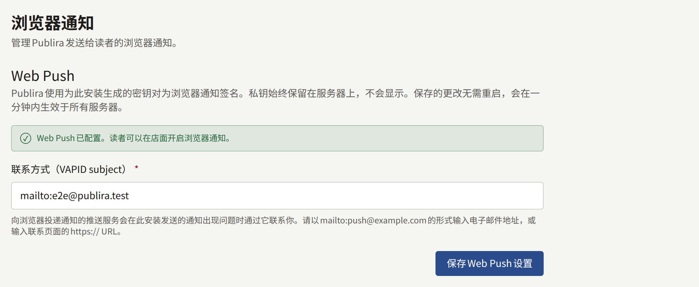

读者可以允许租户的网站向其浏览器发送通知，这样无需打开网站，就能得知新章节或租户发布的公告。安装实例通过每位读者浏览器的推送服务发送通知，并使用属于该安装实例的VAPID密钥对为每条通知签名。Web Push是可选的，在您开启之前处于关闭状态；从未开启的安装实例不会发送任何浏览器通知，也不会因此出现任何故障。

本页中的`publiractl`命令都只写出命令本身。请按照[平台控制台与publiractl](./1-platform-console.md#在两者之间进行选择)中的说明运行：将`PUBLIRA_PLATFORM_DB_URL`设置为`publira_platform`的连接，并使用与各进程相同的`PUBLIRA_SECRET_ENCRYPTION_KEYS`和`PUBLIRA_SECRET_ENCRYPTION_PRIMARY_KEY_ID`。所有选项都列在[`publiractl`参考](https://github.com/publira/publira/blob/main/server/cmd/publiractl/README.md#webpush)中。

## 开启所需的条件

需要两样东西，都保存在安装实例的设置中，而不是任何进程的环境中：

- **VAPID密钥对**，浏览器的推送服务会用它校验每条通知。它由Publira生成，您无需接触其中任何一个密钥。私钥使用安装实例的加密密钥加密保存，永远不会显示；公钥会在每位读者的浏览器订阅时交给浏览器。
- **subject**，即安装实例发送的内容出现问题时，推送服务可以联系到您的联系方式：形如`mailto:push@example.com`的邮箱地址，或联系页面的`https://` URL。

在保存subject之前，Web Push保持关闭。在此之前，网站不会提供浏览器通知，worker进程也不会发送任何通知。

## 开启

### 使用publiractl

```bash
publiractl webpush init --subject mailto:push@example.com
publiractl webpush show
```

如果尚未保存密钥对，`webpush init`会生成密钥对，并保存subject。`webpush show`会输出subject和公钥。

`publiractl setup`中也提供了这一步，因此在其中做过设置的安装实例已经开启了Web Push。

### 在平台控制台中

在侧边栏的**外部服务**下选择**Web Push**。如果尚未保存密钥对，打开该页面时就会生成。输入**联系方式（VAPID subject）**并选择**保存Web Push设置**；随后页面会显示Web Push已配置。运营人员或超级管理员可以保存；审计员只能查看该页面。



如果页面提示API服务器没有加密密钥，因此无法设置Web Push，说明`publira server`启动时没有设置`PUBLIRA_SECRET_ENCRYPTION_KEYS`。请设置与其他进程相同的密钥，重启它，然后重新打开该页面。

### 确认是否正常工作

API和worker进程每十秒重新读取一次设置，因此保存的subject无需重启即可生效。第一次保存后，worker进程还会在大约二十秒后，即API开始以该subject响应时，丢弃每个租户网站信息的缓存副本，因此每个网站从下一个请求起就会提供浏览器通知。这次丢弃是发件箱中的一次缓存重新验证，与其他重新验证一样发送：没有`PUBLIRA_REVALIDATE_TOKEN`的worker进程无法发送它，详见[发件箱](./10-scheduled-jobs.md#发件箱邮件推送和缓存重新验证)。

要确认它是否正常工作，请以读者身份登录某个租户的网站，在读者通知设置的**浏览器通知**下开启**在此浏览器中接收推送通知**，在通知偏好的**关注的系列和单话的新话**一行中保持**浏览器**开启，然后关注一个系列：该系列下一个发布并显示在网站上的章节会以浏览器通知的形式送达。公告则只有在读者同时开启**公告**一行中的**浏览器**后才会送达，该项默认关闭。

每次保存都会记录在**审计日志**中。

## 以后更改

subject可以随时更改，使用`webpush init`加上新的`--subject`，或在同一页面中更改。它无法删除：一旦保存了subject，Web Push就会保持开启。

密钥对永远不会被替换。每个浏览器订阅都是基于其公钥创建的，因此新的密钥对会悄无声息地停止向所有开启通知的读者发送通知；`publiractl`和平台控制台都不会生成第二个密钥对。因此，密钥对是安装实例的备份必须保留的内容之一：它存放在数据库中，使用加密密钥加密，两者任一丢失，它就会丢失。轮换加密密钥时密钥对会被保留：`publiractl db reseal`会将私钥与其他所有内容一起用新密钥重新加密，详见[轮换密钥加密密钥](./12-security/1-rotating-secrets.md#轮换密钥加密密钥)。

浏览器已放弃的订阅——因为读者撤销了权限或清除了网站数据——会在下一次向其发送通知被拒绝时删除。

## 移动应用上的通知

Web Push只涵盖浏览器。租户的移动应用收到的通知通过租户自己的Firebase项目发送，由其管理员在租户控制台中设置；这些都不是安装实例的设置。[推送通知](../5-mobile-app/3-push-notifications.md)介绍了相关设置。
