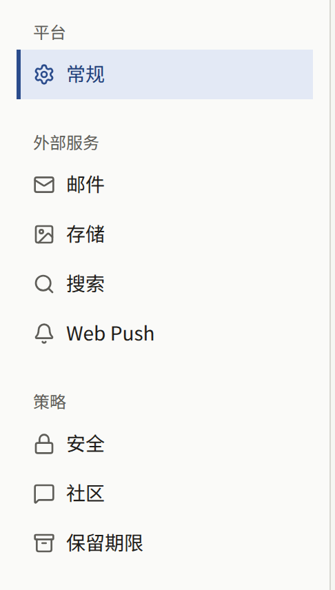
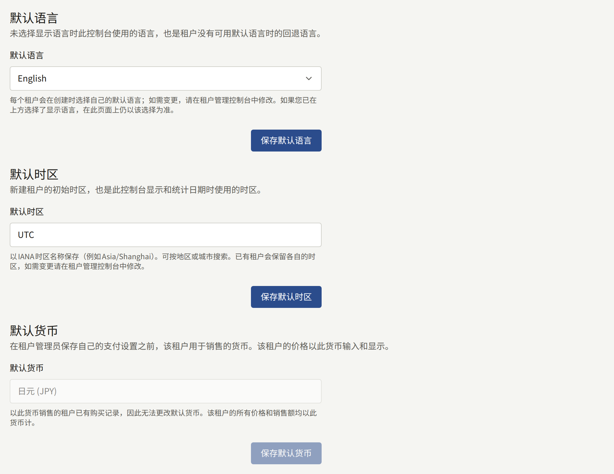
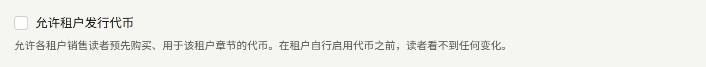
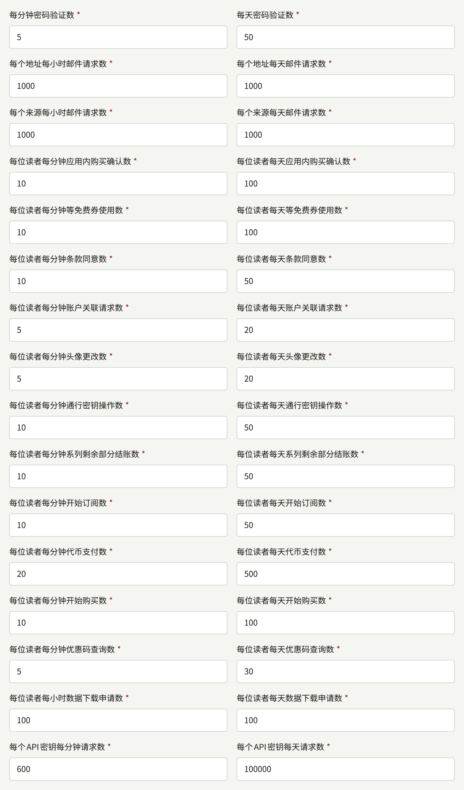
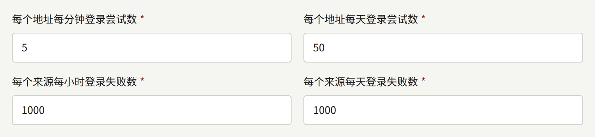
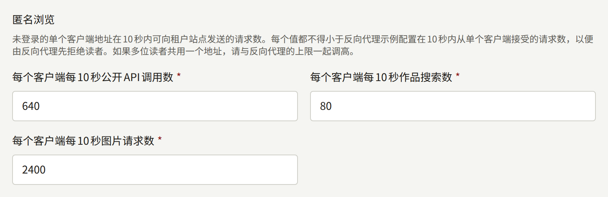
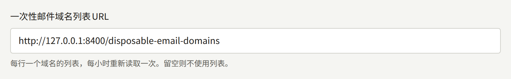
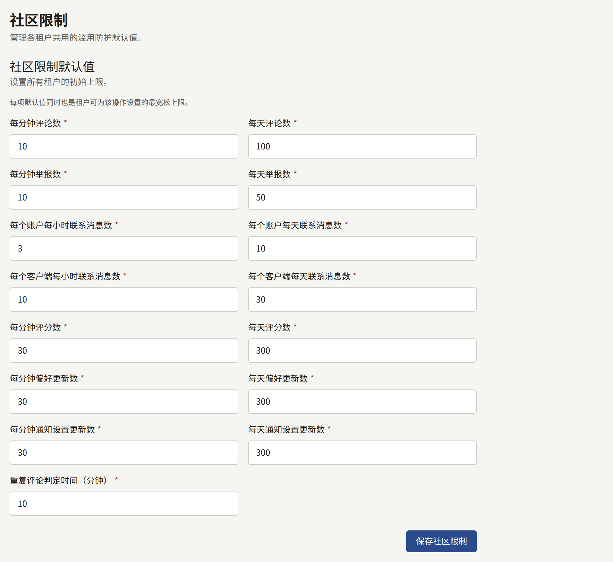
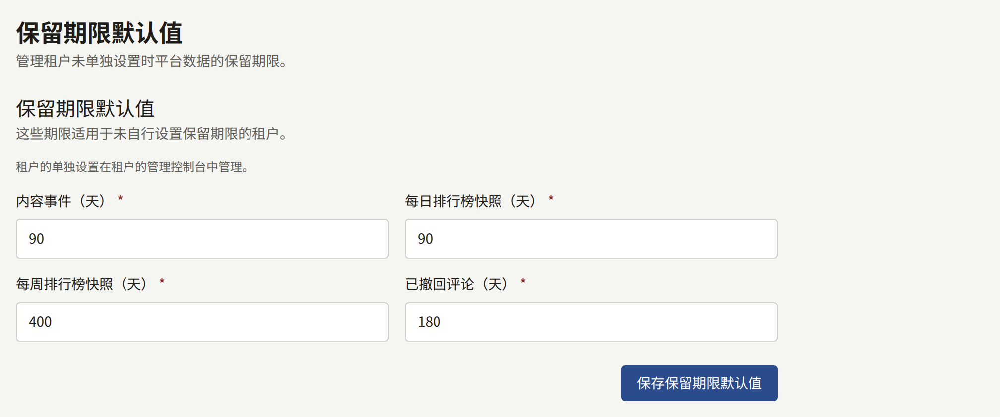

安装实例依赖少数几项不属于任何租户的设置：新租户起始使用的语言、时区和货币，防止单个读者或单个地址压垮平台的各项限制，以及会过期的记录保留多长时间。本页说明每组设置防范什么、如何更改，以及其中哪些部分可以由租户管理员为自己的租户更改。

每项策略和保留期限的值都有内置默认值，没有保存任何值的安装实例就使用这些默认值。默认时区和默认货币也是如此：默认时区在保存之前为`UTC`；默认货币为`publiractl setup`时指定的货币，未指定时为`USD`，在本版本之前就已运行的安装实例上则为`JPY`。默认语言没有内置默认值：`publiractl setup`保存了一个，平台控制台的初始设置页面又将其替换为第一位运营人员选择的语言。每个值的范围和内置默认值请参阅`publiractl`参考中的[`policy`](https://github.com/publira/publira/blob/main/server/cmd/publiractl/README.md#policy)和[保留期限](https://github.com/publira/publira/blob/main/server/cmd/publiractl/README.md#retention-periods)，本页不再重复。

## 设置所在的位置

每组设置都可以在平台控制台中设置，也可以使用`publiractl`设置，运行方式请参阅[平台控制台与publiractl](./1-platform-console.md#在两者之间进行选择)：

| 组 | 平台控制台 | `publiractl` |
| --- | --- | --- |
| 默认语言、时区和货币 | **平台**下的**常规** | `platform set`、`platform show` |
| 两步验证、是否允许租户发行代币、登录、密码、购买、票券、邮件、读者操作、API密钥和匿名浏览的限制，以及一次性邮件域名列表 | **策略**下的**安全** | `policy set`、`policy show` |
| 评论、举报、评分、联系、阅读器和通知设置的限制 | **策略**下的**社区** | `policy set`、`policy show` |
| 会过期的记录保留多长时间 | **策略**下的**保留期限** | `retention set`、`retention show` |



两者都通过同一套代码写入。`set`命令只更改其选项指定的值，其余保持不变；平台控制台中的页面则一次保存其上的所有值。没有改变任何内容的保存不会被记录；其他保存会以**更新了平台设置**、**更新了平台策略**或**更新了保留期限默认值**记录在**审计日志**中。**安全**、**社区**和**保留期限**页面不会覆盖它们没有看到的保存：如果在您打开页面后有人保存了该页面，平台控制台会拒绝保存，并显示“其他运营人员已更改这些设置，因此未保存。请重新加载页面后重试。”**安全**和**社区**作为同一个策略保存，因此保存其中任何一个时，也会拒绝另一个的过时副本。**常规设置**上的三个表单不做这种检查：每个表单都会用自己的值覆盖已保存的值，并保持其他值不变。`publiractl`会在写入之前读取已保存的值，如果在读取和写入之间有其他保存发生，它会以`1`退出，之后再次运行同一命令，就会在那次保存的基础上应用其选项。

运营人员或超级管理员可以保存这些页面。审计员看到的是相同的表单，但保存会被拒绝。

在保存策略之前，平台控制台仪表盘上的**设置状态**卡片显示“登录、防滥用和数据保留限制使用内置默认值。”这是一个正常运行的安装实例，而不是尚未完成设置的安装实例：只有当内置值不适合平台时，才需要更改。

## 平台默认值

**常规设置**包含三个值，每个值都有自己的保存按钮。



**默认语言**是平台控制台为尚未选择语言的运营人员显示的语言，包括其登录页面，也是平台控制台发给运营人员的邮件（例如密码重置）所用的语言。它不决定任何租户的语言：每个租户在创建时都会被指定自己的默认语言，详见[租户](./2-tenants.md#创建租户之前)。第一位运营人员在初始设置页面上选择了这个值。

**默认时区**是创建时未指定时区的新租户起始使用的时区，也是平台控制台显示和计算日期所用的时区。租户会保留创建时的时区，因此更改默认值只会影响之后创建的租户。租户的管理员可以在租户控制台中更改其时区。第一位运营人员在初始设置页面上选择了这个值，该页面提供的是其浏览器的时区。

**默认货币**是管理员尚未保存**支付设置**的每个租户销售所用的货币，因此也是该租户的价格录入和显示所用的货币。保存了支付设置的租户会保留在那里保存的货币，默认值不再影响它。可以通过名称或ISO 4217代码（例如`EUR`）在列表中查找。一旦有以该货币销售的租户卖出了任何东西，它就无法更改：此时该字段为只读，并说明原因，`publiractl`也会拒绝更改，直到每个这样的租户都以自己的货币保存了支付设置。`publiractl setup`和平台控制台的初始设置页面会在设置安装实例时询问它，这正是选择它的时机。

使用命令行：

```bash
publiractl platform set --default-locale en --default-timezone America/New_York --default-currency USD
```

## 安全

**安全策略**包含同等适用于每个租户、且任何租户都无法更改的值。每一项都保护账户、发送邮件的操作、涉及资金的操作或租户控制台的API。

### 租户管理员的两步验证

**要求租户管理员使用多因素认证**（`--mfa-required-for-tenant-admin`）会阻止租户管理员仅凭密码登录租户控制台。尚未设置身份验证器应用的管理员不会被拒之门外：输入密码后，控制台会显示**设置两步验证**，只有在注册了身份验证器之后才能完成登录。页面会告诉他们这是租户的要求，但实际上这是平台的要求，租户无法关闭它。


它同时适用于所有租户，并且只适用于**租户管理员**角色；编辑和审计员永远不会被要求。它在每位管理员下次登录时生效，不影响已打开的会话。管理员仍然可以在自己的账户设置中关闭身份验证器，下次登录时会再次被要求设置。

平台控制台自身的运营人员不受此设置约束；下一项设置才是针对他们的。

### 平台运营人员的两步验证

**要求平台控制台的所有运营人员使用两步验证**（`--mfa-required-for-platform-operator`）会阻止运营人员仅凭密码登录平台控制台。尚未设置身份验证器应用的运营人员不会被拒之门外：输入密码后，控制台会显示**设置两步验证**，只有在注册了身份验证器并看到恢复码之后才能完成登录。


它适用于所有角色，包括**审计员**，因为每位运营人员都能读取所有租户的数据。它在每位运营人员下次登录时生效，不影响已打开的会话。运营人员仍然可以在**账户设置**中关闭身份验证器，下次登录时会再次被要求设置。在有人开启之前，它处于关闭状态。如果安装实例的`publira server`没有`PUBLIRA_SECRET_ENCRYPTION_KEYS`，将拒绝开启它，因为在那里没有运营人员能够设置身份验证器，也就没有人能登录去再次关闭它。

### 租户发行的代币

**允许租户发行代币**（`--tenant-coins-allowed`）允许租户发行代币：租户的读者预先购买、用于该租户章节的余额。在有人开启之前，它处于关闭状态，无论是新安装实例，还是从不具备此功能的版本升级而来的安装实例。



代币是一种储值工具，因此根据您和各租户所在的地区，可能适用有关预付支付工具、电子货币、资金转移或礼品卡的法律。在某些司法管辖区，这些法律关注的是运行安装实例的平台，而不是销售代币的租户。除非您已确认允许租户发行代币不会使您成为发行方，或者已经完成了作为发行方所需的一切，否则请保持关闭。

开启它不会改变读者看到的任何内容：租户仍需在其控制台的**支付** › **代币**下为自己开启代币，详见[代币](../4-console/9-coins.md)。通过清除复选框或使用`--tenant-coins-allowed=false`关闭它，会立即停止所有租户，无论其自身设置如何：没有租户销售代币，也没有读者使用代币，每位读者都保留其余额。再次开启后，每个租户都会恢复其之前保存的设置。

### 速率限制

每项限制都是每分钟或每小时的次数，外加每天的次数，每天的次数永远不低于较短时段的次数。超出限制的请求会被拒绝，直到其时间窗口过去。时间窗口按时钟固定，而不是从读者的第一个请求开始计算，因此次数在每分钟或每小时开始时重新计算，每天的次数则在UTC午夜重新计算。

| 安全页面上的项目 | 保护对象 |
| --- | --- |
| **每分钟密码验证数**和**每天密码验证数** | 读者为了更改密码、更改邮箱地址或删除账户而输入当前密码。每项都按账户计数，输入正确的密码会清除计数，因此它减缓的是有人在其持有的会话中猜测密码，而不是偶尔输错一次的读者 |
| **每个地址每小时邮件请求数**和**每个地址每天邮件请求数** | 由会发送邮件的表单发往同一地址的邮件：读者注册和邮箱验证、三个应用中的密码重置和邮箱更改、工作人员邀请、平台控制台中的管理员邀请和新增运营人员，以及对联系留言的回复。地址在其所属租户内或平台控制台内计数，带有`+tag`的地址与去掉它的地址合并计数 |
| **每个来源每小时邮件请求数**和**每个来源每天邮件请求数** | 按发出请求的客户端地址统计的同类邮件，跨越所有地址和所有租户，因此单个客户端无法向一长串陌生人发送邮件 |
| **每位读者每分钟应用内购买确认数**和**每位读者每天应用内购买确认数** | 单个读者交给服务器、由服务器向Apple或Google验证的商店交易 |
| **每位读者每分钟等免费券使用数**和**每位读者每天等免费券使用数** | 单个读者使用等免费券的请求。已使用的券本身已受其系列恢复时间的限制；这项限制约束的是被拒绝的尝试 |
| **每位读者每分钟条款同意数**和**每位读者每天条款同意数** | 在被要求同意修订版本时，单个读者向其租户的服务条款和隐私政策发送的同意 |
| **每位读者每分钟账户关联请求数**和**每位读者每天账户关联请求数** | 单个读者将Apple或Google账户关联到其账户的请求 |
| **每位读者每分钟头像更改数**和**每位读者每天头像更改数** | 单个读者上传、选择或删除其头像的次数 |
| **每位读者每分钟通行密钥操作数**和**每位读者每天通行密钥操作数** | 单个读者开始注册通行密钥或用通行密钥确认请求，或者重命名或删除通行密钥的次数 |
| **每位读者每分钟系列剩余部分结账数**和**每位读者每天系列剩余部分结账数** | 单个读者发起的购买系列剩余部分的结账 |
| **每位读者每分钟开始订阅数**和**每位读者每天开始订阅数** | 单个读者开始的订阅，无论是通过网站上的结账还是通过租户应用中的商店，合并计数 |
| **每位读者每分钟代币支付数**和**每位读者每天代币支付数** | 单个读者用代币支付的章节 |
| **每位读者每分钟开始购买数**和**每位读者每天开始购买数** | 单个读者发起的章节、卷或代币包的购买，无论是在网页上还是通过应用的商店，合并计数 |
| **每位读者每分钟优惠码查询数**和**每位读者每天优惠码查询数** | 单个读者查询优惠码的次数，无论是通过报价还是通过使用优惠码发起的购买，合并计数。在读取优惠码之前就会计数，因此这项限制约束的是单个账户猜测租户优惠码的速度 |
| **每位读者每小时数据下载申请数**和**每位读者每天数据下载申请数** | 单个读者申请的其数据副本，如[读者账户](../4-console/2-readers/1-accounts.md#读者下载的个人数据)所述。每次都会读取安装实例保存的有关该读者的所有记录 |
| **每个API密钥每分钟请求数**和**每个API密钥每天请求数** | 租户的一个[API密钥](../4-console/10-api-keys-and-webhooks.md#发出请求)向租户控制台的API发出的请求，按密钥计数。密钥属于系统而不是个人，因此这一限制为逐页读取目录的作业留有余量，它限制的是一个泄露的密钥能给数据库造成多大负担 |



每份邀请都算作一次请求，包括**创建租户**上的每个**初始管理员邮箱**地址，这些地址会在租户创建之前全部计数：如果其中一个超出限制，就不会创建租户，也不会发送任何邮件。`publiractl`不通过任何表单发送，不计入这些限制中的任何一项。

客户端地址是`publira server`在`Forwarded`或`X-Forwarded-For`中跳过其信任的代理后找到的地址，详见[Publira信任的代理](../2-deployments/4-edge/index.md#publira信任的代理)。共用同一个地址的读者，例如在办公室或移动运营商网关后面的读者，会共享该地址按来源和按客户端的计数。

### 登录尝试

另有两项限制保护以密码登录本身，包括登录租户的网站、租户控制台或平台控制台。它们位于**安全**页面上的速率限制之后，计数方式相同：

| 安全页面上的项目 | 选项 | 保护对象 |
| --- | --- | --- |
| **每个地址每分钟登录尝试数**和**每个地址每天登录尝试数** | `--login-attempts-per-account-per-minute`和`--login-attempts-per-account-per-day` | 针对同一地址尝试的密码。地址在其所属租户内计数（租户的网站与其租户控制台共用一个计数），或在平台控制台内计数。以正确的密码登录会清除计数，因此它减缓的是有人猜测某个账户的密码，而不是输错密码的人 |
| **每个来源每小时登录失败数**和**每个来源每天登录失败数** | `--login-attempts-per-source-per-hour`和`--login-attempts-per-source-per-day` | 来自同一客户端地址的登录失败，跨越所有地址、所有租户和平台控制台，因此单个客户端无法对一长串地址尝试同一个密码。以正确的密码登录不计入其中 |



超出任一限制的尝试会在检查密码之前被拒绝，并且无论该地址是否有账户，拒绝的方式都相同，因此拒绝不会向猜测者透露哪些地址已注册。此时登录页面会显示“短时间内的请求过多。请稍后再试。”，而不是提示邮箱地址或密码不正确，因为密码很可能是正确的。两步验证是密码之后的单独检查，这些限制不计算其验证码。

按账户的限制也意味着，任何知道某个地址的人都可以用错误的密码耗尽其计数，使地址的所有者在时间窗口过去之前无法用密码登录。使用Apple或Google登录以及密码重置不受其影响。请将每天的值设得足够高，以免别人的脚本让您一整天都无法用密码登录。

### 匿名浏览

另有三项限制约束单个客户端地址在未登录的情况下读取租户网站的速度：移动应用调用的公开API、其作品搜索的调用，以及租户域名和图片主机上的图片。每项都是10秒时间窗口内的次数，没有每天的次数；在安装实例前面的边缘对相同请求设置的限制之外，它们作为后备，用于不做任何限制的边缘。Web应用以自身身份、同时代表其所有读者发出的调用不计入。

它们位于**安全**页面上登录尝试限制之后的**匿名浏览**下：

| 安全页面上的项目 | 选项 |
| --- | --- |
| **每个客户端每10秒公开API调用数** | `--anonymous-read-public-api-per-10-seconds` |
| **每个客户端每10秒作品搜索数** | `--anonymous-read-search-per-10-seconds` |
| **每个客户端每10秒图片请求数** | `--anonymous-read-images-per-10-seconds` |



低于示例边缘配置在10秒内从单个客户端接受的数量的值会被拒绝，以便边缘始终先于服务器拒绝读者：页面会在消息中给出最小值，并且不保存任何内容。当读者共用一个地址时，例如移动运营商的网关，请同时提高这些值和边缘的允许量，因为边缘的允许量一旦超过服务器的，就会放行随后被服务器拒绝的请求。[publira server自身的限制](./12-security/5-rate-limits.md#publira-server自身的限制)给出了内置值、每项的最小值以及边缘接受的数量。

### 计数保存的位置

这些限制由`publira server`计数，保存在其`PUBLIRA_REDIS_URL`指定的Valkey或Redis服务器中，[安装](../2-deployments/2-installing.md#准备服务)中要求您准备该服务器。`publira server`的所有实例共享这些计数，因此无论运行多少个实例，限制在整个安装实例范围内都有效。

没有该变量时，每个实例都在自己的内存中计数，日志中也不会有任何提示。这样一来，请求分散到三个实例上的读者会获得三倍的限制，重启也会使所有计数归零。实例无法连接Redis期间也会如此：启动时无法连接的服务器会记录一条错误并自行计数；之后失去连接的服务器会记录一条警告，在连接恢复之前自行计数，并在恢复时再次记录。如果运行多个`publira server`实例，请在每个实例上都设置`PUBLIRA_REDIS_URL`。

保存的更改会在十秒内传达到每个正在运行的实例，无需重启。

### 一次性邮件域名列表

**一次性邮件域名列表URL**（`--disposable-email-domains-url`）是`publira server`读取一次性邮件专用域名列表的位置。Publira不附带任何列表，因此在您提供URL之前没有列表。



列表是每行一个域名的纯文本文件；空行和以`#`开头的行会被忽略，这正是[disposable-email-domains](https://github.com/disposable-email-domains/disposable-email-domains)项目的屏蔽列表格式。列出的域名也涵盖其子域名。每个实例在首次需要时读取列表，一小时后再读取一次。如果读取失败，或文件中有一行不是域名，该实例会继续使用上次读取的列表并记录一条警告；如果没有之前的列表，它不拒绝任何地址，并在一小时后重试。新的URL在保存后的下一次查询时读取。

仅保存列表本身不会拒绝任何地址。希望拒绝一次性地址的租户，需要在其控制台的**设置**中的**不接受的电子邮件地址**下开启**不接受一次性邮箱域名**，此后读者就无法使用列出的域名上的地址注册，也无法将其地址更改为这样的地址。使用Apple或Google登录不受影响。当平台没有列表时，该开关会说明它不起作用。

## 社区

**社区限制**是对读者在租户社区中的行为的限制。这里的每个值既是所有租户的起点，也是租户可以选择的最宽松值：租户可以为自己收紧限制，但永远不能放宽。



| 社区页面上的项目 | 限制对象 |
| --- | --- |
| **每分钟评论数**和**每天评论数** | 单个读者发表的评论 |
| **每分钟举报数**和**每天举报数** | 单个读者举报的评论 |
| **每个账户每小时联系消息数**和**每个账户每天联系消息数** | 单个已登录读者通过租户联系表单发送的消息 |
| **每个客户端每小时联系消息数**和**每个客户端每天联系消息数** | 从单个客户端地址通过联系表单发送的消息，无论是否登录，跨所有租户计数 |
| **每分钟评分数**和**每天评分数** | 单个读者点按章节评分的次数 |
| **每分钟偏好更新数**和**每天偏好更新数** | 单个读者保存阅读器布局的次数 |
| **每分钟通知设置更新数**和**每天通知设置更新数** | 单个读者保存其通知设置的次数 |
| **重复评论判定时间（分钟）** | 读者在同一章节再次发表相同评论时被拒绝的时长，从1分钟到一周。去除首尾空格后进行完全一致的比较 |

这些限制与安全限制在同一位置计数，因此[计数保存的位置](#计数保存的位置)同样适用于它们。

## 保留期限

**保留期限默认值**设置四种记录在所有未自行设置期限的租户中保留多长时间。每个期限都是整数天数。`publira worker`按自己的时间表删除超过期限的记录；无需为其运行做任何设置，`publiractl job`可以手动执行相同的清除。



| 记录 | 内容 | 删除者 | 频率 |
| --- | --- | --- | --- |
| **已撤回评论** | 作者已删除的评论，保留这些评论是为了在有关它们的举报或争议尚未解决时，工作人员仍能阅读。针对评论提交的举报会随评论一起删除 | `purge-withdrawn-comments` | 每小时 |
| **内容事件** | 每次浏览、读完、购买、收藏、评分和评论，按发生时记录 | `purge-content-events` | 每24小时 |
| **每日排行榜快照** | 每天的排行榜 | `purge-ranking-snapshots` | 每24小时 |
| **每周排行榜快照** | 每周的排行榜 | `purge-ranking-snapshots` | 每24小时 |

每次清除都在开始时读取期限，因此保存的更改从下一次运行起生效。如果某项清除在当前间隔内尚未运行，它也会在`publira worker`启动时运行，停机后的第一次运行会删除在此期间过期的所有内容。

有些记录按设计会在超过期限后仍然保留：

- 被工作人员或因达到举报阈值而隐藏的评论，无论多久都不会被删除：它是审核决定的记录。只有作者撤回的评论才会被清除。
- 租户每种排行榜中最新的一份始终保留，因此排行榜永远不会变成空白。

选择期限：

- **内容事件**在记录之后用于两件事：每天的统计数据，在当天结束后生成；以及推荐，基于租户在其自身时区已结束的最近28天生成。统计数据比事件保留得更久，因此较短的期限不会缩小租户的报表。记录每位已登录读者在哪些天活跃的数据也是如此，控制台会据此在某一周之后的十二周内跟踪该周注册的读者，因此比这更短的期限仍然会保留那几周用于计数。短于30天（28天，加上生成推荐的那一天，再加上因时钟调整而变长的一天）的期限，会让推荐基于更少的天数生成，并且可能在某一天的统计数据生成之前就删除当天的事件，因此无论是平台的默认值还是租户自己的期限，都会被拒绝。在Publira开始拒绝之前保存的较短期限按30天保留。
- **排行榜快照**用于随时间进行比较；只有最新的一份会显示给读者。较短的期限只会缩短这种比较能追溯的范围。
- **已撤回评论**的期限应覆盖您的租户解决有关评论的举报或争议所需的时间。租户控制台会向工作人员显示每条已撤回评论的预定删除时间。

使用命令行：

```bash
publiractl retention set --content-event-days 120
```

## 租户可以更改的内容

租户的管理员可以在租户控制台的**设置** → **限制与保留**中为自己的租户更改其中部分设置，详见面向他们的[设置](../4-console/3-setup/1-settings.md#限制与保留)。编辑和审计员可以看到该页面，但无法保存。

| 组 | 租户可以做什么 |
| --- | --- |
| **常规**：默认语言和时区 | 这里无可更改；每个租户从创建之时起就拥有自己的语言和时区，并在其控制台的**设置**中更改 |
| **常规**：默认货币 | 在**支付设置**中选择自己的货币，此后默认值不再影响它 |
| **安全**：所有值 | 无可更改。租户唯一相关的选择是是否拒绝一次性邮件域名，而它用于拒绝的列表是平台的列表 |
| **社区**：所有值 | 将其中任意一项收紧：降低限制，或延长重复评论判定时间。比平台更宽松的值会被拒绝 |
| **保留期限**：所有期限 | 将其中任意一项设置得比平台默认值更长或更短，范围为1到36500天，**内容事件**则从30天起 |

在该页面上，每组设置最初都勾选了**使用平台默认值**，并在旁边显示平台的值。取消勾选后，管理员可以输入租户自己的值，并通过**保存社区限制**或**保存保留期限**保存；再次勾选并保存，则该组恢复为平台的值。使用平台默认值的租户会跟随您之后对其所做的每项更改。

平台的值发生变化时，租户自己的值保持不变，但有一个例外。租户的社区限制在每次请求时都会与平台的限制比较，并采用两者中更严格的一个，因此将平台限制降低到低于租户自己的值时，该租户的限制也会随之收紧。再次提高平台限制，不会放宽选择了更严格值的租户。保留期限没有这种比较：租户自己的期限按原样使用。

租户的更改会以**更新了社区限制**和**更新了保留期限**记录在其控制台的审计日志中。
