系列是读者追看的作品：它有标题、简介、封面、书系和作者，并包含读者打开的章节。侧边栏**作品**分组中的**系列**列出租户的系列，最新的排在最前，每页二十个。列表上方的**连载状态**和**年龄分级**可以缩小列表范围。

每一行都可以通过**编辑**（审计员则为**查看**）打开系列，通过**章节**打开其章节。系列的**发布日期和时间**已过时，该行的**状态**为**已发布**；该时间尚未到来时为**已预约**；没有设置时为**草稿**。没有同时在网站和应用上显示的系列，会在标题旁标有**仅网页**或**仅应用**。

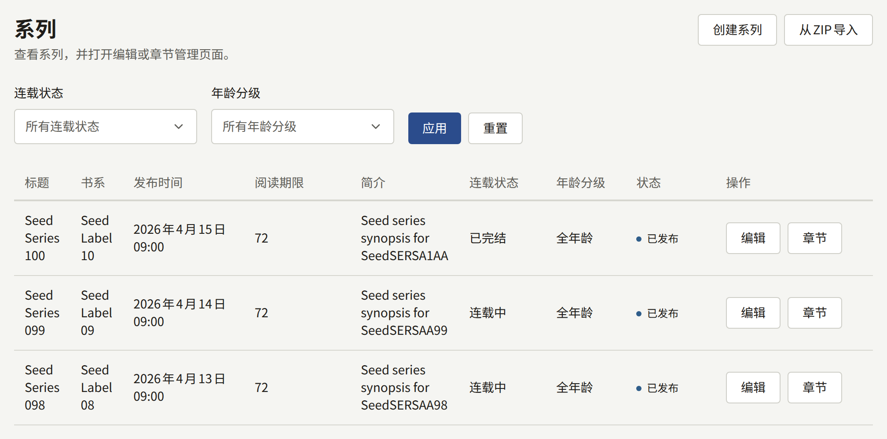

## 创建系列

选择**创建系列**。这个表单与之后编辑系列时使用的表单相同，其中每个字段之后都可以更改。选择底部的**创建系列**进行保存，随后会打开该系列的编辑页面。

标题和简介使用网站的默认语言填写。网站其他语言的标题和简介在系列创建后添加，如[其他语言的标题](#其他语言的标题)所述。

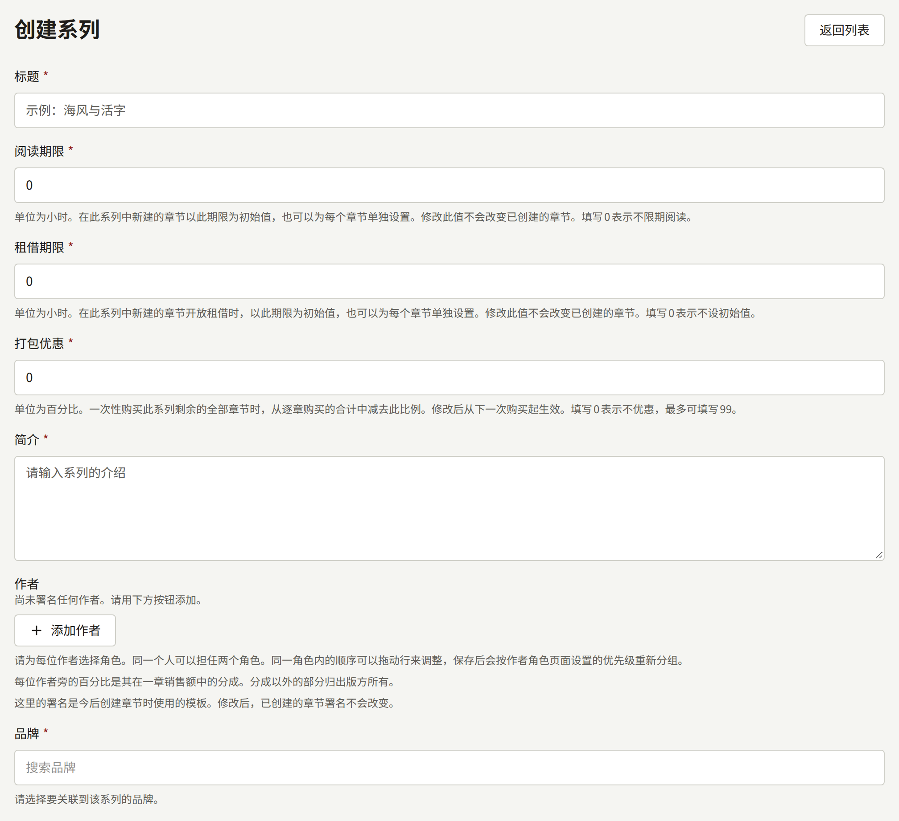

### 读者首先看到的内容

- **标题**：最多255个字符。
- **简介**：系列页面上的介绍，最多10,000个字符。
- **作者**：在系列上署名的人，每人对应一个角色，如[作者和作者角色](./4-authors.md#为作者署名)所述。每人旁边的百分比是其在该系列章节销售额中的分成，[报表与版税](../6-reports-and-royalties.md#作者应得的金额)对此有说明。这些署名会在每个章节创建时复制到章节上：之后更改它们，已有的章节保持不变。
- **书系**：系列发行时所属的出版品牌。系列必须有一个书系，因此请先创建书系，如[书系](./3-labels.md)所述。
- **题材**：任意数量的租户题材，按**题材**中设置的顺序显示。
- **标签**：最多20个自由填写的词，每个最多50个字符，读者可以按标签浏览。与已在使用的标签（不区分大小写）相同的标签，会归入该标签。
- **封面图**：JPEG、PNG或WebP图片，大小不超过10 MB，尺寸至少为2400 × 3200像素。只有在创建系列时才会在此表单中提供；之后要在**封面图**选项卡中更改，如[封面图](#封面图)所述。

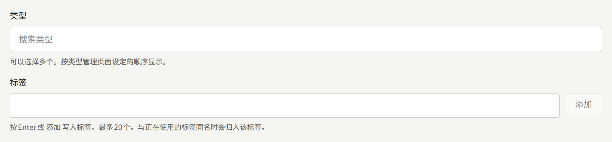

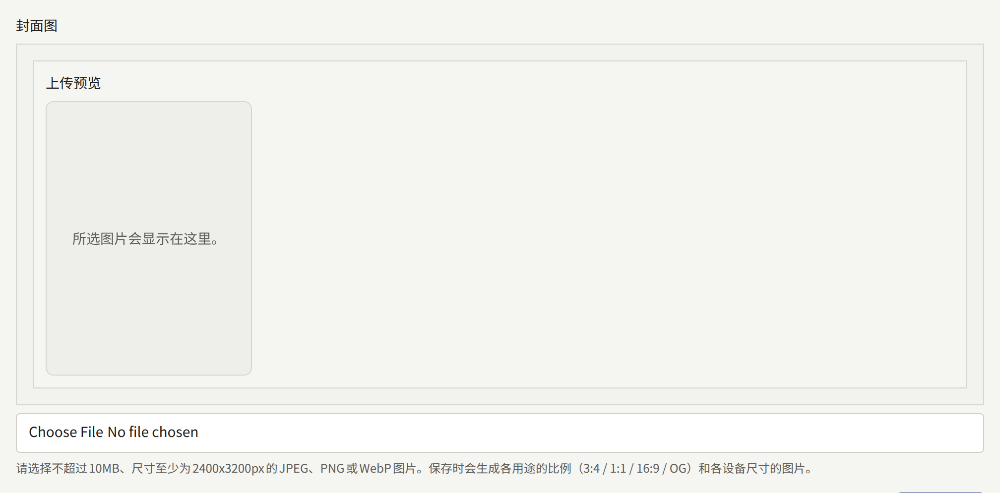

### 发布日期和时间

**发布日期和时间**决定系列是否公开。它按租户的时区解释，字段中会注明该时区。

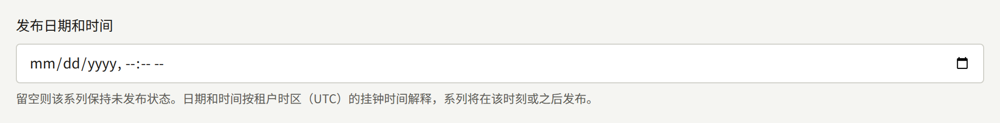

- **留空**：系列处于隐藏状态。其页面的响应就像它不存在一样，无论其章节本身处于什么状态，都无法阅读。
- **已过去的时间**或当前时间：系列一保存就会公开。
- **将来的时间**：系列在那之前保持隐藏。`publira worker`每分钟查找一次时间已到的系列，并刷新网站缓存的页面，所以在到达该时间后大约一分钟内，网站的列表和首页就会包含该系列。

之后清空该字段，会让已公开的系列连同其章节再次从网站上撤下。有章节或卷、或被其他记录引用的系列无法删除，如[删除系列](#删除系列)所述，这时就用这种方法撤回系列。

隐藏的系列变为公开时（无论是第一次还是再次公开），在其隐藏期间发布的章节会通知关注这些章节、该系列或其署名作者的读者，并以系列公开的时刻作为其日期。在系列之前公开期间已经通知过的章节保留原来的日期，不会再次通知。通知哪些人，请参阅[章节](./2-episodes.md#已预约的章节何时出现)。

### 显示位置和销售位置

**显示位置**决定读者可以在哪里找到该系列：**网页和应用**、**仅网页**或**仅应用**。新系列默认为**网页和应用**。在不显示的渠道上，该系列及其章节对读者来说并不存在；章节可以缩小这个设置的范围，但永远不能扩大。

**销售位置**决定可以在哪里购买其付费章节。默认为**沿用租户设置**，即沿用**支付** › **支付方式**中的**销售位置**，该设置更改后也会跟着变化。[销售章节](../4-selling-episodes.md#章节的销售位置)介绍了这两个设置，以及拥有应用的租户为什么可能只在网站上提供某个系列。

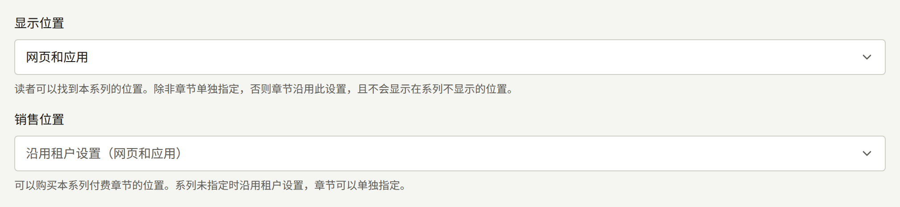

### 连载状态和更新周期

**连载状态**为**连载中**、**已完结**或**休刊中**。读者会在系列页面上看到它，并可以按它筛选系列列表。它不会改变其他任何内容：**已完结**的系列仍然可以添加章节。

**更新周期**用于勾选预计发布新章节的星期。系列页面随后会显示这些星期再加上“更新”，该系列也会列在网站首页**按更新日浏览**中对应的每一天下。没有勾选任何一天时，系列页面不会显示更新周期，系列也不会出现在任何一天下。这些日子并不会自动发布章节：章节的发布仍由各章节自己的**发布日期和时间**决定。

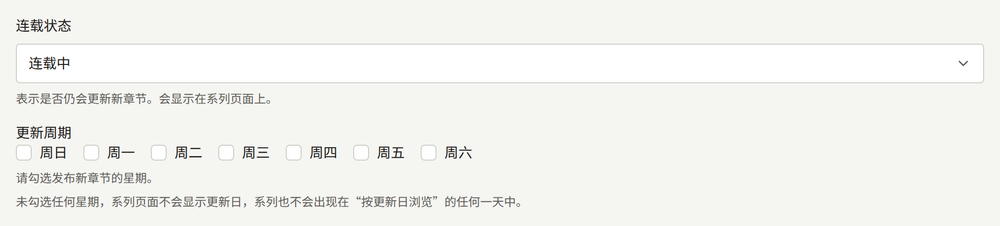

### 年龄分级

**年龄分级**为**全年龄**、**R15**或**R18**。分级为**R15**或**R18**的系列会在网站上标出分级，其页面在打开前会要求读者确认年龄。在读者确认之前，有分级的系列也不会出现在首页和搜索结果中。

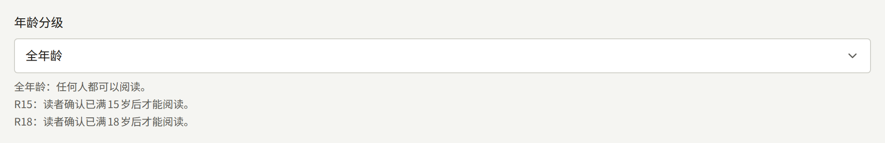

仅确认年龄是否足够，还是读者还必须登录并拥有能证明其年龄的出生日期，由整个租户的**需要证明年龄的分级**决定，如[设置](../3-setup/1-settings.md#年龄验证)所述。系列无法自行设置这一点。

### 评论

**评论**决定读者在该系列章节下的评论如何公开：**不接受评论**、**立即公开**或**审核后公开**。默认为**沿用租户设置**，即沿用**设置**中的**评论的公开方式**，该设置更改后也会跟着变化，如[设置](../3-setup/1-settings.md#读者评论)所述。评论的审核和管理请参阅[评论](../2-readers/2-comments.md)。

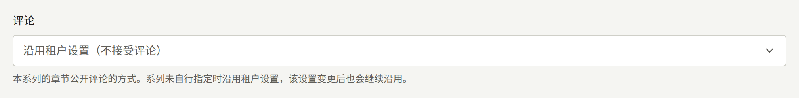

在这里做出的选择无论租户设置如何都适用于该系列，因此设为**立即公开**的系列，即使租户不接受评论，也会接受评论。

### 阅读方向和跨页

**阅读方向**是系列页面的翻页方向：**从右到左**（日本漫画的阅读方式，也是默认值）或**从左到右**。它决定翻页的方向、跨页中两页的顺序、进度条，以及上一章节和下一章节位于哪一侧。

**跨页起始页**决定在足以并排显示两页的屏幕上，从哪一页开始成对显示。在它之前的页面单独显示。默认值`2`让第一页（通常是封面）单独显示；`1`则从第一页开始成对显示。页数少于该值的章节会一次显示一页。

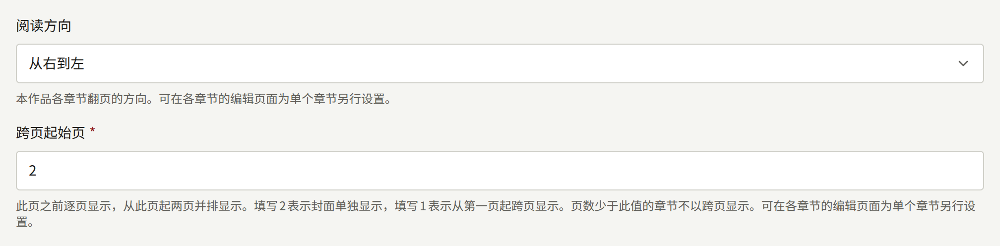

章节可以单独设置其中任何一项，如[页面布局](./2-episodes.md#页面布局)所述。没有单独设置的章节沿用系列的设置，系列的设置更改后也会跟着变化。

### 阅读期限

**阅读期限**以小时为单位，是该系列中每个新章节的**阅读期限**的初始值。购买后章节保持开放的时长取决于章节自己的期限，而不是系列的期限：章节可以在创建时或[之后更改](./2-episodes.md#更改价格和阅读期限)为不同的期限，之后更改系列的期限，已经创建的章节保持不变。新系列的初始值为`0`，即购买后永久开放。期限的用法请参阅[销售章节](../4-selling-episodes.md#价格与阅读期限)。

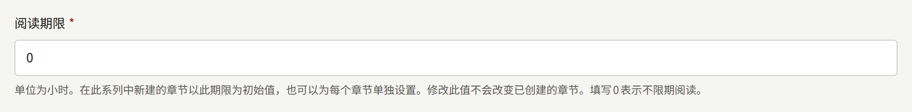

### 租借期限

**租借期限**以小时为单位，是该系列中每个新章节的**租借期限**的初始值。它本身不会让任何章节可以租借：只有为章节设置了**租借价格**后，章节才可以租借，届时该期限就是一次租借保持章节开放的时长。与**阅读期限**一样，系列的期限更改后，章节保留其创建时的值。新系列的初始值`0`表示不设置，此时新章节的**租借期限**初始为空。租借请参阅[销售章节](../4-selling-episodes.md#价格与阅读期限)。

### 打包优惠

**打包优惠**以整数百分比表示，是读者在一次结账中购买系列剩余部分时节省的比例：即该系列中读者尚未拥有的所有付费章节，按其价格总和减去该百分比计价。新系列的初始值`0`表示不打折，最大为`99`。更改从下一次结账开始生效，不影响读者已经购买的任何内容。这种销售方式请参阅[销售章节](../4-selling-episodes.md#系列的剩余章节)。

## 其他语言的标题

系列在网站提供的每种语言中各有一个标题和一个简介，这些语言由租户管理员在[**设置**](../3-setup/1-settings.md#语言)中选择。在**基本信息**选项卡的表单上方，**语言**为每种语言各提供一个选项卡，下方的表单编辑所选语言的标题和简介。**标题**下方的说明会注明是哪种语言。系列尚无标题的语言会标有“**（未添加）**”：其选项卡打开的表单中，**标题**和**简介**为空，在那里选择**更新系列**即可添加。在添加之前，使用该语言的读者在网站和应用中会看到该系列的其他语言版本，并附有相应说明，搜索引擎也不会被告知该系列有该语言的页面。

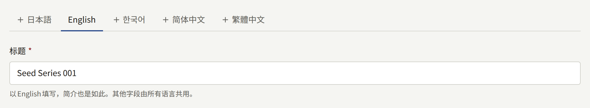

表单上的其他字段都属于系列本身，而不属于某种语言，因此在任何语言的选项卡上更改它们，所有语言都会随之更改。选项卡旁的**删除此翻译**会删除所选语言的标题和简介，但不能删除系列最后剩下的那一个。

**系列**列表以及控制台中其他提到系列名称的界面，都以网站的默认语言显示系列的标题。没有默认语言标题的系列，则以其最初填写的语言显示名称。

## 封面图

系列的**封面图**选项卡用于替换或删除创建系列时选择的图片。在**封面图**中选择新图片并选择**更新封面图**，或者选择**删除当前的封面图**，让系列不再有封面图。新图片必须是JPEG、PNG或WebP图片，大小不超过10 MB，尺寸至少为2400 × 3200像素。

网站不会按上传时的原样显示图片。保存时会从中裁切出四种固定形状的图片，显示在下方的**各比例图片**中。每个位置以形状名称为标题，下方有一行文字说明该形状用在哪里：

| 位置 | 最小尺寸 | 用途 |
| --- | --- | --- |
| **竖版 (3:4)** | 1200 × 1600 | 网站和应用书架上的封面，以及网站上系列页面的封面 |
| **方形 (1:1)** | 1200 × 1200 | 网站列表中系列及其章节旁边的小图，以及网站提供给搜索引擎的图片之一 |
| **横版 (16:9)** | 1600 × 900 | 网站和应用中的宽横幅，以及网站上系列页面中每个章节旁边和章节末尾的小图 |
| **链接预览 (1200:630)** | 1200 × 630 | 分享系列或其章节的链接时显示的预览。没有该图片的系列在分享时，会使用网站根据其标题、徽标和主题颜色绘制的卡片，如[链接预览](../3-setup/2-branding.md#链接预览)所述 |

每种形状都从图片中央裁切。要为某种形状使用不同的裁切方式或单独的图片，请点击**各比例图片**下的对应图片，选择一张至少达到该位置要求尺寸的JPEG、PNG或WebP图片（可以是之前的同一张图片）。然后用**调整取景框**设置该形状显示图片的哪一部分，再用**替换**保存，其他三种形状保持不变。只有系列已有封面图时才能替换形状，所以请先在**封面图**中上传。在那里上传新的封面图会替换全部四种形状。

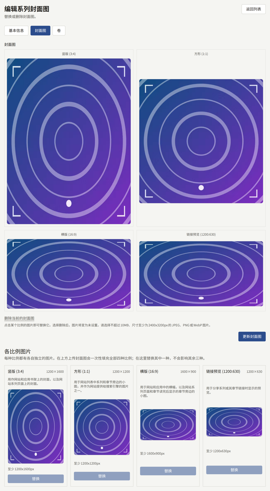

书系和题材也有同样的选项卡，尺寸也相同。不过它们各形状的用途不同，每个位置下方的那行文字会说明正在编辑的记录在哪里使用该形状：例如，书系的方形图片用作应用中的书系卡片和网站列表中书系旁边的小图，而其竖版图片目前在任何地方都不显示。

## 等待即可免费

**基本信息**选项卡中系列表单下方的**等待即可免费**，让已登录的读者用一张免费券一次免费打开该系列的一个付费章节，免费券在等待一段时间后会再次发放：

- **为本系列提供免费券**用于开启该功能。关闭后，下方的数值会保留到下次使用，读者已经用免费券打开的章节在其时间到期之前仍保持开放。
- **获得下一张免费券的时间**：读者使用一张免费券后，经过多长时间获得下一张，范围为1到8760小时。初始值为`23`。更改从每位读者下一次使用时开始生效。
- **章节可阅读的时间**：用免费券打开的章节可以阅读多长时间，范围为1到8760小时。初始值为`72`。
- **免费券不可阅读的最新章节数**：按系列顺序从最后一个章节往前数，有多少个最新的已发布章节保留给购买者。`0`表示免费券可以打开任何付费章节。

选择**保存等待即可免费设置**进行保存。每位读者每个系列只持有一张免费券，未使用的免费券不会累积。免费券不能打开已经对所有人免费的章节、读者已经可以打开的章节，或读者年龄不允许阅读的章节。系列页面会向读者说明免费券的使用方式，并将免费券不能打开的章节标为**不可用免费券**。

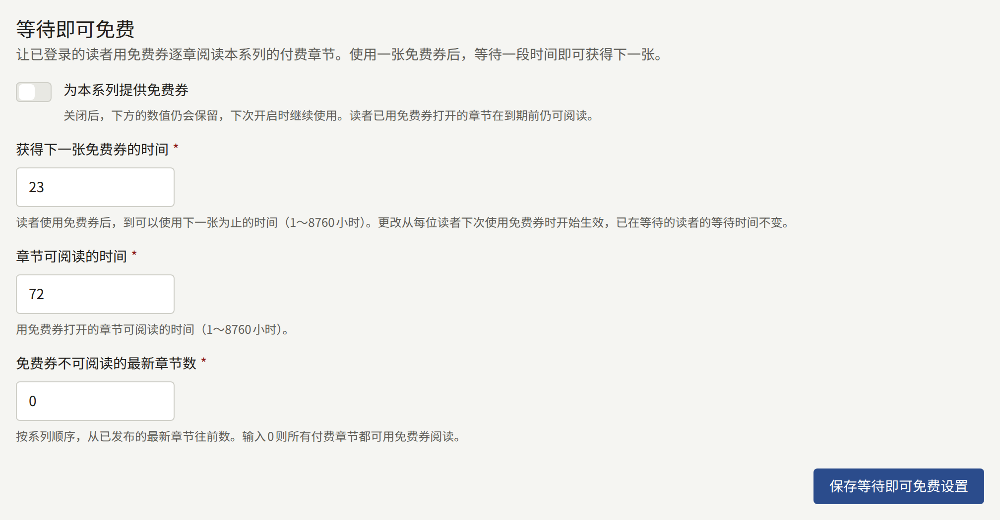

免费券与价格和免费阅读期之间的关系，请参阅[销售章节](../4-selling-episodes.md#免费阅读期与等待即可免费)。

## 发布后免费

**基本信息**选项卡中**等待即可免费**下方的**发布后免费**，会让该系列的每个付费章节在发布满设定天数后对所有人免费：

- **章节发布后转为免费**用于开启该功能。关闭后，下方的数值会保留到下次使用。
- **发布后天数**：章节发布后经过多少天转为免费，范围为1到3650。初始值为`30`。
- **保持付费的最新章节数**：按系列顺序从最后一个章节往前数，有多少个最新的已发布章节无论发布多久都保持其价格。`0`表示每个付费章节到期后都转为免费。

选择**保存发布后免费设置**进行保存。worker进程会在每个章节到期当天为其添加一个免费阅读期，从而开放该章节；该免费阅读期在章节的[免费阅读期](./2-episodes.md#免费阅读期)中列为**按系列规则**，无法在那里删除。只要规则仍覆盖该章节，这个免费阅读期就会持续：将规则保存为关闭，或保存的数值使某些章节不再适用，这些章节会立即恢复收费；之后进入最新章节范围的章节，会在worker进程下一次执行时恢复收费。手动安排的免费阅读期保持不变，规则的免费阅读期从其结束时开始。

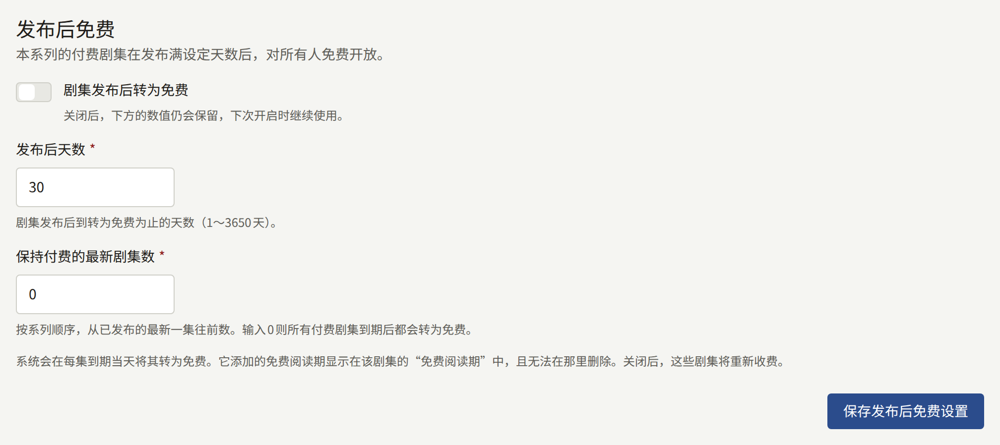

## 卷

卷是将系列中一连串章节放在一起、在一次结账中以其自己的价格销售的单位。购买一卷会永久开放其中的每个章节：卷永远不能租借，也没有阅读期限。一个章节最多属于一卷，并且在卷之外仍然单独销售。

系列的**卷**选项卡按顺序列出其各卷，每卷显示封面、价格、包含的章节数、书店链接数，以及是否为**销售中**。拖动卷的手柄可以调整顺序，松开后立即保存。审计员看到的列表没有手柄，并通过**查看**打开每一卷。

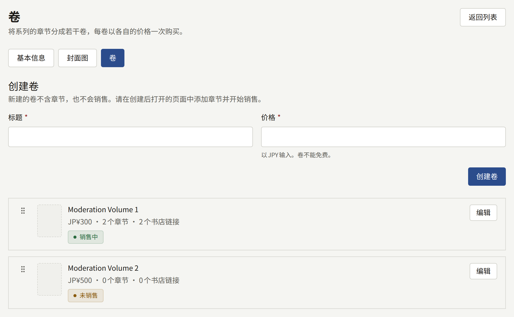

### 创建卷

在**创建卷**中输入**标题**（最多255个字符）和以租户货币计价的**价格**（必须大于`0`）。选择**创建卷**会打开新卷。它尚不包含任何章节，也尚未开始销售。一个系列最多可以有100卷。

卷的界面有五个部分：

- **基本信息**用于同时更改标题和价格，通过**更新卷**保存。新价格适用于保存之后的购买。
- **章节**是卷所包含内容的列表，如下所述。
- **封面图**接受JPEG、PNG或WebP图片，大小不超过10 MB，尺寸至少为2400 × 3200像素，并会裁切成与[系列的封面图](#封面图)相同的四种形状。没有封面图的卷会显示系列的封面图。
- **书店链接**列出该卷纸质书的销售地点，如下所述。
- **销售**用于开始或停止销售该卷。

### 选择章节

在**章节**中，通过**添加章节**搜索系列的章节，选择**添加**将其放到列表末尾。拖动章节的手柄可以调整它在卷中的位置，用其所在行末尾的按钮可以将其移出。在选择**保存章节**之前不会保存任何内容。除了已发布的章节，草稿和已预约的章节也可以添加。

已在其他卷中的章节不会作为候选显示：请先将其从那一卷中移出。

卷一旦开始销售过，其中包含的章节就无法再移出，即使之后停止销售也一样。在卷销售期间开始结账的读者仍然可以完成结账，购买会开放该卷所包含的内容。章节仍然可以添加和调整顺序。

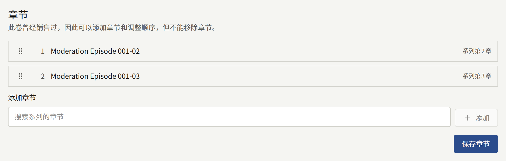

### 书店链接

在**书店链接**中，**添加链接**会在列表末尾添加一行。为每一行填写**标签**（即其按钮上显示的文字，例如书店名称，1到50个字符），以及以`https://`开头、最多2,048个字符的**URL**。一卷最多有10个链接。拖动链接的手柄可以调整它在列表中的位置，用其所在行末尾的按钮可以将其移出。

在选择**保存书店链接**之前不会保存任何内容，保存时按列表当前的内容和顺序保存：移出所有行后保存，该卷就不再有任何链接。某一行无法保存时，其字段下方的消息会指出是哪一行，列表中的任何内容都不会保存。不会检查URL是否可以访问。

卷在销售期间，系列页面会在网站和应用中，于该卷下方的**购买纸质书**下按列表顺序列出其链接。每个链接都是一个显示其标签的按钮，在网站上会在新标签页中打开书店，在应用中则在设备的浏览器中打开，绝不会在应用内打开。

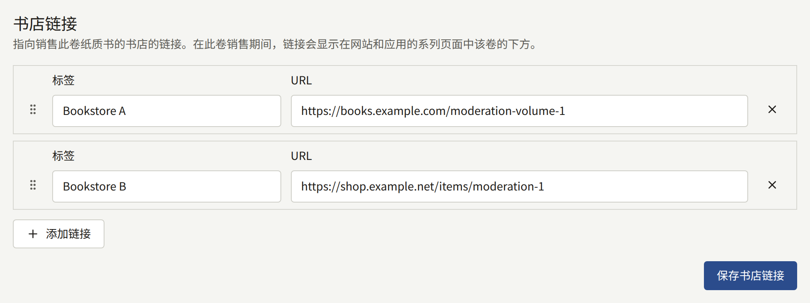

### 开始销售卷

在**销售**中，**开始销售**会向读者提供该卷，**停止销售**则停止提供。不包含任何章节的卷无法开始销售。停止销售某一卷不会收回读者已经购买的任何内容。

由于购买一卷就等于购买其中的每个章节，卷只在其所有章节都可以购买的地方销售：如果其中某个章节的**销售位置**设为只在网站上销售，那么该卷也只在网站上销售。章节在哪里销售，请参阅[销售章节](../4-selling-episodes.md#章节的销售位置)。

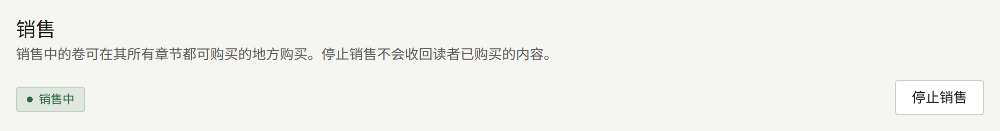

## 删除系列

租户管理员可以通过系列编辑画面**基本信息**标签页末尾的**删除本系列**来删除系列；编辑和审计员看不到它。对话框会要求输入系列标题，即**系列**列表中显示的网站默认语言的标题；在准确输入标题之前，**删除系列**无法点击。点击后，系列会连同其所有语言的标题和简介、署名、类型和标签、封面图、等待即可免费和发布后免费的设置，以及读者的关注一起删除。系列会立即从网站、应用和搜索索引中消失，控制台会返回**系列**列表。删除无法撤销，**审计日志**会记录该操作及系列标题。

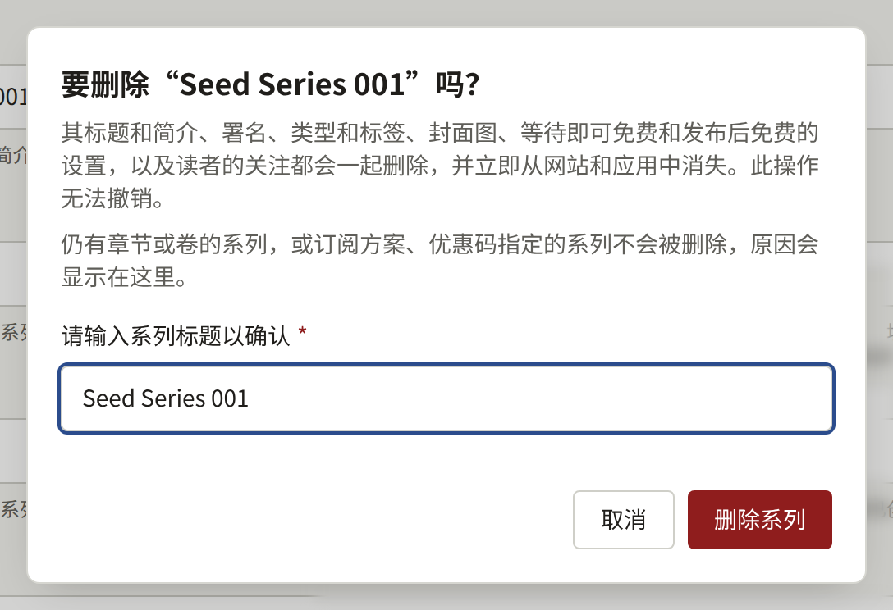

只有在系列不含任何内容、也没有任何内容引用它时，才能删除系列。只要存在以下任一项，系列就不会被删除，对话框会显示原因，并附上通往其所在画面的链接：

- 章节，无论其状态如何。请先按照[删除章节](./2-episodes.md#删除章节)所述逐一删除章节。**查看本系列的章节**会打开该系列的章节列表。
- 卷。卷无法删除，因此有卷的系列无法删除。**查看本系列的卷**会打开**卷**标签页。
- **可阅读范围**包含本系列的订阅方案。请按照[更改、取消发布和删除方案](../5-subscription-plans.md#更改取消发布和删除方案)所述，将本系列从方案的可阅读范围中移除。**查看订阅方案**会打开**订阅方案**。
- 本系列未删除或已被读者使用的优惠码。请按照[查看、暂停和删除优惠码](../4-selling-episodes.md#查看暂停和删除优惠码)所述删除无人使用的优惠码；有读者使用过的优惠码时，系列无法删除。**查看优惠码**会打开**优惠码**。

对话框会按此顺序显示第一个符合的项目，因此同时符合多项的系列，在解决一项之后会因下一项再次被拒绝删除。无法删除的系列，请改为清空其**发布日期和时间**，将其从网站上撤下。
