章节是读者打开并为之付费的内容：一组页面图片，带有标题、价格和发布时间。章节存在于其系列之中。在**系列**列表中，选择该系列所在行的**章节**即可打开它们。

列表显示每个章节的位置和标题、其状态（**草稿**、**已预约**或**已发布**）、价格，以及已预约章节的预定发布时间。在租户[要求审核](#发布前审核)期间，等待租户管理员决定的已预约章节标有**审核中**，被退回的标有**已退回**。没有同时在网站和应用上显示的章节标有**仅网页**、**仅应用**或**不在任何位置显示**；带有[试读页数](#试读页数)的付费章节会标出页数，例如**试读：3页**，这样就能一眼检查整个系列的试读设置。**编辑**会打开章节（审计员则为**查看**）。章节的编辑界面有两个选项卡：**封面图**（[封面图](#封面图)中有说明）和**基本信息**（包含界面上的其他所有部分）。

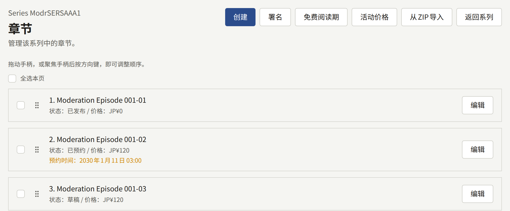

无论作品是否为漫画，章节都由页面图片组成。目前尚不支持以文本形式撰写的小说（[#505](https://github.com/publira/publira/issues/505)）。

## 章节的顺序

章节按系列的顺序列出，并在网站上按此顺序编号。新章节会添加到末尾。要移动章节，请拖动其手柄，或聚焦手柄后使用方向键。列表每页显示二十个章节，章节只能在其所在页内移动。

网站按位置为每个章节编号，显示为“第N章”，读者尚看不到的章节也会计入。请把草稿和已预约的章节放在顺序的末尾，这样已发布的章节编号才不会出现空缺。

新的顺序一经保存，就会立即反映到网站上。

## 创建章节

在章节列表中选择**创建**，然后填写：

- **标题**：章节在网站默认语言中的标题，例如`Episode 1 — A beginning morning`。之后可以[更改](#更改标题)，并在那里填写网站其他语言的标题。
- **价格**：以租户货币计价的价格（字段中会注明货币），小数位数不能超过该货币的小数位数：500日元填写`500`，4.99美元填写`4.99`。`0`表示章节免费。
- **阅读期限**：一次购买让章节保持开放的小时数。`0`表示永久开放。初始值为系列的[阅读期限](./1-series.md#阅读期限)。
- **租借价格**和**租借期限**：租借该章节的费用（须低于**价格**），以及一次租借让章节保持开放的小时数。**租借价格**留空则该章节不可租借。**租借期限**的初始值为系列的[租借期限](./1-series.md#租借期限)。
- **试读页数**：对于付费章节，任何人在购买前可以阅读的开头页数，如[试读页数](#试读页数)所述。初始值为`0`，即不开放任何页面。**价格**为`0`时不提供该字段，因为免费章节会开放全部页面。
- **发布日期和时间**：章节的发布时间，按租户的时区解释。留空则创建草稿。已经过去的时间会让章节一创建就发布。
- **显示位置**和**销售位置**：可以在哪里找到和购买该章节，如[显示位置和销售位置](#显示位置和销售位置)所述。两者初始都沿用系列的设置。

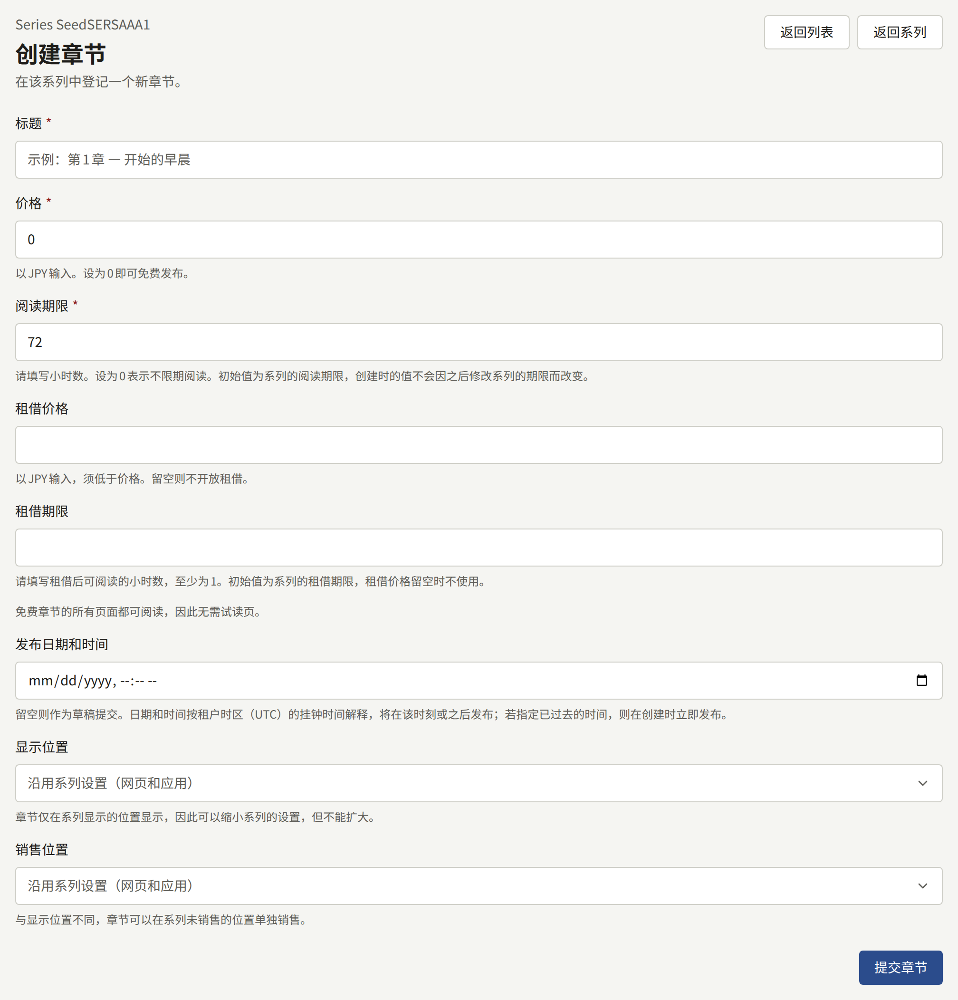

**价格**、**阅读期限**、租借和**试读页数**之后都可以[更改](#更改价格和阅读期限)。[销售章节](../4-selling-episodes.md#价格与阅读期限)对它们有说明。

选择**提交章节**。章节创建时会带有系列上署名的作者，随后会打开其编辑界面，以便添加页面。

## 更改标题

章节编辑界面顶部的**标题**包含章节在网站提供的每种语言中的标题。**语言**为每种语言各提供一个选项卡，下方的字段包含所选语言的标题。修改后选择**更新标题**。新标题一经保存，网站和应用就会立即显示。标题不能留空。

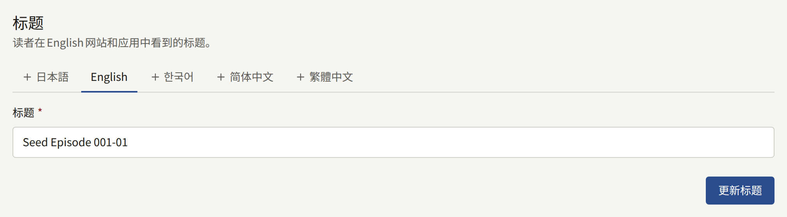

章节尚无标题的语言会标有“**（未添加）**”。其选项卡打开时字段为空：输入标题后选择**添加翻译**。在此之前，使用该语言的网站和应用读者会看到章节其他语言的标题。选项卡旁的**删除此翻译**会删除所选语言的标题，但不能删除章节最后剩下的那一个。

章节列表以及控制台中其他提到章节名称的界面，都以网站的默认语言显示章节的标题。

## 更改价格和阅读期限

章节编辑界面中的**价格与阅读期限**包含章节销售时所依据的数值，规则与创建时相同：**价格**以租户货币计价，`0`表示章节免费；**阅读期限**是小时数，`0`表示购买后永久开放。**租借价格**和**租借期限**包含租借设置：清空**租借价格**会停止租借该章节；对于不可租借的章节，**租借期限**会填入系列的[租借期限](./1-series.md#租借期限)，因此只需填写价格即可开始租借。**试读页数**包含章节的[试读页数](#试读页数)。修改其中任何一项后，选择**更新价格与阅读期限**。新数值一经保存，网站和应用就会立即按新数值销售该章节。

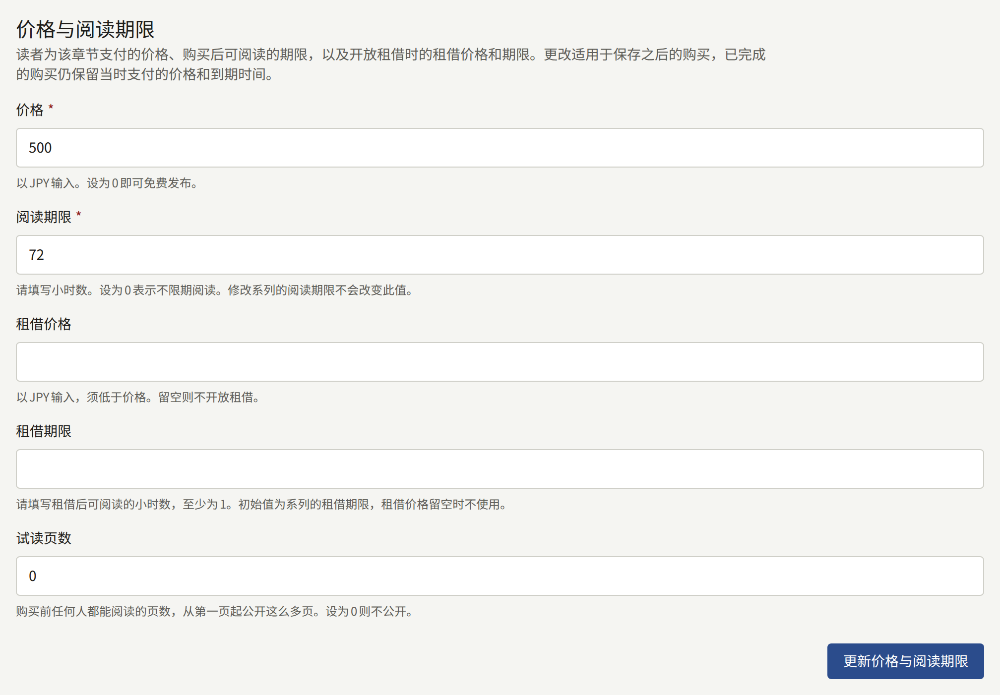

### 试读页数

**试读页数**是付费章节中，从阅读顺序的第一页算起，任何人（无论是否登录）在购买前都可以阅读的页数。`0`表示不开放任何页面，该字段不接受负数。也可以填写大于章节现有页数的数值，因为页面常常是在设定价格之后才添加的：字段会注明章节当前有多少页，只有这些页面会开放，之后添加的页面也会在不超过该数值的范围内依次开放。

只有**价格**大于`0`时才会提供该字段。免费章节本来就会开放全部页面，因此该字段会换成一条说明其无需试读的提示；将**价格**降为`0`并保存，会清除该数值。重新为章节定价时，该字段会以`0`重新出现。

更改适用于保存之后的购买。已经完成的购买保留其支付时的价格和到期时间；在更改前就已打开支付服务商结账页面的读者，按该页面显示的金额付款。更改系列的**阅读期限**或**租借期限**不会改变这些数值。

通过应用商店销售的应用会将章节作为与其价格对应的商店商品来购买，因此新价格或新的[活动价格](#活动价格)可能需要新的商品：请参阅[商店商品](../4-selling-episodes.md#在应用中销售)。

## 添加页面

章节编辑界面中的**添加漫画页面**可以在**上传方式**下用以下三种方式之一添加页面：

- **选择多张页面图片**可以一次接受多个JPEG、PNG、GIF或WebP文件，选择或拖放到**页面图片**中均可。它们按浏览器传递的顺序（通常按文件名）添加，所以之后请检查顺序。
- **提交ZIP**接受一个ZIP文件，并按路径顺序添加其中的`.png`、`.jpg`、`.jpeg`和`.gif`图片，因此`page2.png`排在`page10.png`之前。其中的其他文件（包括WebP图片）会被忽略，最多可以包含1000张图片。
- **提交ePub**接受一个ePub文件，并按阅读顺序添加其页面显示的JPEG、PNG、GIF或WebP图片，最多1000张。

选择**添加页面图片**、**提交ZIP**或**提交ePub**进行上传。无论使用哪种方式，每张图片最大20 MB，每次上传最大128 MB，因此整个章节可以作为一个ZIP或ePub添加。ZIP或ePub解压后的图片合计最大256 MB。超过此大小的需要分多次上传；每次上传的页面会添加在最后一页之后。卡片在文件选择器下方注明了这些格式和限制。

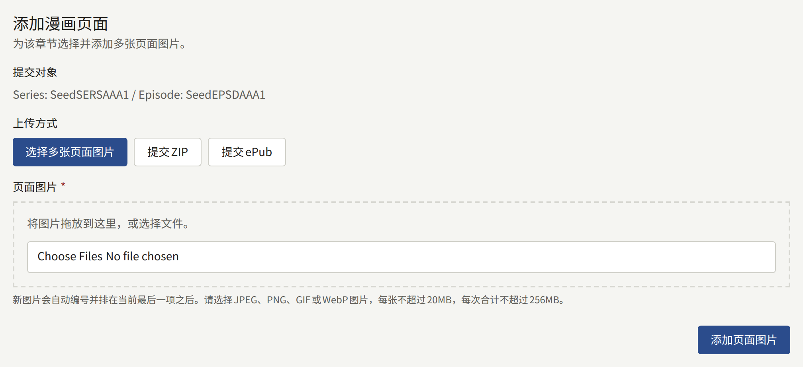

**已登记的页面图片**按顺序显示页面。拖动页面的手柄，或聚焦手柄后使用方向键，即可移动页面。每个页面下方有：

- **替换**用新图片替换该页面。在**新的页面图片**中选择一张不超过20 MB的JPEG、PNG、GIF或WebP图片，然后选择**替换页面**。其他页面保持不变。
- **删除**在通过**删除页面**确认后，将该页面从章节中移除。其后的页面依次前移一位。被删除的页面无法恢复；要恢复，请重新添加其图片。

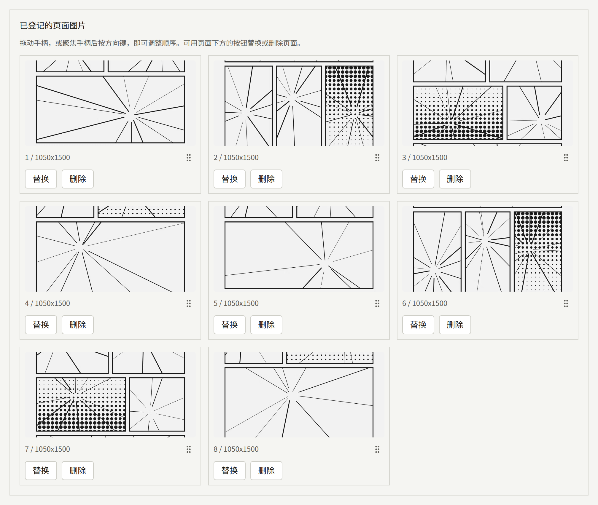

向已发布的章节添加页面、替换或删除页面，以及调整页面顺序，一经保存就会立即呈现给读者。没有任何页面的已发布章节，会向读者显示其页面尚未发布。

删除页面不会改变章节在[页面布局](#页面布局)中自己设置的**跨页起始**。如果该页现在已超出最后一页，章节将不以跨页显示，直到页数再次达到该值。

## 从ZIP导入

**系列**列表和系列的章节列表上的**从ZIP导入**可以用一个包含页面图片的ZIP创建系列及其章节，而不必逐个创建章节并手动添加页面。它适用于从其他服务迁移作品目录，或一次交付多个章节。

ZIP中包含放在任意文件夹里的页面图片，以及位于根目录、名为`publira-import.json`的清单：

```json
{
  "version": 1,
  "series": {
    "title": "系列标题",
    "synopsis": "系列简介",
    "locale": "zh-Hans",
    "reading_direction": "rtl"
  },
  "episodes": [
    {
      "title": "第1话",
      "price": 0,
      "scheduled_at": "2030-01-01T00:00:00+09:00",
      "pages": ["ep01/001.png", "ep01/002.png"]
    }
  ]
}
```

- `version`为`1`。
- `series`指定章节的去向。要创建系列，请填写`title`，并可选填`synopsis`、`reading_direction`（`rtl`或`ltr`，未填写时为从右到左），以及系列文字和章节标题所用语言`locale`（未填写时为租户的默认语言）。系列将以草稿创建。要添加到现有系列，只填写`{ "id": "<ID>" }`，ID可在系列地址`/series/<ID>`和章节列表顶部查看。从系列的章节列表导入时，清单必须指定该系列。
- `episodes`按创建顺序列出章节，它们排在系列已有章节之后。每个章节都需要`title`和`pages`：`pages`是ZIP内的路径，须与存储的完全一致，并按阅读顺序排列。`price`的写法与**价格**相同，使用租户的货币，未填写时为`0`。`scheduled_at`是带时区偏移的未来时间，在所有页面就绪后预约章节；未填写时章节保持为草稿。

清单不接受其他键。署名、封面、翻译、类型、标签和租赁在导入后到控制台中设置。

在**ZIP文件**中选择ZIP。控制台会在发送任何内容之前检查它，并按章节和路径列出发现的所有问题：清单不接受的键、ZIP中缺少的页面、重复的路径、不是JPEG、PNG、GIF或WebP图片的文件，以及超出限制的内容。ZIP通过检查之前不会创建任何内容。如果ZIP中可见的路径被报告为缺失，请将文件夹和文件名改为ASCII字符：某些工具会以清单无法匹配的形式存储其他字符。

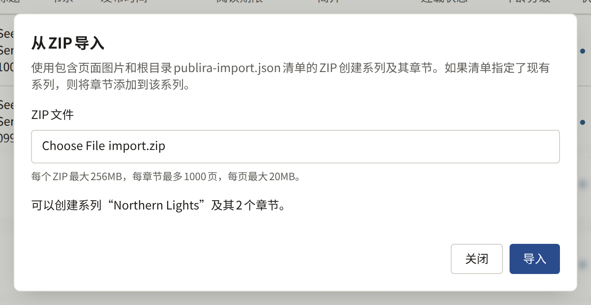

每个ZIP最大256 MB，每个章节最多1000页，每页最大20 MB。更大的目录可分成多个指定同一系列ID的ZIP导入。在[#4239](https://github.com/publira/publira/issues/4239)解决之前，Cloud Run上的安装每个ZIP最大32 MiB。

选择**导入**，并在结果出现之前保持窗口打开。ZIP会整体发送，控制台在最后一个章节完成后才会应答，因此可能需要几分钟。结果中每个章节一行，显示**已导入**、**失败**或**未开始**。

导入不是全部成功或全部撤销的操作。章节依次创建，第一次失败会让之后的章节停止，已创建的内容会保留。要继续，请从清单中移除已导入的章节，然后再次导入ZIP。失败的章节如果带有指向编辑界面的链接，说明它已作为草稿创建，页面可能不完整：请在那里添加其余页面并设置发布时间，然后将它也从清单中移除，或者删除该章节并将它保留在清单中。如果在结果出现之前连接中断，导入可能仍已完成，因此再次导入前请检查系列的章节。

导入的章节与手动创建的章节相同：[审计日志](../../3-operations/12-security/3-audit-logs.md)显示相同的操作，如果租户要求审核，预约的章节会经过[审核](#发布前审核)。

## 页面布局

**页面布局**为本章节单独设置系列为其章节决定的两项内容：

- **阅读方向**：**沿用系列设置**、**从右到左**或**从左到右**。
- **跨页起始**：**沿用系列设置**，或**为该章节指定**，后者需要填写跨页开始的页码，范围从1到章节的最后一页。请先添加页面：没有任何页面的章节只能沿用系列的设置。

选择**更新页面布局**进行保存。沿用系列的值会随系列的更改而变化。各项在阅读器中的作用，请参阅[阅读方向和跨页](./1-series.md#阅读方向和跨页)。

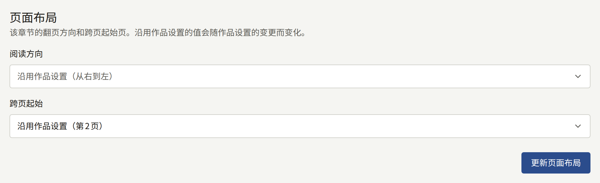

网站只有在阅读器宽度至少为768像素且高度不超过宽度时，才会并排显示两页；应用则只在平板电脑或横握的手机上并排显示。其他情况下，页面一次显示一页。

## 预览页面

章节编辑界面底部的**预览**在网站所用的阅读器中显示章节的页面：按保存的顺序排列，按章节的阅读方向翻页，并从布局设定的页面开始组成跨页。草稿或已预约的章节与已发布的章节预览方式相同，因此可以在读者看到之前检查页面。

像读者在网站上一样翻页：使用方向键、点击阅读器两侧边缘附近，或点击阅读器中央以显示**上一页**、**下一页**和页面下方的阅读进度滑块。预览遵循与网站相同的跨页规则，因此窗口足够宽时会并排显示两页。

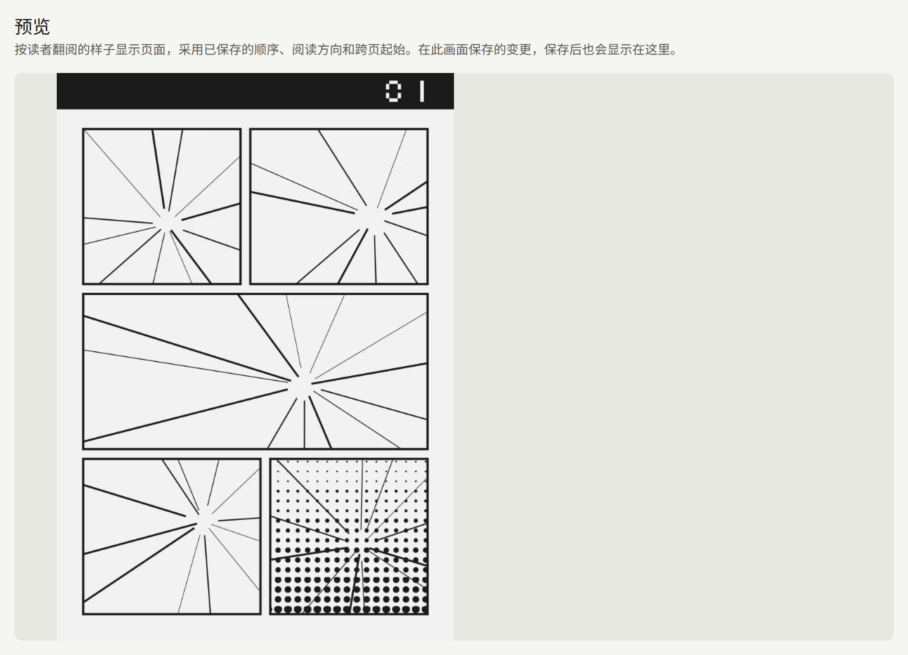

在编辑界面上保存的更改（添加、替换、删除或移动页面，或者更新**页面布局**）一经保存就会显示在预览中，预览也会从第一页重新开始。在**页面布局**中选择但尚未保存的值不会显示。没有任何页面的章节会在预览中提示这一点。

所有能打开该章节的人都可以在预览中翻页，包括无法更改它的人。

## 封面图

没有专属封面图的章节，在网站和应用中所有需要显示图片的地方，都会显示其系列的[封面图](./1-series.md#封面图)，因此新章节无需在这里做任何设置。只有在章节需要与系列看起来不同时，才为其设置专属封面图。如果章节和系列都没有“**链接预览 (1200:630)**”图片，分享章节链接时会使用网站根据章节标题绘制的卡片，如[链接预览](../3-setup/2-branding.md#链接预览)所述。

章节编辑界面的**封面图**选项卡用于设置封面图。在**封面图**中选择一张大小不超过10 MB、尺寸至少为2400 × 3200像素的JPEG、PNG或WebP图片，然后选择**更新封面图**。保存时会将其裁切成与系列封面相同的四种形状，尺寸也相同，并显示在**各比例图片**中：**竖版 (3:4)**、**方形 (1:1)**、**横版 (16:9)**和**链接预览 (1200:630)**。每个位置下方的那行文字说明章节封面的该形状用在哪里。

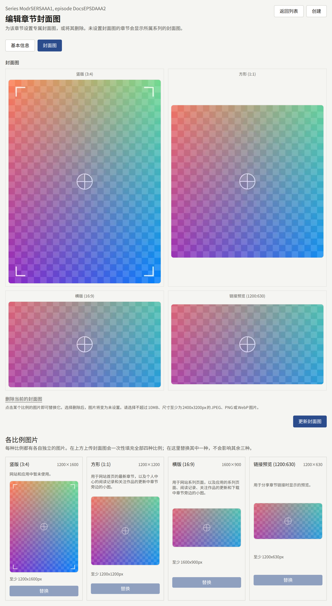

每种形状都从图片中央裁切。要为某种形状使用不同的裁切方式或单独的图片，请点击**各比例图片**下的对应图片，选择一张至少达到该位置要求尺寸的JPEG、PNG或WebP图片（可以是之前的同一张图片）。然后用**调整取景框**设置该形状显示图片的哪一部分，再用**替换**保存，其他三种形状保持不变。只有章节已有封面图时才能替换形状，所以请先在**封面图**中上传。在那里上传新的封面图会替换全部四种形状。

要恢复为系列的封面，请选择**删除当前的封面图**，然后选择**更新封面图**。

## 署名

章节编辑界面中的**作者**列出在本章节上署名的作者，每人对应一个角色，并显示其在本章节销售额中的分成。新章节以系列的署名作为初始值，之后在这里单独更改：之后对系列署名的更改不会影响它。在这里添加的署名标有**仅本集**，用于只参与本章节的客座作者。选择**保存作者**进行保存。

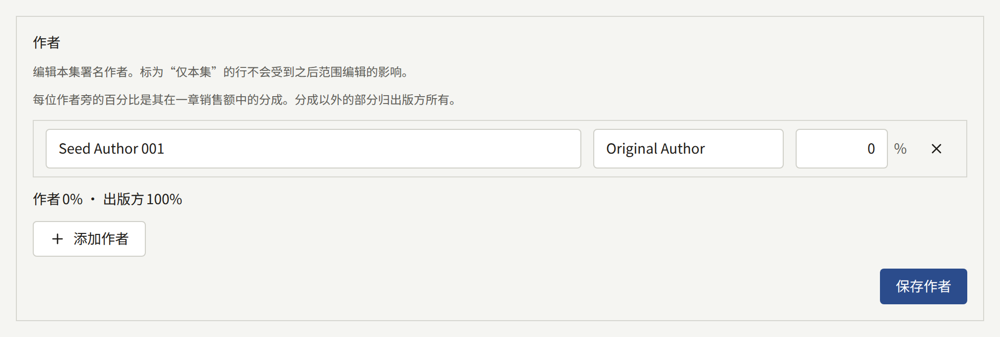

网站上的章节页面显示这些署名，系列页面则显示系列自己的署名。章节的署名也是支付版税的依据，如[报表与版税](../6-reports-and-royalties.md#作者应得的金额)所述；与读者账户关联的作者可以阅读署名自己的章节，如[作者和作者角色](./4-authors.md#将作者与读者账户关联)所述。

要一次更改多个章节的署名，例如某位作画者从第12章开始加入时，请在列表中选择这些章节，然后选择**署名**。在**操作**中：

- **添加**在每个所选章节上，以某个角色为某位作者署名（已经以该角色署名的章节除外），不设分成。
- **替换**将一条署名改为另一条。
- **移除**删除一条署名。
- **设置分成**更改一条署名的分成。

选择操作所适用的**作者**和**角色**，在**章节**中勾选章节（该列表列出系列的所有章节，一次最多1000个），然后选择**应用**。**替换**、**移除**和**设置分成**不会影响**仅本集**的署名。结果会显示有多少个章节发生了更改，以及其他章节各自未更改的原因。

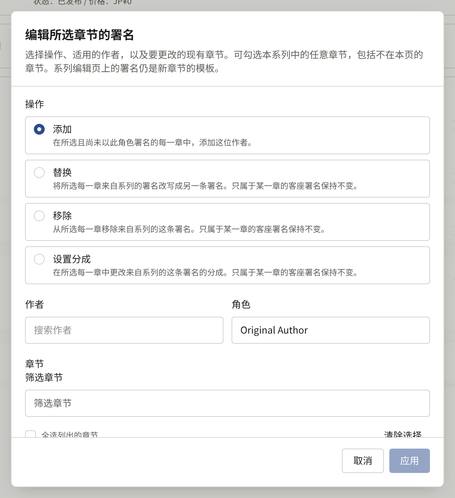

## 显示位置和销售位置

每个章节都有自己的**显示位置**和**销售位置**，初始都沿用系列的设置：

- **显示位置**可以缩小系列的显示范围，但不能扩大。在显示位置为**仅应用**的系列中，设为**仅网页**的章节在任何地方都不会显示，界面会对此发出警告。选择**更新显示位置**进行保存。
- **销售位置**可以指定系列自己的**销售位置**未包含的渠道，但章节只会在其同时显示的地方销售。选择**更新销售位置**进行保存。

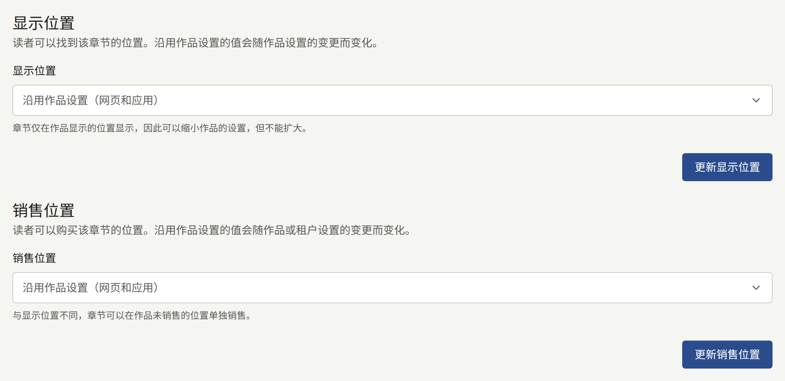

将**显示位置**设为让章节在任何地方都不显示，可以在不取消发布的情况下将已发布的章节从网站上撤下。章节不销售的地方读者会看到什么，请参阅[销售章节](../4-selling-episodes.md#章节的销售位置)。

## 免费阅读期

免费阅读期会在两个时间点之间向所有人（无论是否登录）开放付费章节。章节保留其价格，免费阅读期结束后重新按该价格收费。为免费章节设置免费阅读期不会产生任何作用。

章节编辑界面中的**免费阅读期**列出其免费阅读期，状态为**免费中**、**已安排**或**已结束**。要添加，请输入**开始时间**和**结束时间**（均按租户的时区），然后选择**添加免费阅读期**。**结束时间**必须晚于**开始时间**，且必须在将来；**开始时间**可以是过去的时间，这样章节会从现在起免费。同一章节的两个免费阅读期不能重叠，但一个可以恰好在另一个结束时开始。

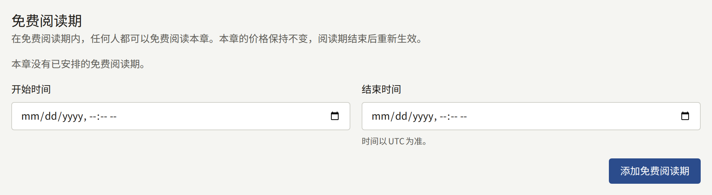

免费阅读期无法编辑。请**删除**它再添加一个新的；删除已经开始的免费阅读期，会让章节立即恢复收费。

标有**按系列规则**且没有结束时间的免费阅读期，是由系列的[发布后免费](./1-series.md#发布后免费)规则添加的，该规则会在每个付费章节发布满设定天数后将其开放。它没有**删除**：当规则被关闭或不再覆盖该章节时，它就会消失，如[定时任务与维护任务](../../3-operations/10-scheduled-jobs.md#其他定时任务)所述。

要为多个章节设置相同的免费阅读期，请在章节列表中选择**免费阅读期**。在**对象章节**中选择**所选的章节**（列表中勾选的章节）、**开头的章节**（按系列顺序从头数起的若干章节）或**所有章节**。然后输入**开始时间**和**结束时间**，并选择**添加**。如果该期间与任何一个章节已有的免费阅读期重叠，则不会添加任何内容。

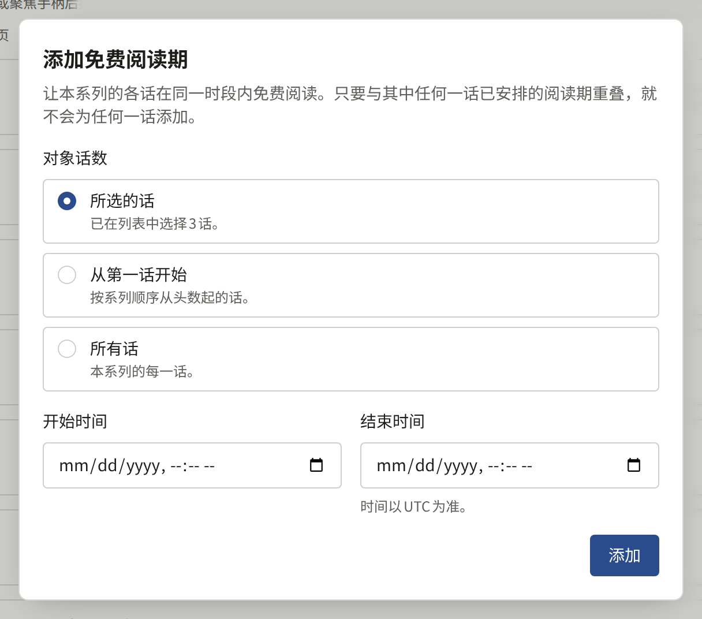

网站从免费阅读期开始的那一刻起显示它，并在其结束的那一刻撤下：`publira worker`会在开始和结束时刷新缓存的页面，如[定时任务与维护任务](../../3-operations/10-scheduled-jobs.md#免费阅读期及其他缓存页面)所述。

## 活动价格

活动价格会在两个时间点之间以较低的价格销售付费章节。在活动期间购买章节，无论是在网站上还是在通过**应用内购买**销售的应用中，都按活动价格收费；与[系列的剩余部分](../4-selling-episodes.md#系列的剩余章节)一起购买时也是如此，并且是在扣除系列的**打包优惠**之前。章节保留其自己的**价格**，活动结束后重新按该价格收费。租借保留其**租借价格**，按活动价格完成的购买则保留其支付时的价格。

章节编辑界面中的**活动价格**列出其活动及价格，状态为**活动中**、**已安排**或**已结束**。要添加，请输入以租户货币计价、低于章节**价格**的**活动价格**，再输入**开始时间**和**结束时间**（均按租户的时区），然后选择**添加活动价格**。**结束时间**必须晚于**开始时间**，且必须在将来；**开始时间**可以是过去的时间，这样章节会从现在起开始促销。同一章节的两个活动不能重叠，但一个可以恰好在另一个结束时开始。免费章节没有可以降低的价格，因此该部分不会为其提供表单。

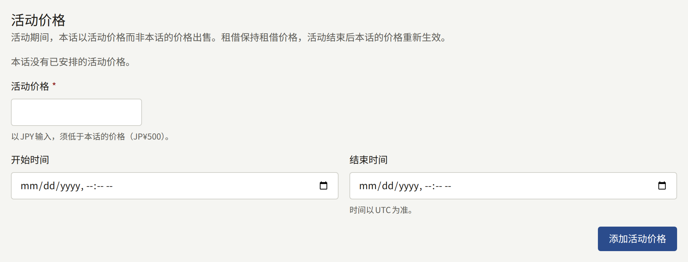

活动无法编辑。请**删除**它再添加一个新的；删除已经开始的活动，会让章节立即恢复按自己的价格销售。将章节的**价格**降到等于或低于某个活动的价格，会使该活动失去作用，因为此时章节按自己的价格销售。

要以相同的价格和期间让多个章节参加活动，请在章节列表中勾选它们，然后选择**活动价格**。输入**活动价格**、**开始时间**和**结束时间**，然后选择**添加**。如果该价格不低于每个所勾选章节的**价格**，或者该期间与其中任何一个章节已有的活动重叠，则不会添加任何内容。

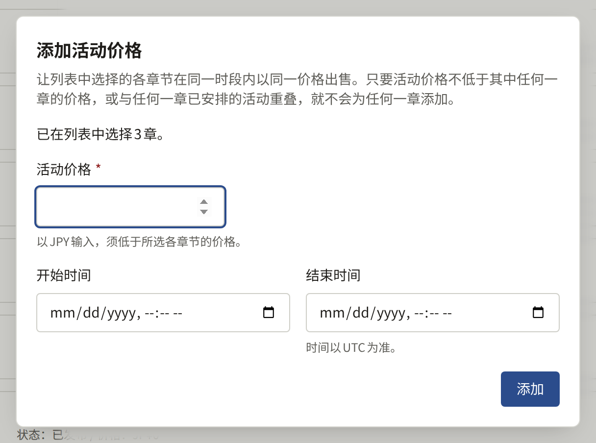

在网站上标出章节价格的所有地方，处于活动中的章节都会显示活动价格、旁边划线的自身**价格**，以及按租户时区表示的活动结束时间。价格在读者开始购买时确定，因此在活动结束后才开始购买的读者支付章节自己的**价格**（支付页面会显示该价格），即使其开始购买的页面上仍标着活动价格。

网站从活动开始的那一刻起标出活动价格，并在其结束的那一刻撤下：`publira worker`会在开始和结束时刷新缓存的页面，如[定时任务与维护任务](../../3-operations/10-scheduled-jobs.md#免费阅读期及其他缓存页面)所述。

应用会在系列的章节列表、锁定的章节上，以及上一章节末尾推荐下一章节的地方标出活动：活动价格、旁边划线的章节自身**价格**，以及活动结束时间。与应用中的所有时间一样，结束时间按读者设备的时区显示。无论应用是通过网页结账销售，还是通过[**应用内购买**](../4-selling-episodes.md#在应用中销售)销售，都会这样显示；应用内购买会将章节作为与活动价格对应的商店商品来购买，因此商店的支付界面收取的就是应用标出的价格。

## 发布章节

章节处于以下三种状态之一：

| 状态 | 含义 |
| --- | --- |
| **草稿** | 没有发布时间。读者看不到 |
| **已预约** | 发布时间尚未到来。在此之前读者看不到 |
| **已发布** | 发布时间已过。只要其系列已公开，且章节在读者所用的渠道上显示，读者就可以打开 |

章节在发布之前，其页面的响应就像它不存在一样，它不会出现在任何列表中，相邻章节的上一章和下一章链接也会跳过它。

### 设置时间

章节编辑界面中的**发布设置**用于设置或更改已存在章节的时间。按租户的时区输入时间，或清空该字段，然后选择**更新发布日期和时间**：

- **已经过去的时间**（例如当前时间）会立即发布草稿或已预约的章节，除非租户[要求审核](#发布前审核)。它会通知关注者并发送到搜索索引，与已预约章节到时间时完全一样。已发布的章节保持不变，因此用其当前显示的时间保存该部分不会产生任何变化。
- **将来的时间**会将章节预约在该时间发布。
- **空白字段**会让章节变为草稿。

已发布的章节会因后两者而从网站上撤下，如[将章节从网站撤下](#将章节从网站撤下)所述。

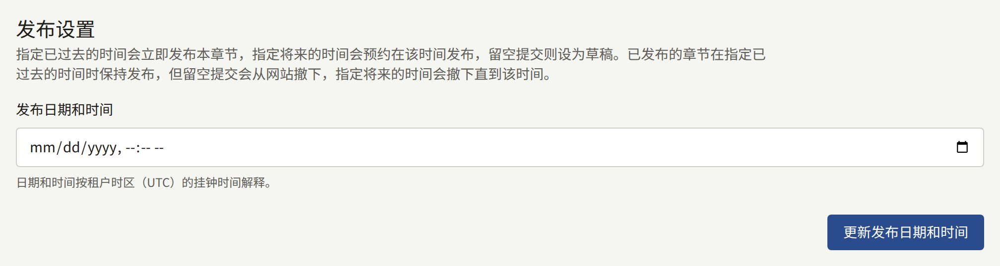

因此，在已公开的系列中发布新章节的通常做法是：

1. 将**发布日期和时间**留空，作为草稿创建章节。
2. 添加页面，设置布局，并在[预览](#预览页面)中检查二者。
3. 在**发布设置**中输入当前时间以立即发布，或者输入应该发布的时间，然后保存。

### 已预约的章节何时出现

章节由`publira worker`发布，它每分钟查找一次时间已到的章节。在那次执行时，章节：

- 在网站上的章节页面和系列的章节列表中，以及在应用中开放。
- 通知关注该章节、其系列或其署名作者的每位读者：在章节所显示的网站和应用上各发送一条通知和一条推送通知，在网站上显示时还会发送邮件。每位读者的通知设置决定其中哪些会送达。
- 发送到搜索索引。

因此，预约在12:00的章节大约在12:01即可阅读，网站的列表（例如按**最近更新**排序的系列列表）也从同一时刻开始显示它。

如果章节在时间过去很久之后仍为**已预约**，说明worker进程没有运行，或者发布失败。此时租户管理员会收到标题为“有章节发布失败”的通知。这需要由运营人员修复，如[定时任务与维护任务](../../3-operations/10-scheduled-jobs.md#定时发布)所述，修复后章节会自动发布。要不等待而立即发布，请在**发布设置**中输入当前时间并保存。

在系列未公开时发布的章节会等待系列公开，这样就不会有通知把读者引向找不到的页面。无论是通过**更新系列**，还是系列自己的**发布日期和时间**到来，章节都会在系列发布时发出通知；此后它会以系列公开的时刻作为发布日期，因为在此之前没有读者能打开它。在系列之前公开期间已经通知过关注者的章节保留原来的日期，不会再次通知。

在**不在任何位置显示**状态下发布的章节不会通知任何人，之后变为显示时也不会补发通知。只在网站和应用其中之一显示的章节，只在那里发出通知：读者只会在那一方的通知中看到它，其推送通知也只会送达读者的浏览器或只会送达其手机。章节在哪里通知，是在`publira worker`发送通知时决定的，之后更改其**显示位置**不会改变已经发出的通知。请在发布时间之前设置好章节的显示位置。

### 发布前审核

租户可以要求每个章节在发布前都必须经租户管理员批准，这样编辑预约的内容会先由第二个人阅读。在租户管理员于[**设置**](../3-setup/1-settings.md#发布前审核)中开启**发布前必须审核**之前，审核处于关闭状态；审核关闭时，章节仅按其时间发布，如上所述。

要求审核期间：

- **保存时间即提交审核**。创建章节时或在**发布设置**中保存的发布时间，会让章节变为**已预约**并进入审核，而不是单独预约发布。已经过去的时间也不会让它立即发布：它和其他章节一样等待决定。要求审核期间，**发布设置**会在其字段上方说明这一点。
- **租户管理员批准或退回章节**。章节的编辑界面在**发布设置**下方有一个**审核**部分。章节处于审核中时，租户管理员会在那里看到一个**评语**字段，以及**批准**和**退回**。已批准的章节与其他已预约章节一样，由`publira worker`在其时间发布；时间已经过去的章节会在批准的那一刻发布。批准时评语是可选的，退回时则需要写明要修改的地方。
- **被退回的章节保留其时间，且保持未发布**。提交它的工作人员会在控制台中收到标题为“有章节被退回”的通知，以及一封引用评语的邮件。修改完成后，他们在**发布设置**中选择**提交审核**，即可在不改变时间的情况下再次提交。保存其他时间也会再次提交。
- **每一轮都会保留**。在**审核**部分中，按从旧到新的顺序列出章节审核的每一轮：谁在何时提交、谁在何时批准或退回，以及评语。章节的当前状态会标在该部分标题旁：**审核中**、**已退回**或**已批准**。所有工作人员都可以阅读该部分；审计员在其中看不到任何操作控件，编辑看不到**批准**或**退回**。
- **批准后的更改会让章节重新进入审核**。已批准的章节如果更改了页面、标题、价格、布局、封面图、署名，或**显示位置**和**销售位置**，或者设置了其他时间，就需要再次批准，因为已批准的内容已不再是将要发布的内容。已发布的章节不会再次审核。
- **等待审核的章节不算发布失败**。它在时间过后仍保持**已预约**，也不会有人收到无法发布的通知。
- **草稿永远不会处于审核中**。在**发布设置**中清空时间，会将章节连同其预约一起撤出审核。

开启审核会将每个已预约的章节提交审核，包括之前开启审核期间已批准的章节，因此在租户管理员批准之前，它们都不会发布。关闭审核会让每个已预约的章节按其时间发布，无论它处于审核中、已退回还是已批准。审核关闭期间，编辑界面不显示**审核**部分和**提交审核**，章节列表也不会将任何章节标为**审核中**或**已退回**。

每次提交、批准和退回都会记录在**审计日志**中。

### 何时发布什么

侧边栏**作品**分组中的**日历**显示租户所有系列一个月内的发布情况。每一天列出在当天发布或已经发布的章节，显示系列标题、章节标题及其状态（**已预约**或**已发布**），选择其中一个会打开其编辑界面。一天是指租户时区中的一天（界面上会注明该时区），因此在该时区预约于23:30的章节，无论查看者身在何处，都显示在那一天。草稿没有时间，因此不会出现在日历上。

日历打开时显示当前月份，并标出今天。**上个月**和**下个月**每次移动一个月，**本月**会回到当前月份。仪表盘**发布队列**旁的**打开日历**也可以打开日历。所有工作人员都可以打开它，但不能在其中更改任何内容：要重新安排章节的时间，请在其自己的**发布设置**中操作。


### 将章节从网站撤下

已售出的章节，或有需要保留的记录引用的章节，无法删除，详见[删除章节](#删除章节)。要将已发布的章节从网站上撤下，请改为：

- 在**发布设置**中**清空该字段**并保存。章节会恢复为**草稿**。
- **输入将来的时间**并保存。在那之前章节不在网站上，到时会再次发布，且不会再次通知关注者。
- **设置显示位置**，让它在任何地方都不显示。章节仍保持已发布状态，一旦更改该设置就会恢复。

使用以上任何一种方式，已购买该章节的读者都会失去访问权限，直到章节恢复为止。

### 删除章节

租户管理员可以通过章节编辑画面**基本信息**标签页末尾的**删除本章**来删除章节；编辑和审计员看不到它。对话框会要求输入章节标题，在准确输入标题之前，**删除章节**无法点击。点击后，章节会连同其页面、封面图、译文、署名、免费阅读期、活动价格和审核记录一起删除，读者留下的评论及其举报、关注、反应和阅读记录也会一并删除。稍后，关于该章节及其评论和审核的通知也会从读者和工作人员的通知中删除。章节会立即从网站、应用和搜索索引中消失，控制台会返回该系列的章节列表。删除无法撤销，**审计日志**会记录该操作及章节标题。

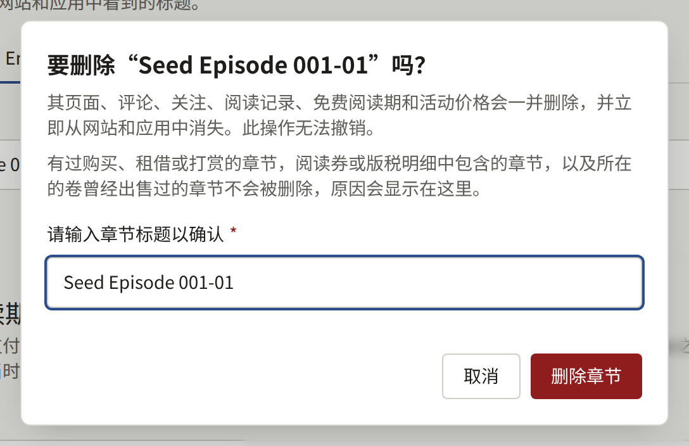

只要以下任一项引用了该章节，章节就不会被删除，对话框会显示原因：

- 购买、租借或打赏，无论是读者付费还是工作人员授予，包括在App Store或Google Play中的购买、用代币支付的购买，以及随包含该章节的卷或打包优惠一起的购买。**查看本章的购买记录**会打开筛选为本章的**购买记录**。
- 本章仍有可能完成的付款。
- 阅读券，包括已撤销和已过期的。**查看本章的阅读券**会打开筛选为本章的**阅读券**。
- 包含本章的版税明细。
- 读者已使用的本章优惠码。
- 包含本章且曾经出售过的卷，无论现在是否仍在出售。

这些都是金钱或授予读者权利的记录，因此记录和章节都不会被删除：请改为将章节从网站上撤下。从未出售过的卷，以及无人使用过的本章优惠码，只会在章节删除时失去该章节。
