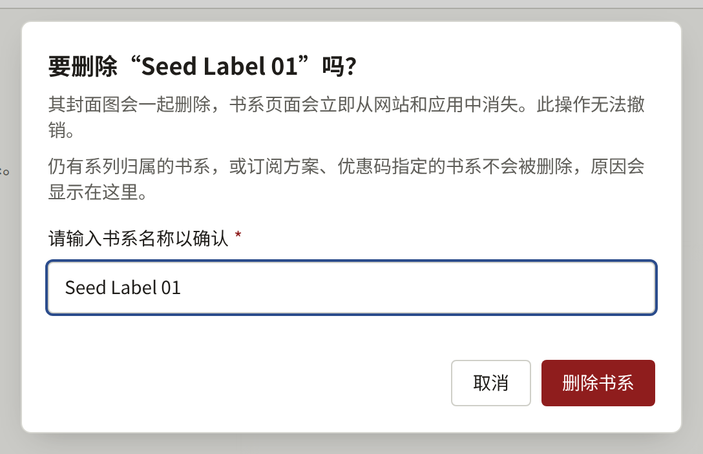

书系就是出版品牌（imprint）：出版社为其某一系列作品起的名字，例如一本杂志或一套丛书。每个系列都恰好属于一个书系，所以在书系存在之前无法保存系列。只有一个出版品牌的出版社只需创建一个书系，并把所有系列都归入其中。

侧边栏**作品**分组中的**书系**列出所有书系，最新的排在最前，每页二十个。

## 创建书系

选择**创建书系**，输入**书系名称**，然后选择**创建书系**。**书系封面图**是可选的，可以稍后添加，须为JPEG、PNG或WebP图片，大小不超过10 MB，尺寸至少为2400 × 3200像素。

书系的页面有两个选项卡。**基本信息**用于更改名称，通过**更新书系**保存。**封面图**用于替换或删除图片，并调整从中裁切出的四种形状，方法与[封面图](./1-series.md#封面图)中对系列的说明相同。

两个书系可以同名，所以创建之前请先查看列表。误建的书系在没有任何内容引用它之后，可以按照[删除书系](#删除书系)所述删除。

## 网站上的显示

- 网站页眉中的**书系**列出所有书系，以及每个书系已发布系列的数量。
- 每个书系都有一个页面，显示其名称、作为宽横幅的封面图，以及按标题排序的已发布系列。
- 系列页面会显示其所属书系并链接到该书系。
- 首页的**推荐书系**显示最近创建的、拥有已发布系列的六个书系，并附有查看全部书系的链接。

书系从创建那一刻起，即使其中还没有任何公开的系列，也会列在**书系**中，其页面也可以访问，显示“已发布0部系列”。只有当其中某个系列发布后，它才会出现在**推荐书系**中，所以请在此之前设置好名称和封面图。

如果一个书系的所有已发布系列都通过其**显示位置**设置为不在某个渠道上显示，那么该书系也不会在该渠道上列出。

## 删除书系

租户管理员可以通过书系页面**基本信息**标签页末尾的**删除本书系**来删除书系；编辑和审计员看不到它。对话框会要求输入书系名称；在准确输入名称之前，**删除书系**无法点击。点击后，书系会连同其封面图一起删除。书系页面会立即从网站、应用和搜索索引中消失，控制台会返回**书系**列表。删除无法撤销，**审计日志**会记录该操作及书系名称。

只有在没有任何内容引用书系时，才能删除书系。只要存在以下任一项，书系就不会被删除，对话框会显示原因，并附上通往其所在画面的链接：

- 归属本书系的系列，无论其状态如何。请在系列**基本信息**标签页的**书系**中将其逐一移到其他书系，或按照[删除系列](./1-series.md#删除系列)所述删除系列。**查看本书系的系列**会打开按本书系筛选的**系列**列表。
- **可阅读范围**包含本书系的订阅方案。请按照[更改、取消发布和删除方案](../5-subscription-plans.md#更改取消发布和删除方案)所述，将本书系从方案的可阅读范围中移除。**查看订阅方案**会打开**订阅方案**。
- 本书系未删除或已被读者使用的优惠码。请按照[查看、暂停和删除优惠码](../4-selling-episodes.md#查看暂停和删除优惠码)所述删除无人使用的优惠码；有读者使用过的优惠码时，书系无法删除。**查看优惠码**会打开**优惠码**。

对话框会按此顺序显示第一个符合的项目，因此同时符合多项的书系，在解决一项之后会因下一项再次被拒绝删除。
