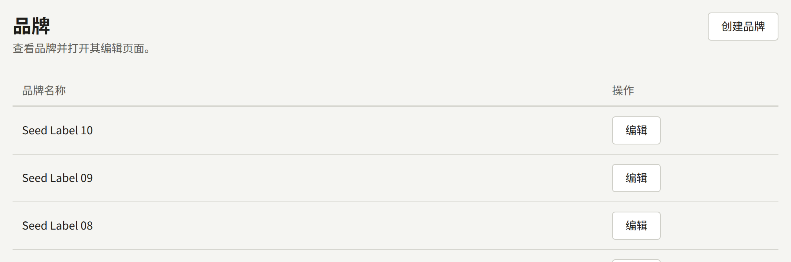
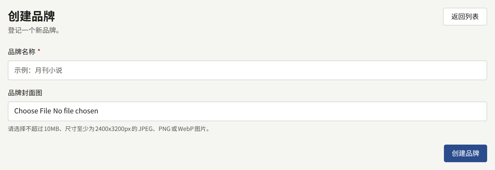
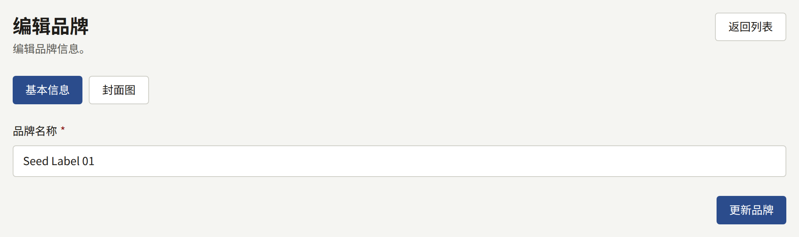

品牌就是出版品牌（imprint）：出版社为其某一系列作品起的名字，例如一本杂志或一套丛书。每个系列都恰好属于一个品牌，所以在品牌存在之前无法保存系列。只有一个出版品牌的出版社只需创建一个品牌，并把所有系列都归入其中。

侧边栏**作品**分组中的**品牌**列出所有品牌，最新的排在最前，每页二十个。

## 创建品牌

选择**创建品牌**，输入**品牌名称**，然后选择**创建品牌**。**品牌封面图**是可选的，可以稍后添加，须为JPEG、PNG或WebP图片，大小不超过10 MB，尺寸至少为2400 × 3200像素。

品牌的页面有两个选项卡。**基本信息**用于更改名称，通过**更新品牌**保存。**封面图**用于替换或删除图片，并调整从中裁切出的四种形状，方法与[封面图](./1-series.md#封面图)中对系列的说明相同。

两个品牌可以同名，而且品牌无法删除，所以创建之前请先查看列表。

## 网站上的显示

- 网站页眉中的**品牌**列出所有品牌，以及每个品牌已发布系列的数量。
- 每个品牌都有一个页面，显示其名称、作为宽横幅的封面图，以及按标题排序的已发布系列。
- 系列页面会显示其所属品牌并链接到该品牌。
- 首页的**推荐品牌**显示最近创建的、拥有已发布系列的六个品牌，并附有查看全部品牌的链接。

品牌从创建那一刻起，即使其中还没有任何公开的系列，也会列在**品牌**中，其页面也可以访问，显示“已发布0部系列”。只有当其中某个系列发布后，它才会出现在**推荐品牌**中，所以请在此之前设置好名称和封面图。

如果一个品牌的所有已发布系列都通过其**显示位置**设置为不在某个渠道上显示，那么该品牌也不会在该渠道上列出。
