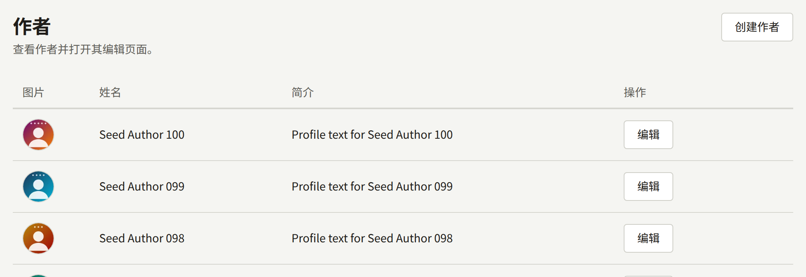
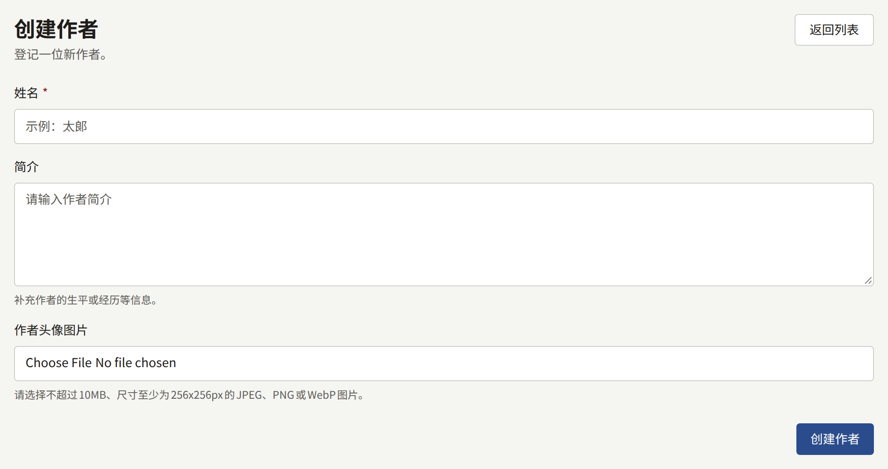
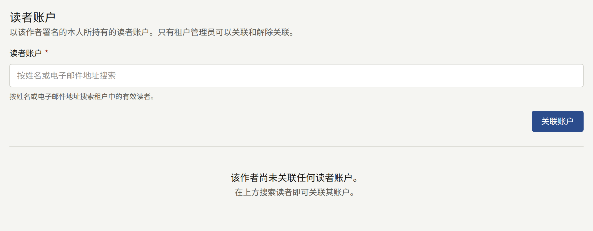
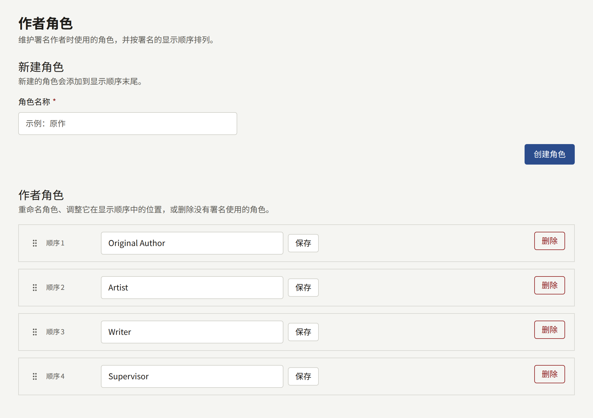
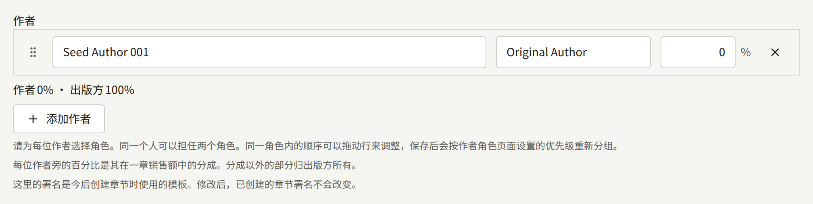

作者是在作品上署名的人：编剧、作画者、改编作品的原作者。系列及其每个章节都会为其作者署名，每位作者各有一个作者角色。这些署名就是读者在标题旁看到的内容，也是支付版税的依据。

## 作者

侧边栏**作品**分组中的**作者**列出租户的作者，最新的排在最前，每页二十位。选择**创建作者**并填写：

- **姓名**：读者看到的名字；如果此人以笔名发表作品，则填写笔名。
- **简介**：可选的个人介绍，会按原样显示在作者页面上，包括换行。
- **作者头像图片**：可选的JPEG、PNG或WebP图片，大小不超过10 MB，尺寸至少为256 × 256像素。**调整取景框**用于选择从中裁切出的正方形区域。

选择**创建作者**进行保存。之后可以在同一表单中通过**更新作者**修改作者信息。作者无法删除，两位作者也可以同名，所以请先查看列表。

以两个笔名发表作品的人就是两位作者。

### 网站上的显示

- 至少拥有一个已发布系列的作者都有一个页面，显示其头像、姓名、简介，以及按标题排序的署名系列。读者可以在那里关注作者，之后每当有署名该作者的新章节时都会收到通知。
- 网站的作者列表和首页的**推荐作者**按姓名顺序显示这些作者。
- 没有已发布系列的作者没有页面。

系列或章节页面上的署名是纯文本，不会链接到作者页面。

### 将作者与读者账户关联

租户管理员可以在作者页面的**读者账户**中，记录某位作者就是网站上的某位读者。编辑和审计员看不到这一部分。

在**读者账户**中按姓名或邮箱地址搜索该读者，然后选择**关联账户**。该读者必须已经在网站上拥有账户，并且邮箱地址已确认；工作人员的账户无法关联。一个账户可以关联多位作者，一位作者也可以关联多个账户。

关联之后，该读者：

- 无需购买即可阅读署名该作者的每个章节，前提是署名在章节本身上。章节会提示该读者，作为作者，此章节对其开放。仅在系列上署名不会开放其章节，系列的年龄分级也依然适用。
- 不会看到购买这些章节的选项，也不能为它们评分。
- 在这些章节下发表的评论会带有**作者**徽章，其名字会链接到作者页面。

在租户管理员于[设置](../3-setup/1-settings.md#作者页面)的**作者页面**中开启**向作者显示其自己的页面**之前，已关联的读者看不到作者的任何其他信息。开启后，对于其关联的每位作者，该读者可以查看：

- 当前关注该作者的读者人数。
- 每个署名该作者且已在网站上发布的章节，以及其最近28天的会员阅读数和读完数，计算方式与**分析**中的**章节**相同。比率由这两项算出，也与那里相同。
- 如果同时开启了**显示明细和销售额**，还可以查看这些章节在同样28天内的销售量和扣除退款后的收入，以及每份已结算版税结算单中该作者的部分，如[报表与版税](../6-reports-and-royalties.md#关联读者账户的作者能看到的明细内容)所述。
- 每个署名该作者且已在网站上发布的章节下已公开的评论，按从新到旧排列，每条都附有所属章节，与所有读者在章节下看到的完全相同。等待审核的评论、已被移除的评论和评论者自己删除的评论不在其中，仅通过系列署名该作者的章节下的评论也不在其中。该列表仅供阅读：要回复时，读者需要在章节下发表评论，其评论会带有**作者**徽章。

读者在网站**个人中心**中通过**打开作者页面**，或在应用**账户**选项卡的**已购买**下通过**作者页面**打开这些页面。只有存在可以打开的作者时，这两个入口才会显示。每位作者都有自己的页面，关联了多位作者的读者可以通过顶部的选项卡在它们之间切换。作者页面上的**评论**会打开该作者章节下的评论。

读者只能看到自己关联的作者，绝不会看到其他作者的数据或明细行，即使是与其共同署名的作者也一样。工作人员的账户什么也看不到，即使它是在成为工作人员之前关联的。

**解除关联**会移除关联，读者的账户则保持原样。关联和解除关联都会记录在审计日志中。

## 作者角色

作者角色是指作者以什么身份署名。每条署名都指定一个角色，同一位作者可以在一个系列上以两个角色署名两次。

新租户有四个角色：**Original Author**、**Artist**、**Writer**和**Supervisor**。它们的名称按原样以英文保存，读者看到的也是原样文字，所以使用其他语言的网站需要重命名它们。

**作者角色**按优先级顺序列出这些角色。在该界面上：

- **新建角色**用于添加角色，填写**角色名称**后选择**创建角色**。名称最多50个字符，且不区分大小写必须唯一。新角色会添加到顺序的末尾。
- 每个角色的名称可以直接在列表中修改，然后选择**保存**。该角色的所有署名都会显示新名称。
- 拖动角色的手柄可以调整顺序。
- **删除**用于删除没有任何署名使用的角色。仍在使用的角色无法删除：控制台会显示有多少条署名在使用它，必须先将这些署名改为其他角色。

没有任何角色时，就无法为任何人署名。

## 为作者署名

署名在系列表单和每个章节编辑界面的**作者**中填写。每一行指定一位**作者**、一个**角色**和一个分成比例，即作者获得版税所依据的销售额百分比。分成之外剩余的部分归出版社所有。分成合计不能超过100%。

保存时，各行会按角色的优先级顺序按角色分组；拖动行可以调整同一角色内作者的顺序。

网站以同样的方式显示署名：每个角色后面跟着其作者，例如“Original Author Name1, Name2 / Artist Name3”。系列页面显示系列的署名，章节页面显示章节自己的署名。

系列的署名是其新章节的模板：章节创建时会复制一份系列的署名，之后系列的署名发生变化时，章节仍保留这份副本。在章节上或一次为多个章节修改署名的方法，请参阅[署名](./2-episodes.md#署名)；分成如何转换为版税，请参阅[报表与版税](../6-reports-and-royalties.md#作者应得的金额)。
