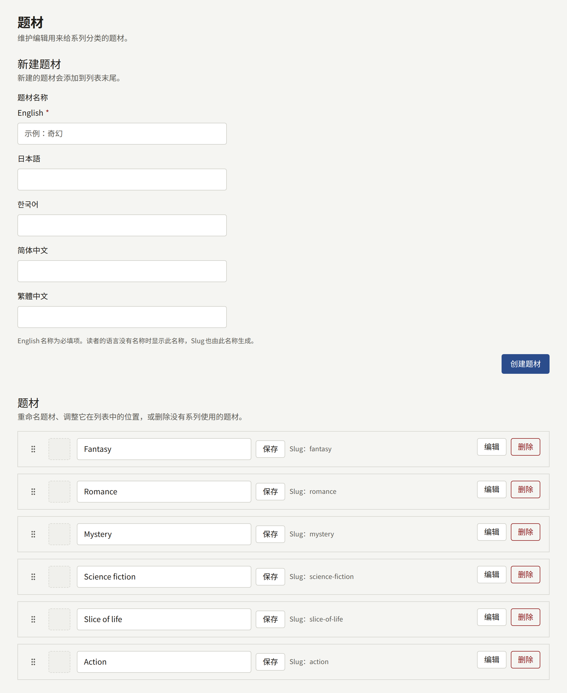
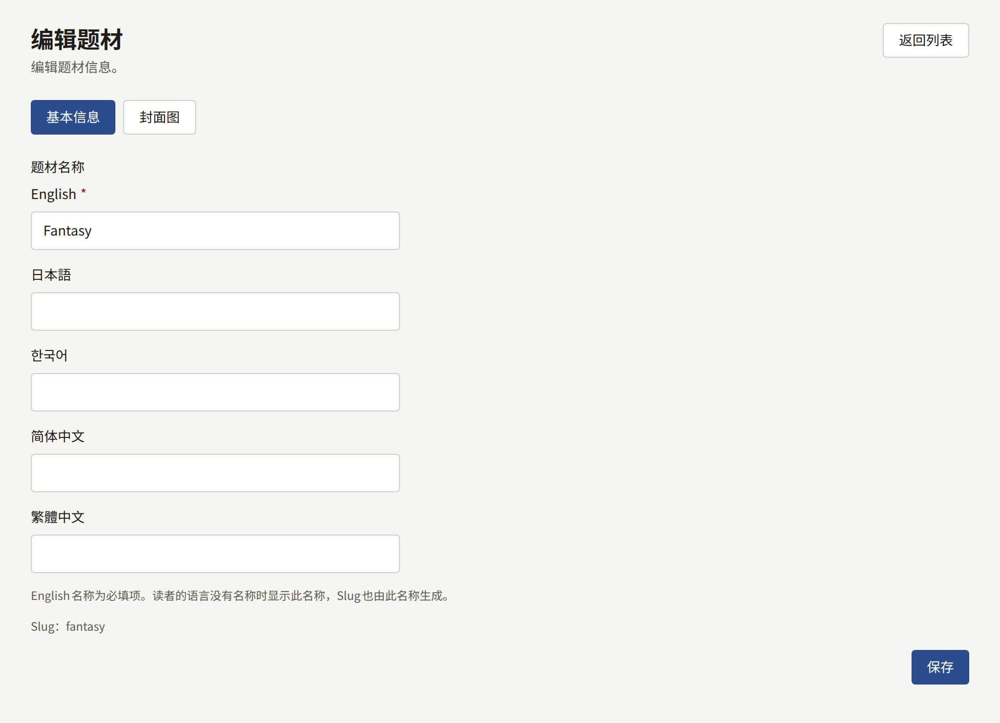

题材是租户用来给系列归类的分类，例如奇幻或恋爱。一个系列可以属于任意数量的题材，在系列的表单中选择，读者则按题材浏览作品目录。题材完全由租户自己定义：没有任何预设，而且只有一个扁平的列表。

侧边栏**作品**分组中的**题材**在一个页面上显示整个列表。

## 管理题材

- **新建题材**用于添加题材，填写**题材名称**后选择**创建题材**。**题材名称**为网站提供的每种语言各有一个字段，如[用各语言为题材命名](#用各语言为题材命名)所述。名称最多50个字符，默认语言的名称必须唯一。新建的题材会添加到列表末尾。
- 每个题材在默认语言中的名称可以直接在列表中修改，然后选择**保存**。
- 拖动题材的手柄可以调整它的位置。这个顺序就是网站列出题材的顺序，也是系列的题材显示的顺序。
- **编辑**会打开题材的页面。其**基本信息**选项卡包含该题材在网站提供的每种语言中的名称，**封面图**选项卡则为它设置图片，方法与[封面图](./1-series.md#封面图)中对系列的说明相同。
- **删除**用于删除没有任何系列使用的题材。仍在使用的题材无法删除：请先将它从所有系列中移除。

## 用各语言为题材命名

题材可以在网站提供的每种语言中各有一个名称，这些语言由租户管理员在[**设置**](../3-setup/1-settings.md#语言)中选择。**新建题材**和题材的**基本信息**选项卡中的**题材名称**为每种语言各提供一个字段，字段以该语言自身的语言名称标注，网站的默认语言排在最前。

- 默认语言的名称为必填项。题材没有对应语言名称时，使用该语言的读者会看到默认语言的名称。
- 与名称一起显示的题材Slug由默认语言的名称生成。正是它防止两个题材取相似的名字：仅大小写或空格不同的名称会生成相同的Slug，因此其中第二个会被拒绝。
- 题材在网站上的地址是其公开ID，而不是Slug，所以重命名题材不会改变地址，而且在所有语言中都相同。
- 其他名称是可选的。填写某个字段，就会添加该语言的名称。在题材的**基本信息**选项卡中，清空某个字段并选择**保存**，就会删除该名称。
- 网站不提供的语言没有字段。已用该语言保存的名称会保留下来，当网站重新提供该语言时，其字段也会重新出现。

## 网站上的显示

- 首页的**按类型浏览**按列表顺序显示所有题材，以及每个题材已发布系列的数量。租户没有任何题材时，该区域会隐藏。
- 网站页眉中的**类型**以磁贴形式显示所有题材，带有其封面图；没有封面图时，则显示其中几个系列的封面。
- 每个题材都有一个页面，显示本周其中的热门作品以及它的系列，读者可以按连载状态和其他条件筛选。
- 系列页面会链接到它的每个题材。
