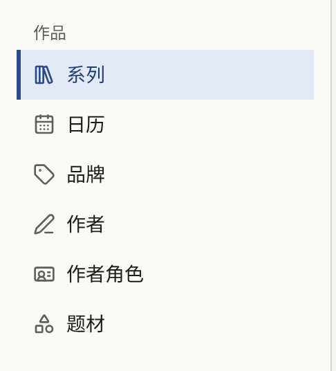

读者在网站上能打开的一切都是某个系列的章节，而系列归属于某个品牌，并署名其作者。侧边栏的**作品**分组包含制作这些内容的界面，以及显示它们何时上线的日历：

| 界面         | 包含的内容                                              |
| ------------ | ------------------------------------------------------- |
| **系列**     | 作品及其章节                                            |
| **日历**     | 所有已排期和已发布的章节，显示在各自上线的日期          |
| **品牌**     | 系列发行时所属的出版品牌                                |
| **作者**     | 在系列和章节上署名的人                                  |
| **作者角色** | 作者以什么身份署名，例如**Original Author**或**Artist** |
| **题材**     | 读者浏览作品目录时使用的分类                            |

租户管理员和编辑可以在这些界面上创建和更改所有内容，只有与作者关联的**读者账号**例外，仅租户管理员可以查看和更改。审计员可以打开每一个界面，但表单为只读，也看不到用于创建内容的按钮。作品目录中除了章节的页面，以及未被任何内容使用的作者角色和题材之外，什么都不能删除，因此不应再被阅读的系列或章节要从网站上撤下，而不是删除。

## 从空的作品目录到第一个章节

下面的顺序正是控制台所要求的：没有品牌就无法保存系列，作者要从已存在的作者列表中选择署名，而章节属于某个系列。在准备第一个章节期间，系列保持隐藏，二者在最后一步一起与读者见面。

1. **创建品牌**。在**品牌**中选择**创建品牌**，输入**品牌名称**，然后选择**创建品牌**。只有一个出版品牌的出版社只需创建这一个品牌，之后的所有系列也都归入其中，而不是每个系列各建一个品牌。请参阅[品牌](./3-labels.md)。
2. **创建作者**。在**作者**中，为每位要署名的人选择**创建作者**，填写其**姓名**，如有的话再填写**简介**和**作者头像图片**。请参阅[作者和作者角色](./4-authors.md)。
3. **检查作者角色**。新租户有四个英文的作者角色：**Original Author**、**Artist**、**Writer**和**Supervisor**。如果网站使用其他语言，请在**作者角色**中重命名它们，因为读者会在每个名字旁边看到它们。
4. **创建题材**。如果网站要按题材浏览，请在**题材**中创建。系列可以在没有题材的情况下保存，之后再设置题材。请参阅[题材](./5-genres.md)。
5. **创建系列**。在**系列**中选择**创建系列**。填写**标题**、**简介**和**品牌**，在**作者**中为作者署名，选择**封面图**，并将**发布日期和时间**留空，这样在您制作期间系列会保持隐藏。选择**创建系列**。请参阅[系列](./1-series.md)。
6. **创建第一个章节**。在**系列**列表中，选择该系列所在行的**章节**，然后选择**创建**。输入**标题**和**价格**，并将**发布日期和时间**设为当前时间，这样章节一创建就会发布。由于其系列仍处于隐藏状态，它暂时还不能阅读。选择**提交章节**。请参阅[章节](./2-episodes.md)。
7. **添加页面**。在章节的编辑界面中，于**添加漫画页面**下添加页面图片，然后在**已登记的页面图片**中检查它们的顺序。
8. **发布系列**。回到该系列，将**发布日期和时间**设为当前时间，然后选择**更新系列**。现在系列及其第一个章节已经出现在网站上。
9. **以读者身份打开**。退出登录或使用无痕窗口，在网站首页、**品牌**下，或通过搜索标题找到该系列。打开章节并翻页。付费章节会显示其价格，按[销售章节](../4-selling-episodes.md)所述的方式打开。

之后的章节会添加到已经公开的系列中，因此先作为草稿准备，待页面就位后再设置发布时间，如[发布章节](./2-episodes.md#发布章节)所述。

## 本章内容

- [系列](./1-series.md)：创建系列、它在哪里以及何时显示、年龄分级、阅读方向、评论、封面图，以及**等待即可免费**。
- [章节](./2-episodes.md)：创建章节、添加页面、价格和阅读期限、页面布局、署名、在哪里显示和销售、免费阅读期、定时发布，以及显示何时上线什么内容的日历。
- [品牌](./3-labels.md)：系列发行时所属的出版品牌，以及读者看到的品牌页面。
- [作者和作者角色](./4-authors.md)：在作品上署名的人、他们以什么身份署名、署名在网站上如何显示，以及将作者与其读者账户关联。
- [题材](./5-genres.md)：读者浏览时使用的分类及其顺序。
