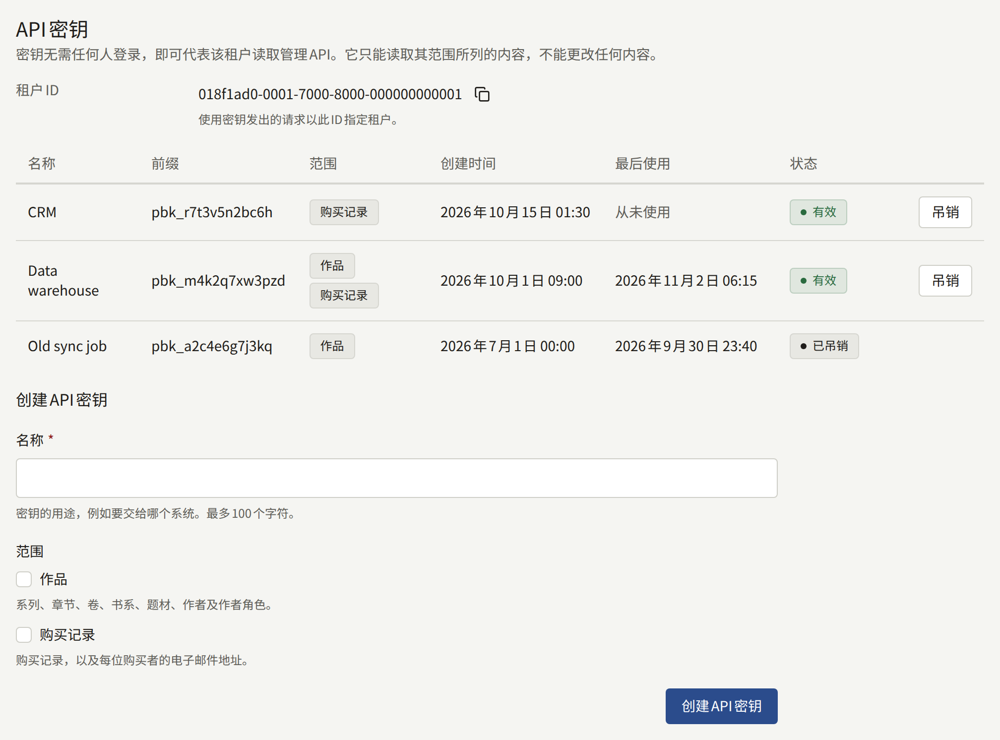
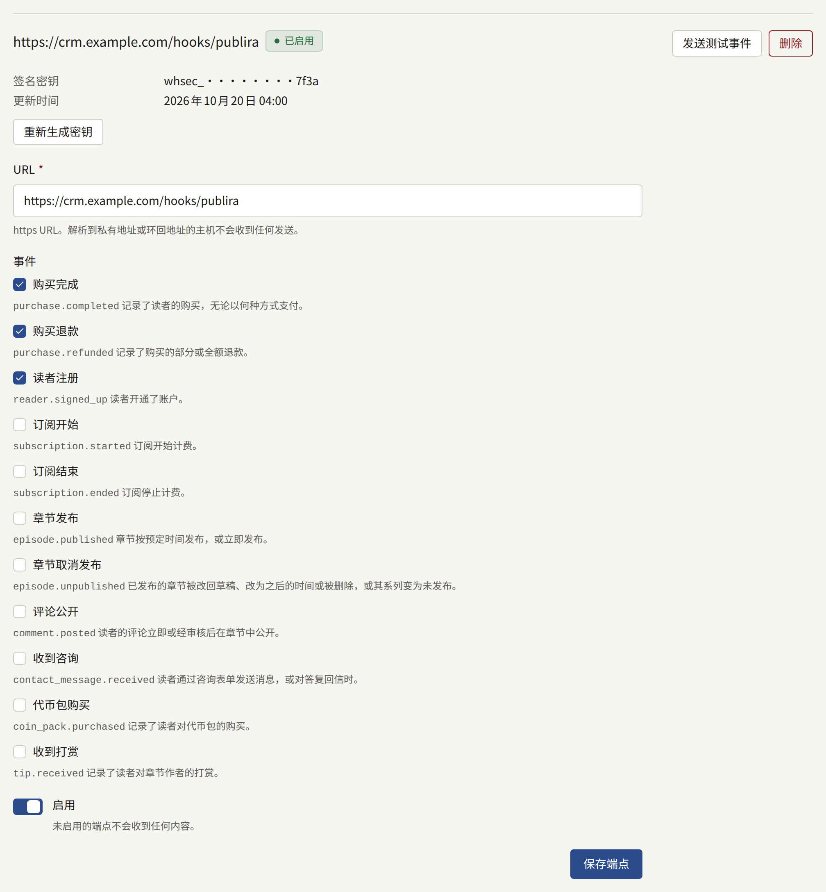
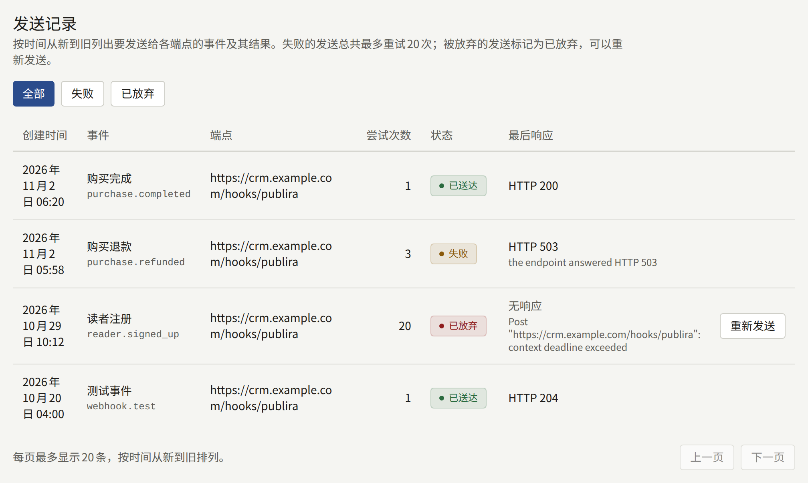

**集成** › **API密钥与Webhook**将租户与出版社自己运行的系统连接起来，例如CRM、数据仓库或会计系统。系统使用**API密钥**读取租户的作品目录和购买记录，并通过**Webhook端点**在销售、退款、新读者或订阅发生时立即获知。Webhook端点是系统自己的一个URL，每个事件都会发送到这里。**发送记录**列出发送给每个端点的内容以及被放弃的内容。

只有租户管理员能看到**API密钥与Webhook**，其中的每次更改都会记录在**审计日志**中：**创建了API密钥**、**吊销了API密钥**、**创建了Webhook端点**、**更新了Webhook端点**、**删除了Webhook端点**、**重新生成了Webhook签名密钥**和**重新发送了Webhook**。

## API密钥



密钥无需任何人登录，即可读取该租户的管理API。它只能读取其范围所列的内容，任何密钥都不能更改任何内容。

### 创建密钥

1. 在**创建API密钥**下，输入说明密钥用途的**名称**，例如要交给哪个系统，最多100个字符。
2. 选择它的**范围**，至少选择以下一项：

   | 范围 | 密钥可以读取的内容 |
   | --- | --- |
   | **作品** | 系列、章节、卷、书系、题材、作者及作者角色 |
   | **购买记录** | 租户的购买记录或某一位读者的购买记录，以及每位购买者的电子邮件地址 |

   只选择系统需要的范围：**购买记录**会把每位购买者的地址交给它。

3. 选择**创建API密钥**。

密钥只在**新的API密钥**下显示一次，并附有复制它的控件。请立即复制，并保存在使用它的系统可以读取的位置：系统只保存它的哈希值，因此它无法再次显示；离开或刷新页面后，它也会从界面上消失。未复制的密钥需要吊销，并换成新的密钥。

此后，列表会按**前缀**显示该密钥，即`pbk_`及其后的十二个字符，也就是系统所持有密钥的开头部分；**最后使用**精确到分钟。

### 发出请求

系统在管理API上以`Authorization: Bearer <key>`发送密钥，并用列表上方显示的**租户ID**指定租户，如下面这个获取租户系列的请求所示：

```bash
curl <server>/rpc/publira.admin.v1.AdminSeriesService/ListSeries \
  -H "Authorization: Bearer pbk_…" \
  -H "Content-Type: application/json" \
  -d '{"tenant": {"tenantId": "<Tenant ID>"}}'
```

安装实例前面的边缘不会转发管理API，因此密钥由能直接访问`publira server`的系统使用，即通过Web应用调用它的那个网络进行访问。请向安装实例的运营人员询问该地址。

各个过程及其字段见[管理API的定义](https://github.com/publira/publira/tree/main/proto/publira/admin/v1)。使用密钥的请求会在以下情况下收到这些响应：

- **`unauthenticated`**：密钥已吊销或未知，或者请求指定了其他租户。
- **`permission_denied`**：调用了其任何范围都不允许的过程，所有写入操作都包括在内。
- **`resource_exhausted`**，附带`Retry-After`：超过了安装实例对使用密钥发出的请求的限制，即每分钟600次、每天100,000次，除非运营人员设置了其他值。

### 吊销密钥

选择密钥旁边的**吊销**，然后选择**吊销密钥**。此后使用它发出的每个请求都会被拒绝，它会以**已吊销**状态保留在列表中。已吊销的密钥无法再次使用。

要不间断地替换密钥，请先创建新密钥，将系统切换到新密钥，等**最后使用**显示旧密钥已不再被使用后，再吊销旧密钥。

## Webhook端点



端点是出版社自己的https URL，每发生一个它订阅的事件，都会收到一个带签名的`POST`请求。一个租户最多可保留五个端点，每个端点都有自己的表单。

### 添加端点

在**添加端点**下：

1. 输入它的**URL**：使用`https`，带有主机名，不含用户名、密码或片段，最多2048个字符。`http` URL会被拒绝。
2. 选择发送给它的**事件**，至少一个，详见[事件](#事件)。
3. 保持**启用**开启，即可立即开始发送。
4. 选择**添加端点**。

端点的签名密钥只在**端点的签名密钥**下显示一次。请立即复制并交给接收方，接收方用它验证每次发送的签名，详见[验证发送](#验证发送)。此后，端点只会在**签名密钥**下显示它的提示：`whsec_`、一段掩码，以及密钥的最后四个字符。

除非安装实例的运营人员已[允许该地址](../3-operations/12-security/index.md#发往自有网络的webhook)，否则发送不会发往解析到私有地址、环回地址、链路本地地址或共享地址的主机，并且绝不会跟随重定向。每次发送时都会检查主机解析到哪里，因此之后解析到其他地方的URL会在那时被拒绝。

### 更改、测试和删除端点

- **保存端点**保存端点自己的表单：它的URL、事件和**启用**。未启用的端点不会收到任何内容：在此期间发生的事件不会再发送给它，关闭时仍在等待的发送会被放弃。
- **发送测试事件**向端点发送一个`webhook.test`事件，无论端点是否启用，也无论它订阅了什么。该测试会和其他发送一起列在**发送记录**中，可以借此在真实事件到达之前检查新的接收方。
- 选择**重新生成密钥**，然后再选择**重新生成密钥**，会替换签名密钥，并在**新的签名密钥**下显示一次新密钥。此后每次发送都会使用新密钥签名，包括之前发送的重试；仍在用旧密钥验证的接收方会拒绝它们。请立即更新接收方，并重新发送在此期间被放弃的发送。
- 选择**删除**，然后选择**删除端点**，会删除该端点以及所有要发送给它的发送。

## 事件

| 事件 | 发送时机 | `data` |
| --- | --- | --- |
| **购买完成**（`purchase.completed`） | 记录了读者的购买，无论以何种方式支付：支付服务商、应用商店、租户的代币，或抵扣了全部价格的优惠码 | 购买 |
| **购买退款**（`purchase.refunded`） | 记录了购买的部分或全额退款。每次部分退款都是一个单独的事件 | 退款后的购买 |
| **读者注册**（`reader.signed_up`） | 读者开通了账户，使用地址和密码，或通过Apple或Google登录 | 读者 |
| **订阅开始**（`subscription.started`） | 订阅开始计费 | 订阅 |
| **订阅结束**（`subscription.ended`） | 订阅停止计费 | 订阅 |
| **测试事件**（`webhook.test`） | 选择了**发送测试事件** | 空 |

### 请求正文

每次发送都是一个JSON对象：

```json
{
  "id": "evt_…",
  "type": "purchase.completed",
  "created_at": "2026-11-02T06:20:00Z",
  "tenant_id": "<the tenant's public ID>",
  "data": {}
}
```

`id`是事件的ID。对于该事件发往的每个端点和每次尝试，它都相同，因此接收方应保存它，并丢弃已经处理过的事件：当对之前某次尝试的响应丢失时，同一事件可能会到达不止一次。`type`是上表中的事件名称，`created_at`是事件发生的时间。

`data`用管理API识别记录时所用的ID来指定记录，绝不使用数据库自身的ID：

| 对象 | 字段 |
| --- | --- |
| 购买 | `purchase_id`，即`GetPurchase`所接收的ID；`kind`：`purchase`、`rental`或`tip`；`item`：`episode`、`volume`、`series_bundle`或`coin_pack`，并在适用时附带`series_public_id`、`episode_public_id`和`volume_public_id`；`reader_public_id`和`reader_email`，读者删除账户后两者都为空；`price`为读者支付的金额，`list_price`为扣除优惠码折扣之前的价格，两者都以货币的最小单位表示，并附带`currency`；`refunded_amount`；`purchased_at`、`expires_at`和`refunded_at`；`provider`为支付服务商或`coins`，`store`为`app_store`或`google_play`，对于优惠码赠予的购买，两者都为空；以及`test` |
| 读者 | `reader_public_id`、`email`、`name`、`email_verified`（读者确认地址之前为false），以及`signed_up_at` |
| 订阅 | `plan_public_id`和`plan_name`；`reader_public_id`和`reader_email`，读者删除账户后两者都为空；`provider`：`stripe`、`app_store`或`google_play`；`status`；`current_period_end`和`cancel_at_period_end`；`started_at`；以及`test` |

每次发送还带有以下请求头：

| 请求头                | 值                                    |
| --------------------- | ------------------------------------- |
| `X-Publira-Event`     | 事件名称                              |
| `X-Publira-Delivery`  | 本次发送的ID，它的每次尝试都相同      |
| `X-Publira-Signature` | 签名，见下文                          |
| `Content-Type`        | `application/json`                    |
| `User-Agent`          | `Publira-Webhooks/`加上安装实例的版本 |

## 验证发送

`X-Publira-Signature`的格式为`t=<unix seconds>,v1=<hex>`，其中hex是用端点的签名密钥，对时间戳、一个句点以及与接收时完全相同的请求正文计算出的HMAC-SHA256。接收方重新计算该值，并拒绝签名不同的发送，以及时间戳与自身时钟相差超过几分钟的发送，重放的发送就属于这种情况：

```js
import { createHmac, timingSafeEqual } from "node:crypto";

// body is the raw request body, before any JSON parsing.
const verify = (secret, header, body, toleranceSeconds = 300) => {
  const parts = new Map(header.split(",").map((part) => part.split("=")));
  const timestamp = Number(parts.get("t"));
  const signature = Buffer.from(parts.get("v1") ?? "", "hex");
  const expected = createHmac("sha256", secret)
    .update(`${timestamp}.${body}`)
    .digest();

  return (
    Math.abs(Date.now() / 1000 - timestamp) <= toleranceSeconds &&
    signature.length === expected.length &&
    timingSafeEqual(signature, expected)
  );
};
```

对接收方已接受的发送，请以`2xx`状态响应，之后再执行它所要求的工作：超过十秒的响应视为没有响应。

## 重试与重新发送



发送的结果取决于端点的响应：

- **`2xx`**：它变为**已送达**。
- **除`408`和`429`以外的其他任何`4xx`**：无论发送多少次，接收方都不会接受它，因此它会被立即放弃。
- **其他任何情况**，包括`3xx`、`408`、`429`和`5xx`、超时或无响应：它变为**失败**并被重试，每次尝试后的等待时间加倍，从一秒开始，最长一小时。总共尝试20次后，即第一次尝试约八小时后，它会被放弃。

被放弃的发送为**已放弃**。**发送记录**按时间从新到旧列出每次发送，**失败**和**已放弃**会把列表缩小到相应的发送：每条都显示创建时间、事件、端点、已进行的尝试次数、状态，以及端点的最后响应或没有响应的原因。

已放弃的发送旁边的**重新发送**会再次发送它，请求正文和事件ID都相同，并且拥有自己的20次尝试。它的**尝试次数**会从原来的次数继续计数。请先修复导致接收方拒绝它的问题，否则重新发送也会以同样的方式被放弃。
