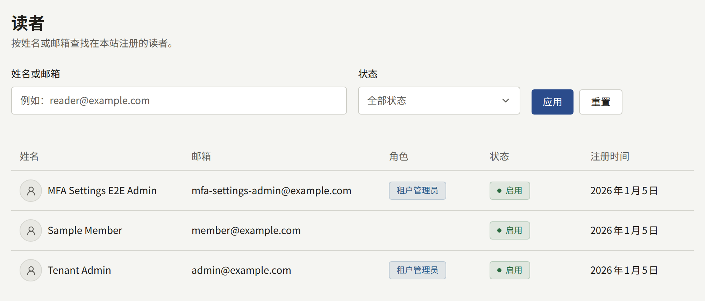
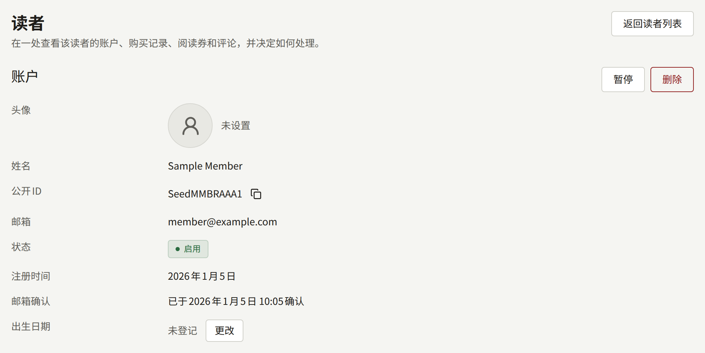

**读者**列出租户网站上的所有账户，最新注册的排在最前，每页二十个。其中也包括工作人员，因为控制台账户同时也是网站上的账户：**角色**显示工作人员所拥有的最高角色，读者则为空。只有租户管理员能看到这一列。

要查找某人，请在**姓名或邮箱**中输入其姓名或邮箱地址的一部分，然后选择**应用**。搜索会匹配二者中任意位置的内容，并且不区分大小写，所以`tanaka`可以找到`Tanaka Hanako`和`h.tanaka@example.com`。**状态**可以将列表筛选为某一种状态：

| 状态       | 含义                                             |
| ---------- | ------------------------------------------------ |
| **启用**   | 该账户可以登录                                   |
| **未启用** | 读者已注册，但尚未确认邮箱地址。确认之前无法登录 |
| **已暂停** | 租户管理员暂停了该账户。解除暂停之前无法登录     |

每一行开头是读者为其账户选择的头像；尚未选择头像的读者则显示一个简单的轮廓。**评论**也以同样的方式显示评论者的头像。点击列表中读者的姓名会打开其页面。对于租户管理员，**评论**中评论者的姓名，以及撰写咨询时已登录的发送者，也同样可以打开其页面。

## 读者页面

**账户**显示读者的**头像**、姓名、**公开ID**及其复制按钮、邮箱地址、状态、注册时间、是否以及何时确认了邮箱地址，以及**出生日期**。

其下方的三个部分列出读者拥有的内容，最新的排在最前，每页二十条：

| 部分 | 列出的内容 |
| --- | --- |
| **购买记录** | 读者购买的所有内容，包括所购买的章节、卷、系列的剩余章节或代币套餐、金额、付款方式，以及该购买现在是否仍能打开所购内容。点击标题会打开所购买的内容，**查看**会在**购买记录**中打开该笔购买，可以在那里退款 |
| **阅读券** | 工作人员向读者发放的阅读券，包括对应的章节和阅读券的状态。**撤销**和**发放阅读券**的作用与[阅读券](./4-access-tickets.md)中相同，无需离开此页面 |
| **评论** | 读者写下的所有内容，包括其自行删除、尚未被彻底删除的评论，可执行的操作与[评论](./2-comments.md)中相同 |

## 更正出生日期

读者一旦保存出生日期就无法自行更改，因此填错的读者必须联系网站，而[年龄验证](../3-setup/1-settings.md#年龄验证)中设置的年龄检查会依据已保存的日期进行。要更正，请选择**出生日期**旁的**更改**，输入日期，然后选择**保存**。将日期留空即可清除，之后读者打开有年龄限制的系列时会再次被要求填写。新日期从读者下次阅读时开始生效。

## 删除读者的头像

读者的头像会显示在其评论旁，所有阅读网站的人都能看到，因此违反网站规则的头像要在这里撤下。选择**头像**旁的**删除头像**，然后用**删除**确认。该图片会立即从网站和控制台中消失，账户改为显示简单的轮廓。之后读者可以选择另一个头像，就像自己删除头像后一样。

只有账户显示头像时才会提供**删除头像**。

读者是否可以上传头像、从租户提供的头像中选择，或完全不显示头像，在**设置**中配置，如[读者头像](../3-setup/1-settings.md#读者头像)所述。

## 暂停读者

**暂停**会让读者在所有设备上退出登录，并在解除暂停之前拒绝其登录，无论是使用密码还是Apple或Google登录。账户的其他方面都不会改变：其已公开的评论仍保留在网站上，其购买记录和阅读券仍归其所有，只是在无法登录期间无法使用。

同一页面上的**解除暂停**会将账户恢复为**启用**；如果其邮箱地址从未确认，则恢复为**未启用**。读者需要重新登录；被暂停终止的会话不会恢复。要查找被暂停的读者，请将**状态**设为**已暂停**。

## 读者下载的个人数据

读者可以在网站的**账户设置**或应用的账户界面中，下载网站保存的关于其本人的所有数据的副本。因此，读者依据APPI或GDPR要求查看网站所持有的其个人数据时，无需工作人员手动收集即可满足。工作人员无法代表读者申请：对于来信询问的读者，请引导其前往账户设置。

读者申请后，副本大约在一分钟内准备好。无论其通知设置如何，都会通过网站上的通知和邮件告知读者副本已就绪，读者可以在同一位置下载，七天内可以下载任意多次。七天后副本会被删除，读者可以再次申请。除非运营人员允许更多次数，读者每天只能申请一次，如[平台策略](../../3-operations/9-platform-policies.md)所述；在之前的申请仍在准备期间也不能再次申请。副本保存在安装实例的对象存储中，所以在运营人员尚未设置对象存储时，读者无法申请。

副本是一个ZIP文件，其中每种记录各有一个JSON文件，旁边还附有读者原本就能下载的购买记录CSV：

| 文件 | 包含的内容 |
| --- | --- |
| `account.json` | 姓名、邮箱地址、状态、出生日期，以及注册时间和邮箱确认时间 |
| `sign_in_methods.json` | 账户是否设置了密码和第二验证因素、与其关联的Apple和Google账户，以及其通行密钥 |
| `follows.json` | 读者关注的系列、章节和作者 |
| `reading_positions.json`、`reading_history.json` | 在每个章节中停在了哪里，以及读过的每个章节 |
| `ratings.json` | 读者给章节的评分 |
| `comments.json`、`comment_reports.json` | 读者写下的每条评论（无论现在处于什么状态），以及其举报过的评论 |
| `purchases.json`、`purchases.csv` | 读者购买的所有内容 |
| `coin_transactions.json` | 读者获得和花费的代币 |
| `subscriptions.json` | 读者在网站和应用中的订阅 |
| `preferences.json` | 读者的通知设置和阅读器偏好设置（如果保存过的话） |
| `legal_page_consents.json` | 读者同意过的每个版本的服务条款和隐私政策 |
| `access_tickets.json` | 工作人员向读者发放的阅读券 |
| `contact_messages.json` | 读者在登录状态下发送的咨询，以及每条咨询的回复 |

副本不包含属于工作人员而非读者的内容：工作人员在阅读券或咨询上记录的备注、哪位工作人员审核、隐藏或处理了某项内容，以及支付服务商和应用商店用来保存租户记录的ID。副本中也不包含任何密码或第二验证因素的密钥，网站本身就不会以任何人都能读取的形式保存它们。

## 删除读者

**删除**会以与读者自行注销完全相同的方式删除账户，并且无法撤销：

| 读者拥有的内容 | 会如何处理 |
| --- | --- |
| 评论及其提交的举报 | 删除 |
| 购买记录 | 保留，但不再关联购买者，因此销售额和版税不会改变 |
| 方案订阅 | 立即在租户的Stripe账户上取消，读者不会再被扣费。已付款的周期不予退款。读者在应用中购买的订阅由App Store或Google Play计费，只有读者本人才能取消：该订阅会保留，但不再关联订阅者，读者需要在应用商店中取消 |
| 阅读券、关注、阅读历史、评分、通知，以及关联的Apple和Google登录 | 删除 |
| 咨询 | 保留，显示为来自**访客** |
| 工作人员的角色 | 移除 |
| 读者申请的数据副本 | 在一小时内删除 |

如果之后可能需要撤销，请选择暂停而不是删除。

您无法暂停或删除您当前登录所用的账户，也无法暂停或删除租户最后一位有效的租户管理员：请先将其他人设为租户管理员。暂停、解除暂停、删除、更改或清除出生日期，以及删除头像，都会记录在[审计日志](../3-setup/8-audit-log.md)中，分别显示为**暂停了读者**、**解除了读者暂停**、**删除了读者**、**更改了读者出生日期**、**清除了读者出生日期**和**删除了读者头像**。
