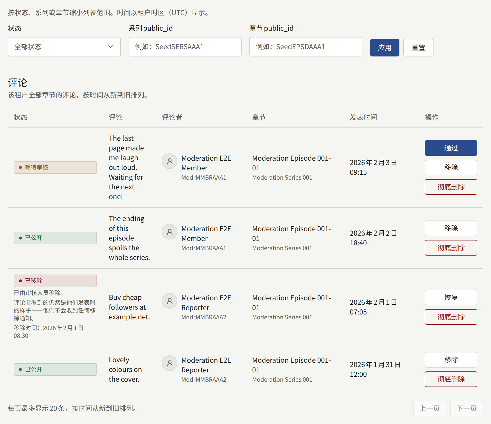
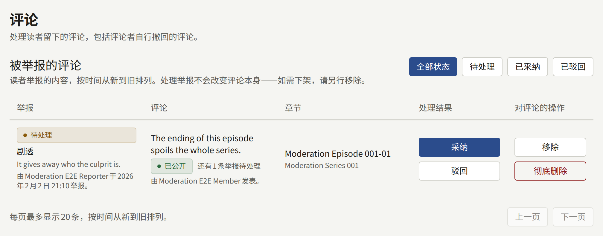

只有开启评论后，读者才能在章节下发表评论：对整个租户在**设置** › **读者评论**中开启，对某个系列则在该系列的表单中开启。[读者评论](../3-setup/1-settings.md#读者评论)说明了**不接受评论**、**立即公开**和**审核后公开**这三个选项，以及评论被自动移除所需的举报次数。

只有已登录的读者才能发表评论，每条最多1000个字符。评论属于某个章节；没有回复或讨论串，所以对一条评论的操作不会影响其他评论。

**评论**显示两个列表：先是**被举报的评论**，然后是租户所有章节下的全部评论，最新的排在最前。审计员可以看到这两个列表，但没有操作按钮。

## 评论状态的含义

| 状态 | 谁能看到这条评论 |
| --- | --- |
| **等待审核** | 只有评论者本人，并标有**等待审核** |
| **已公开** | 所有人 |
| **已移除** | 只有评论者本人，看到的就是其发表时的样子 |
| **评论者已删除** | 网站上没有人能看到，包括评论者本人。在被彻底删除之前，工作人员可以在这里看到 |

## 各操作的作用

| 操作 | 适用于 | 作用 |
| --- | --- | --- |
| **通过** | **等待审核** | 公开该评论，并通知评论者其评论现已公开 |
| **移除** | **等待审核**、**已公开** | 让该评论从网站上消失，只有评论者本人仍能看到。“**理由（可选）**”会记入审计日志 |
| **恢复** | **已移除** | 将评论恢复原状：如果之前已公开，则重新公开，否则恢复为**等待审核**。针对它仍待处理的所有举报都会被驳回 |
| **彻底删除** | 任何状态 | 永久删除该评论及其举报。必须填写**理由**，因为审计日志条目是这条评论留下的唯一记录 |

无论是审核人员还是读者的举报移除了评论，评论者都不会收到通知。他们看到的评论仍然是发表时的样子，所以为扰乱评论区而发帖的人不会得到任何促使其再次发帖的信号。

如果在您加载列表之后，其他审核人员对同一条评论进行了操作，您的操作会被拒绝，并显示“其他审核人员已处理这条评论。请重新加载列表查看当前状态。”

## 处理审核队列

只要有评论在等待审核，菜单中的**评论**就会显示其数量。每位工作人员还会在控制台中收到“有评论等待审核”通知，每个章节每小时最多一次；点击通知会打开筛选为该章节等待审核评论的列表。

1. 打开**评论**，将**状态**设为**等待审核**，然后选择**应用**。
2. 阅读每条评论，选择**通过**将其公开，或选择**移除**使其不出现在网站上。
3. 逐页处理，直到列表为空。

评论在通过之前，除评论者外没有人能看到，所以如果不处理队列，评论区就会一直是空的。从队列中移除的评论，对评论者仍显示为**等待审核**。

## 被举报的评论

已登录的读者可以举报不是自己发表的已公开评论，从**垃圾信息或广告**、**辱骂或骚扰**、**剧透**或**其他原因**中选择，并可附上备注。每位读者对一条评论只能举报一次；再次举报不会产生任何变化。评论者不会收到通知。

当某条评论待处理的举报数达到**触发移除的举报次数**时，它会被自动移除，无需等待工作人员处理，评论者也不会收到通知。之后它会显示“举报数达到阈值后已自动移除。”，审计日志会记录**因举报自动移除了评论**，操作者为**自动**。每位工作人员都会在控制台中收到“有评论被举报”通知，每个章节每小时最多一次。

**被举报的评论**为每条举报列出一行，最新的排在最前，显示举报原因、备注、举报者、评论及其评论者。举报在处理之前都是**待处理**：

- **采纳**表示记录该举报是正确的。它不会改变评论本身：要撤下已公开的评论，还需要选择**移除**。
- **驳回**表示记录该举报是错误的。它不会恢复被自动移除的评论：要恢复，请选择**恢复**。

处理队列时，请将其设为**待处理**，然后逐条决定评论是否保留。如果不保留，就**移除**它，并**采纳**其举报。如果保留，而它已被移除，就选择**恢复**，这会一次性驳回它所有待处理的举报；如果它未被移除，就逐条**驳回**举报。处理举报会减少计入自动移除的数量，因此已驳回的举报日后不会让评论越过阈值。

## 撤回的评论

读者可以随时删除自己的评论。评论会立即从网站上消失，包括评论者本人在内的所有人都看不到，工作人员也无法恢复。**评论**会继续将其显示为**评论者已删除**，并显示删除时间和将被彻底删除的时间，这样即使评论者撤下了评论，工作人员仍然可以阅读被举报或被投诉的评论。针对它的举报会保留在队列中，仍然可以处理。

撤回的评论连同其举报，会在撤回后经过**设置** › **限制与保留** › **保留期限** › **已撤回评论**中设置的期限后被彻底删除。`publira worker`每小时执行一次彻底删除；该行会显示“将于N天后的某日期被彻底删除”，天数和日期按当前设置的期限计算。要提前删除，请选择**彻底删除**。被移除的评论永远不会被自动彻底删除：它会一直保留，直到审核人员将其彻底删除。

## 查找评论

评论列表可以按**状态**、**系列public_id**和**章节public_id**筛选。公开ID是控制台中系列或章节地址的最后一部分，例如`/series/<series public ID>/episodes/<episode public ID>`，每条评论的**章节**也链接到那里。没有任何匹配的ID会显示空列表。

来自与该章节署名作者相关联账户的评论，在网站上和这里都会带有**作者**徽章。这不会改变评论的审核方式。

作者无需使用控制台，就能阅读读者对其作品的评价。与作者关联的读者可以在自己的作者页面中，阅读署名该作者的每个章节下已公开的评论，如[作者](../1-catalog/4-authors.md#将作者与读者账户关联)所述。等待审核或已被移除的评论不会出现在那里，因此移除对所有人都和对评论者本人一样，不会有任何提示。

通过、移除、恢复和彻底删除评论，以及采纳和驳回举报，都会连同您填写的理由一起记录在审计日志中。
