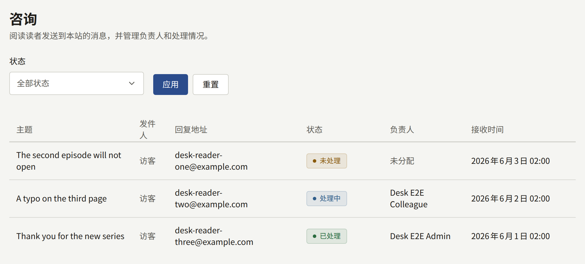
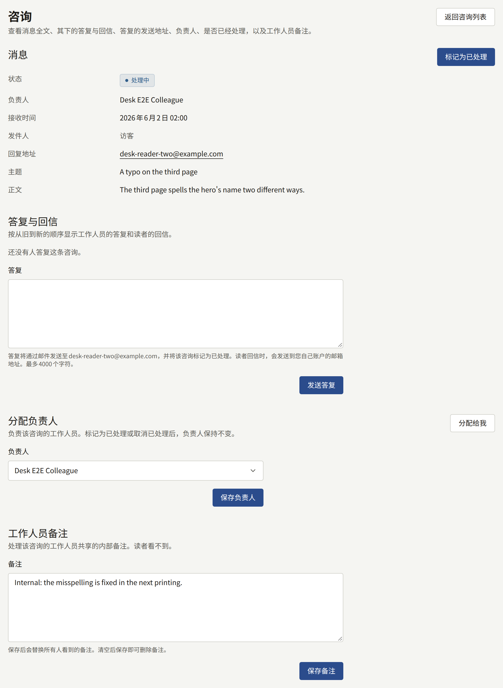

无论是否登录，读者都可以通过**联系我们**向网站发送消息，网站每个页面的页脚和应用中都有该链接。读者需要填写接收答复的邮箱地址、最多200个字符的可选主题，以及最多4000个字符的消息。已登录读者的邮箱地址会自动填入，也可以修改。

新消息会通过邮件发送给每位有效的租户管理员，发送到其账户的邮箱地址，邮件中包含读者的邮箱地址、主题和完整消息。编辑和审计员不会收到邮件，因为他们无法打开**咨询**；被暂停的账户也不会收到。没有有效租户管理员的租户不会把邮件发给任何人，但消息仍会在**咨询**中等待处理。控制台本身不会为新消息显示数量或通知，因此请查看**咨询**，或留意这些邮件。

**咨询**按从新到旧的顺序列出消息，每页二十条，显示**主题**、**发件人**、**回复地址**、**状态**、**负责人**和**接收时间**。读者发送时已登录的，**发件人**显示读者的账户，否则显示**访客**。**状态**由消息的情况决定，从不手动设置：

| 状态       | 条件                               |
| ---------- | ---------------------------------- |
| **未处理** | 尚未处理，且没有分配负责人         |
| **处理中** | 尚未处理，且已分配给某位租户管理员 |
| **已处理** | 已标记为已处理，或已答复           |

## 答复消息

1. 在**咨询**中打开该消息。
2. 在**分配负责人**中选择**分配给我**，或选择一位租户管理员后选择**保存负责人**，让其他人知道已有人在处理。只有租户管理员可以被分配。
3. 在**答复**中撰写答复，最多4000个字符，然后选择**发送答复**。

答复会保存在**答复与回信**中，消息变为**已处理**，`publira worker`会将答复通过邮件发送到该消息的**回复地址**：

- 通过[邮件](../3-setup/7-email.md)中设置的邮件服务器，从其地址发出；在租户拥有自己的邮件服务器之前，则通过平台的邮件服务器发出；
- 主题为“Re:”加上读者填写的主题；读者未填写主题时，则为“Re: 您向”加上网站名称再加上“发送的咨询”；
- 答复下方会引用读者的消息；
- 无论读者用什么语言撰写，邮件都使用租户的默认语言。

控制台不会显示邮件是否已送达。如果邮件设置有误，答复仍会保存，消息也仍为**已处理**，但邮件永远不会发出。因此，当租户通过自己的服务器发送邮件时，请在答复读者之前，用**发件**中的**测试连接**进行检查。与控制台发送的所有邮件一样，发往同一地址的答复每小时和每天的数量都有限制。

## 读者回信时

读者的回信发到哪里，取决于**集成** › **邮件**的**收件**部分是否为**就绪**，其设置方法请参阅[读者对咨询消息答复的回信](../3-setup/7-email.md#读者对咨询消息答复的回信)：

- **在变为就绪之前**，答复的回复地址是您自己账户的邮箱地址。读者的回信会到达您自己的邮箱。它不会记录在控制台中，消息仍为**已处理**：请从您的邮箱答复，或再次从控制台答复。
- **变为就绪之后**，回复地址是网站自己的地址，专为该消息生成。读者的回信会以“来自……的回信”的形式记录在**答复与回信**中，消息会重新打开，并像收到新消息时一样通过邮件通知租户管理员。

**答复**下方的提示会说明租户适用哪一种情况。

## 跟踪处理情况

- **工作人员备注**是租户管理员共享的关于该消息的一条备注，最多4000个字符。读者永远看不到。保存后会替换所有人看到的备注，保存空白内容则会删除备注。
- **标记为已处理**用于将无需答复的消息（例如垃圾信息）标记为已处理。**取消已处理**会将其恢复为**处理中**或**未处理**。两者都不会改变负责人。

消息永远不会被删除：咨询没有保留期限。读者之后删除自己的账户时，其消息仍会保留，并显示为来自**访客**。标记为已处理、取消已处理、分配负责人、编辑备注和答复都会记录在审计日志中，但答复的正文不会记录。
