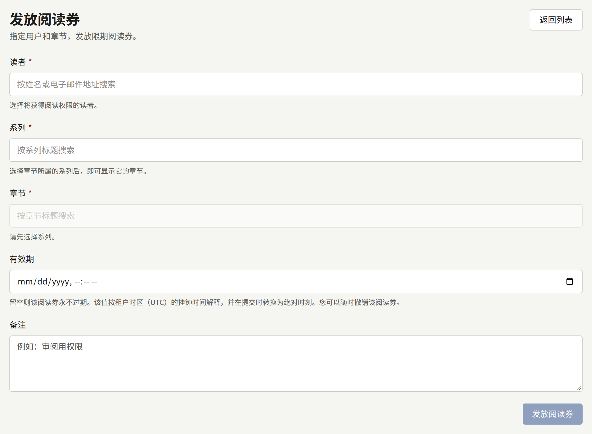
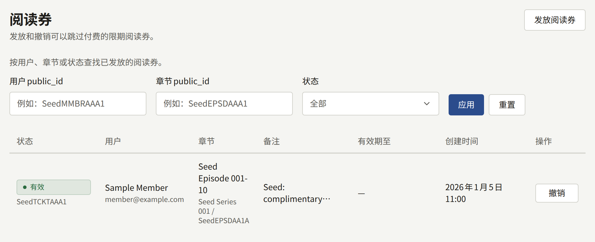

阅读券可以在网站和应用中，无需付款向某一位读者开放某一个章节，直到其过期或被撤销。当读者应该不经购买就能阅读时使用：例如书评人或媒体人士、奖品，或者购买出了问题、不应让其等待退款后再重新购买的读者。只有租户管理员能看到**阅读券**。

阅读券不是销售。它不会为任何作者带来版税，该章节也不会出现在读者的**已购买**中。它不会解除年龄检查：年龄不够阅读该系列的读者即使持有阅读券也无法阅读。它只能开放已发布的章节，对免费章节没有任何作用。读者不会收到获得阅读券的通知，所以请您亲自告知。

## 发放阅读券

1. 打开**阅读券**，选择**发放阅读券**。
2. 在**读者**中输入读者姓名或邮箱地址的一部分，然后选择该读者。只会列出**启用**状态的读者。
3. 选择**系列**，然后选择**章节**。
4. 可以选择设置**有效期**，按租户的时区填写。留空则阅读券永不过期。
5. 可以选择填写**备注**，最多1000个字符，例如发放阅读券的原因。
6. 选择**发放阅读券**。

要向您正在查看其页面的读者发放阅读券，请在[读者页面](./1-accounts.md#读者页面)的**阅读券**下选择**发放阅读券**。同一个表单会在页面上方打开，但没有**读者**字段；发放后，阅读券会出现在该页面的列表中。

同一读者和同一章节同时只能有一张由工作人员发放的阅读券：

- 如果已有一张有效的阅读券，则不会发放新的阅读券，现有阅读券的有效期和备注保持不变。控制台会提示这一点，并指出是哪张阅读券。要更改阅读券的有效期或备注，请在列表中撤销它，然后重新发放一张。
- 如果已有一张过期的阅读券，控制台会要求您先在列表中撤销它。

## 撤销阅读券

在列表或读者页面中，对有效的阅读券选择**撤销**，会立即对该读者关闭该章节。此操作无法撤销：要再次授予其阅读权限，请重新发放一张阅读券。已撤销的阅读券会以**已撤销**状态保留在列表中，并显示撤销时间。

## 查看列表

列表只包含工作人员发放的阅读券。读者通过[**等待即可免费**](../4-selling-episodes.md#免费阅读期与等待即可免费)自行领取的阅读券不在其中，也无法在这里撤销：每一张都是读者依据系列的规则有权获得的免费阅读，而不是工作人员发放的；为同一读者和同一章节发放的工作人员阅读券会与之并存，而不是取而代之。

列表按从新到旧的顺序显示每张阅读券的**状态**、**用户**、**章节**、**备注**、**有效期至**和**创建时间**，每页二十条。**状态**为**有效**、**已过期**或**已撤销**，筛选条件中的**仅有效**会同时排除已过期和已撤销的阅读券。**用户public_id**和**章节public_id**需要填写完整的公开ID，可以从读者页面或控制台中章节的地址复制；ID的一部分或名称都找不到任何结果。

发放和撤销会以**发放了阅读券**和**撤销了阅读券**记录在审计日志中。
