**管理**下的**设置**有三个标签页。**常规**存放租户为自己的网站所做的决定。**限制与保留**存放运营人员为所有租户设定的值，租户可以在一定范围内更改这些值。**读者头像**存放读者可以显示为头像的内容，以及租户提供给读者选择的头像。

这些标签页上的每张卡片都有自己的保存按钮，并且只保存自己的字段，因此请先保存一张卡片，再处理下一张。所有工作人员都可以打开**设置**，但只有租户管理员可以保存。编辑或审计员会在每张卡片上看到“只有租户管理员才能变更此设置。您只有只读权限。”

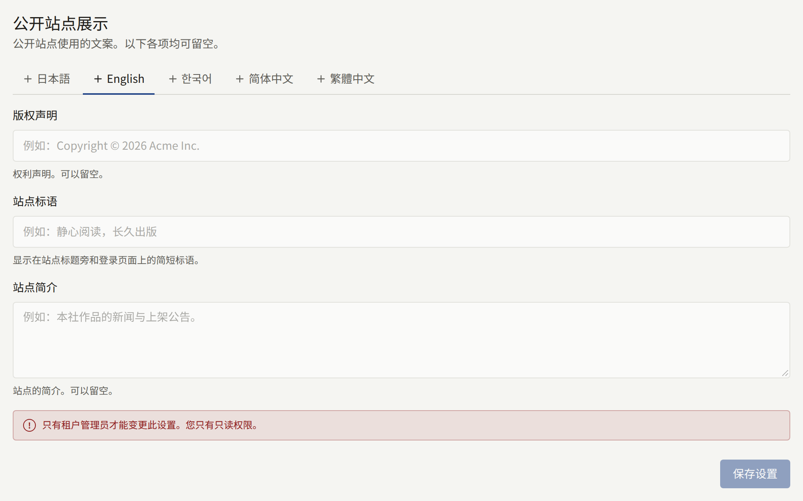

## 常规

### 公开站点展示

三段文案，每段都可以留空：

- **版权声明**：显示在网站每个页面及其登录页面的底部。
- **站点标语**：一句简短的话，显示在登录、注册和密码页面上，也显示在分享网站首页链接时附带的图片上（参见[链接预览](./2-branding.md#链接预览)）。
- **站点简介**：显示在网站页脚中，并作为网站的简介提供给搜索引擎和链接预览。

在[语言](#语言)中选择的网站提供的每种语言，都在**语言**下有自己的标签页，各自拥有这三段文案。卡片打开时显示默认语言的标签页，没有自己文案的语言会标有“**（未添加）**”。**保存设置**保存当前打开的标签页中的三个字段，其他语言的文案保持不变。请在切换标签页之前保存：未保存的编辑不会保留。清空全部三个字段并保存，会删除该语言的文案。

网站向读者显示其阅读所用语言的文案，该语言没有文案时则显示默认语言的文案。有自己文案的语言只显示自己的文案：其标签页中留空的字段在该语言下保持为空，而不会显示默认语言的内容。

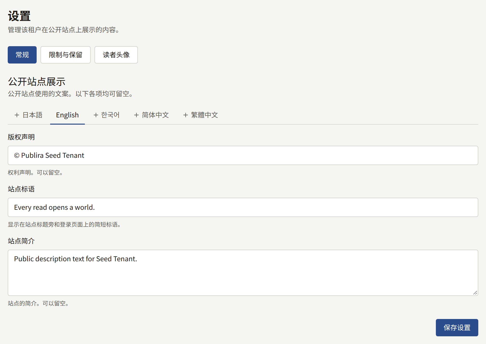

### 时区

**时区**是控制台和公开网站上显示和输入所有日期时间时使用的时区。在系列或章节上输入的发布时间按该时区解读，横幅停止显示的时间以及报表和审计日志按日统计的日期也是如此。它还决定版税计算中一个月的销售在何时结束、下个月从何时开始，以及计算读者年龄时所依据的日历日期。输入城市或地区以缩小列表范围，然后选择**保存时区**。

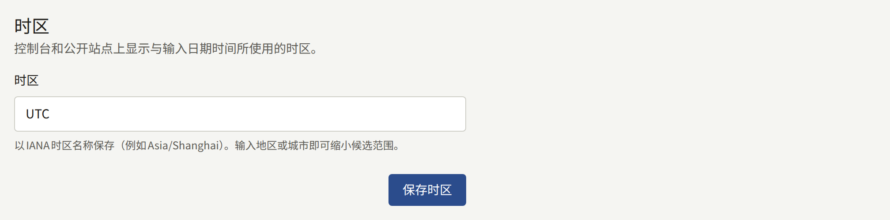

请在首次销售之前设置它：之后再更改，会移动当前未结月份的截止点，而已为版税结算的月份则保留结算时所用的时区。

新租户起初使用平台的默认时区，除非运营人员选择了其他时区，否则为`UTC`。

### 语言

**语言**决定网站向读者提供哪些语言，以及最初以其中哪种语言显示。

**提供的语言**为Publira已翻译的每种语言各提供一个复选框：日本語、English、한국어、简体中文和繁體中文。勾选读者可以使用的语言。关闭某种语言会隐藏以该语言撰写的页面翻译，但不会删除它们，重新开启该语言后它们会恢复显示，如[翻译](./3-pages.md#翻译)所述。

读者只会看到已勾选的语言。网站的**显示语言**菜单列出这些语言，网站地图和搜索引擎读取的语言链接也是如此。通过书签或搜索结果访问已关闭语言的地址时，会改为以默认语言打开同一页面。

租户的应用也遵循同样的选择。应用没有**显示语言**菜单，而是读取读者设备上设置的语言：以网站提供的其中第一种语言打开，如果网站一种都不提供，则以默认语言打开。

**默认语言**是网站和本控制台为尚未选择语言的人最初使用的语言。已经选择过语言的读者或工作人员会保留其选择。默认语言还是：

- 租户发送的邮件所用的语言，包括发给新工作人员的邀请；
- 新页面最初撰写所用的语言。

默认语言始终会被提供：它的复选框保持勾选且无法取消，将未勾选的语言选为默认语言时会自动勾选它。运营人员在创建租户时选择了默认语言，除非运营人员选择了更多语言，否则新租户只提供该语言。**保存语言**会同时保存两者。

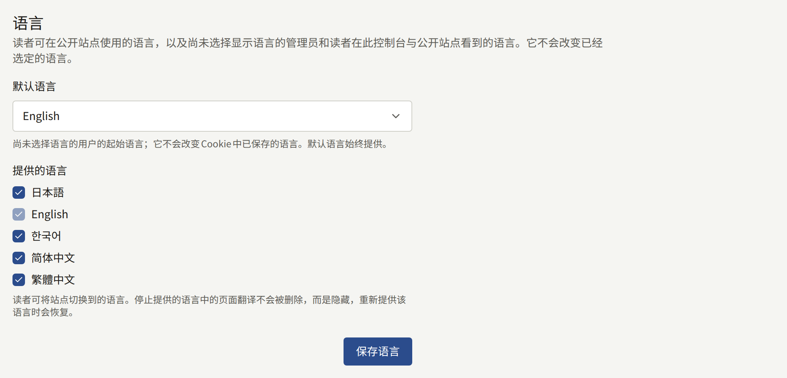

### 读者评论

**评论的公开方式**决定读者能否对章节发表评论，以及其他人何时能看到评论：

| 选项 | 作用 |
| --- | --- |
| **不接受评论** | 章节页面不显示评论区，也无法发表评论。新租户起初为此选项 |
| **立即公开** | 评论一经发表，所有人都可以阅读 |
| **审核后公开** | 在审核员于**评论**中批准之前，只有评论者本人能看到该评论，如[处理审核队列](../2-readers/2-comments.md#处理审核队列)所述 |

**触发移除的举报次数**是指需要多少位不同的读者举报一条评论，该评论才会不等工作人员处理就被隐藏。被隐藏的评论会在**评论**下的[举报队列](../2-readers/2-comments.md#被举报的评论)中等待处理，其评论者仍然能看到它，工作人员可以将其恢复。初始值为`3`；设为`0`则所有移除都交由您的审核员处理。

系列可以在其表单上设置自己的**评论**选项，该选项随后代替此处的设置应用于该系列。保持**沿用租户设置**的系列会跟随此处之后的任何更改。选择**保存评论设置**进行保存。

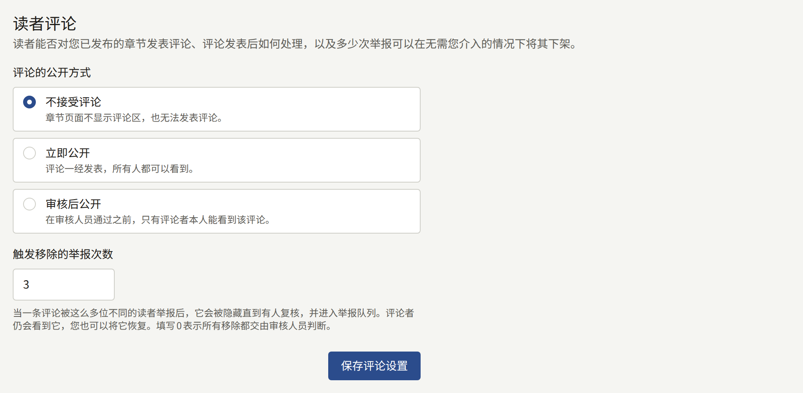

### 发布前审核

**发布前必须审核**在新租户上处于关闭状态，开启后每个章节在发布前都要等待租户管理员批准。开启后，保存章节的发布时间即会提交该章节以供审核，只有在租户管理员批准后，它才会在该时间发布；租户管理员也可以附上说明需要修改之处的评论将其退回。[发布前审核](../1-catalog/2-episodes.md#发布前审核)介绍了在章节编辑页面上进行的这一流程。

开启它会将所有已安排的章节提交审核，因此在获得批准之前，其中任何一个都不会发布。关闭它会让所有已安排的章节在各自的时间发布，无论其处于审核中、已退回还是已批准。选择**保存审核设置**进行保存。

### 作者页面

两个复选框，在新租户上都处于关闭状态。**向作者显示其自己的页面**让与某位作者关联的读者可以打开该作者的页面，如[将作者与读者账户关联](../1-catalog/4-authors.md#将作者与读者账户关联)所述。关闭时，即使第二个复选框已开启，这些页面也保持隐藏。

**显示明细和销售额**会在这些页面中加入每个章节的销售额，以及每份已结算版税明细中属于该作者的部分。页面关闭时也可以保存它，页面开启后即生效。页面开启而此复选框关闭时，读者仍能看到关注者人数以及每个章节的浏览次数和读完次数，但看不到销售额和明细。

选择**保存作者页面设置**进行保存。

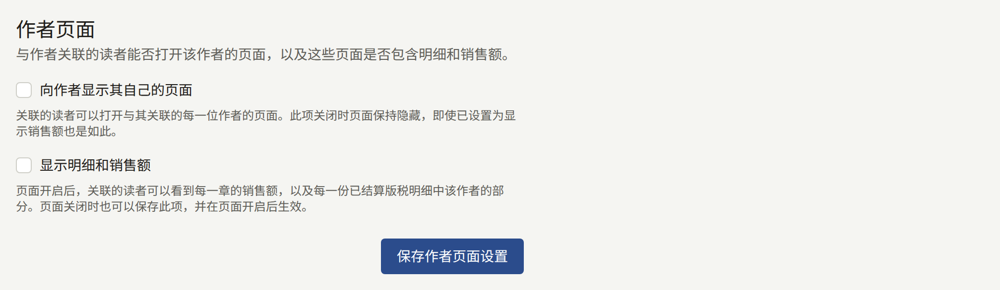

### 年龄验证

每个系列都有**年龄分级**：**全年龄**、**R15**或**R18**。**需要证明年龄的分级**决定网站在多大程度上严格要求读者遵守分级：

| 选项 | R15系列 | R18系列 |
| --- | --- | --- |
| **不验证年龄** | 读者确认自己已满15岁 | 读者确认自己已满18岁 |
| **仅验证R18** | 读者确认自己已满15岁 | 只对出生日期显示已满18岁的读者开放 |
| **验证R15和R18** | 只对出生日期显示已满15岁的读者开放 | 只对出生日期显示已满18岁的读者开放 |

新租户起初为**不验证年龄**。分级为**全年龄**的系列永远不受限制。

所谓“确认”，是读者按下**我已满15岁**或**我已满18岁**，浏览器会为该网站记住这一选择。所谓“证明”年龄，是读者登录，并且其账户中保存了出生日期。读者可以在注册时或之后在设置中填写出生日期，保存后便无法更改。没有出生日期的读者会看到**登记出生日期**，年龄不够的读者会被告知该作品不适用于其年龄。出生日期填写有误的读者需要联系网站，由租户管理员在**读者**下该读者的页面中更正。

选择**保存年龄验证**进行保存。

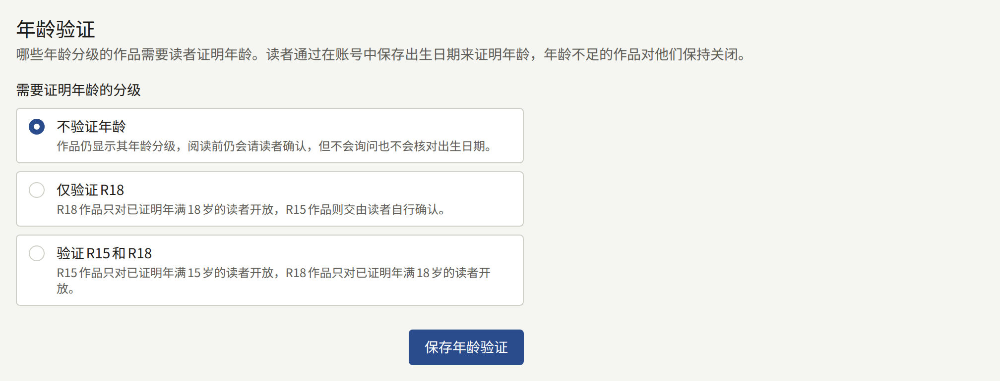

### 服务条款与隐私政策

**服务条款**和**隐私政策**各自指定租户已发布的一个页面。网站和应用会链接到这些页面，读者在创建账户时同意它们，当其中任一页面的新版本要求读者同意时会再次同意，如[发布新版本](./3-pages.md#发布新版本)所述。请先撰写并发布这些页面，如[页面](./3-pages.md#服务条款和隐私政策)所述，然后在此处选择它们，并选择**保存服务条款与隐私政策**。选择**无**则不设置相应的一项。

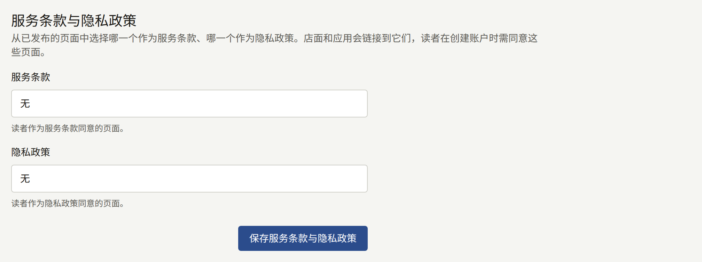

如果此处选择的页面之后从网站下线，卡片会提示已没有任何地方链接到它，注册时也不再要求读者同意它。请重新发布该页面，或选择其他页面。

### 读者注册

访客能否在网站上创建读者账户。暂停注册可以让网站在不接纳新读者的同时继续为已有读者提供服务，适用于在正式上线前只向受邀群体开放的网站，或是在应对一波不受欢迎的注册时。已有账户的读者可以继续登录、购买和阅读。

- **接受新读者**在您关闭之前一直处于开启状态。关闭期间，任何人都无法在网站上创建账户，无论是通过电子邮件地址，还是首次使用Apple或Google登录。网站的注册页面会显示**暂停注册**和您的消息来代替表单，**登录**页面也会在原本提供**注册**的位置显示相同的提示。
- **暂停注册期间显示的消息**是访客看到的文字，最多1000个字符，按原样连同换行显示。如果留空，网站会显示“本站目前不接受新账户注册。”开放注册期间消息也会保留，因此再次暂停时会显示同样的文字。

选择**保存注册设置**进行保存。注册暂停期间，卡片会在开关上方提示：“注册已暂停。在重新开放之前，任何人都无法通过电子邮件地址或Apple、Google在网站上新建读者账户。”重新打开开关并保存，注册即会立即开放。

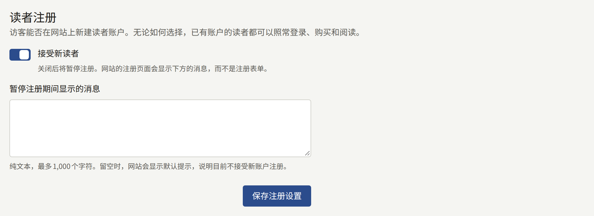

保存操作会以**更新了读者注册设置**记录在[审计日志](./8-audit-log.md)中。

### 不接受的电子邮件地址

读者无法用来注册、也无法将电子邮件地址更改成的地址。尝试使用这类地址的读者会被告知“本站不接受此电子邮件地址。请使用其他电子邮件地址。”

- **不接受一次性邮箱域名**会根据平台维护的列表拒绝一次性邮件服务的域名。如果运营人员没有设置列表，该开关会提示它不起作用。
- **不接受的地址和域名**每个字段填写一个条目，最多1000个。含有`@`的条目是一个地址，同时也会拒绝该地址加上`+tag`后的形式。其他条目都是域名，例如`example.net`，同时也会拒绝其子域名。将多行内容粘贴到一个字段中，会为每一行添加一个字段。不支持通配符。

选择**保存不接受的电子邮件地址**进行保存。该列表从下一次注册或地址更改起生效。已经用被拒绝的地址注册的读者会保留其账户。

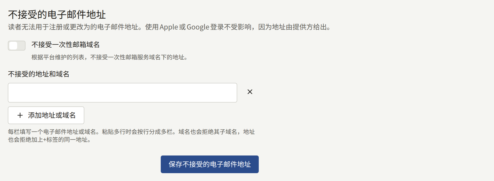

使用Apple或Google登录永远不会在此被拒绝，因为地址由提供方提供。只有租户管理员可以查看此卡片的内容。

### 爬虫排除规则

网站的`robots.txt`要求爬虫避开的内容。遵循`robots.txt`的爬虫会停止抓取此处排除的内容。这不会对读者隐藏任何内容，忽略该文件的爬虫仍然可以抓取每个页面，因此这不是让页面保持私密的方法。

- **排除在整个网站之外的爬虫**列出Publira已知的爬虫，按其抓取页面的用途分组：**AI训练**、**AI助手**和**图片搜索**。每个爬虫都以其运营方为`robots.txt`公布的标识命名，下方注明运营方。被勾选的爬虫会被要求不抓取网站的任何页面。该列表由Publira固定；不在列表中的爬虫无法添加。
- **对所有爬虫排除的路径**每个字段填写一个路径，最多100个，例如`/drafts`。路径以`/`开头，同时涵盖其下的所有内容。将多行内容粘贴到一个字段中，会为每一行添加一个字段。不支持通配符，路径中不能包含空格、`*`、`$`、`?`或`#`。`/robots.txt`、`/sitemap.xml`和`/sitemap`无法排除，因为爬虫需要它们来读取网站。

选择**保存爬虫排除规则**进行保存。每个路径保存时会去掉末尾的`/`，列表按字母顺序显示。

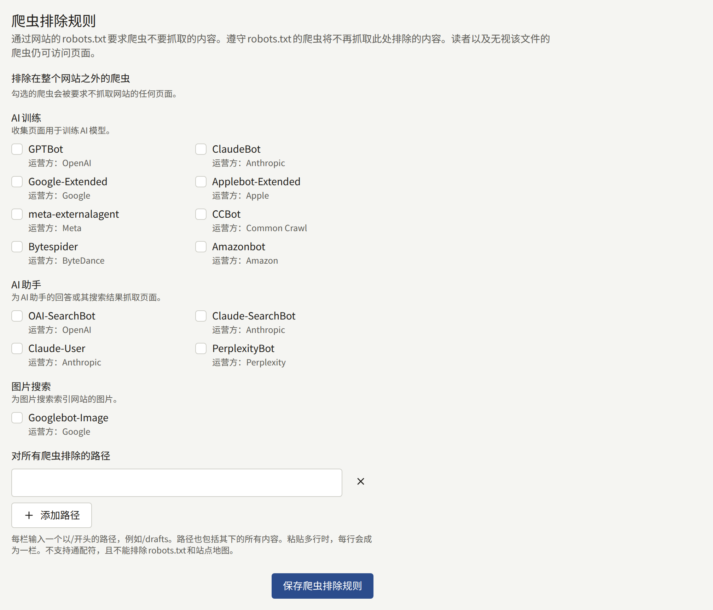

保存操作会以**更新了爬虫排除规则**记录在[审计日志](./8-audit-log.md)中。

### 搜索引擎所有权验证

Google Search Console和Bing Webmaster Tools为证明网站归您所有而提供的代码。已设置的每个代码都会以`<meta>`标签的形式添加到网站的每个页面中，两项服务分别将这种方法称为**HTML tag**或**HTML Meta Tag**。

- **Google Search Console**填写以网址前缀资源添加网站时Search Console显示的标签，例如`<meta name="google-site-verification" content="…" />`。
- **Bing Webmaster Tools**填写Bing Webmaster Tools显示的标签，例如`<meta name="msvalidate.01" content="…" />`。

可以粘贴整个标签，也可以只粘贴其`content`值。只有该值会被保存，离开字段后字段中会显示该值。从另一项服务复制来的标签会被拒绝。将字段留空即可从网站中移除相应的标签。

选择**保存验证代码**进行保存，然后请相应的服务验证网站。

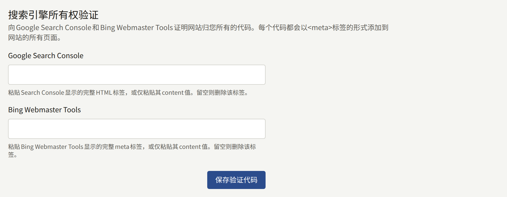

只有租户管理员可以查看此卡片的内容。保存操作会以**更新了搜索引擎所有权验证**记录在[审计日志](./8-audit-log.md)中。

## 限制与保留

**限制与保留**包含两张表单：

- **社区限制**：一位读者发表或举报评论、为章节评分、通过咨询表单留言、保存阅读器布局以及保存通知设置的频率上限，以及读者再次发表相同评论时被拒绝的时长。
- **保留期限**：已撤下的评论、内容事件以及每日和每周排行榜快照在被删除之前保留多长时间。

这些表单上的每一组起初都勾选了**使用平台默认值**，并在旁边显示运营人员设定的值。使用默认值的租户会跟随运营人员之后的更改。要设置租户自己的值，请取消勾选该复选框，输入值，然后用**保存社区限制**或**保存保留期限**保存表单。要恢复为平台的值，请重新勾选该复选框并保存。

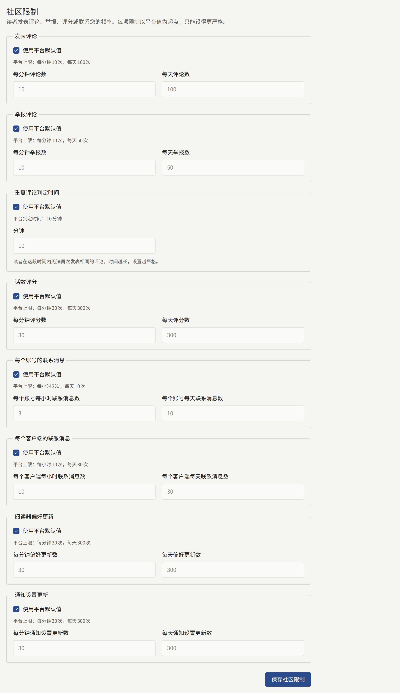

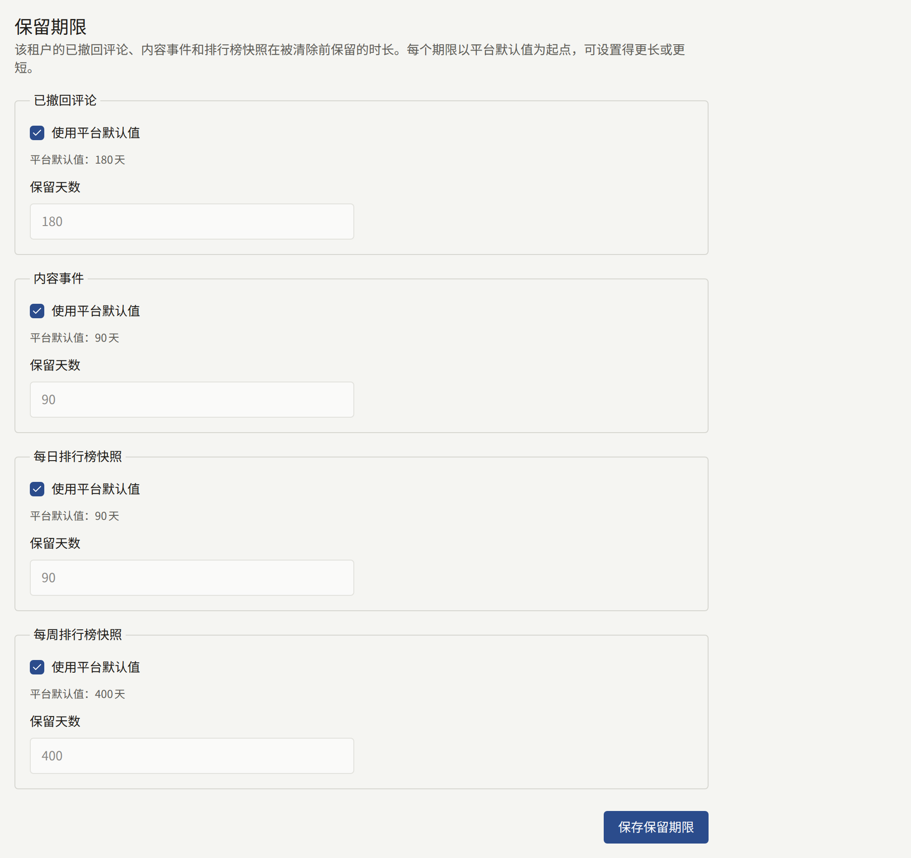

- 社区限制只能设得比平台的更严格：更少的次数，或更长的重复评论判定时长。更宽松的值会被拒绝，并显示指明该设置的消息。如果运营人员之后把平台的限制收紧到比租户的更严格，则以平台的为准。
- 保留期限可以比平台的默认值更长或更短，范围为1到36500天。但**内容事件**的下限为30天，更短的期限会被拒绝：网站的推荐内容是根据最近28个完整日的内容事件生成的。

如果在您打开表单之后有其他人保存了同一表单，您的保存会被拒绝，并显示“在此页面打开期间，该设置已在别处被更改。请重新加载页面后再次输入。”

每项限制和记录是什么，以及每次清除会保留哪些内容，在[平台默认值与策略](../../3-operations/9-platform-policies.md#社区)中从运营人员的角度进行了说明。此标签页上的保存操作会以**更新了社区限制**和**更新了保留期限**记录在[审计日志](./8-audit-log.md)中。

## 读者头像

### 读者头像设置

**读者可以显示的内容**决定读者可以在其名称旁、评论上和账户中显示什么作为头像：

| 选项               | 作用                                                 |
| ------------------ | ---------------------------------------------------- |
| **上传自己的图片** | 读者上传自己选择的图片。新租户起初为此选项           |
| **从预设中选择**   | 读者从[预设头像](#预设头像)中选择一个，无法上传图片  |
| **不显示头像**     | 所有读者都不显示头像，网站为每个人显示一个简单的轮廓 |

选择**保存读者头像设置**进行保存。保存**从预设中选择**或**不显示头像**会撤下该选项不允许的头像，因此控制台会先询问“要删除读者的头像吗？”：

- **从预设中选择**会删除读者上传的所有图片。选择了预设头像的读者会保留其头像。
- **不显示头像**会删除读者显示的所有头像。

选择**保存并删除**继续。控制台会根据卡片上显示为已保存的设置来询问，因为在页面打开之后，其他租户管理员可能已经更改了设置。被删除的头像无法恢复，因此当设置再次允许头像时，每位读者需要重新选择。**上传自己的图片**不会删除任何内容，保存时也不会询问。

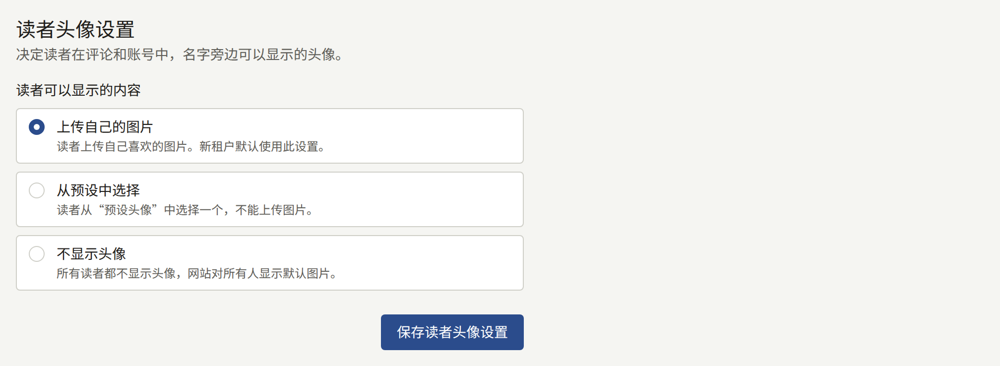

### 预设头像

读者在**从预设中选择**下可选的头像，最多50个。无论处于哪种设置都可以添加预设，因此请在切换到该设置之前把预设准备齐全：预设为空时，读者没有可选的头像。

要添加预设，请在**头像图片**下选择一张10MB以内的JPEG、PNG或WebP图片，然后选择**添加头像**。系统会从图片中心裁出一个正方形，其尺寸至少须为128 × 128 px。每个预设都以网站绘制头像的样式显示，并注明其存储尺寸。

要删除预设，请选择其下方的**删除**，然后再选择**删除**确认。选择了该预设的读者将没有头像，在选择其他头像之前显示简单的轮廓。

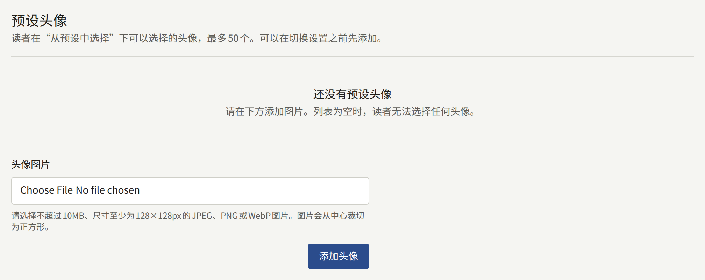

此标签页上的保存操作会以**更新了读者头像设置**、**添加了读者头像预设**和**删除了读者头像预设**记录在[审计日志](./8-audit-log.md)中。
