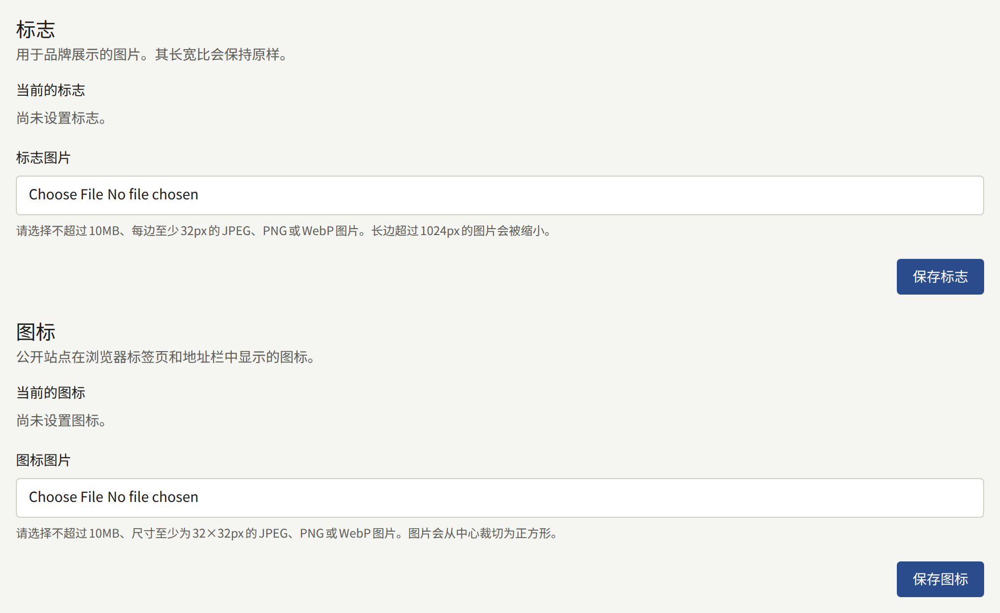
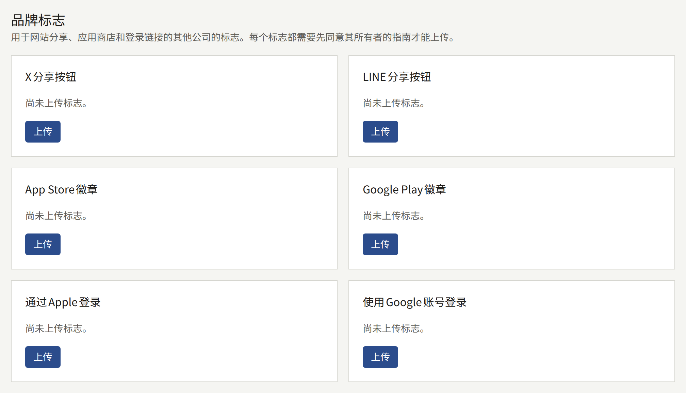
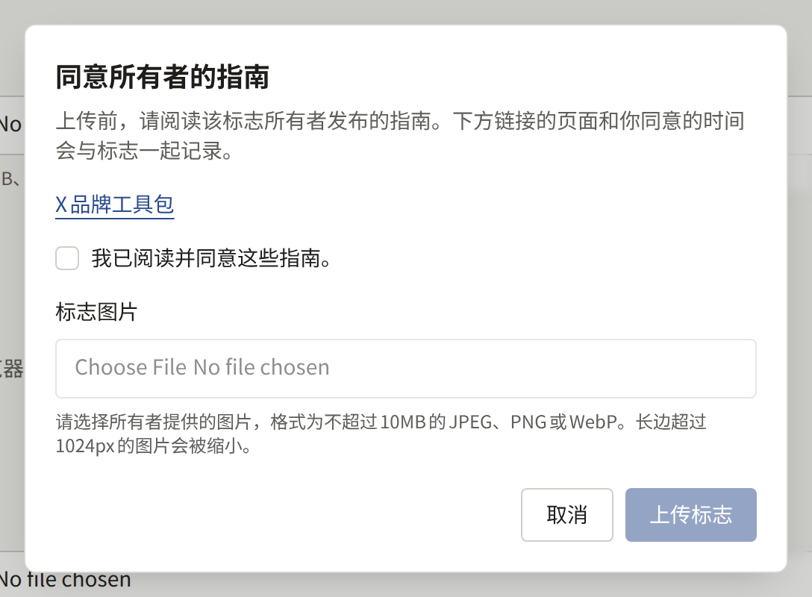
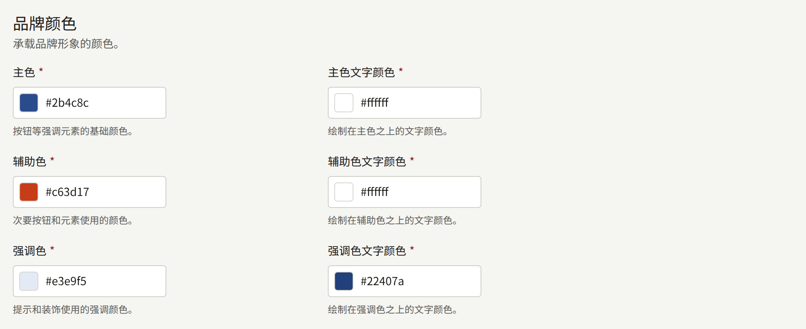
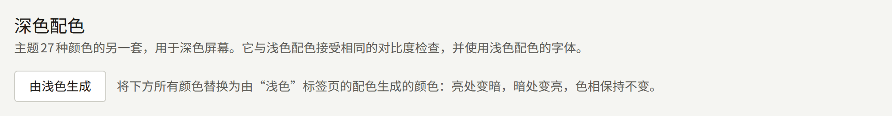
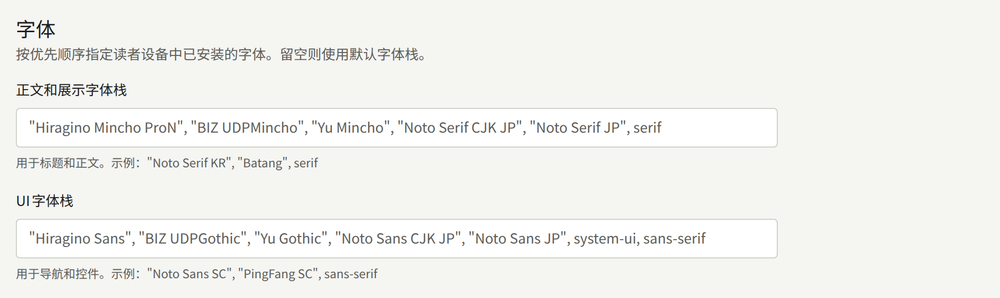
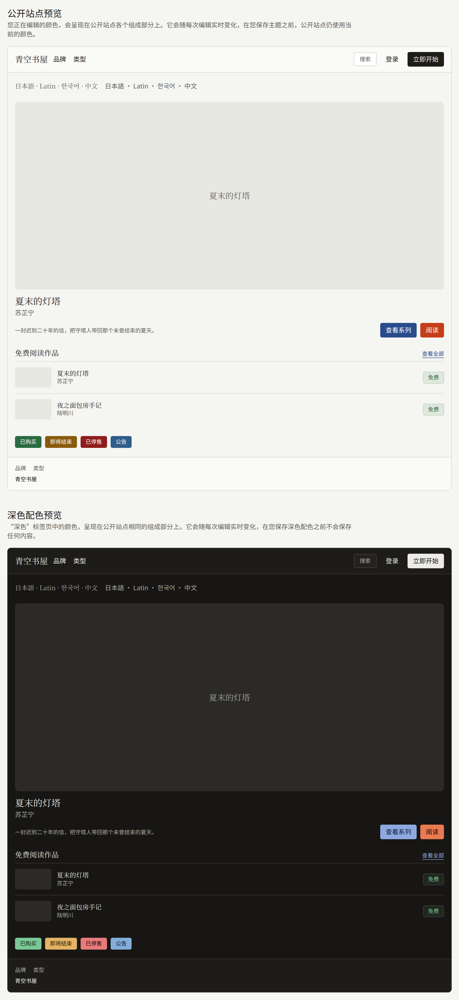

**管理**下的**品牌**决定网站的外观：页眉中的标志、浏览器标签页中的图标、登录表单旁的图片、其他公司的标志、配色，以及文字所用的字体。该页面包含**标志**、**图标**、**登录页面图片**、**品牌标志**，以及主题的配色和字体，旁边还有深色配色。每一项都单独保存，保存其中一项不会影响其他项。

只有租户管理员可以更改品牌设置。编辑和审计员看到的是同一页面，但其中的控件处于禁用状态。

## 标志、图标和登录页面图片

三者都接受10MB以内的JPEG、PNG或WebP图片。标志和图标以PNG格式存储，因此透明背景会保持透明。登录页面图片中的JPEG按JPEG存储，其他格式按PNG存储。

|  | **标志** | **图标** | **登录页面图片** |
| --- | --- | --- | --- |
| 显示位置 | 代替网站名称，显示在网站及本控制台每个页面的顶部。租户的应用在其作品目录页面上代替名称显示它 | 显示在浏览器的标签页和地址栏中，也是读者将网站添加到手机主屏幕时使用的图标 | 在宽度至少为1024px的屏幕上，显示在网站登录和注册页面的表单旁。更窄的屏幕只显示表单。租户的应用在其登录页面上显示它：在宽度至少为840px的屏幕上显示在表单旁，在更窄的屏幕上显示在表单上方 |
| 形状 | 保持原样 | 从中心裁剪为正方形 | 保持原样。网站和应用会裁剪它以填满表单旁或上方的空间，该空间的形状随窗口变化 |
| 尺寸 | 宽或高超过1024px的图片会被缩小，缩小后每边仍须至少为32px | 至少为32×32px。大于512×512px的图片会被缩小 | 宽或高超过2560px的图片会被缩小，缩小后较短的一边仍须至少为512px |
| 未设置时 | 网站显示租户的名称 | 浏览器显示其默认图标 | 网站和应用都会用主题的颜色填充该空间 |

在**标志图片**、**图标图片**或**登录页面图片文件**下选择文件，然后选择**保存标志**、**保存图标**或**保存登录页面图片**。再次保存会替换图片。**删除**会在您确认后将其删除。

图标请使用标志位于中央的正方形图片，因为中央正方形以外的部分都会被裁掉。标志请使用标志周围留白较少的图片。网站页眉以32px的高度、最多144px的宽度显示标志，因此宽度超过高度四倍半的标志会显示得比32px更矮。

登录页面图片请使用即使边缘被裁掉也依然成立的图片：把重要的内容放在靠近中央的位置，也不要放入需要读者阅读的文字。标志和系列的图片都不会代替它，因此如果想在两处都使用同一作品图，请在这里也上传一份。

如果运营人员尚未为安装实例设置对象存储，上传这三者中的任何一个都会被拒绝，并显示“平台尚未设置图片存储，因此无法上传图片。请联系平台运营人员进行设置。”，如[对象存储](../../3-operations/5-object-storage.md)所述。

这三者都不会用于租户的邮件，邮件以Publira自己的配色发送。分享网站链接时显示的图片中会使用标志，如[链接预览](#链接预览)所述；图标和登录页面图片则不会使用。

## 链接预览

在聊天或帖子中分享网站任意页面的链接时，链接会展开并附带一张图片。设置了“**链接预览 (1200:630)**”图片的系列或章节会按上传时的原样显示该图片，如[系列](../1-catalog/1-series.md#封面图)所述。其他所有页面，以及没有该图片的系列或章节，会显示网站为其绘制的卡片：

- 以大字显示页面自己的名称：系列或章节的标题，品牌、类型、标签或作者的名称，或**页面**下某个页面的标题。章节的卡片在其上方显示所属系列的标题，品牌、类型或作者的卡片则显示其所属列表的名称。首页以及排行榜等没有自己名称的页面，显示[设置](./1-settings.md)中的**站点标语**，没有标语时显示网站名称。
- 底部显示标志，没有上传标志时则显示网站名称。
- 使用浅色配色的背景色和文字颜色，顶部有一条主色的色带。

卡片使用所链接页面的语言。网站无法绘制的文字（例如表情符号）不会出现在图片中，但随图片一起分享的标题会保留它们。新的标志、颜色的变更或系列的重命名会像反映到页面上一样反映到卡片上，但已经显示过某个链接的服务可能会在一段时间内保留之前的图片，因为每项服务都保存着自己的副本。

## 品牌标志

**品牌标志**存放其他公司的标志，用于网站的分享、应用商店和登录链接：**X分享按钮**、**LINE分享按钮**、**App Store徽章**、**Google Play徽章**、**通过Apple登录**和**使用Google账号登录**。Publira不附带任何这些图稿。每个标志都归其所有者所有，所有者会公布允许使用该标志的条件，因此由租户在同意这些条件后上传所有者提供的图稿。

每个标志都有自己的卡片。尚未上传的卡片会显示“尚未上传标志。”并提供**上传**。**上传**会打开一个对话框，其中链接到所有者的指南页面，例如**X品牌工具包**。在您勾选“我已阅读并同意这些指南。”之前，**标志图片**字段和**上传标志**一直处于禁用状态。该勾选仅在对话框打开期间有效，因此每次上传（包括替换）都会再次要求勾选。

除最小尺寸外，图片适用与标志相同的限制：10MB以内的JPEG、PNG或WebP，以PNG格式存储，宽或高超过1024px时会被缩小。宽度远大于高度的徽章也会被接受。与标志一样，在运营人员尚未设置对象存储期间，上传会被拒绝。

标志上传后，其卡片会显示该标志、同意指南的人和时间，以及指向**已同意的指南**的链接，即对话框当时显示的页面。Publira会将该页面与标志一同记录，因此当Publira之后的版本将对话框链接到其他页面时，已经上传的标志仍保留其同意时的页面。如果同意指南的账户之后被删除，卡片会提示这一点，而不显示其名称。**替换**会在重新同意后上传另一张图片，**删除**会在您确认后删除该标志及其同意记录。

网站会将上传的X或LINE标志绘制在分享菜单中该服务一行的开头，位于该行原有文字的旁边。上传的App Store或Google Play徽章会以图片自身的比例，代替在应用内销售的章节上该商店的按钮。上传的通过Apple登录或使用Google账号登录标志会以图片自身的比例，显示在登录和注册页面上该提供方按钮的开头，位于按钮原有文字的旁边。未上传标志的地方，网站只显示文字，与上传任何标志之前一样。

Publira不会检查上传的图片显示的是什么。图片是否为所有者当前的图稿、是否按照指南允许的方式使用，由租户负责。

## 主题配色和字体

主题有三个标签页：存放配色和字体的**浅色**、存放深色配色的**深色**，以及**预览**。

### 配色

**浅色**标签页上的主题有27种颜色，每种都以`#RRGGBB`的形式输入，或通过旁边的色块选择。它们分为四组：

- **品牌颜色**：**主色**、**辅助色**和**强调色**，每种都附有在其上绘制的文字颜色。主色用于按钮和其他强调元素。
- **背景与文字颜色**：页面的背景和文字，以及在其上绘制的表面、卡片、弹出层和弱化区域，每种都附有其文字颜色。
- **界面元素颜色**：边框、输入字段，以及表示哪个控件拥有键盘焦点的焦点环。
- **状态颜色**：成功、警告、错误和信息提示的颜色，每种都附有其文字颜色。

每种颜色与在其上绘制的文字颜色之间的对比度必须至少为4.5:1，即WCAG AA对普通文字的要求。低于该值的组合会被拒绝，并在“请检查这些颜色组合，以保证文字清晰可读。”下方显示其达到的对比度。边框、输入字段和焦点环的颜色不做检查，因为它们上面不绘制文字。

### 深色配色

**深色**标签页存放同样的27种颜色的第二套，分组相同，用于深色屏幕。它适用同样的4.5:1对比度检查，也没有自己的字体：它使用**浅色**标签页上的字体。**保存深色配色**将其与浅色配色分开保存，保存其中任一套都不会影响另一套。

租户起初没有深色配色。在保存之前，该标签页会显示“尚未保存深色配色。”，并用由已保存的浅色配色生成的颜色填充各字段，可直接调整后保存。

**由浅色生成**会用根据**浅色**标签页上的颜色（包括尚未保存的颜色）生成的颜色，替换该标签页上的所有颜色。每种颜色保持其色相并取相反的明度，因此背景变暗、文字变亮，品牌颜色的浅淡色调会变成其深色调。生成后对比度会低于4.5:1的组合会改用白色或黑色文字，因此生成结果可以直接保存。再次选择它即可从浅色配色重新开始。

保存深色配色后，**保存深色配色**旁的**删除**会在您确认后将其删除，该标签页会再次显示生成的颜色。

在租户拥有深色配色之前，网站只有一套颜色。拥有深色配色后，当读者的设备处于深色模式时，网站会以深色配色绘制，并且页眉中会增加**主题**，读者可在其中选择**浅色**、**深色**或**跟随系统**。该选择保存在读者的浏览器中，如[网站在读者浏览器中存储的内容](./3-pages.md#网站在读者浏览器中存储的内容)所列，每个页面都会以该选择打开。

当读者的设备设为深色时，租户的应用会以深色配色显示。没有深色配色时，应用的深色模式会根据**主色**生成其颜色，与保存深色配色之前相同。

### 字体

**字体**有两个字段：

- **正文和展示字体栈**：用于标题和正文的字体。
- **UI字体栈**：用于导航和控件的字体。

每个字段都是以逗号分隔的字体族名称列表，按CSS的写法书写，例如`"Noto Serif KR", "Batang", serif`。读者的设备会使用列表中其已安装的第一个字体。系统不会下载任何字体，因此请写上读者设备中已有的字体，并以`serif`或`sans-serif`结束列表。字段留空时使用Publira的默认列表（显示为占位文字），该列表优先使用日文字体。面向使用其他文字的读者的网站，应先写上适用于该文字的字体。

租户的应用使用主题的配色，但不使用其字体。

### 预览和保存

在您编辑**浅色**标签页期间，控制台本身会套用新的颜色，因此您可以在保存之前看到效果。深色配色只在预览中显示，因为控制台以浅色绘制。**预览**标签页以浅色配色显示构成网站的各个部分：页眉、精选系列、章节列表、徽章和页脚，以及分别用两种字体栈显示的一行日文、拉丁文、韩文和中文文字。其下方的**深色配色预览**以**深色**标签页上的颜色显示相同的部分。预览不显示标志、图标或登录页面图片。

在您选择**保存主题**之前，任何内容都不会反映到网站上。保存后，随着读者的浏览器和网站的缓存获取新主题，读者会在大约一分半钟内看到新主题。

控制台没有将主题恢复为Publira默认值的按钮。每种颜色的默认值就是新租户上该字段显示的值，因此请在更改之前记下它们。
