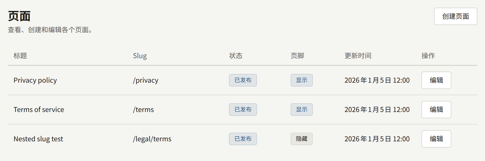
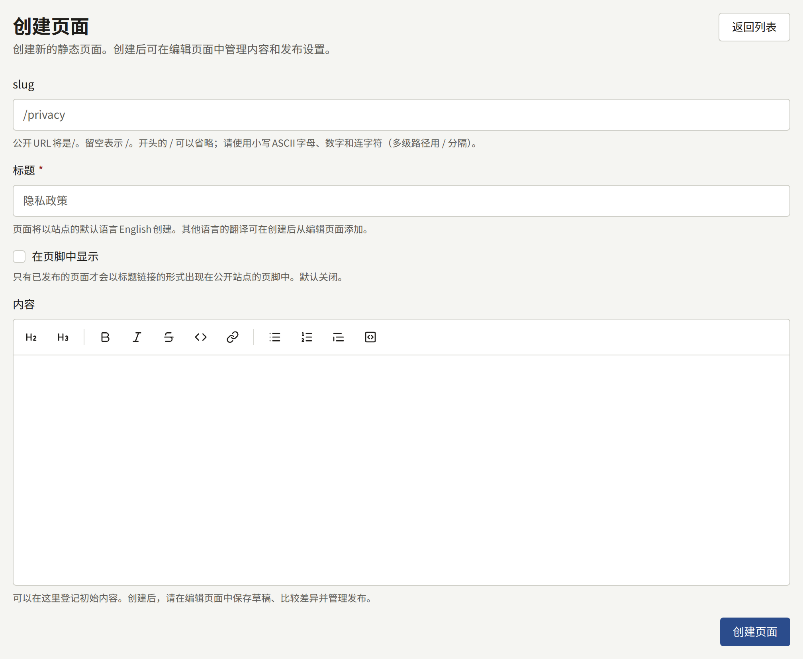
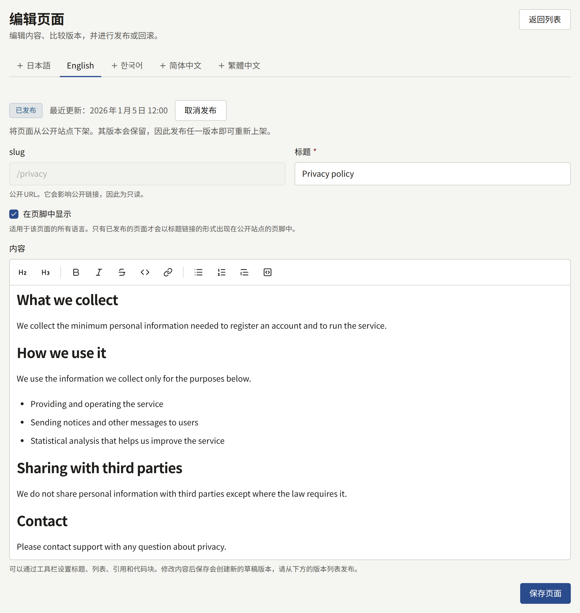
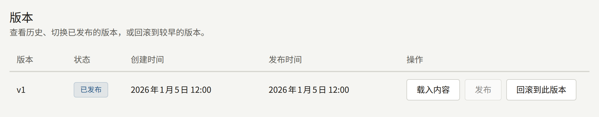
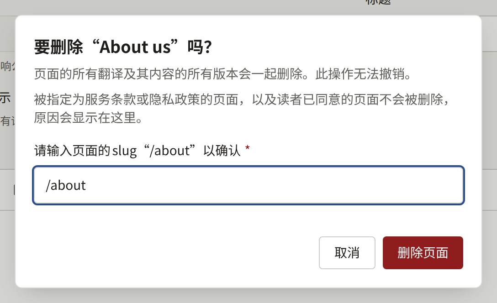

**网站**下的**页面**存放出版社为网站撰写的页面：服务条款、隐私政策、介绍出版社的页面、投稿指南，以及其他任何不属于系列的内容。页面在富文本编辑器中撰写，按版本保存，并且可以翻译成网站的每种语言。

租户管理员和编辑可以创建、编辑、发布和翻译页面，只有租户管理员可以删除页面。审计员可以打开页面，但不能做任何更改。

## 创建页面

选择**创建页面**并填写：

- **Slug**：页面在网站上的地址。`privacy`会在`https://comics.example.com/privacy`提供该页面，`legal/terms`则在`https://comics.example.com/legal/terms`提供。请使用小写字母、数字和连字符，嵌套路径的各部分之间用`/`分隔。页面创建后Slug无法更改，因为指向它的链接会失效。网站自身使用的路径（例如登录页面和账户页面）会被拒绝。
- **标题**：显示在页面顶部以及链接到该页面的各处。页面以网站的默认语言创建。
- **在页脚中显示**：页面发布后，以其标题列在网站每个页面的页脚中。之后可以在编辑页面上更改。
- **内容**：页面正文的第一个版本，在[撰写和发布](#撰写和发布)中介绍的编辑器中撰写。可以留空，在下一个页面中再撰写。

**创建页面**会将页面创建为草稿，并打开其编辑页面。在发布某个版本之前，网站上不会显示任何内容。

不应再被阅读的页面可以取消发布，如下文所述。误建或不再需要的页面在此之后可以删除，详见[删除页面](#删除页面)。

## 撰写和发布

编辑页面在编辑器中显示页面正文，撰写时即以排版后的样式显示。编辑器上方的工具栏会为所选文字或光标所在段落设置格式：**标题**、**小标题**、**粗体**、**斜体**、**删除线**、**代码**、**链接**、**项目符号列表**、**编号列表**、**引用**和**代码块**。**链接**会要求输入地址，未选择任何文字时，会将地址本身作为链接插入。在编辑器中输入的Markdown会在输入时即设置格式，因此在行首输入`## `会生成标题，输入`- `会生成项目符号列表。

正文以Markdown格式保存。在编辑器出现之前用Markdown撰写的正文，会连同其表格、任务列表和图片一起在编辑器中打开，编辑后也会保留它们。脚注和HTML在编辑后无法保留：它们会作为纯文本保存。

**保存页面**会立即保存更改后的标题和**在页脚中显示**。更改后的正文会保存为新的**草稿**版本，读者看不到它。保存永远不会发布。

**在页脚中显示**属于页面本身，而不属于其某个翻译，因此在任一语言的标签页上更改它，都会更改所有语言的设置。只要页面处于发布状态，页脚会在保存后片刻随之更新。

**版本**列出页面的每个版本，编号为`v1`、`v2`等，并显示其状态：读者看到的版本为**已发布**，其他为**曾发布**或**草稿**。对于每个版本：

- **发布**会将该版本设为读者看到的版本，代替之前发布的版本。
- **载入内容**会将该版本的正文放回编辑器，以便在此基础上继续撰写。
- **回滚到此版本**会将该版本的正文复制为新的草稿。发布该草稿即可将旧的文字恢复到网站上。

页面有两个版本后，**比较版本**会显示任意两个版本之间新增和删除的Markdown行。

页面状态旁的**取消发布**会将页面从网站下线。其版本会保留，发布其中一个即可让页面重新上线。

网站会在发布后片刻显示更改。

## 翻译

编辑页面在**语言**下为网站提供的每种语言各设一个标签页，网站提供哪些语言由租户管理员在[**设置**](./1-settings.md#语言)中选择。网站不再提供的语言的翻译没有标签页，但会被保留：当该语言再次被提供时，其标签页会连同原有翻译一起恢复。读者也看不到这类翻译，因此只以网站不再提供的语言发布的页面会从网站和网站地图中下线，直到其中某种语言再次被提供，或页面以网站提供的语言发布为止。没有自己翻译的语言会标有“**（未添加）**”，以该语言浏览网站的读者会看到另一种语言的页面，并附有相应的说明。要添加翻译，请打开其标签页，输入标题，然后选择**添加翻译**。然后按上述方式撰写并发布其正文。

每个翻译都有自己的标题、版本和已发布版本，因此对某个翻译的更正，在其他翻译中也做同样修改之前，不会反映到其他翻译。**删除此翻译**会删除一个翻译，但不能删除最后一个。

## 删除页面

租户管理员可以通过页面编辑界面末尾**删除页面**中的**删除本页面**删除页面；编辑和审计员看不到此操作。只有在页面的所有翻译都未发布时才会显示此操作，因此读者可以访问的页面，需要先在每个已发布翻译的标签页中通过**取消发布**将其从网站下架。

对话框会要求输入页面的slug，在准确输入之前，**删除页面**无法点击。开头的`/`可加可不加。点击后，页面会连同其所有翻译及其所有版本一起删除，控制台会返回**页面**列表。删除无法撤销，**审计日志**会记录此操作及页面的slug和标题。

只要符合以下任何一项，对话框就会说明原因，而不会删除页面：

- 页面的某个翻译已发布。在打开对话框后有人发布了翻译时就属于这种情况。**打开已发布的翻译**会打开某个已发布翻译的标签页，在那里通过**取消发布**将其从网站下架。
- 租户将本页面指定为服务条款或隐私政策。已取消发布的页面在选择其他页面或**无**之前仍保持指定。**打开服务条款与隐私政策**会打开该设置。
- 读者已同意页面的某个版本。读者同意的内容会作为其同意的记录保留，因此读者作为服务条款或隐私政策同意过的页面永远无法删除，只能保持取消发布的状态。

对话框会按此顺序显示第一项，因此符合多项的页面在第一项解决后，会因下一项再次被拒绝删除。

## 服务条款和隐私政策

Publira没有专门用于法律文本的页面类型。服务条款和隐私政策都是普通页面，由租户管理员之后在**设置** › **服务条款与隐私政策**中指定：

1. 在此处创建并发布每个页面；如果希望读者以自己的语言阅读，请以网站提供的每种语言发布。
2. 在**设置**中，将它们分别选为**服务条款**和**隐私政策**，然后选择**保存服务条款与隐私政策**。

从此以后：

- 无论这两个页面是否在页脚中显示，网站和应用都会链接到它们。
- 注册表单会在指向这两个页面的链接上方显示“我已阅读并同意以下内容。”，不勾选就无法创建账户。首次通过Apple或Google注册的读者会在**完成注册**中看到同样的同意项。
- 租户会记录每位读者同意了每个页面的哪个已发布版本，以及同意的时间。

已选择但未发布的页面不会在注册时要求同意。如果没有选择任何页面，注册时完全不要求同意。

### 发布新版本

发布任一页面的新版本，会改变此后新读者所同意的内容。如果您发布时有读者正打开着注册表单，其注册会被拒绝，并显示“需要同意的页面已更新。请阅读后重新同意。”，这样就不会有人同意其未曾看到的文字。

已有账户的读者是否需要同意新版本，在发布时选择。在任一页面上，租户管理员选择**发布**时会先询问，并提供两种发布方式：

- **发布并要求读者同意**会要求每位读者同意此版本。当更改改变了读者所同意的内容时，请选择此项。
- **不要求同意直接发布**会将该版本作为更正发布，例如修正错别字或失效的链接：已同意较早版本的读者不会被再次要求同意。

编辑选择**发布**时，总是不要求同意直接发布。在**版本**中，发布时要求了读者同意的版本，会在其状态下方标有**已要求读者同意**。

被要求同意的读者，下次在登录状态下打开网站的页面时，会被引导到一个显示“以下页面已更新。如需继续使用您的账户，请阅读并同意。”的页面。该页面链接到已更改的页面，并要求读者勾选“我已阅读并同意以下内容。”。**同意并继续**会记录读者对其所看到版本的同意，并将其带回原来所在的页面，在另一个版本再次要求之前，不会再次询问。在同意之前，读者仍然可以阅读网站和自己拥有的章节，但账户的大部分操作，例如购买章节、发表评论或关注系列，都会被拒绝。不想同意的读者可以退出登录，或在**设置**中注销账户。

每个翻译单独询问。已经同意了另一种语言的页面、且该语言的翻译没有更改的读者不会被询问，因此适用于所有语言的更改，需要在每个翻译的标签页上以**发布并要求读者同意**发布。

应用也会询问。已在应用中登录的读者，在打开应用时、返回应用时，或在应用因其尚未同意而被拒绝执行某项操作时，会看到同样的页面，代替应用的其余部分。该页面链接到同样的页面，并提供**退出登录**和**注销账户**来代替同意；**同意并继续**会将读者带回其在应用中所在的位置。在应用或网站上给出的同意对两者都有效，因此读者只会被询问一次。

### 网站在读者浏览器中存储的内容

隐私政策需要说明网站在读者浏览器中保存了什么。以下是网站设置的全部Cookie和浏览器存储，因此隐私政策无需猜测即可将其列出。所有Publira网站上的Cookie名称都相同。

| Cookie | 设置时机 | 内容 | 保留期限 |
| --- | --- | --- | --- |
| `publira_web_storefront_auth` | 读者登录时 | 读者的会话，使用只有网站持有的密钥加密 | 直到会话结束：登录一天后，或读者退出登录时 |
| `publira_web_storefront_signup_pending_email`、`publira_web_storefront_reset_password_email`、`publira_web_storefront_resend_verification_email` | 读者提交注册表单、请求重置密码或再次请求确认链接时 | 消息所发送到的电子邮件地址，以便下一个页面无需将其放入页面地址即可显示它 | 一分钟 |
| `publira_web_storefront_sign_in` | 读者选择**通过Apple继续**或**通过Google继续**时 | 正在进行的登录，已加密，用于核对Apple或Google的应答 | 十分钟，或直到应答到达 |
| `publira_web_storefront_sign_up` | 首次通过Apple或Google登录的读者看到**完成注册**时 | Apple或Google返回的读者信息，已加密，保存到读者同意条款为止 | 四分钟 |
| `publira_web_storefront_mfa` | 开启了两步验证的读者输入密码，或通过Apple或Google登录后，被要求输入验证码时 | 等待验证码的登录，已加密 | 五分钟，或直到验证码被接受为止 |
| `publira_web_storefront_dismissed_announcement` | 读者选择**关闭该公告**时 | 读者关闭的公告的标识符 | 一年 |
| `publira_resolved_locale` | 每次访问时，只要该Cookie中尚未保存网站的默认语言 | 网站的默认语言代码，例如`en`，不含任何读者信息 | 一年 |
| `publira_web_storefront_view_actor` | 未登录的读者打开系列或章节时；在网站先征求同意的情况下，于读者在同意横幅上同意之后 | 仅用于统计其浏览次数的随机标识符。它不与任何账户关联，网站上也没有任何内容据此进行个性化 | 180天 |
| `publira_web_storefront_analytics_consent` | 读者在同意横幅上选择**同意**或**不同意**时；只有当**集成** › **Google代码**下的**读者同意**为**先征求读者同意**时，网站才会显示该横幅 | 读者的回答，`granted`或`denied`，不含其他任何内容 | 六个月 |

| 浏览器存储 | 设置时机 | 内容 | 保留期限 |
| --- | --- | --- | --- |
| `localStorage`中的`publira.age-rating.confirmation.<tenant ID>` | 读者在打开有分级的系列或章节之前，通过**我已满15岁**或**我已满18岁**确认年龄时 | 已确认的最高分级，`r15`或`r18` | 直到读者清除该网站的数据 |
| `localStorage`中的`publira.payment-provider.<tenant ID>` | 读者在付款前于**支付方式**中选择支付服务商时；只有当租户通过多个支付服务商收款时，网站才会显示该选项 | 所选的支付服务商，例如`stripe` | 直到读者清除该网站的数据 |
| `localStorage`中的`publira.theme` | 读者在网站页眉的**主题**下选择**浅色**、**深色**或**跟随系统**时；只有当租户拥有深色配色时，网站才会显示该选项 | 读者的选择，`light`、`dark`或`system` | 直到读者清除该网站的数据 |
| `sessionStorage`中的`publira.wide-viewer` | 读者将章节阅读器加宽至窗口宽度，或再次将其缩窄时 | 阅读器是否处于加宽状态 | 直到关闭标签页 |
| 推送订阅 | 读者在**设置**中开启**浏览器通知**，并在浏览器自身的提示中允许通知时 | 浏览器的推送服务向其投递网站通知的地址 | 直到读者关闭通知或退出登录 |
| 网站的Service Worker | 与推送订阅同时 | 显示网站通知的脚本。它不保存任何页面，也不保存任何读者信息 | 直到读者清除该网站的数据。关闭通知或退出登录会结束订阅，Service Worker会保留下来，但没有任何内容可投递 |

这些内容都只会发送给网站本身。除非网站按下文所述加载Google代码，否则网站不会加载任何可能设置自己的Cookie或了解读者信息的其他公司的内容，您可以在隐私政策中用如下这样的一句话说明这一点：“本网站仅存储此处列出的Cookie和浏览器存储，且不会将其中的任何内容发送给任何其他公司。”

只有当读者进行需要其他公司参与的操作时，读者的浏览器才会访问其他公司：选择**通过Apple继续**或**通过Google继续**会将读者带到Apple或Google进行登录，**分享到X**和**分享到LINE**会打开这些服务，浏览器通知则通过读者所用浏览器的开发公司的推送服务投递，并经过加密，该服务无法读取其内容。

该列表涵盖的是Publira自身存储的内容。如[Google代码](../8-google-tag.md)所述，在**集成** › **Google代码**中输入的Google Analytics或Google Tag Manager ID，会在除读者登录、注册、重置密码或更改账户设置的页面以外的所有页面上加载Google的代码。该代码会带来其自己的Cookie，并将其收集的内容发送给Google或您的服务器端Tag Manager容器，您的容器触发的每个代码也是如此。您的隐私政策也必须涵盖这些内容，请参考Google自己的文档以及容器中每个代码的文档。
