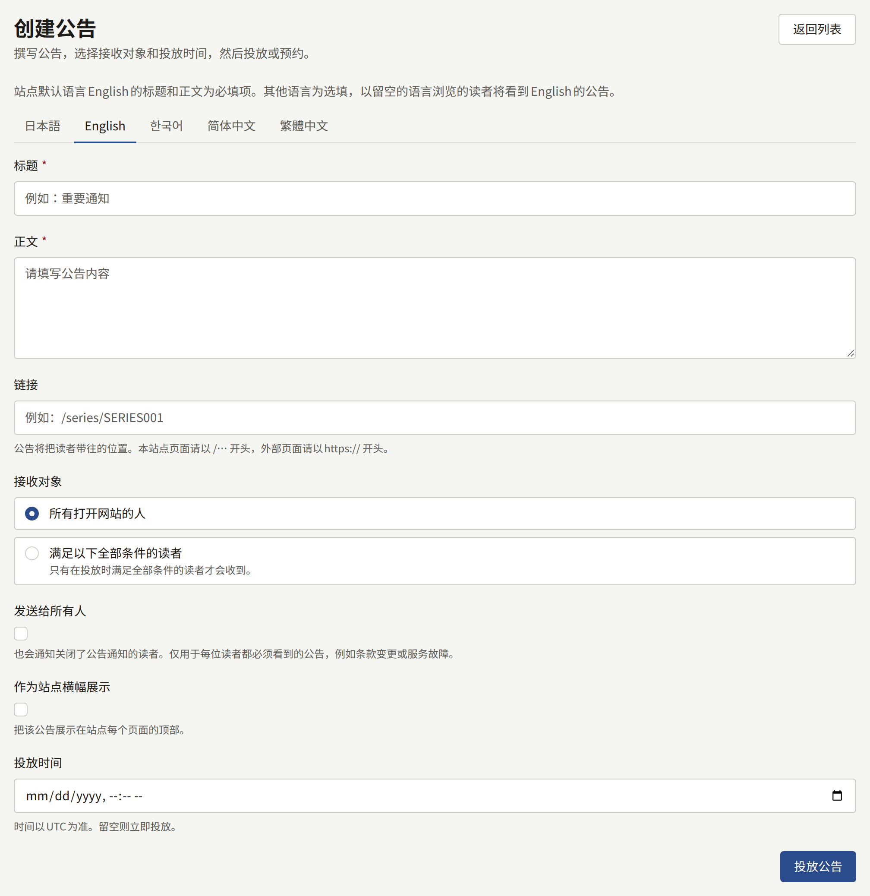
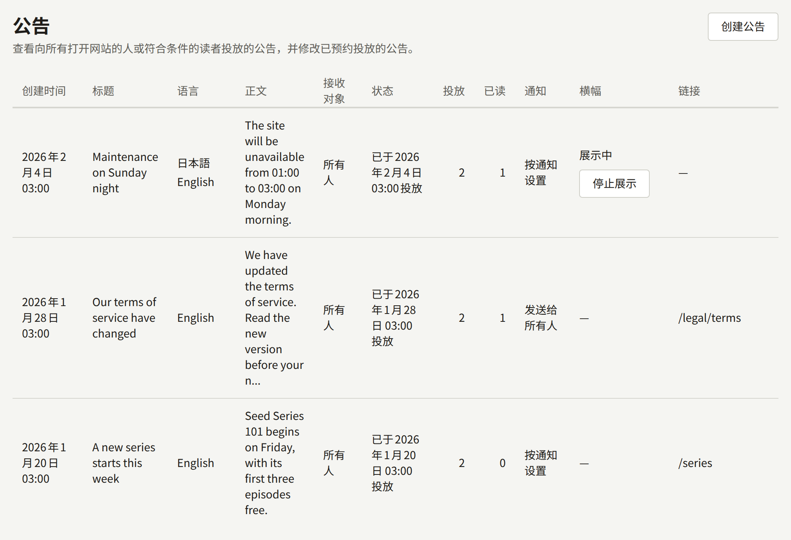

**网站**下的**公告**是出版社一次性向所有读者告知某件事的方式：新系列、条款的变更、维护时段等。每条公告都会列在网站的**公告**页面上，并投放到读者的通知中。公告也可以只发给按一组条件选出的读者，例如某个系列的关注者；参见[选择接收对象](#选择接收对象)。同一时间还可以有一条公告以横幅形式显示在网站和应用的每个页面顶部。

租户管理员和编辑可以创建公告、修改或删除已预约的公告，以及撤下横幅。审计员只能查看列表。

## 创建公告

选择**创建公告**并填写：

- **标题**和**正文**：网站提供的每种语言各有一个标签页，标题最多120个字符，正文为最多2000个字符的纯文本。参见[以多种语言撰写](#以多种语言撰写)。
- **链接**（可选）：读者打开公告时被带往的位置。本网站的页面以`/`开头，例如`/series/SERIES001`或`/legal/terms`；其他网站则以`https://`或`http://`开头。
- **接收对象**：**所有打开网站的人**（默认），或**满足以下全部条件的读者**。参见[选择接收对象](#选择接收对象)。
- **发送给所有人**（默认关闭）：通知每位拥有账户的读者，包括在通知设置中关闭了公告的读者。参见[发送给所有人](#发送给所有人)。
- **作为站点横幅展示**：同时在每个页面的顶部显示该公告。参见[站点横幅](#站点横幅)。
- **投放时间**（可选）：公告发出的时间。留空则立即投放。参见[预约公告](#预约公告)。

**投放公告**会立即投放公告。设置了**投放时间**时，按钮会变为**预约投放公告**，公告会在该时间发出。公告一经投放就无法编辑或删除，因此请在发出之前仔细检查。

## 预约公告

可以为公告指定发出时间，而不是立即发出：例如在周五写好，于周一九点投放。在**投放时间**中输入时间，然后选择**预约投放公告**。该时间以租户的时区为准，并且必须是将来的时间。横幅的**停止展示的时间**必须晚于该时间。

在该时间之前，公告处于已预约状态，读者看不到它：它不会出现在网站的**公告**页面或应用中，不会通知任何读者，其横幅也不会显示。列表的**状态**列会显示**预约于**该时间**投放**。租户管理员或编辑仍可以在该列中选择**编辑**，修改其中的任何内容（包括时间），然后选择**保存**；也可以选择**删除**并确认，将其删除。在**投放时间**为空的状态下保存，会立即投放该公告。

在指定时间后约一分钟内，公告会像在那时创建的公告一样投放：通知读者，在**公告**页面和应用中显示，并显示其横幅。读者看到的公告在其他公告中按发出时间排列，而不是按撰写时间。带有条件的公告也在那一刻选出其读者。从此以后，它就无法再编辑或删除。

## 以多种语言撰写

表单为网站提供的每种语言各设一个标签页，以该语言本身命名，打开时显示网站的默认语言。这些语言就是在**设置**的[语言](./1-settings.md#语言)中选择的语言：网站不提供的语言没有标签页。

- 默认语言的**标题**和**正文**为必填项。以您留空的语言浏览的读者，会看到默认语言的公告。
- 其他所有标签页均为选填。请同时填写其**标题**和**正文**，或将两者都留空。

**投放公告**会一次性发送公告，包含您撰写的所有语言。公告投放后无法再添加语言，因此请在投放之前写好所有翻译。

列表以默认语言显示每条公告的标题，**语言**列列出撰写该公告所用的每种语言。

## 发送给所有人

只有当读者的通知设置允许在通知和电子邮件中接收公告时，公告才会送达读者的通知和电子邮件，因此关闭了公告的读者不会得知活动信息。**发送给所有人**会通知每位拥有账户的读者，并向每位电子邮件地址已确认的读者发送邮件，无论其设置如何。推送仍然只会送达开启了公告推送设置的读者。请仅将其用于每位读者都必须看到的通知，例如条款的变更或服务故障。

列表的**通知**列显示每条公告的发送方式：**发送给所有人**，或未使用该选项发送时的**按通知设置**。

## 选择接收对象

公告可以发给满足一组条件的读者，而不是发给所有人。在**接收对象**下选择**满足以下全部条件的读者**，然后在**添加条件**中选择一个条件。每个条件会添加一行，包含该条件所需的输入项，**移除**可将其删除。条件如下：

- **关注了系列**：读者关注了您选择的**系列**。
- **购买过系列的章节**：读者持有您选择的**系列**中某个章节的购买记录，无论是单独购买、按卷购买还是打包购买。已退款或已撤销的购买不计入。
- **订阅**：读者对您选择的**套餐**或**任意套餐**的订阅仍然有效（**正在订阅**：处于试用期、有效状态，或续费付款已逾期），或者读者曾有一个已结束的订阅，且目前没有有效的订阅（**订阅已结束**）。
- **从未购买过**：读者从未在网站上购买过任何东西。在支付服务提供方的测试模式下进行的购买不计入。
- **未阅读的天数**：读者至少在您输入的**天数**内没有打开过任何章节，或者从未打开过章节。
- **注册后的天数**：读者注册至今不超过您输入的**天数**。
- **语言**：读者以您从网站提供的语言中选择的语言使用网站：即其最后一次浏览网站或使用应用时所用的语言，对于从未选择过语言的读者，则为网站的默认语言。
- **登记了应用的推送通知**：读者已登记运行网站应用的手机以接收推送通知。

天数的范围为1到3650。每个条件只能使用一次，因此已添加的条件不会再次提供，各条件之间是组合关系：只有满足公告列出的所有条件的读者才会收到它。

每一行都填写完毕后，表单会统计条件选出的读者人数并显示，例如**将送达12位读者**，条件变化时会重新统计。这是当时的人数，仅供参考：公告发出时会重新选出读者，并且无论能否完成统计，公告都可以发出。

公告带有条件期间，**发送给所有人**和**作为站点横幅展示**处于关闭状态且无法开启，表单上方也有相应说明。删除所有条件后，它们会恢复可用。

列表的**接收对象**列显示每条公告的对象：**所有人**，或其列出的条件数，例如**2个条件**。

条件只在公告投放的那一刻评估一次。之后才满足条件的读者（例如一天后才关注该系列的读者）不会收到该公告，而之后不再满足条件的读者会保留已收到的公告。

带有条件的公告会按照通知设置所允许的方式送达其选出的每位读者，并且永远不会：

- 作为所有访客都能看到的站点横幅显示；
- 通过**发送给所有人**发送，因为每位读者都必须看到的通知，不应由条件将其中一部分读者排除在外；
- 对未登录的访客或未收到该公告的已登录读者，在**公告**页面或应用中列出，这些人打开其页面时会看到**找不到页面**。

## 读者看到的内容

- **在网站上**，页眉中的**公告**页面按从新到旧的顺序列出所有发给所有人的公告，任何人都可以阅读。已登录的读者还会在其中看到投放给自己的带条件公告，与其他公告排在一起，并可在登录状态下像其他公告一样打开。每个标题都会在单独的页面中打开该公告。已登录的读者可以看到哪些公告尚未阅读。
- **在通知中**，通知设置接收公告的每位拥有账户的读者都会收到“新公告”，点击即可前往该公告；对于通过**发送给所有人**发送的公告，每位拥有账户的读者都会收到。带有条件的公告只会送达其选出的读者。
- **通过电子邮件**，通知设置以电子邮件接收公告且地址已确认的每位读者，都会收到一封包含公告标题和**公告**页面链接的邮件；对于通过**发送给所有人**发送的公告，每位地址已确认的读者都会收到。
- **作为推送通知**，通知设置以浏览器通知接收公告的读者会在浏览器中收到通知，设置在手机上接收的读者会收到来自应用的通知。通知的标题是读者所用语言的公告标题，打开通知即可查看公告。这两项设置的初始状态均为关闭，因此没有保存任何设置的读者不会收到推送，**发送给所有人**也不会覆盖这些设置。
- **在应用中**，**公告**页面列出同样的公告，并带有同样的已读标记。

读者会以自己的语言看到每条公告：在网站上为其浏览所用的语言，在应用中为应用显示所用的语言。如果您没有以该语言撰写公告，读者会看到默认语言的公告，并附有注明所显示语言的说明。

公告发出后，列表会显示其送达范围。**投放**列统计公告投放到的读者人数：发给所有人的公告为每位拥有账户的读者，带条件的公告则为发出时条件选出的读者。通知设置不在通知中接收公告的读者也计入其中。**已读**列统计在网站或应用中打开过该公告的读者人数。公告处于已预约状态时，这两列都显示—；公告发出后的片刻，在通知其读者之前，**投放**可能显示为0。

## 站点横幅

以**作为站点横幅展示**创建的公告，会显示在网站每个页面的页眉上方，面向所有访客（无论是否登录），也会显示在应用作品目录页面的顶部。在网站上，横幅的链接指向公告的**链接**，没有链接时则指向公告自己的页面。访客可以关闭横幅，之后在该浏览器中保持关闭。

同一时间只显示一个横幅：横幅仍在显示的公告中最新的一条。因此，创建新的横幅会隐藏之前的横幅，直到新横幅撤下为止。

横幅会一直显示，直到您将其撤下，除非您为其设置了结束时间：

- 横幅复选框下的**停止展示的时间**会在该时间（以租户的时区为准）撤下横幅。该时间必须是将来的时间。
- 列表**横幅**列中的**停止展示**会立即撤下横幅。

无论哪种方式，公告都会保留在**公告**页面和读者的通知中。撤下的只是横幅。
