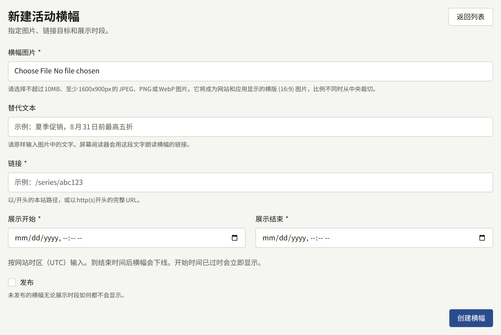
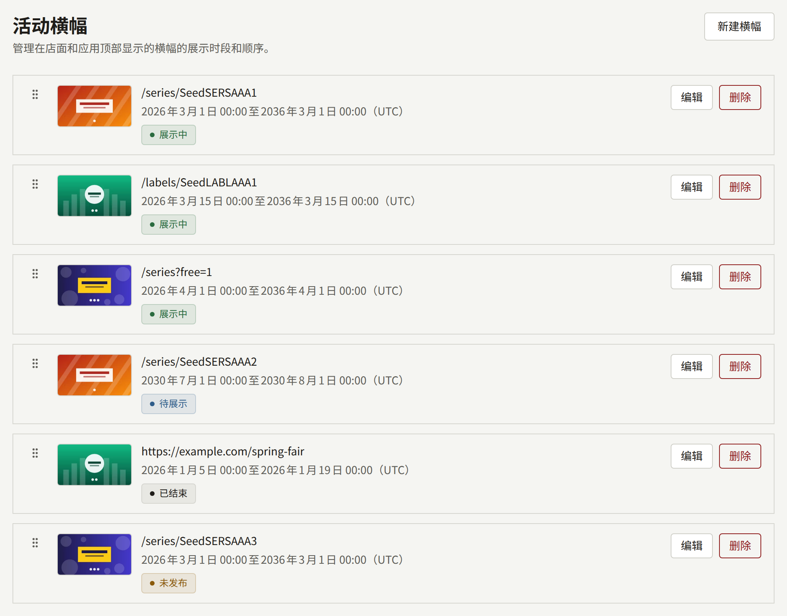

**网站**下的**活动横幅**用于把活动展示给并未主动寻找它的读者：某个系列的折扣、新的连载、在其他网站上举办的展会等。横幅是一张链接到某处的图片，在您设定的时段内显示。网站会在首页顶部显示正在展示的横幅，应用则在其作品目录页面的顶部显示。

横幅不是公告。它不会进入任何人的通知，读者无法关闭它，并且只在这两个页面上显示。如果要告知每位读者某件事，或在每个页面顶部保留一行文字，请使用[公告](./4-announcements.md)。

租户管理员和编辑可以创建、修改、排序和删除横幅。审计员可以查看列表，并通过**查看**打开横幅，但无法修改。

## 创建横幅

选择**新建横幅**并填写：

- **横幅图片**：10 MB以内、至少1600 × 900像素的JPEG、PNG或WebP图片。参见[图片](#图片)。
- **替代文本**：图片中绘制的文字，最多255个字符，例如`Summer sale, up to 50% off through August 31`。屏幕阅读器无法读取图片中的文字，因此会改用这些文字来称呼横幅的链接。该字段为选填，但未填写的横幅只能通过其链接目标与其他横幅区分开来。
- **链接**：读者打开横幅时被带往的位置，最多2048个字符。本网站的页面以`/`开头，例如`/series/SERIES001`或`/labels/LABEL001`；其他网站则以`https://`或`http://`开头。
- **展示开始**和**展示结束**：横幅展示的时段，以租户的时区输入，两个字段下方的说明会注明该时区。参见[展示时段](#展示时段)。
- **发布**：横幅是否显示。新横幅起初为未发布状态。参见[发布](#发布)。

选择**创建横幅**。横幅会在其单独的页面中打开，其中的**基本信息**标签页用于修改替代文本、链接、展示时段和**发布**，**图片**标签页用于更换图片。

## 图片

网站和应用中的横幅条都基于同一种形状“**横版 (16:9)**”绘制，不做裁剪，您上传的图片会被处理成该形状。为横幅条制作的图稿（例如1920 × 1080的图片）会完整保留；其他形状的图片会从中心裁剪。**图片**标签页会在**各比例图片**下的“**横版 (16:9)**”栏位中显示处理结果。旁边的“**竖版 (3:4)**”、“**方形 (1:1)**”和“**链接预览 (1200:630)**”栏位起初为空，也不会在任何地方显示。

如果要以不同的方式取景，请在**横版 (16:9)**栏位上选择**调整取景框**，或者通过**替换**为其上传其他图稿，替换的图片须至少为1600 × 900像素。在**封面图**下上传新图片并选择**更新图片**也会替换它，同时清空其他已填充的栏位。横幅始终保留一张图片，因此无法将图片删除。系列的[封面图](../1-catalog/1-series.md#封面图)详细介绍了这些栏位。

在手机上，横幅条与屏幕同宽，因此图片中的文字必须在该尺寸下清晰可读。如果新图片中的文字不同，需要在**基本信息**标签页上相应地改写其**替代文本**。

## 展示时段

**展示开始**和**展示结束**按租户的时区解读，该时区在[设置](./1-settings.md#时区)中选择，列表也以该时区显示每个时段。横幅从第一个时刻开始展示，到第二个时刻即已撤下，因此一个横幅可以在下一个横幅开始的同一时刻结束。

- 结束时间必须晚于开始时间。
- 新横幅的结束时间必须是将来的时间。如果开始时间已经过去，横幅一经发布即开始展示。
- 编辑横幅时，结束时间也必须是将来的时间，除非您保持时段不变。因此，已结束的横幅仍然可以取消发布或更换链接，而无需重新安排时段。

网站和应用每次读取时都会将时段与当前时间进行比较，因此无论读者身在何处，横幅都会在同一时刻切换。网站会保留已绘制的内容，直到worker进程下一次运行时将其清除，通常在您设定的时间后一分钟内。如果横幅在时段开始后仍未显示，或在时段结束后仍在显示，安装实例的运营人员可以检查[定时任务](../../3-operations/10-scheduled-jobs.md)中介绍的任务。

## 发布

**发布**决定横幅是否显示。未发布的横幅无论处于什么时段都不会显示，因此可以先准备好横幅，在准备就绪之前保持未发布状态。在**基本信息**标签页上取消勾选**发布**并选择**更新横幅**，即可立即撤下横幅。

列表显示每个横幅当前的状态：

| 状态       | 含义                           |
| ---------- | ------------------------------ |
| **展示中** | 已发布，且当前时刻处于其时段内 |
| **待展示** | 已发布，但其时段尚未开始       |
| **已结束** | 已发布，且其时段已经结束       |
| **未发布** | 未发布，无论其时段如何         |

每一行以横幅的替代文本开头，下方是其链接；没有替代文本时只显示链接。

## 排序

网站和应用按列表的顺序显示正在展示的横幅。新横幅会排在末尾。要移动横幅，请拖动其手柄，或将焦点移到手柄上并使用方向键。横幅放下后，顺序会立即保存。

如果有其他人同时对列表进行排序，您的移动会被拒绝，并显示“横幅顺序已在其他地方被更改。请重新加载页面后重试。”

## 删除横幅及50个的上限

横幅所在行中的**删除**会在要求确认后删除该横幅及其图片。网站会立即停止显示它。

一个租户最多可以有50个横幅，包括已结束的横幅。超过上限后创建的横幅会被拒绝，并显示“活动横幅数量已达上限。请删除已结束的横幅后重试。”已结束的横幅不会在任何地方显示，因此删除它不会让读者看到的内容有任何损失。

## 读者看到的内容

- **在网站上**，正在展示的横幅位于首页顶部，在页面开头的作品之上。只有一个横幅时显示为单个横幅条。两个或更多时显示为读者可以滑动或滚动浏览的轮播条，带有**上一个活动**和**下一个活动**按钮，下方还有`1 / 3`这样的计数；轮播条会从最后一个横幅接续到第一个，并且不会自动切换。在宽屏幕上，相邻的横幅会显示在轮播条的边缘。
- **在应用中**，同样的横幅位于作品目录页面的顶部，如果有站点横幅则位于其下方，并位于书架之上。两个或更多时显示为读者可以滑动浏览的页面，并露出下一个横幅的边缘。应用在首次显示作品目录页面时读取横幅，读者下拉页面刷新时会再次读取。
- **当读者打开横幅时**，网站会前往其链接，若链接指向网站的页面，则保持读者的语言。如果链接指向应用有对应页面的网站页面（例如系列或书系），应用会打开自己的页面；如果指向租户已发布的页面，会打开用于显示这类页面的界面；其他情况则打开浏览器。

没有正在展示的横幅的租户，在网站和应用中都既不显示横幅条，也不为其留出空间。
