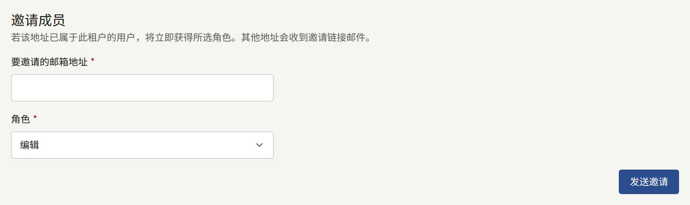
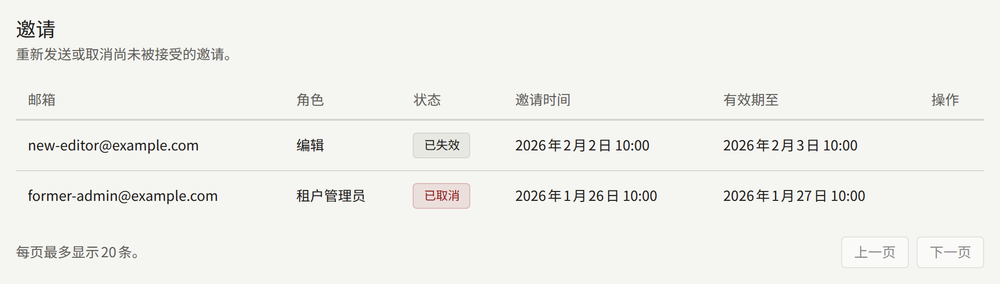
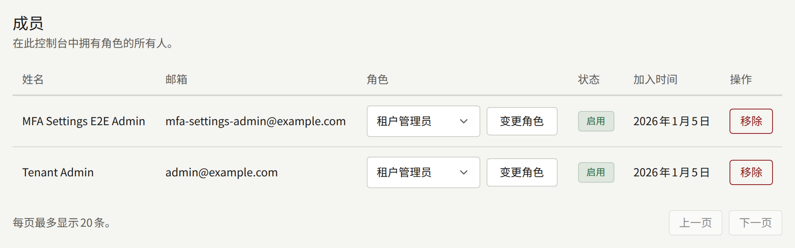

**管理**下的**成员**列出所有可以登录本控制台的人，租户管理员在这里引入工作人员、更改其角色，以及将其移出。只有租户管理员能看到它。

工作人员是在租户网站上同时拥有控制台角色的账户。工作人员使用与在网站上相同的电子邮件地址和密码登录控制台，收回某人的角色后，其在网站上的账户保持不变。[租户的工作人员](../../3-operations/3-tenant-staff.md#成员与用户)从运营人员的角度对此进行了说明。

## 角色

| 角色           | 可以做什么                                           |
| -------------- | ---------------------------------------------------- |
| **租户管理员** | 控制台中的一切操作，包括本页面                       |
| **编辑**       | 作品目录、网站的页面和公告，以及评论审核             |
| **审计员**     | 查看编辑所处理的内容以及租户的设置，但不能做任何更改 |

[租户控制台](../index.md#角色)列出了每个角色涵盖的范围。请将租户管理员的人数控制在少数：租户管理员可以替换租户的支付和邮件凭据、暂停和删除读者的账户，以及更改工作人员。

## 邀请成员

在**邀请成员**下，于**要邀请的邮箱地址**中输入地址，选择其**角色**，然后选择**发送邀请**。角色的初始值为**编辑**，因此只有在对方确实需要时，才特意选择**租户管理员**。

- **网站上没有账户的地址**会收到一封以租户默认语言发送的、邀请其担任所选角色的邮件。邮件中的链接指向本控制台，受邀者在那里输入其**姓名**和**密码**，然后选择**接受邀请**。之后，他们即可以该角色登录。该链接的有效期为24小时。
- **网站上已有账户的地址**会立即被授予该角色，不会发送邮件。已拥有角色的账户可以通过这种方式成为租户管理员，并替换其原有角色；对于其他任何角色，控制台会拒绝，并引导至**成员**，在那里按下文所述更改角色。

**邀请**列出每份邀请及其授予的**角色**，状态为**待处理**、**已接受**、**已取消**或**已失效**。对于待处理的邀请，**重新发送**会附上新链接再次发送邮件，有效期重新计为24小时；**取消邀请**会撤回邀请。无论哪种操作，之前的链接都会失效。如果要在邀请失效或被取消后重试，或者要更改待处理邀请所授予的角色，请以应有的角色再次邀请同一地址。

除非租户通过自己的邮件服务器发送，否则邀请由平台的邮件服务器发送，如[邮件](./7-email.md)所述。如果邀请没有送达，请检查受邀者的垃圾邮件文件夹，然后检查租户的邮件设置。

## 更改角色

在**成员**中，于该成员的**角色**列中选择新角色，然后选择**变更角色**。更改会在该成员在控制台中的下一次操作时生效，包括在其已打开的控制台中。

## 移除成员

在成员所在行中选择**移除**，并以**移除**确认，即会收回其所有角色。从其下一次操作起，该成员将无法使用控制台。其账户作为读者账户保留在网站上，包括其购买记录和历史记录。

如果还要取消其阅读权限，请在**读者**下该成员的页面中暂停或删除其账户，列表中该成员的名称即链接到该页面。[读者账户](../2-readers/1-accounts.md)介绍了这两种操作各自保留的内容。

## 最后一位租户管理员

控制台会拒绝降级或移除租户最后一位有效的租户管理员（包括您自己），以确保始终有人可以管理工作人员。请先将其他人设为租户管理员。

如果最后一位租户管理员仍然离开了出版社或无法访问其账户，运营人员可以将该角色授予其他人，如[恢复没有管理员的租户](../../3-operations/3-tenant-staff.md#恢复没有管理员的租户)所述。

## 记录的内容

每一次邀请、重新发送、取消、接受、角色更改和移除，都会连同执行操作的租户管理员一起记录在[审计日志](./8-audit-log.md)中。邀请、其重新发送和接受以及角色更改，还会记录其授予的角色。
