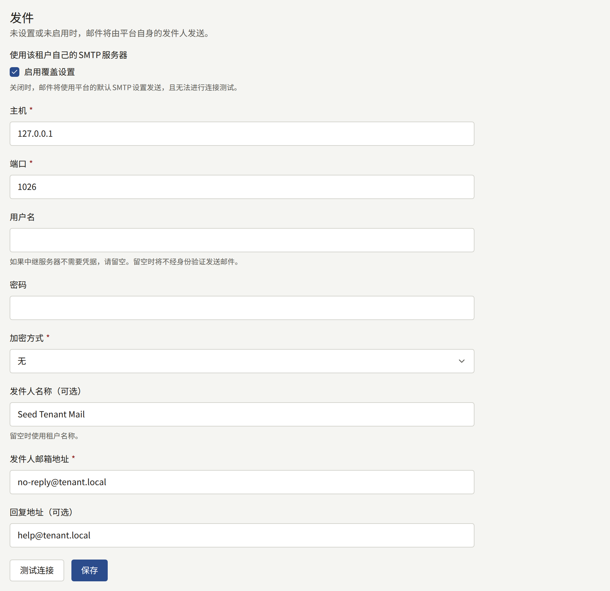
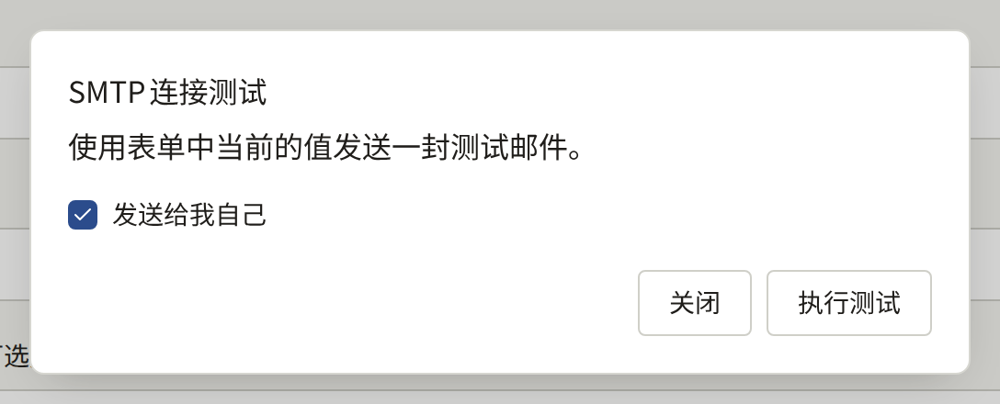
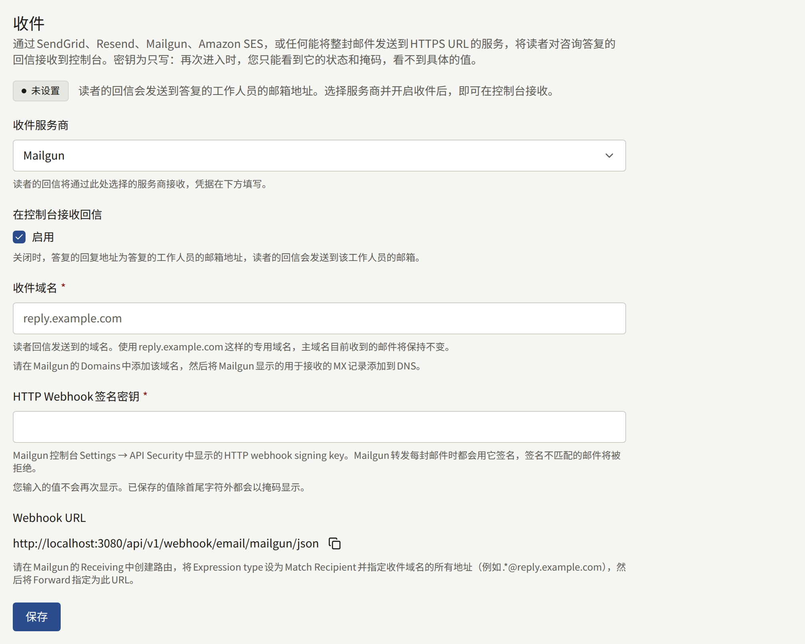

租户会向其读者和工作人员发送邮件：地址确认、密码重置、购买收据、邀请、对咨询消息的答复等。在租户管理员设置租户自己的服务器之前，所有这些邮件都通过平台的邮件服务器、从运营人员选定的平台地址发出。**集成** › **邮件**可以改为通过出版社自己的SMTP服务器、从出版社域名下的地址发送这些邮件。

只有租户管理员能看到此页面。运营人员无需事先允许任何操作。

## 经由它发送的邮件

开启租户自己的服务器后，租户发送的所有邮件都经由它发送：

- 发给读者的：注册确认、密码重置及密码已更改的通知、电子邮件地址更改确认及地址已更改的通知，以及有人试图用已有账户的地址注册的通知。
- 发给在网站上购买章节的读者的：一份收据，注明系列和章节、支付的价格、购买时间，对于有阅读期限的章节还会注明可阅读至何时，并附有指向读者购买记录的链接。对于在[设置 › 税费与发票](./1-settings.md#税费与发票)中设置了“**税率（%）**”的租户，记录了税费的购买的收据还会注明税费及其税率，例如“其中税额（10%）：¥100”，详见[销售章节](../4-selling-episodes.md#价格中包含的税费)。租户在那里输入**开票名称**和**登记编号**后，每张收据都会以“开票方”注明其**开票名称**，并注明其**登记编号**。
- 发给在网站上打赏章节作者的读者的：写明章节和打赏金额的收据。
- 发给在网站上的购买或打赏被全额或部分退款的读者的：一份通知，写明所购买的内容、退款金额以及退款是否会关闭章节，详见[退款](../4-selling-episodes.md#退款)。无论读者的通知设置如何，都会发送此通知。
- 发给通知设置以电子邮件接收的读者的：所关注作品的新章节、其评论已公开的通知，以及公告（公告的情况如[读者看到的内容](./4-announcements.md#读者看到的内容)所述）。
- 对读者咨询消息的答复。
- 发给工作人员的：发给新租户管理员的邀请、控制台的密码重置和电子邮件地址更改，以及发给租户管理员的新咨询消息通知。

## 开始之前

请向负责出版社邮件的人员索取以下信息：

- SMTP服务器的主机名和端口，以及它是要求从连接开始就使用TLS（通常为465端口），还是使用STARTTLS（通常为587端口）。
- 该服务器的用户名和密码，除非它无需凭据即可中继邮件。
- 邮件的发件地址，该服务器须被允许以此地址发送邮件。请让该域名的SPF和DKIM记录涵盖该服务器，否则读者的邮件服务很可能会将租户的邮件归为垃圾邮件。

## 设置

1. 打开**集成** › **邮件**，在**发件**部分中，勾选**使用该租户自己的SMTP服务器**下的**启用覆盖设置**。其下方的字段随即展开。
2. 填写：
   - **主机**和**端口**。
   - **用户名**和**密码**（如果服务器要求登录）。对于不需要凭据的中继（例如信任平台地址的中继），请将**用户名**留空：这样邮件会在不登录的情况下发送，也不会保存密码。只有密码而没有用户名会被拒绝。
   - **加密方式**：**TLS**、**STARTTLS**或**无**。**TLS**和**STARTTLS**都要求TLS 1.2或更高版本，当服务器不提供STARTTLS时，**STARTTLS**会直接失败，而不会以明文发送。只有对通过私有网络访问的服务器，才选择**无**。
   - **发件人邮箱地址**：邮件的发件地址，例如`noreply@comics.example.com`。
   - **发件人名称（可选）**：读者在该地址旁看到的名称，通常为网站名称。留空时，租户邮件和连接测试都使用租户的名称。
   - **回复地址（可选）**：读者回复的去向，例如客服地址。留空时，回复会发往发件地址。对咨询消息的答复则保留其自己的回复地址。
3. 选择**测试连接**，然后选择**执行测试**。测试会使用表单中的值（不保存）发送一封邮件到您自己的地址；如果取消勾选**发送给我自己**，则发送到另一个地址。测试失败时，只要能判断出来，就会说明在哪一步失败：连接、TLS或STARTTLS、登录、服务器拒绝收件人，或服务器响应时间过长。
4. 选择**保存**。租户发送的下一封邮件就会经由新的服务器。





已保存的密码不会再次显示。该字段只显示已保存了密码，**变更**可将其替换。选择**变更**后保持输入框为空并保存，即会删除密码，租户就是通过这种方式改用不需要凭据的中继的：同时也要清空**用户名**，因为只有用户名而没有密码会被拒绝。

## 无法正常工作时

开启租户自己的服务器后，其邮件不会退回到平台的服务器。如果服务器拒绝某封邮件或无法连接，平台会在一段时间内以逐渐延长的间隔继续尝试，之后放弃该邮件。控制台中不会报告任何失败。如果读者反映收不到确认邮件或密码重置邮件，请使用已保存的设置再次执行**测试连接**。

要恢复使用平台的邮件服务器，请取消勾选**启用覆盖设置**并选择**保存**。其余设置会保留，以便再次开启时使用。

每次保存都会以**更新了邮件设置**记录在[审计日志](./8-audit-log.md)中，每次测试（无论成功与否）都会以**测试了SMTP连接**记录。租户邮件在运营人员一侧的情况，在[邮件](../../3-operations/6-email.md#租户自己的smtp账户)中进行了说明。

## 读者对咨询消息答复的回信

对咨询消息的答复会通过邮件送达读者。在租户接收自己的邮件之前，答复的回复地址是作答的工作人员的地址，因此回信的读者会发到该工作人员的邮箱，控制台永远看不到这些回信。**集成** › **邮件**中的**收件**部分可以通过SendGrid、Resend、Mailgun或Amazon SES，或者通过任何能将整封邮件发送到HTTPS URL的邮件服务或服务器（例如Cloudflare Email Routing或出版社自己的Postfix服务器），将这些回信接收回控制台，显示在其所答复的消息下方。

### 开始之前

- 一个SendGrid、Resend或Mailgun账户，一个能在支持接收电子邮件的区域使用Amazon SES的AWS账户，或者一个能将收到的每封邮件交给您自己代码处理的邮件服务或服务器：Cloudflare Email Routing或Postfix服务器。
- 一个您可以更改其DNS的回信用域名，例如`reply.comics.example.com`。其MX记录将指向服务提供方，因此发往该域名的邮件不会到达其他任何邮箱。使用一个专用的子域名，可以让出版社主域名已经在接收的邮件保持原样。
- 网站可以从互联网访问：服务提供方会将每封回信发送到网站自己的域名。网站前面的IP允许列表、登录提示或机器人验证必须放行这些请求，如面向运营人员的[Webhook](../../2-deployments/4-edge/index.md#webhook)所述。

### 设置

1. 打开**集成** › **邮件**。在**收件**部分中，于**收件服务商**下选择服务提供方，勾选**在控制台接收回信**下的**启用**，并在**收件域名**中输入回信用域名。
2. 设置服务提供方。该部分会显示网站域名下的**Webhook URL**，并附有复制按钮。
   - **SendGrid**：自行生成一个足够长的随机字符串，填入**Webhook令牌**。在DNS中，将该域名的MX记录指向`mx.sendgrid.net`，优先级为10。在SendGrid中，于**Settings** › **Inbound Parse**下添加该域名，以**Webhook URL**作为目标URL，并用令牌替换其中的`<token>`：SendGrid不做任何签名，因此网站要靠URL中的令牌来区分来自SendGrid的请求和其他任何人的请求。
   - **Resend**：在**API Keys**下创建一个具有**Full access**权限的API密钥，并填入**API密钥**；回信将使用它从Resend读取。在**Domains**下添加该域名，为其开启接收功能，并将Resend显示的MX记录添加到DNS中。在**Webhooks**下，为`email.received`事件添加**Webhook URL**，并将Resend为其显示的签名密钥（`whsec_…`）填入**Webhook签名密钥**。
   - **Amazon SES**：自行生成一个足够长的随机字符串，填入**Webhook令牌**，并将邮件所发布到的SNS主题的ARN填入**SNS主题ARN**。在AWS中设置域名、主题和接收规则，然后保存，再按下文[通过Amazon SES接收](#通过amazon-ses接收)所述，将该主题订阅到**Webhook URL**。
   - **Raw MIME over HTTPS**：自行生成一个足够长的随机字符串，填入**Webhook令牌**。将该域名的MX记录指向接收邮件的服务或服务器，并让它将该域名上的每封邮件完整且不做改动地发送到**Webhook URL**，内容类型为`message/rfc822`，用令牌替换`<token>`，并在`X-Envelope-To`标头中写上邮件被投递到的地址。读者一侧的转发或别名常常会导致回信的**To**中不含该消息自己的地址，而这个标头仍然可以与之匹配。下文的[Cloudflare Email Routing](#从cloudflare-email-routing发送原始邮件)和[Postfix](#从postfix发送原始邮件)完成了所有这些操作。
   - **Mailgun**：从**Settings** › **API Security**中复制**HTTP webhook signing key**，并填入同名的字段；Mailgun会用它为发送的每封回信签名，签名不匹配的请求会被拒绝。对于子账户下的域名，子账户的密钥和主账户的密钥都可以使用。在**Domains**下添加该域名，并将Mailgun显示的用于接收的MX记录添加到DNS中。在**Receiving**下创建一条路由，表达式类型为**Match Recipient**，收件人涵盖该域名上的所有地址，例如`.*@reply.comics.example.com`，并勾选**Forward**，填入与显示完全一致、以`/json`结尾的**Webhook URL**：Mailgun只会对以此结尾的URL签名并发送整封邮件，发送到其他任何URL的请求都会被拒绝。Mailgun欧盟区域的账户也适用同样的步骤。
3. 选择**保存**。该部分会变为**就绪**，并显示**回复地址**，即`contact+*@`后接该域名：从此以后，每份答复都会请读者回复到这种形式的地址，其中`*`是该消息的ID，回信会显示在该消息下方。



在该部分变为**就绪**之前，答复会保留作答工作人员的地址，该部分也会说明这一点。**未设置**表示没有保存任何内容；**已停用**表示设置已保存，但**启用**未勾选；**未完成**表示已启用，但缺少域名或服务提供方所需的某项凭据。

令牌和密钥一经保存就不会再次显示：每个字段都显示为掩码，**变更**可将其替换。选择其他服务提供方后保存，会删除为之前的服务提供方保存的凭据。

要停止接收回信，请取消勾选**启用**并选择**保存**。下一份答复会再次使用工作人员的地址，设置会保留，以便再次开启时使用。每次保存都会以**更新了收件设置**记录在[审计日志](./8-audit-log.md)中。

### 通过Amazon SES接收

Amazon SES接收该域名的邮件，并将每封邮件交给接收规则。该规则将邮件的通知发布到Amazon SNS主题，主题再通过HTTPS订阅将其投递到**Webhook URL**。SNS会为每次投递签名，但任何AWS账户都可以将自己的主题订阅到该URL，因此网站还会检查URL中的令牌以及投递来自哪个主题。

SES只在部分AWS区域接收邮件，这些区域列于[Email receiving endpoints](https://docs.aws.amazon.com/general/latest/gr/ses.html#ses_inbound_endpoints)中。下文的域名、主题和规则请使用其中的一个区域；存储桶可以位于其他区域。

1. 在SES的**Identities**下验证收件域名。在DNS中，将其MX记录指向`inbound-smtp.<region>.amazonaws.com`（例如`inbound-smtp.us-east-1.amazonaws.com`），优先级为10。
2. 在SNS中创建一个标准主题，例如`publira-inbound`。在控制台中将其ARN填入**SNS主题ARN**。
3. 在SES的**Email receiving**下，于当前生效的规则集中创建一条规则，以收件域名作为其收件人条件，并为其指定以下操作之一：
   - **Deliver to Amazon S3 bucket**，并在**SNS topic**下选择该SNS主题。SES会将每封邮件写入存储桶，并告知主题邮件所在位置，网站会从那里读取邮件。应该使用的是这个操作：它可以承载SES接收的任何大小的回信，最大40 MB。存储桶的策略必须允许SES写入，如[Giving permissions to Amazon SES for email receiving](https://docs.aws.amazon.com/ses/latest/dg/receiving-email-permissions.html)所述。请不要勾选**Message encryption**：否则SES会在客户端对每封邮件进行加密，网站无法解密。然后，在IAM中创建一个用户，为其创建访问密钥，并附加允许对该存储桶中的对象执行`s3:GetObject`的策略，再将该密钥填入**AWS访问密钥ID**和**AWS秘密访问密钥**。填写**S3存储桶**可以让网站只从该存储桶读取，而不从其他存储桶读取；当存储桶与主题位于不同区域时，请填写**S3存储桶区域**。
   - **Publish to Amazon SNS topic**，选择该主题，编码选择**Base64**，这样任何字符集的邮件都能保持发送时的原样。邮件包含在通知之中，因此不需要存储桶或访问密钥，但SES会退回所有超过150 KB的邮件，而带有图片或附件的回信很容易超过这个大小。
4. 在控制台中选择**保存**：当SNS将其确认请求发送到网站时，订阅即被确认，并且网站只对其已保存的令牌和主题进行确认。
5. 在SNS中为该主题创建一个订阅，协议为**HTTPS**，端点为**Webhook URL**，并用令牌替换其中的`<token>`。请不要勾选**Enable raw message delivery**：不带SNS签名的投递会被拒绝。订阅会在一分钟内变为**Confirmed**。如果一直处于**Pending confirmation**，请检查控制台中的令牌和主题，保存后在该订阅上选择**Request confirmation**。

第3步中用户的IAM策略如下，请用存储桶的名称替换`publira-inbound-mail`：

```json
{
  "Version": "2012-10-17",
  "Statement": [
    {
      "Effect": "Allow",
      "Action": "s3:GetObject",
      "Resource": "arn:aws:s3:::publira-inbound-mail/*"
    }
  ]
}
```

如果存储桶默认使用KMS密钥对写入的内容进行加密，还需要添加对该密钥的`kms:Decrypt`权限。

对于网站无法接收的投递（网站停机期间，或无法从存储桶读取邮件期间返回的`5xx`），SNS会以20秒的间隔重试三次，之后将其丢弃。在订阅上设置[投递策略](https://docs.aws.amazon.com/sns/latest/dg/sns-message-delivery-retries.html)可以让它持续重试最多一小时，死信队列则可以保存被丢弃的内容。无论哪种情况，S3操作写入的邮件都会保留在存储桶中。

### 从Cloudflare Email Routing发送原始邮件

Cloudflare Email Routing将每封邮件交给Email Worker，由其发送到**Webhook URL**。收件域名的DNS必须托管在Cloudflare上。

1. 在Email Routing下为收件域名开启路由；`reply.comics.example.com`这样的子域名在**Settings** › **Subdomains**下添加。Cloudflare会自行添加其MX记录。在同一设置中开启**Subaddressing**，使发往`contact+<message ID>@`的邮件能够匹配`contact@`的规则。
2. 在Email Routing的目标地址下，添加一个工作人员邮箱并进行验证，用于接收网站在回信到达时无法接收的回信。
3. 使用下面的代码创建一个Worker。将去掉`inbound:<token>@`部分的**Webhook URL**设为变量`WEBHOOK_URL`，将令牌设为密钥`WEBHOOK_TOKEN`，将工作人员邮箱设为变量`FALLBACK_ADDRESS`。
4. 在Email Routing的路由规则下，为收件域名创建一个自定义地址`contact`，操作为**Send to a Worker**，并选择您创建的Worker。

```js
export default {
  async email(message, env) {
    let status;
    try {
      const response = await fetch(env.WEBHOOK_URL, {
        body: await new Response(message.raw).arrayBuffer(),
        headers: {
          Authorization: `Basic ${btoa(`inbound:${env.WEBHOOK_TOKEN}`)}`,
          "Content-Type": "message/rfc822",
          "X-Envelope-To": message.to,
        },
        method: "POST",
      });
      if (response.ok) {
        return;
      }
      status = response.status;
    } catch {
      // The site did not answer.
    }
    if (status === 400) {
      message.setReject("The site could not read this mail");
      return;
    }
    try {
      await message.forward(env.FALLBACK_ADDRESS);
    } catch {
      message.setReject(
        `The reply could not be delivered (${status ?? "no answer"})`
      );
    }
  },
};
```

`message.to`是邮件被投递到的地址，包括`+<message ID>`。

Cloudflare没有为Email Worker提供请发件人稍后重试的方法：拒绝邮件是永久性的，读者会收到退信。因此，Worker只拒绝网站因无法读取而拒收的邮件。当网站没有响应或无法接收邮件时（网站停机期间返回的`5xx`，或控制台中保存的令牌与Worker中的令牌不一致期间返回的`401`），Worker会将邮件转发到工作人员邮箱，在那里而不是在控制台中阅读回信，只有转发也失败时才拒绝该邮件。网站接收后又丢弃的邮件（例如没有指明任何消息的邮件，或在**启用**未勾选期间到达的邮件）会被视为已接收，不会再被转到其他任何地方。

### 从Postfix发送原始邮件

接收收件域名邮件的Postfix服务器，可以通过`pipe`传输使用`curl`发送每封邮件。将该域名的MX记录指向该服务器，并将以下脚本保存为`/usr/local/bin/publira-inbound`，其中**Webhook URL**被拆分为令牌和去掉令牌的URL：

```sh
#!/bin/sh
# Posts the mail on standard input for the recipient named as $1, and tells
# Postfix whether a failure is worth retrying.
status=$(curl --silent --output /dev/null --write-out '%{http_code}' \
  --max-time 60 --user 'inbound:<token>' \
  --header 'Content-Type: message/rfc822' \
  --header "X-Envelope-To: $1" \
  --data-binary @- \
  https://comics.example.com/api/v1/webhook/email/mime)
case "$status" in
  2??) exit 0 ;;
  400) exit 65 ;; # EX_DATAERR: not a mail the site can read; bounce it
  *) exit 75 ;;   # EX_TEMPFAIL: keep it queued and try again later
esac
```

如果命令以Postfix不认识的状态码结束（例如`curl`退出时使用的状态码），Postfix会退回该邮件，因此脚本只用Postfix认识的两种状态码作答。只有网站因其不是邮件而拒收的请求才会退信。其他任何情况（没有响应、网站停机期间返回的`5xx`、控制台中保存的令牌与脚本中的令牌不一致期间返回的`401`）都会让邮件留在队列中，Postfix会一直重试，直到其队列有效期结束。该脚本包含令牌，因此请使其只能由传输的用户读取：`chown nobody /usr/local/bin/publira-inbound`和`chmod 700 /usr/local/bin/publira-inbound`。

将该传输添加到`/etc/postfix/master.cf`：

```text
publira   unix  -       n       n       -       -       pipe
  user=nobody argv=/usr/local/bin/publira-inbound ${recipient}
```

然后在`/etc/postfix/main.cf`中，将该域名的邮件发送到该传输，每次发送一个收件人，以便`${recipient}`只指明一个地址：

```text
relay_domains = reply.comics.example.com
transport_maps = hash:/etc/postfix/transport
publira_destination_recipient_limit = 1
```

并在`/etc/postfix/transport`中写入：

```text
reply.comics.example.com  publira:
```

运行`postmap /etc/postfix/transport`和`postfix reload`。
