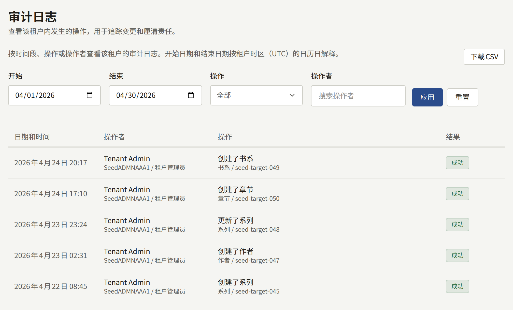

**管理**下的**审计日志**是租户对其工作人员在控制台中所做操作的记录：谁在何时更改了什么，以及操作是否成功。它可以回答诸如谁暂停了某位读者、谁更改了支付设置、某位成员何时被授予了角色之类的问题。只有租户管理员能看到它。

## 阅读日志

每条记录显示：

- **日期和时间**，以租户的时区显示。
- **操作者**：执行操作的工作人员，附有其公开ID和当时担任的角色。**自动**表示由平台自行执行的操作，例如因足够多的读者举报而被隐藏的评论。
- **操作**，下方附有操作对象的类型和ID，如果操作记录了理由，还会显示理由。
- **结果**：**成功**或**失败**。失败的尝试也会被记录，例如两步验证登录时输入了错误的验证码，或邮件服务器测试未能通过。

最新的记录排在最前面，每页20条。要缩小列表范围，请设置**开始**和**结束**（以租户时区的整日为单位）、**操作**或**操作者**，然后选择**应用**。**重置**会清除这些条件。

记录永远不会被删除。即使工作人员的账户之后被删除，记录也会保留其名称和公开ID。

## 下载日志

筛选条件旁的**下载CSV**会将所显示的期间以及**操作**和**操作者**条件下的记录保存为一个CSV文件，按从旧到新的顺序排列，文件名由租户的公开ID和期间组成，例如`audit-log-<tenant>-2026-04-01--2026-04-30.csv`。一个文件最多涵盖366天。没有设置**结束**时，期间截至今天；没有设置**开始**时，期间为截至**结束**（或今天）的366天。超过该长度的期间，或**开始**晚于**结束**的期间，在缩小范围之前无法下载。

各列的内容，以及为了让电子表格将其作为文本打开而采用的文件编码方式，在[导出日志](../../3-operations/12-security/3-audit-logs.md#导出日志)中进行了说明。每次下载本身也会以**下载了审计日志CSV**记录在日志中，因此日志会显示谁获取了哪个期间的副本。

## 记录的内容

| 领域 | 记录的内容 |
| --- | --- |
| 作品目录 | 系列、章节、卷、作者、作者角色、书系和题材的创建与更改，卷的上架、下架和排序，按语言删除的系列和章节标题，作者角色和题材的删除，它们的图片上传，以及免费阅读期间和等待即可免费的更改 |
| 网站 | 页面的创建与更改，页面版本的创建、发布和回滚，页面翻译的添加和删除，页面的取消发布，公告的创建及其横幅的撤下，以及活动横幅的创建、更改、排序和删除及其图片上传 |
| 评论 | 评论的批准、移除、恢复和清除，因举报而自动进行的移除，以及举报的采纳或驳回 |
| 读者 | 读者的暂停、解除暂停和删除，其出生日期的更改或清除，其头像的移除，阅读券的发放和撤销，以及其购买的退款申请和退款。咨询消息的处理、重新打开、分配、备注和答复 |
| 版税 | 结算设置的更改、月份的结算，以及明细的CSV下载 |
| 分析 | 从**销售额**、**读者反响**和**流失**下载的CSV报表 |
| 审计日志 | 日志的CSV下载及其涵盖的期间 |
| 工作人员 | 成员的邀请，邀请的重新发送、取消和接受，角色的更改，以及成员的移除 |
| 品牌 | 主题的更改，以及徽标、图标、登录表单旁的图片和品牌标志的上传与删除 |
| 设置 | **常规**标签页上的公开站点展示、时区、默认语言、读者评论、年龄验证、服务条款和隐私政策，以及不接受的电子邮件地址；**限制与保留**上的社区限制和保留期限；以及读者可以显示为头像的内容，包括预设头像的添加和删除 |
| 集成 | 邮件设置及其测试、支付服务提供方的设置、**销售位置**、移动推送的凭据、**应用链接**中指定的应用、登录服务提供方，以及Google代码 |
| 两步验证 | 工作人员的设置、关闭、重新生成恢复码，以及使用两步验证或恢复码登录 |

成员更改自己的电子邮件地址不会留下记录，读者在网站上的任何操作也不会留下记录。

运营人员通过平台控制台或`publiractl`为租户所做的更改（例如其域名或管理员的角色）记录在平台控制台自己的日志中，而不是记录在这里。
