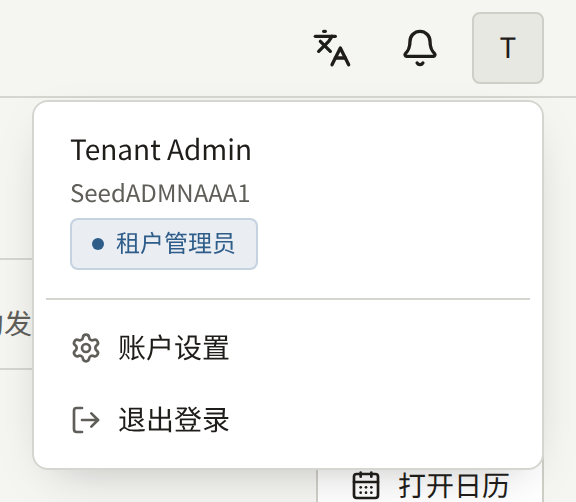
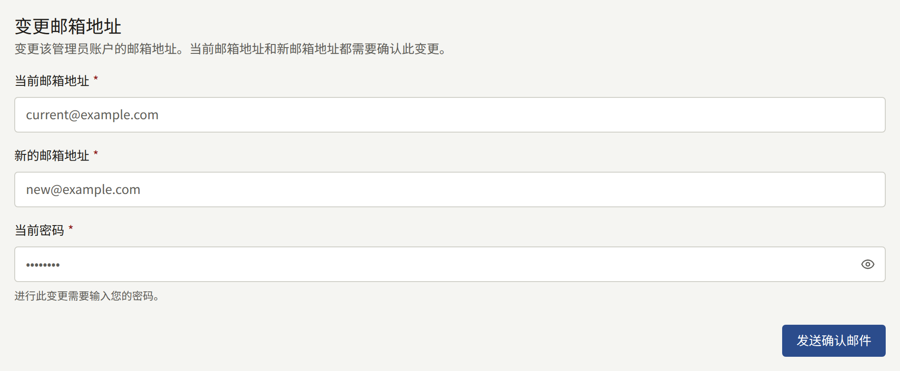
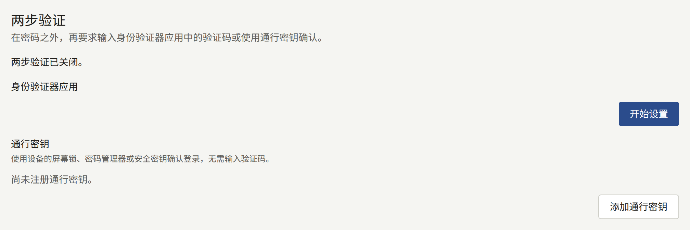
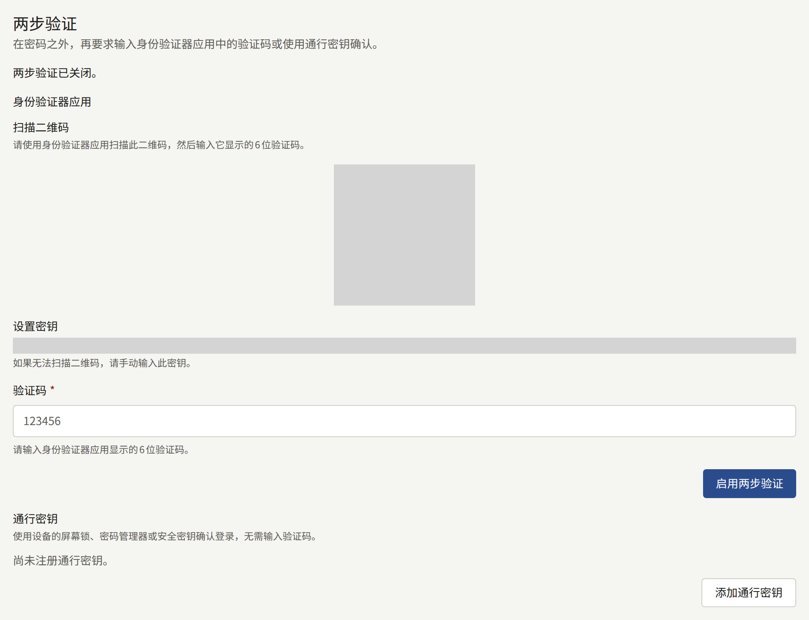
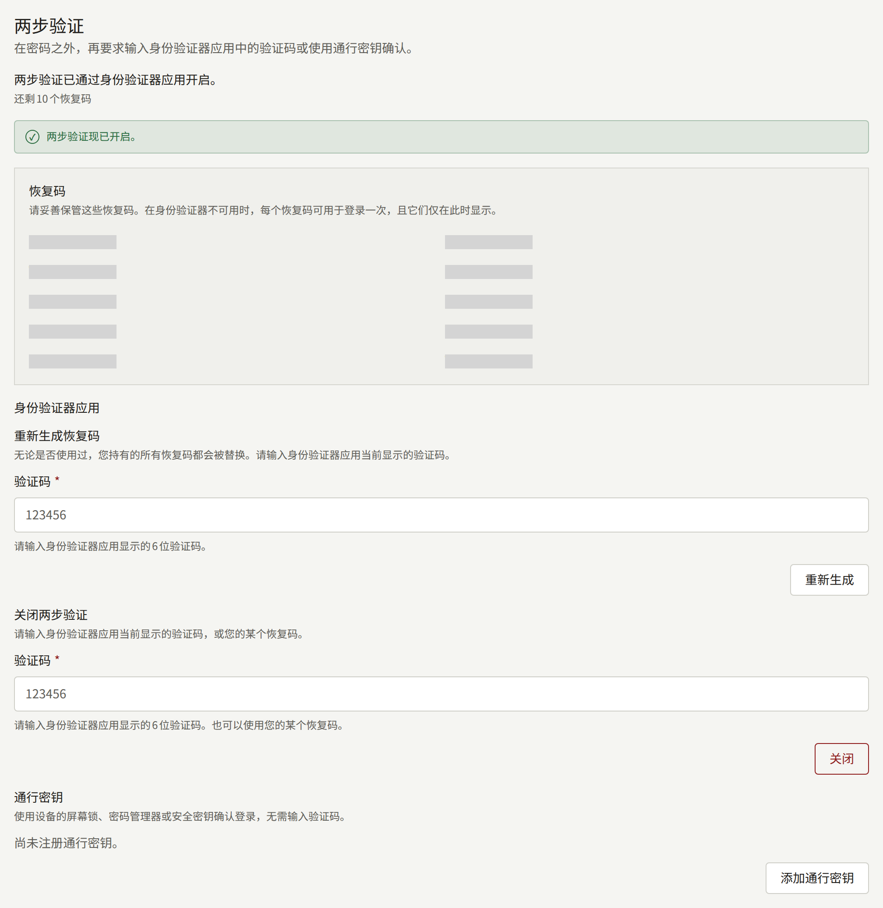

每位工作人员，无论其角色如何，都通过控制台顶部账户菜单中的**账户设置**管理自己的控制台账户。它有两张卡片：**变更邮箱地址**和**两步验证**。

控制台没有更改密码的页面。请退出登录，然后在登录页面上使用**忘记密码？**，系统会通过邮件向您发送一个用于设置新密码的链接。

## 更改电子邮件地址

在**变更邮箱地址**下，输入您的**当前邮箱地址**、**新的邮箱地址**和**当前密码**，然后选择**发送确认邮件**。

确认邮件会同时发送到两个地址，必须在各自的24小时内打开两个链接，更改才会完成。要求确认当前地址，可以防止只知道您密码的人将账户转移到其自己的地址。在两个链接都打开之前，您继续使用当前地址登录。两个链接都打开后，您将使用新地址登录，旧地址会收到地址已更改的通知。

新地址不得属于该租户上的其他账户，包括读者的账户。第二次请求会取代第一次请求，第一次请求的链接将失效。

由于您的控制台账户同时也是您在网站上的账户，此更改对两者都适用。

## 两步验证

两步验证会在密码之后要求第二项证明，因此仅凭被盗的密码无法登录。该证明可以是手机上身份验证器应用中的验证码，也可以是通行密钥。任何能读取二维码的身份验证器应用都可以使用，包括许多密码管理器内置的身份验证器。通行密钥通过设备的屏幕锁定、密码管理器或安全密钥解锁，无需输入任何内容。

**两步验证**卡片为两者各设一个部分：**身份验证器应用**和**通行密钥**。您可以使用其中任一种，也可以两者都用，卡片顶部的一行会说明其中哪些已开启。只要至少有其中一种，两步验证就处于开启状态。

运营人员可以要求安装实例上的每位租户管理员都使用两步验证。届时，尚未设置的租户管理员会在输入密码后、使用控制台之前被要求进行设置，**两步验证**也会显示“该租户要求管理员启用两步验证。”他们可以使用身份验证器应用或通行密钥来完成，如[使用通行密钥登录](#使用通行密钥登录)所述。编辑和审计员永远不会被要求使用，但可以自行开启。

### 设置身份验证器应用

1. 在**身份验证器应用**下，选择**开始设置**。
2. 用身份验证器应用扫描二维码。如果无法扫描，请手动输入旁边显示的**设置密钥**。
3. 在**验证码**中输入应用显示的六位数验证码，然后选择**启用两步验证**。
4. 如果该应用是您的第一个第二因素，控制台会显示十个**恢复码**。请将它们保存在手机以外的地方，例如密码管理器中或纸上。它们只会显示这一次。

从此以后，每次登录时，控制台都会要求输入应用中的验证码。输入密码后，您有五分钟时间输入验证码。输入五次错误的验证码后，账户会被锁定十五分钟。

### 添加通行密钥

1. 在**通行密钥**下，选择**添加通行密钥**。
2. 浏览器会请求为控制台创建通行密钥。请通过设备的屏幕锁定、密码管理器或安全密钥进行确认。
3. 如果该通行密钥是您的第一个第二因素，控制台会显示十个**恢复码**，与身份验证器应用的情况相同。请以同样的方式保存它们：它们只会显示这一次。
4. 在**为通行密钥命名**下，输入能让您知道该通行密钥保存在何处的**名称**，例如设备或密码管理器的名称，然后选择**保存**。**跳过**则不为其命名。

每个通行密钥都会连同其名称、添加时间以及最后一次用于登录的时间一起列出。**重命名**可以更改名称。您可以添加多个通行密钥，例如一个在手机上、一个在安全密钥上，其中任何一个都可以用于登录。保存在可同步的密码管理器中的通行密钥会自动同步到您的其他设备，因此只需添加一次。

如果某个身份验证器上已经保存了您账户的通行密钥，浏览器会拒绝在其上创建第二个通行密钥，控制台也会提示这一点。

### 移除通行密钥

选择通行密钥旁的**移除**并确认。之后它将无法再用于登录控制台。它会保留在您的设备或密码管理器中，直到您也在那里将其删除。

如果这是您的最后一个通行密钥，并且您没有身份验证器应用，两步验证将关闭，您的恢复码也会随之失效。当运营人员要求租户管理员使用两步验证时，控制台会拒绝移除租户管理员的最后一个第二因素：请先添加另一个通行密钥或设置身份验证器应用。

### 使用通行密钥登录

无论是在**账户设置**中还是在登录时添加了通行密钥，之后它都可以用于密码之后的那个页面。当运营人员要求租户管理员使用两步验证、而您尚未设置时，该页面会提供**设置身份验证器应用**和**设置通行密钥**。**设置通行密钥**会让浏览器为控制台创建一个通行密钥，您需要通过设备的屏幕锁定、密码管理器或安全密钥进行确认。然后，控制台会显示十个**恢复码**，与身份验证器应用的情况相同，在您保存好之后进入控制台。

从此以后，密码之后的页面会首先提供**使用通行密钥**。选择它，并在浏览器请求时解锁通行密钥：您即可登录，无需输入任何验证码。**改为输入验证码**会显示用于输入身份验证器应用验证码或恢复码的字段，**改为使用通行密钥**则返回。如果通行密钥是您唯一的第二因素，该链接会显示为**改为输入恢复码**。

通行密钥与验证码一样，须在同样的五分钟内完成验证，被控制台拒绝的通行密钥也会与错误的验证码一样计入同一锁定次数。浏览器提示无法使用通行密钥、您关闭了提示或提示超时，以及控制台无法识别的通行密钥，都会在页面上留下一条消息，并且验证码字段仍然只需点击一下即可打开。

当控制台在租户的域名或其子域名（例如`admin.<domain>`）上提供服务时，通行密钥属于该租户的域名；否则属于控制台自己的主机。如果运营人员更改了租户的域名，或将控制台移入或移出该域名，控制台将不再提供之前创建的通行密钥。如果您还有身份验证器应用，请使用它或恢复码登录。如果通行密钥是您唯一的第二因素，控制台会仅凭您的密码让您登录；如果您是运营人员要求使用两步验证的租户管理员，则会要求您重新设置。

### 恢复码

当您手边没有手机或保存通行密钥的设备时，恢复码可以代替应用或通行密钥使用一次。请在控制台要求输入应用验证码的地方输入恢复码；使用通行密钥登录时，则在**改为输入恢复码**下输入。之后，控制台会告诉您还剩多少个恢复码。这十个恢复码由账户上的应用和所有通行密钥共用。

**重新生成恢复码**会发放十个新的恢复码，并使之前的所有恢复码失效，无论是否已使用过。它永远不接受恢复码。设置了应用后，它位于**身份验证器应用**下，并要求输入应用中的验证码。如果通行密钥是您唯一的第二因素，它则位于**通行密钥**下：选择**使用通行密钥重新生成**，并在浏览器请求时解锁您的一个通行密钥。被控制台拒绝的通行密钥不会发放恢复码，您手中的恢复码保持不变，并且会与错误的验证码一样计入同一锁定次数。请在使用恢复码之后、重新拿回手机或通行密钥时进行此操作，或在您认为恢复码可能已被他人看到时进行。

### 关闭两步验证

**身份验证器应用**下的**关闭两步验证**会移除身份验证器应用。它会要求输入应用中的验证码或恢复码。您的通行密钥会保留，如果您有通行密钥，两步验证会凭借它们保持开启；要完全关闭，请同时移除每个通行密钥。如果运营人员要求租户管理员使用两步验证，在没有剩余通行密钥的情况下将其关闭的租户管理员，会在下次登录时被要求重新设置。

### 新设备或丢失的设备

在更换装有身份验证器应用的手机之前，请使用旧手机上的验证码登录，关闭两步验证，然后用新手机重新开启。有些身份验证器应用也可以自行将验证码迁移到新手机。

在更换保存有通行密钥的设备之前，请在新设备上添加通行密钥，并从列表中移除旧设备的通行密钥。保存在可同步的密码管理器中的通行密钥会随密码管理器一起迁移，无需任何操作。

如果您丢失了设备，请使用剩下的方式登录：另一个通行密钥、身份验证器应用或恢复码。然后移除丢失设备上的通行密钥，或关闭该设备上的身份验证器应用，使其不再被视为您的设备，再添加新设备。捡到该设备的人仍然需要您的密码才能登录，但移除它意味着对方永远无法进入第二步。

如果您丢失了所有第二因素和所有恢复码，您将无法再登录控制台，并且无论是您的密码还是任何工作人员，都无法从您的账户中移除两步验证。请联系安装实例的运营人员：他们可以将其移除，如[租户的工作人员](../../3-operations/3-tenant-staff.md#丢失两步验证)所述，之后您可以使用密码登录并重新设置。

两步验证的设置、通行密钥的登记、重命名和移除、两步验证的关闭、恢复码的重新生成，以及每次使用验证码、通行密钥或恢复码的登录，都会记录在租户的[审计日志](./8-audit-log.md)中。
