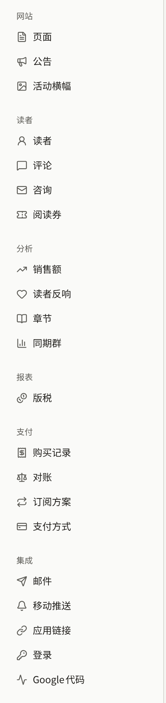

新租户起初只是一个空白网站。它只有运营人员选定的语言和时区、Publira的默认配色，没有标志，没有页面，不开放评论，管理员也只有运营人员邀请的那几位。本节各页带领租户管理员把它变成出版社自己的网站。涉及的大多数页面位于侧边栏的**管理**组中。网站的页面、公告和活动横幅位于**网站**下，租户自己的邮件服务器位于**集成** › **邮件**下。

从运营人员创建租户的那一刻起，网站就已在其域名上提供服务，控制台也没有在您操作期间将其隐藏的开关。提前找到该域名的读者会看到截至当时已保存的内容，因此请在宣布网站上线之前完成以下步骤。

## 首次操作的顺序

1. **为自己开启两步验证**：如果控制台尚未要求您开启，请从账户菜单中的**账户设置**进行操作。参见[您的账户](./9-your-account.md)。
2. **检查语言和时区**：在**设置**中检查。控制台和网站上的所有日期都以该时区显示。参见[设置](./1-settings.md#时区)。
3. **设定网站的外观**：在**品牌**中设置标志、浏览器图标、配色和字体。参见[品牌](./2-branding.md)。
4. **撰写并发布服务条款和隐私政策**：在**页面**中完成后，再到**设置** › **服务条款与隐私政策**中选择它们，读者注册时就会同意这些条款。参见[页面](./3-pages.md#服务条款和隐私政策)。
5. **填写其余的常规设置**：网站页脚和登录页面上的文案、是否允许读者评论、哪些年龄分级需要证明年龄，以及读者不能用哪些电子邮件地址注册。参见[设置](./1-settings.md)。
6. **决定由谁的邮件服务器发送租户的邮件**。在您于**集成** › **邮件**中设置自己的服务器之前，使用平台的邮件服务器。参见[邮件](./7-email.md)。
7. **邀请其他工作人员**：在**成员**中操作。参见[成员](./6-members.md)。

作品目录、支付、使用Apple和Google登录、Google代码以及应用在各自的页面中设置：本节中的[发布作品](../1-catalog/index.md)、[销售章节](../4-selling-episodes.md)、[通过Apple和Google登录](../7-sign-in.md)和[Google代码](../8-google-tag.md)，以及[移动应用](../../5-mobile-app/index.md)。

## 谁可以更改什么

租户管理员可以更改本节各页所述的全部设置，编辑可以更改网站的页面、公告和活动横幅。除此之外，编辑和审计员能看到部分页面但无法保存，其余页面则完全看不到：

| 页面 | 租户管理员 | 编辑 | 审计员 |
| --- | --- | --- | --- |
| **页面**、**公告**、**活动横幅** | 可更改 | 可更改 | 可查看 |
| **品牌**、**设置** | 可更改 | 可查看 | 可查看 |
| **成员**、**审计日志**、**集成** › **邮件** | 可更改 | 不显示 | 不显示 |
| **账户设置** | 自己的账户 | 自己的账户 | 自己的账户 |

## 本节内容

- [设置](./1-settings.md)：网站的文案、时区、默认语言、读者评论、年龄验证、服务条款和隐私政策、不接受的电子邮件地址、租户可以收紧的社区限制和保留期限，以及读者可以显示为头像的内容。
- [品牌](./2-branding.md)：标志、图标、主题配色、字体和预览。
- [页面](./3-pages.md)：网站自己的页面、页面的版本和翻译，以及读者需要同意的服务条款和隐私政策。
- [公告](./4-announcements.md)：向所有读者发布通知，以及显示在网站每个页面顶部的横幅。
- [活动横幅](./5-campaign-banners.md)：为网站首页顶部和应用作品目录顶部的图片横幅安排展示时间及顺序。
- [成员](./6-members.md)：邀请工作人员、更改其角色以及将其移除。
- [邮件](./7-email.md)：通过租户自己的SMTP服务器发送租户的邮件，以及在控制台中接收读者对咨询消息的回复。
- [审计日志](./8-audit-log.md)：控制台对工作人员操作的记录内容。
- [您的账户](./9-your-account.md)：更改电子邮件地址，以及两步验证。
