要在网站上销售章节，需要三样东西彼此吻合：租户控制台中章节的价格、支付服务商的账户，以及支付服务商用来告知安装实例读者已付款的Webhook。向读者扣款的是支付服务商，但只有Webhook才会让章节可以阅读。因此三者中任何一个设置有误，都会出现收了读者的钱、章节却仍然锁定的情况。本页按设置顺序逐一说明这三项，最后通过一次测试购买来确认三者吻合。

租户的应用可以通过同一个支付服务商销售，也可以通过App Store和Google Play自身的支付来销售。后者不需要支付服务商，购买改为向商店进行验证。[在应用中销售](#在应用中销售)说明如何选择。只在应用中通过商店销售的租户可以跳过有关支付服务商的各节。

本页中**支付** › **支付方式**和**支付** › **优惠码**下的所有操作都面向**租户管理员**；编辑和审计员看不到这些页面。章节的定价由创建该章节的人完成。

## 读者如何购买章节

### 价格与阅读期限

章节的**价格**和**阅读期限**首先在创建章节的表单中填写：

- **价格**以租户的货币填写，字段中会标明货币，小数位数不能超过该货币的小数位数：500日元填`500`，4.99美元填`4.99`。填`0`则章节免费；其他任何值都会使其成为付费章节。
- **阅读期限**是一次购买后章节可阅读的小时数。填`0`则永久可读。

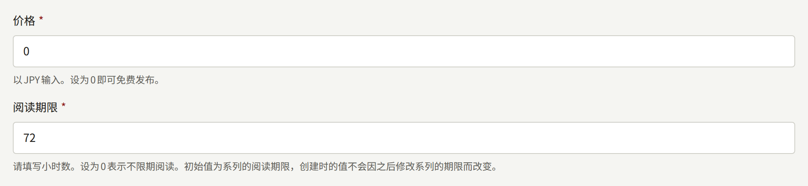

付费章节还可以租借：以低于**价格**的金额，在有限的时间内销售。**阅读期限**下方的两个字段用于设置租借，只有当**租借价格**填有金额时，章节才可以租借：

- **租借价格**与**价格**一样以租户的货币填写，并且必须低于**价格**，因此免费章节不能租借。留空则不租借该章节。
- **租借期限**是一次租借后章节可阅读的小时数，至少为`1`。**租借价格**为空时不使用该字段。

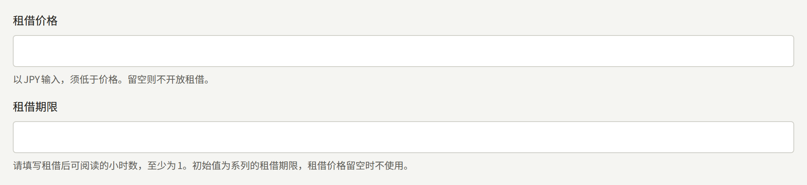

表单会拒绝租借价格等于或高于**价格**的设置，也会拒绝填写了**租借价格**却没有**租借期限**的设置，并指出需要更正的字段。租借并不取代永久购买：租借过章节的读者仍然可以购买它。

付费章节还可以在购买前开放开头的几页。租借字段下方的**试读页数**就是开放的页数，从第一页算起；初始值`0`表示不开放任何页面。只有**价格**大于`0`时才提供该字段，因为免费章节的所有页面都已开放。[试读页数](./1-catalog/2-episodes.md#试读页数)对此有详细说明。

这五项之后都可以在章节编辑页面的**价格与阅读期限**中更改，详见[章节](./1-catalog/2-episodes.md#更改价格和阅读期限)。如果想在有限时间内以较低价格销售章节而不更改其价格，可以为它预约[活动价格](./1-catalog/2-episodes.md#活动价格)。更改只适用于保存之后的购买；已经完成的购买或租借保留其支付时的价格和到期时间。新章节的**阅读期限**以系列的**阅读期限**为初始值，**租借期限**以系列的**租借期限**为初始值，因此只要在系列上设置一次，之后创建的每个章节都会使用相同的期限，除非在表单中修改。更改系列的期限不会影响已经创建的章节。

### 购买与阅读

在付费章节上，网站会显示价格和**购买本章**。在可租借的章节上，网站则会同时提供两种销售方式，并各自标明金额：按价格买断的“**以¥500购买**”，以及按租借价格在租借期限内阅读的“**租阅72小时（¥300）**”。已登录的读者选择其中之一后，会被转到支付服务商的结账页面，在那里付款，然后回到章节页面，页面会告诉读者正在确认付款。当支付服务商的付款通知到达安装实例时，章节才可以阅读，通常只需几秒钟。仅仅从结账页面返回本身不会打开任何东西。

租户有多个**就绪**的支付服务商时，读者可以选择通过哪一个付款。按钮上方的**支付方式**按照**支付设置**中卡片的顺序列出这些支付服务商，每个都显示名称和可用的支付方式：PAY.JP为**银行卡**，Stripe为**银行卡等**，Stripe的支付方式是您为账户开启的那些。在读者选择其他支付服务商之前，选中的是第一个，结账会交给所选的支付服务商。网站会在读者的浏览器中记住这一选择，因此读者下次在网站上购买时，也会从同一个支付服务商开始。卷、系列的剩余章节、代币包和打赏金额的上方也有同样的选择。只有一个支付服务商的租户不显示选择，每个按钮都直接前往该支付服务商。订阅方案也没有选择：如[选择支付服务商](#选择支付服务商)所述，它通过一个支付服务商销售。

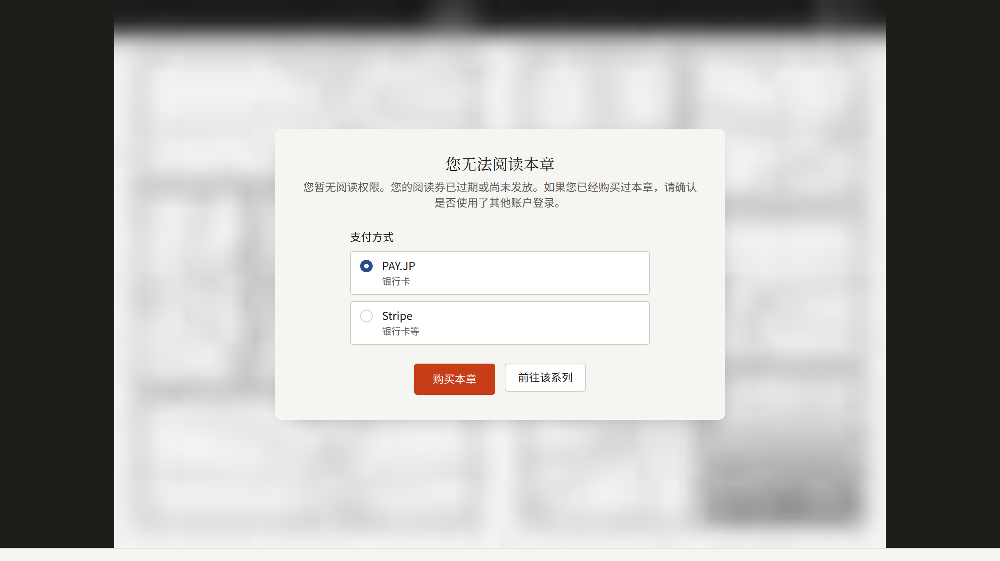

在设有[试读页数](./1-catalog/2-episodes.md#试读页数)的付费章节上，尚不能阅读该章节的读者，无论是否登录，都会先阅读这些页面。网站和应用都是如此，并且使用与章节其余部分相同的阅读器：按该章节的阅读方向，并按其版式组合成跨页。页码计数和进度滑块只计算试读页，例如在网站上为`Page 3 of 3`，在应用中为`3 / 3`。翻过最后一页试读页后，会显示**试读到此结束**，以及购买和该章节提供的其他阅读方式。没有试读页的付费章节，则在页面的位置显示同样的选项，背景是模糊处理的开头几页。读者在试读中读到哪里、是否读到了结尾都不会被记录，因此购买后章节会从第一页开始打开。

购买后，章节：

- 在其阅读期限内可读，租借则在租借期限内可读，均从购买被记录的那一刻起计算。
- 列在读者账户的**已购买**下，标明是购买还是租借，并显示租借的剩余时间；期限结束后列在**购买记录**下。
- 对同一账户而言，无论在哪里购买，在网站和租户的应用中都可以打开。
- 在可阅读期间不能再次购买。阅读期限结束后则可以。持有租借的读者仍可以购买永久版本，但在租借结束前不能再次租借。

**已购买**页面上的**下载CSV**会将列在那里的所有购买，跨越所有分页并包括已退款的购买，保存为一个CSV文件。在租户的应用中，**已购买**页面上的**导出CSV**会生成同样的文件并交给设备的分享面板，读者可以从那里保存或发送。

读者在网站上购买的租户代币包会列在**购买记录**下，以其发放的代币数量和租户对代币的称呼来命名，例如`1,100Points（含赠送100）`，并显示读者支付的金额以及是否已退款。代币包不会打开任何章节，也没有阅读期限：代币会自行过期。CSV中，它的`item`列为`coin_pack`，发放的代币（包括赠送部分）分别写在`coins`和`bonus_coins`中。

### 使用代币支付

如果租户销售自己的代币（平台允许租户发行代币，且租户已按[代币](./9-coins.md)的说明开启了代币），付费章节也会以代币标价：其价格（活动价格进行期间则为活动价格）除以一枚代币的价值，向上取整；租借也按同样方式计算。在网站上，章节会以租户对代币的称呼告诉已登录的读者其持有的代币数量；当代币足以支付价格时，会提供一个使用代币支付的按钮，例如**使用300积分购买**。点击后无需经过支付页面，章节立即可以阅读。

持有代币不足的读者，会在购买选项旁看到能补足差额的最小在售代币包，以及它的价格、其代币可以使用的天数和租户的披露事项。购买该代币包会将读者转到支付服务商的结账页面，然后返回章节，在支付服务商的通知发放代币后，读者即可用代币支付。如果没有足够大的在售代币包，章节会改为链接到读者的代币页面。仅在应用中销售的章节，不能在网站上用代币支付。

用代币支付的章节与其他购买一样：在其阅读期限内可读，租借则在租借期限内可读，并列在**已购买**下，以所花费的代币代替价格。CSV中，其`price`为`0`，所花费的代币写在`coins_spent`中。

**个人中心**会显示一个以租户对代币的称呼为标题的区块，其中有读者的余额、最早一批代币的过期时间，以及指向读者代币页面的链接。该页面列出在售的代币包，每个都附有价格和其代币可以使用的天数，下方是租户的披露事项；还会分页列出每一笔增加、花费、收回或过期的代币。在那里购买的代币包会将读者带回该页面。平台或租户关闭代币时，这些都不会显示。

### 系列的剩余章节

读者还可以在一次结账中，购买某个系列中自己尚未拥有的所有付费章节。系列页面会在章节列表上方提供“**以¥2,250购买剩余的5章**”这样的按钮，标明章节数量和合计金额，租户应用的系列页面也是如此。这次购买会像单独购买每个章节一样打开这些章节，每个章节按各自的阅读期限计算。

合计金额是这些章节价格之和减去系列的**打包优惠**；处于[活动价格](./1-catalog/2-episodes.md#活动价格)的章节，在活动进行期间按活动价格计算。打包优惠在系列的表单中设置，详见[系列](./1-catalog/1-series.md#打包优惠)：可以设为最多`99`的整数百分比，或设为新系列的初始值`0`，即按该合计金额销售。设有优惠时，购买选项会说明比逐个购买便宜多少，结账页面会在章节旁列出优惠。优惠后的价格向下取整到货币的最小单位；如果优惠后没有需要支付的金额，则不提供结账。对优惠的更改从下一次结账开始生效：在更改前已打开支付服务商结账页面的读者，按该页面显示的金额支付。

### 免费阅读期与等待即可免费

价格是在没有其他方式打开章节时读者需要支付的金额。还有两种方式可以打开章节，只要其中之一让某位读者可以阅读该章节，网站就不会向该读者提供购买：

- **免费阅读期**在章节上设置，在两个日期之间向所有人开放，无论是否登录。期间结束后价格重新适用。之前购买过该章节的读者保留其购买，其阅读期限在免费阅读期内照常计算。系列的[发布后免费](./1-catalog/1-series.md#发布后免费)规则会在每个付费章节发布后的指定天数，为其添加这样的期间。
- **等待即可免费**在系列上设置，向每位已登录的读者发放一张免费券，可以打开该系列中的一个付费章节，阅读时间为**章节可阅读的时间**；使用后经过**获得下一张免费券的时间**，会得到一张新券。**免费券不可阅读的最新章节数**会把最新的章节留给购买者。免费券不能用于处于免费阅读期的章节，也不能用于读者已经可以阅读的章节。

由工作人员在**阅读券**下发放的[阅读券](./2-readers/4-access-tickets.md)，同样可以不经付款打开章节。在章节上署名的作者可以免费阅读该章节，不会被提供购买。租户的[工作人员](../3-operations/3-tenant-staff.md#成员与用户)，无论是三种角色中的哪一种，只要使用持有该角色的账户登录网站或应用，就可以免费阅读所有已发布的章节。

### 价格中包含的税费

所有价格都是含税价：读者支付的就是输入的价格，结账时不会另加任何金额。租户管理员在[设置 › 税费与发票](./3-setup/1-settings.md#税费与发票)中设置“**税率（%）**”后，每笔购买都会记录购买时适用的税率以及其价格中包含的税费：价格减去不含税价格，其中不含税价格向下取整到货币的最小单位。税率为10%时，¥1,100的购买包含¥100，¥500的购买包含¥46。之后税率更改时，购买保留其已记录的内容；在未设置税率期间进行的购买不记录任何税费。

- **用代币支付的章节**按其代币的购买价记录税费，即版税明细计入的金额，详见[版税](./6-reports-and-royalties.md#作者应得的金额)。
- **代币包**不记录税费：其代币是预先支付的，税费记录在用这些代币支付的购买上。
- **在应用中通过App Store或Google Play进行的购买**与其他购买一样记录税费。由商店向读者收费并开具收据。
- **订阅付款**按Stripe收到该付款时适用的税率记录税费。

租户为网站上的购买发送的收据会注明税费和税率，例如“其中税额（10%）：¥100”，在输入之后还会注明租户的**开票名称**和**登记编号**，详见[邮件](./3-setup/7-email.md#经由它发送的邮件)。

设置了税率期间，网站提供的每个价格都会注明含税，例如`¥1,100 含税`：章节的价格及其活动价、购买或租阅章节的按钮上的价格、卷的价格、系列剩余章节的价格，以及订阅方案的价格。代币包不注明任何税费。在读者账户的**已购买**下，记录了税费的购买会以“**其中税额**”显示税费及其税率，例如`¥100（10%）`；输入之后，还会以“**开票方**”显示租户的**开票名称**，并显示其**登记编号**。通过App Store或Google Play进行的购买只显示税费，因为收据由商店开具。当文件中有记录了税费的购买时，**下载CSV**保存的文件会增加`tax_rate_percent`列和`tax_amount`列。

应用自身显示的价格同样会注明含税：章节的价格、购买和租借按钮上的价格、卷的价格，以及系列剩余章节的价格。由商店显示的价格不注明税费，例如商店付款面板上的订阅方案或打赏的价格，因为商店决定在读者所在国家收取的金额。在应用的**已购买**下，记录了税费的购买会显示税额，例如`其中税额¥100（10%）`，并在已填写时显示租户的**开票名称**和**登记编号**。通过App Store或Google Play进行的购买只显示税额，并说明收据由二者中的哪一方开具。**导出CSV**生成的文件也会增加与网站相同的两列。

## 选择支付服务商

租户通过在**支付** › **支付方式**的**支付设置**中添加的支付服务商在网站上收款，可以添加以下一个或多个：

| 支付服务商 | 读者可以使用的支付方式 |
| --- | --- |
| Stripe | 在Stripe控制台中为您的账户开启的支付方式，例如银行卡和便利店支付。使用便利店支付等事后付款的方式购买的章节，会在款项到账后打开。 |
| PAY.JP | 银行卡，每次付款都进行3-D Secure认证。 |

**添加服务商**用于添加租户尚未持有的支付服务商，不会改变其他支付服务商。此后，租户持有的每个支付服务商在**支付设置**下都有自己的卡片，显示它的状态、销售的内容、凭据、需要在它那里登记的**Webhook URL**、**保存**和**移除**。

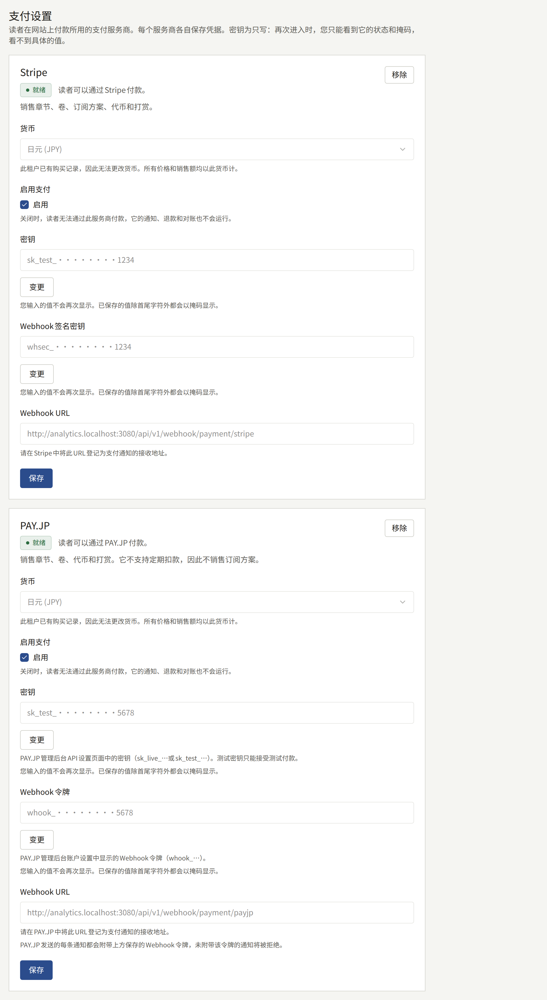

每个支付服务商都销售章节、卷、系列的剩余章节、代币和打赏。订阅方案通过支持定期扣款的支付服务商销售，Stripe支持，PAY.JP不支持；租户持有多个这样的支付服务商时，通过页面上其中第一个**就绪**的支付服务商销售。每张卡片都会注明它销售哪些内容。

款项以租户的货币收取，该货币可在任意一张卡片的**货币**中选择：所有价格都以它填写和显示，网站、应用和控制台都是如此，租户持有的每个支付服务商也都以它收款。**货币**提供该支付服务商以及租户持有的其他所有支付服务商都支持收款的货币（PAY.JP仅支持日元），在保存支付服务商之前，初始值为平台的默认货币，由安装实例的运营人员设置。不支持其他支付服务商所收货币的支付服务商，无法与它们一起添加，其表单会说明这一点。请在第一笔销售之前选择好货币：租户一旦有了购买，所有价格和销售都是以该货币计的金额，**货币**就无法再更改。

每张卡片上的状态显示该支付服务商进行到了哪一步：

- **未完成**：通过它的支付已开启，但缺少它所需的凭据，因此不会通过它扣款。
- **已停用**：**启用支付**处于关闭状态。
- **就绪**：读者可以通过它付款。
- **已移除**：它不会再发起新的结账，详见[移除支付服务商](#移除支付服务商)。

在任何一个支付服务商变为**就绪**之前，付费章节会显示价格，但没有购买的方式，并告诉读者网站目前无法接受购买；对于尚未添加任何支付服务商的租户，**添加服务商**上方的**未设置**会说明这一点。

请先使用支付服务商的测试密钥完成下面的设置，详见[上线前的测试](#上线前的测试)；在测试购买成功后，再替换为正式密钥。

### Stripe

在Stripe控制台中：

1. 从API密钥页面复制**secret key**。测试密钥以`sk_test_`开头，正式密钥以`sk_live_`开头。
2. 添加一个Webhook端点。其URL是在**添加服务商**中选择Stripe后，或添加Stripe后在其卡片上，控制台在**支付设置**下显示的**Webhook URL**，即租户自己网站域名上的`https://<tenant-domain>/api/v1/webhook/payment/stripe`。选择以下事件；如果租户销售订阅方案，还要加上[订阅方案](./5-subscription-plans.md#开始之前)列出的事件：
   - `checkout.session.completed`
   - `checkout.session.async_payment_succeeded`
   - `checkout.session.expired`
   - `charge.refunded`
   - `refund.updated`
   - `charge.dispute.created`
   - `charge.dispute.closed`
3. 打开该端点，复制其**signing secret**，它以`whsec_`开头。

然后在控制台的**添加服务商**中：

1. 选择Stripe作为**支付服务商**。
2. 填写**密钥**和**Webhook签名密钥**。
3. 在**启用支付**下勾选**启用**，然后选择**添加服务商**。

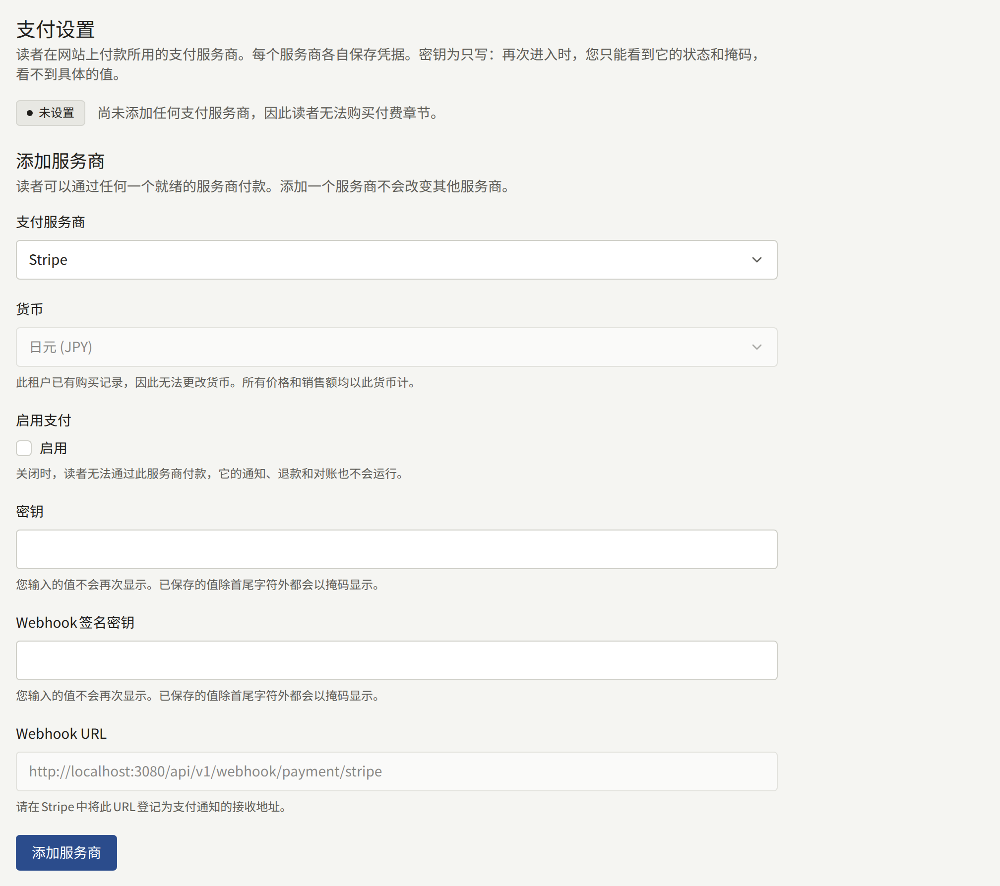

之后要更换某个密钥时，请在Stripe的卡片上选择它旁边的**变更**，填写新值，然后选择**保存**。

Stripe将测试模式和正式模式的Webhook端点分开管理，各自有自己的签名密钥。切换到正式密钥时，请在正式模式下再次添加该端点，并将其签名密钥与正式的secret key一起填写。

#### Stripe优惠码

读者也可以在Stripe的结账页面输入优惠码。这些优惠码在Stripe控制台中，在与secret key相同的账户和模式的优惠券下创建，控制台中无需任何设置：章节和卷的每次结账都接受优惠码。以打包优惠销售的系列剩余章节的结账则不接受，使用租户自己的[优惠码](#优惠码)开始的结账也不接受，因为Stripe对一次结账只会应用一种优惠，不会应用两种。

购买会记录扣除优惠码折扣后读者实际支付的金额，即读者**购买记录**中显示的金额和全额退款时退还的金额，并在旁边记录使用优惠码之前的价格，这才是章节作者获得版税所依据的销售额：促销是租户提供的，因此由租户承担。将价格全部抵扣的优惠码会在不付款的情况下打开章节，因此没有可以退款的金额。PAY.JP的结账页面本身不接受优惠码；租户自己的优惠码在PAY.JP上与在Stripe上一样有效。

### PAY.JP

在PAY.JP的控制台中：

1. 从API设置页面复制**secret key**。测试密钥以`sk_test_`开头，正式密钥以`sk_live_`开头，测试密钥只能进行测试付款。
2. 从账户设置中复制以`whook_`开头的**webhook token**。
3. 将在**添加服务商**中选择PAY.JP后，或添加PAY.JP后在其卡片上，控制台在**支付设置**下显示的**Webhook URL**，即`https://<tenant-domain>/api/v1/webhook/payment/payjp`，登记为PAY.JP发送通知的URL。上线前，也要为正式模式登记该URL。

然后在控制台的**添加服务商**中：

1. 选择PAY.JP作为**支付服务商**。
2. 填写**密钥**和**Webhook令牌**。
3. 在**启用支付**下勾选**启用**，然后选择**添加服务商**。

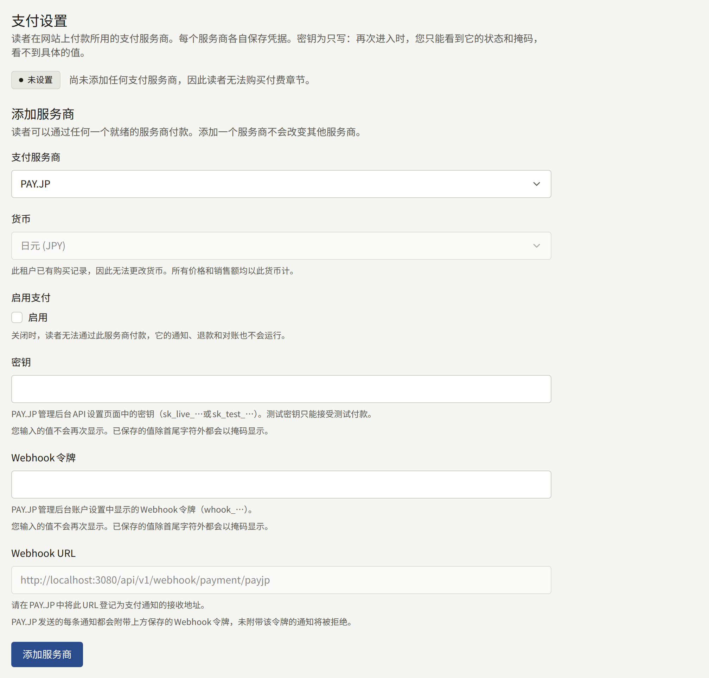

PAY.JP不对通知签名：安装实例因为通知携带了webhook token而信任它，并拒绝不携带的通知，因此请像保管secret key一样严格保管该令牌。

### 移除支付服务商

在支付服务商的卡片上选择**移除**并确认后，通过它的新结账会立即停止，其他支付服务商不受影响。该支付服务商会以**已移除**状态连同凭据一起留在页面上：读者在移除之前发起的结账仍可付款，它的通知、从**购买记录**进行的退款以及对它所收款项的对账都会继续运作，它收费的订阅也是如此。在它的卡片上选择**恢复**，即可重新通过它销售。

在已移除的支付服务商的卡片上选择**彻底删除**，会删除它及其凭据，前提是自移除起已满90天、它所收的款项都已无法再退款，并且它没有正在收费的订阅。在此之前，它会保持**已移除**状态，**彻底删除**也会说明这一点。90天是Stripe文档中所写的、等待无法与付款对应的银行转账的最长期限。

### 付款后章节没有打开时

支付服务商的控制台会列出向Webhook的每一次投递，以及安装实例返回的状态。每种状态对应一个原因：

| 状态 | 原因 | 处理方法 |
| --- | --- | --- |
| 2xx | 已接受。并非每个被接受的通知都会打开章节：对于便利店支付，Stripe会在读者付款之前发送`checkout.session.completed`，章节只有在付款后收到`checkout.session.async_payment_succeeded`时才会打开 | 在控制台中查看事件类型和付款状态。如果付款已完成而章节仍然锁定，读者可能是用另一个账户购买的。 |
| 400 | 控制台中的签名密钥或webhook token与支付服务商的不一致 | 填写正在发送通知的那个端点的值。 |
| 404 | 路径中没有指明支付服务商 | 按控制台显示的URL原样登记。 |
| 503 | URL指明的支付服务商不是**就绪**，或租户尚未添加它 | 完成上面的设置。支付服务商会重试投递。 |
| 没有投递 | Webhook未登记，或登记在了另一种模式下 | 在密钥所属的模式下登记。 |

两个支付服务商都会在一段时间内重试失败的投递，其控制台也可以重新发送。设置修正后，只要付款的通知到达，就会打开所支付的章节。

## 章节的销售位置

同一页面上的**销售位置**决定读者可以在哪里购买付费章节。**销售位置**提供：

- **网页和应用**：在网站和租户的应用中销售。
- **仅网页**：在网站上销售。应用会显示该章节在网站上销售，在网站上购买后即可在应用中打开。
- **仅应用**：在应用中销售。网站会显示该章节在应用中销售，向在应用中购买过的读者打开该章节，并链接到**App Store地址**和**Google Play地址**中填写的应用在各商店的页面。

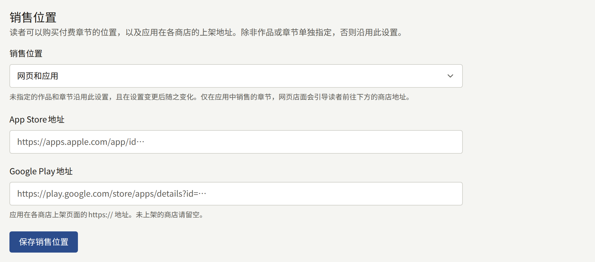

系列或章节可以设置自己的**销售位置**；未设置的则跟随系列或租户的设置，在它们更改后也是如此。章节只在它同时显示的位置销售。

之所以有这一选项，是因为应用商店。Apple和Google各自规定了应用销售数字内容的规则，在审核中判断应用是否遵守，并对应用通过它们售出的内容收取佣金。如下一节所述，通过商店自身支付在应用中销售的租户，需要为在应用中购买的每个章节支付这笔佣金，可以用**仅网页**让某个系列只在网站上销售。没有应用、或不在应用中销售的租户，为所有章节选择**仅网页**。

## 在应用中销售

**应用内购买**区块中的**应用的销售方式**决定租户的应用如何销售它可以销售的章节：

- **网页结账**在手机的浏览器中打开网站的结账页面，通过上面的支付服务商付款，付款后将读者带回章节。
- **应用内购买**使用App Store和Google Play自身的支付面板销售。由商店向读者扣款并收取佣金，上面的支付服务商不参与。

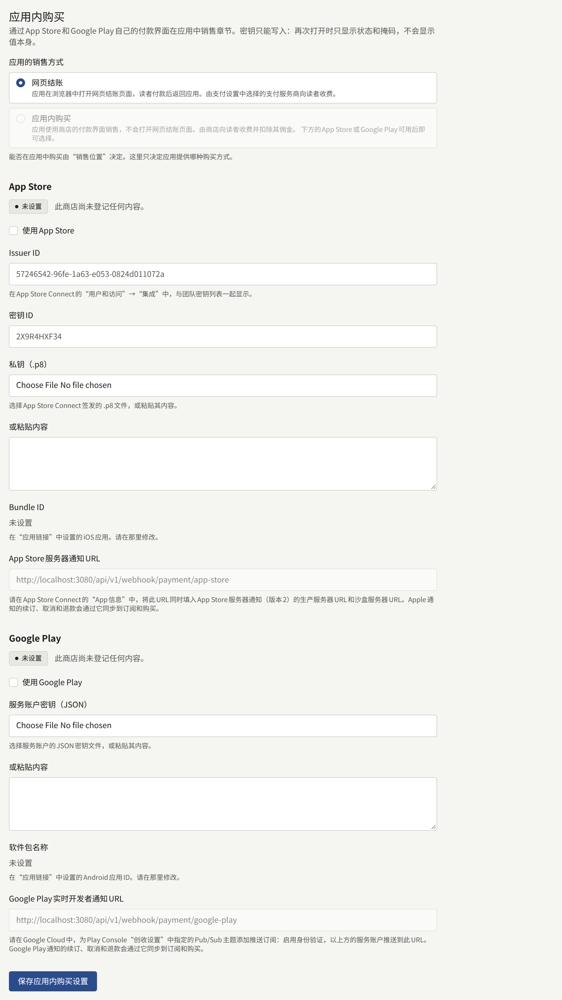

使用**应用内购买**时，应用不需要[选择支付服务商](#选择支付服务商)中的支付服务商：应用通过商店购买，安装实例向商店验证该购买。

对于**仅应用**销售的章节，只有当应用可以销售它时，网站才会显示该章节在应用中销售并链接到商店：使用**网页结账**时，需要有支付服务商处于**就绪**状态；使用**应用内购买**时，需要有商店处于**可用**状态，并且只链接到处于该状态的商店页面。在此之前，网站会标出章节的价格，并告诉读者无法接受购买。以**网页和应用**销售的章节，在有支付服务商处于**就绪**状态时在网站上购买；没有支付服务商就绪而应用可以销售时，网站会将其视同**仅应用**销售的章节。

至少有一个商店处于**可用**状态后，才能选择**应用内购买**：即已通过**使用App Store**或**使用Google Play**开启、填写了密钥，并在**集成** › **应用链接**中指定了应用。

应用以按价格命名的商店商品购买每个章节，例如¥300的章节为`episode_300`，因此商店只能销售已有对应商品的价格。在[活动价格](./1-catalog/2-episodes.md#活动价格)销售期间，价格以活动价格为准：从¥500降价到¥300的章节会作为`episode_300`购买，并按¥300记录。[优惠码](#优惠码)也是如此：¥500的章节使用优惠10%的优惠码购买时，会作为`episode_450`购买。页面底部的**商店商品**列出了应用销售的每个价格所需的商品ID，包括已预约或正在进行的每个活动的价格，以及这些价格各自减去适用于该章节、且未暂停、未删除、未过结束时间的每个优惠码的折扣后的价格，尚未开始的优惠码也包括在内。它按章节的每个价格计数。请在App Store Connect和Play Console中，将每个商品创建为该价格的消耗型商品；每当列表中出现新的价格时就添加一个，活动价格在预约时、优惠码在创建时就会出现，因此可以在其开始前准备好商品。将价格全部抵扣的优惠码不需要商品，因为这样的购买不经过商店记录。折扣后的价格不在列表中的优惠码，应用会拒绝。

接受[打赏](#打赏)期间，每个打赏金额也会列在那里，位于各价格下方，以`tip_`加金额表示，例如¥300的打赏为`tip_300`，同样以该金额创建为消耗型商品。

每个在售的代币包也列在那里，以`coins_`加代币包的ID表示，并附有它发放的代币和赠送代币，同样以代币包的价格创建为消耗型商品。商店显示的商品名称是您在App Store Connect和Play Console中设置的名称，而不是Publira发送的名称，因此请在应用上架的每种语言中，用您对代币的称呼为每个代币包的商品命名。

在其下方的**订阅方案**中，列出了每个指定了**App Store商品ID**或**Google Play商品ID**的[订阅方案](./5-subscription-plans.md#创建方案)，附有每期收费金额和各商店的商品ID；没有为某个商店指定ID时显示**不销售**。订阅方案不是消耗型商品：请在App Store Connect中将其创建为订阅群组内的自动续期订阅，在Play Console中创建为带有基础方案的订阅，价格和计费周期与方案一致。ID在方案上填写，列表会随之更新。

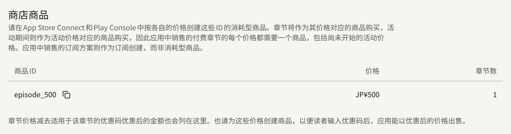

每个商店需要什么，从安装实例用来验证购买的密钥到使用商店的测试买家进行测试，以及应用本身的设置，都在[应用内购买和登录](../5-mobile-app/5-purchases-and-sign-in.md#在应用中销售章节)中说明。来自App Store沙盒或Play许可测试人员的购买会打开章节，但会被记录为测试，不计入版税明细和内容统计。

读者在应用中保存的章节，在应用最后一次在线打开它之后的七天内，即使没有网络也可以在该设备上继续打开，因此退款会在这段时间内、而不是立即让已保存的章节无法阅读，详见[离线阅读](../5-mobile-app/7-offline-reading.md#付费章节离开安装实例七天)。下次应用在线打开它时，章节会被锁定并从设备上删除。

### 在应用中输入优惠码

读者在应用中输入优惠码的位置与网站相同：锁定的章节，以及系列的卷区域。在卷区域输入一次，优惠码就会应用于所有仍可购买的卷。只要租户持有既未暂停、未删除、也未结束的优惠码，已登录的读者就会在这些位置看到**优惠码**和**使用**。游客登录后即可看到。使用**应用内购买**时，商店不销售卷，因此卷区域不显示输入框；一次购买系列剩余章节的优惠不能使用优惠码。

优惠码适用的每个按钮都会显示优惠后的价格，旁边以删除线显示优惠前的价格，优惠码不适用的按钮保持原价。使用**网页结账**时，按钮会在手机的浏览器中以这个价格打开网站的结账页面。使用**应用内购买**时，按钮会打开商店中这个价格的商品的支付面板；优惠码免除全部价格时不会打开支付面板。屏幕打开期间应用会保留优惠码，直到计算优惠所依据的活动价格结束；清空输入框后再次选择**使用**即可取消。

无法使用的优惠码会被拒绝，并在输入框下方显示[优惠码被拒绝时](#优惠码被拒绝时)所列的原因，按钮保持原价。使用**应用内购买**时，商店没有优惠后价格的商品的优惠码也会被拒绝，应用会提示读者到可以使用该优惠码的网站上使用。

应用的**已购买**会在读者支付的金额旁以删除线显示优惠前的价格，并注明所用的优惠码。

## 打赏

读完章节的读者，可以在章节末尾从租户设定的金额中选择一个打赏给该章节的作者，网站和应用中均可打赏。是否接受打赏以及可打赏的金额，在位于**应用内购买**与**商店商品**之间的**打赏**部分中设置：

- **接受给作者的打赏**开启后，会在每个章节末尾提供这些金额。关闭后不再提供打赏，金额会保留，供再次开启时使用。
- **打赏金额**最多可填写6个以租户货币计的金额，每个均须大于0，每栏一个。**添加金额**会添加一栏，栏旁的按钮会删除该栏；在一栏中粘贴多行时会按行分成多栏。金额按从小到大的顺序提供给读者，**保存打赏设置**也按此顺序保存。

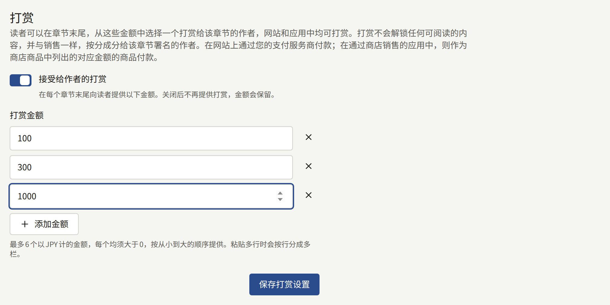

表单不接受第7个金额、重复输入的金额和0，也不接受在没有金额的情况下开启打赏，并会在**打赏金额**下方说明需要更正的地方。每次保存都会在**审计日志**中记录为**更新了打赏设置**。

打赏不会解锁任何可阅读的内容。打赏与章节的销售一样，按分成分给该章节署名的作者，并在其版税结算单中单独成行，因此可以区分打赏与销售。[优惠码](#优惠码)不适用于打赏。

打赏的付款方式与购买该章节相同：

- **在网站上**，通过支付服务商付款，因此网站只在支付服务商处于**就绪**状态期间接受打赏，如[选择支付服务商](#选择支付服务商)所述。
- **在应用中**，选择**网页结账**时在手机浏览器中通过同一支付服务商付款；选择**应用内购买**时，则通过商店，作为**商店商品**中列出的对应金额的商品付款。对于商店中没有对应商品的金额，应用会告知读者无法在应用中打赏，因此添加金额时，请在App Store Connect和Play Console中创建对应商品。

在网站上，读者翻过章节的最后一页后，会在回应按钮旁看到**打赏作者**。它会打开一个对话框，列出该章节的作者，并将租户的每个金额显示为一个按钮，按下按钮后读者会前往支付服务商的结账页面；租户有多个**就绪**的支付服务商时，前往的是在金额上方的**支付方式**中选择的那一个。未登录的读者会先登录，然后回到该章节。从结账页面返回后，章节会向读者致谢，打赏在支付服务商的通知到达安装实例时记录。无论持有什么，读者都可以再次打赏同一章节。该章节署名的读者不会看到打赏，其尝试打赏也会被拒绝。

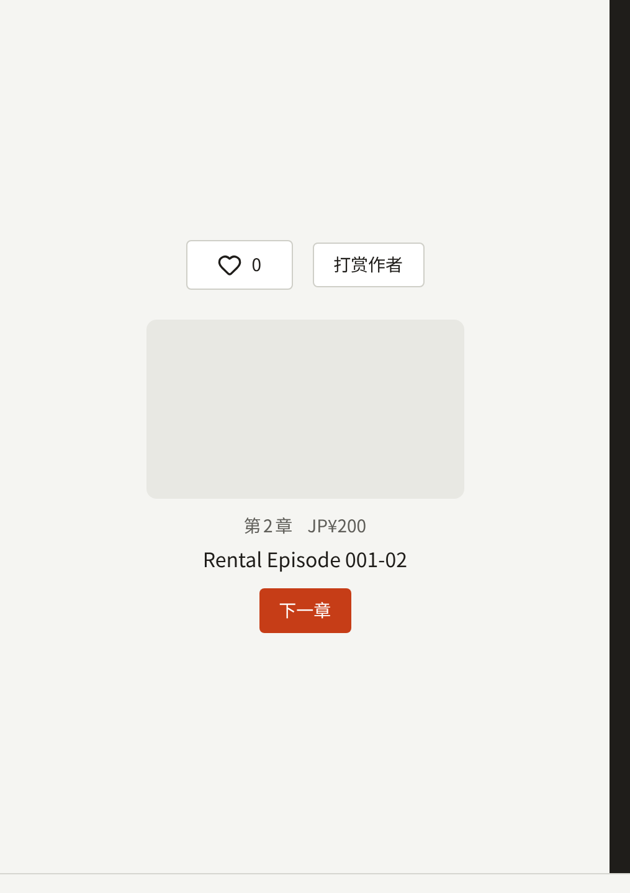

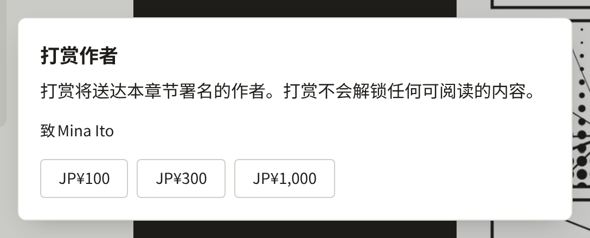

**购买记录**会在打赏的章节下将其列为**打赏**，并显示打赏金额，没有阅读期限。**下载CSV**会在`item`列写入`tip`，并填写该章节的各列。

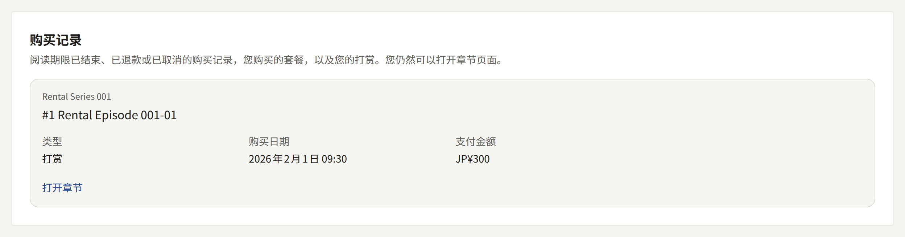

**支付** › **购买记录**会在章节下方将打赏标示为**打赏**，其退款方式与购买相同，如[从控制台退款](#从控制台退款)所述。正如退款的销售会从作者的销售中扣除，退款的打赏也会从作者的打赏中扣除。

在支付服务商的测试模式下、通过App Store沙盒或Play许可测试人员支付的打赏，与购买一样记录为测试，并排除在版税结算单之外。

## 优惠码

租户自己的优惠码是读者在购买章节或卷时输入、用于获得折扣的一个词。安装实例会在请求支付服务商或商店之前扣除折扣，因此支付服务商或商店按折扣后的价格扣款，并不知道优惠码的存在：优惠码在Stripe、PAY.JP、App Store和Google Play上同样有效，无需在其中任何一处进行设置。优惠码在**支付** › **优惠码**中发放，只有租户管理员能看到该页面。

### 优惠码包含的内容

- **优惠码**是读者输入的内容：1至32个字母和数字，不含空格。读者输入时不区分大小写，控制台以大写显示。租户中未删除的两个优惠码，无论大小写，都不能拼写相同。
- 折扣为**按比例优惠**，即价格的1到100之间的整数百分比，计算结果向下取整到货币的最小单位；或为**按金额优惠**，即以租户货币计的金额。折扣从读者购买时章节或卷的售价中扣除，在[活动价格](./1-catalog/2-episodes.md#活动价格)销售期间则从活动价格中扣除，且不会使价格低于零：`100`%，或等于或高于价格的金额，会使这次购买免费。
- **适用对象**为**全部作品**、一个书系、一个系列、一卷或一个章节。优惠码适用于购买章节、租借章节和购买卷，不适用于系列的剩余章节、订阅方案、代币包或打赏。用于书系或系列的优惠码同样适用于其中的章节和卷。用于卷的优惠码适用于购买该卷，不适用于逐章购买其中的章节；用于章节的优惠码适用于该章节，不适用于收录它的卷。如果优惠码的书系、系列、卷或章节之后被删除，该优惠码将不适用于任何内容。
- **开始时间**和**结束时间**是优惠码生效的时间，按租户的时区计。任一项留空即表示不设该界限。
- **总使用次数**是该优惠码总共可用于多少次购买，**每位读者**是一位读者可以用它进行多少次购买。任一项留空即表示不设上限。

优惠码创建后，优惠码本身、折扣和适用对象就固定下来。要更改这些内容，请删除该优惠码并创建另一个，新的优惠码可以使用相同的名称。**开始时间**、**结束时间**和两个上限可以随时更改。

### 创建优惠码

1. 打开**支付** › **优惠码**，选择**创建优惠码**。
2. 填写**优惠码**。
3. 选择**按比例优惠**并填写**比例**，或选择**按金额优惠**并填写**金额**。
4. 在**适用对象**下选择优惠码的适用对象。书系或系列直接选择；卷或章节需要先选择其所属的系列，再选择卷或章节。
5. 根据需要设置**开始时间**、**结束时间**、**总使用次数**和**每位读者**，然后选择**创建优惠码**。

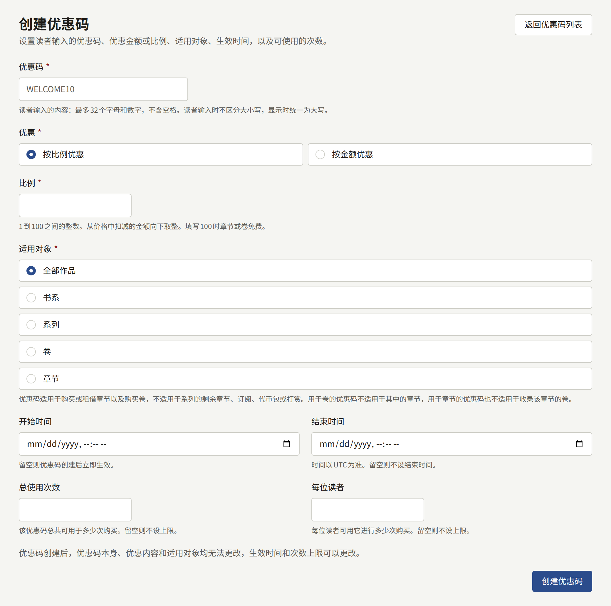

以下情况表单会拒绝提交，并在字段旁说明原因：与租户的其他优惠码拼写相同的优惠码、包含字母和数字以外字符的优惠码、1到100范围之外的比例、为零的金额、早于或等于**开始时间**的**结束时间**，以及在打开表单后被删除的书系、系列、卷或章节。创建后，该优惠码会在列表旁打开。

### 查看、暂停和删除优惠码

列表按从新到旧显示每个优惠码，附有其折扣、适用对象、有效期、已用于多少次购买及其上限，以及状态：

- **有效**：读者可以使用。
- **已安排**：尚未到达其**开始时间**。
- **已暂停**：已被暂停，在恢复之前会被拒绝。
- **已结束**：已过其**结束时间**，无论是否已暂停。

**查看**会在列表旁打开一个优惠码，显示其条件，下方是**使用记录**：它打过折的每笔购买，按从新到旧排列，附有读者、购买的内容、使用优惠码之前的**价格**、读者的**实付金额**以及时间。点击标题会在**购买记录**中打开该笔购买，其中显示相同的**价格**和**实付金额**，以及所使用的**优惠码**。

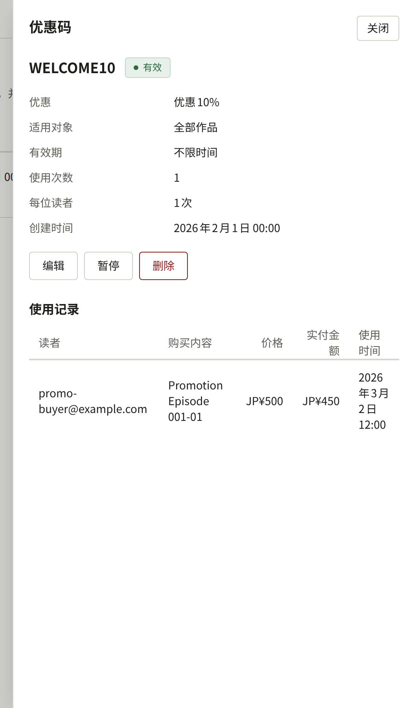

- **编辑**可以更改**开始时间**、**结束时间**、**总使用次数**和**每位读者**，不能更改其他内容。
- **暂停**会像拒绝不存在的优惠码一样，对所有读者拒绝该优惠码，直到**恢复**让它重新可用。已暂停的优惠码保留其名称。
- **删除**在您确认后，从此拒绝该优惠码，并释放其名称供其他优惠码使用。它打过折的购买及其使用记录保留其名称。已删除的优惠码无法恢复。

创建、编辑、暂停、恢复和删除优惠码，都会分别记录在**审计日志**中。

### 在网站上输入优惠码

读者在要购买的章节页面上输入优惠码，也可以在系列的卷区域输入一次，优惠码会应用于列出的所有卷。只要租户持有既未暂停、未删除、也未结束的优惠码，已登录的读者就会在章节的购买按钮下方和卷列表上方看到**优惠码**。游客登录后即可看到，没有此类优惠码的租户不会显示输入框。一次购买系列剩余章节的优惠不能使用优惠码。

读者输入优惠码并选择**使用**后，优惠码适用的每个按钮都会显示优惠后的价格，旁边以删除线显示优惠前的价格。该按钮会以这个价格开始结账：付款页面按此金额收费，且不提供自己的优惠码输入框。优惠码不适用的按钮保持原价。重新加载页面后，已使用的优惠码仍然有效；清空输入框后再次选择**使用**即可取消。

从章节的付款页面返回后，章节页面会显示读者支付的金额，旁边以删除线显示优惠前的价格，并注明所用的优惠码。无论购买的是章节还是卷，**已购买**中的**购买记录**都会显示相同的内容。

### 优惠码被拒绝时

无法使用的优惠码会在读者付款之前被拒绝，并在输入框下方告知读者原因：

- 租户中没有这样拼写的优惠码，或者该优惠码已删除、已暂停或尚未开始。
- 该优惠码已结束。
- 该优惠码不适用于读者正在购买的内容。
- 该优惠码已达到其**总使用次数**，或者该读者用它进行的购买已达到**每位读者**允许的次数。
- 读者在短时间内输入优惠码的次数过多，此时会提示读者稍后再试。

### 优惠码被使用时

优惠码在其购买被记录时才算被使用，而不是在读者开始结账时，因此读者放弃的结账不会消耗任何次数。上限在结账开始时检查，因此在优惠码达到上限时已经开始的结账仍然可以完成，优惠码的使用次数可能会超过其上限。

将价格全部抵扣的优惠码会立即记录购买，不进行付款，也不显示付款页面：读者确认后章节或卷立即打开，该购买在**购买记录**中显示为**未付款**。因此没有可以退款的金额。

章节的作者按使用优惠码之前的价格获得版税，详见[版税](./6-reports-and-royalties.md#作者应得的金额)：促销是租户提供的，因此由租户承担。在应用中使用优惠码的购买与其他购买相同，其折扣后的价格所需的商店商品在[在应用中销售](#在应用中销售)中说明。

## 退款

网站上的购买可以按[从控制台退款](#从控制台退款)的说明在控制台中退款，也可以在Stripe或PAY.JP的控制台中退款。无论哪种方式，支付服务商通知退款后，网站都会像发送收据一样以租户的名义向读者发送邮件，不受读者通知设置的影响。邮件会写明所购买的内容、退款金额、此前已有退款时相对于支付金额的累计退款，以及退款是否会关闭章节。通过App Store或Google Play的购买由Apple或Google退款，并由它们自行通知读者，网站不会为此发送邮件。

- **全额退款**会让读者无法再阅读该章节。该购买仍留在读者的**购买记录**中，标记为**已退款**，读者可以再次购买该章节。
- **部分退款**会让章节保持可读，直到该笔付款的退款累计达到读者支付的金额。它仍会减少章节作者获得版税所依据的销售额。

使用[优惠码](#优惠码)打折的购买，无论是租户自己的优惠码，还是在[Stripe的结账页面](#stripe优惠码)输入的优惠码，最多退还读者支付的金额。其作者按使用优惠码之前的价格获得版税，因此退还其中一部分时，会从作者的销售额中扣除该价格的同等比例：退还读者支付金额的一半，就扣除使用优惠码之前价格的一半。因优惠码而免费的购买没有收取任何款项，因此没有可以退款的金额，控制台也不为其提供退款。

每笔退款都以其购买到达的方式到达安装实例：

- **Stripe和PAY.JP**通过上面的Webhook报告退款，这也是Stripe的端点需要`charge.refunded`的原因。支付服务商已接受的退款之后仍可能失败，例如读者的银行卡已被注销；支付服务商也会报告这种情况（在Stripe上通过`refund.updated`），这时章节会重新对读者开放，除非仍然有效的退款累计仍达到读者支付的金额。
- **App Store**将退款报告到控制台在**App Store**区块中显示的**App Store服务器通知URL**，该URL需要在App Store Connect中同时登记为Production和Sandbox的Server URL。
- **Google Play**通过[应用内购买和登录](../5-mobile-app/5-purchases-and-sign-in.md#各商店为应用内购买所需的内容)中说明的Pub/Sub推送订阅，将退款报告到控制台在**Google Play**区块中显示的**Google Play实时开发者通知URL**。安装实例还会每小时读取一次Google Play最近30天的已作废购买，以应用通知始终未到达的退款；没有通知时，已退款的购买最多可能让章节继续可读一小时。这项读取在`publira worker`中运行，运营人员需要按[概览](../2-deployments/1-overview.md)的说明保持其运行。

早于其所冲销的购买到达的退款会被保留，并在该购买被记录时应用。

### 从控制台退款

**支付** › **购买记录**按从新到旧列出租户的购买，可以按读者的邮箱地址、系列、章节以及购买日期（按租户的时区）筛选。**查看**会在列表旁打开一笔购买，显示读者支付的金额、支付的渠道，以及迄今为止已退款的金额。记录了[税费](#价格中包含的税费)的购买，在列表中会在其金额下方显示税费，例如**含税¥100**；在列表旁则显示为**其中税额**，并附有税率。租借会在章节下方标示为**租借**，[打赏](#打赏)标示为**打赏**。只有租户管理员能看到该页面。

代币包的购买在那里以其发放的代币表示，使用租户默认语言中对代币的称呼，并且不属于任何系列，因此按系列或章节筛选时不会显示。它的退款方式与其他购买相同，只是总是全额退款，所以对话框不会要求填写金额。在支付服务商报告全额退款或对该笔付款的争议之前，代币包的代币一直留在读者手中；报告之后，代币包剩余的代币会被收回，读者已经花掉的部分被记录为欠款，并从其购买的下一个代币包中扣除。用这些已花掉的代币支付的章节仍然可读，其每笔购买都会将这些代币的价值显示为已退款。

用代币支付的章节购买，在其他购买显示支付服务商的位置显示**使用代币支付**，价格则显示所花费代币的价值，这也是其作者获得版税所依据的销售额，详见[版税](./6-reports-and-royalties.md#作者应得的金额)。读者看到的是自己花费的代币，而不是价格。

**退款**会在您填写理由后，请求读者付款时使用的支付服务商退还以租户货币计的**退款金额**；理由会与退款一起记录在审计日志中。金额的初始值是可退款的全部剩余金额，在您修改金额时，对话框会说明章节对读者是保持可读还是变为不可读。

- **全部剩余金额**会立即让读者无法阅读该章节，在支付服务商通过Webhook报告退款之前，购买显示为**已申请退款**，报告之后显示为**已退款**。支付服务商拒绝的退款，或在支付服务商接受后失败的退款，会让章节重新对读者开放。
- **少于全部剩余金额**会让章节对读者保持可读。在支付服务商报告退款之前，购买显示为**已申请退款**，旁边附有金额；报告之后显示为**部分退款**，该金额会计入已退款金额。在此之前，这笔购买只能以相同的金额再次退款，这就是请求未到达支付服务商时重新请求的方法。支付服务商拒绝的退款会撤回该请求。支付服务商报告之后，如需让章节不可读，请按上面的方式退还剩余金额。

对于在应用中进行的购买、读者已向银行提出争议的购买，或通过租户已不再使用的支付服务商支付的购买，控制台不提供退款：请在读者付款的地方为这些购买退款。用代币支付的购买也不提供退款，因为它没有收取任何款项：钱属于代币包，退还代币包才能将其收回。

## 争议

当读者就Stripe的付款向银行提出争议时，Stripe会通过同一个Webhook报告，这也是其端点需要`charge.dispute.created`的原因。争议一提出，章节就对读者关闭，无论银行之后如何裁定；该购买仍留在读者的**购买记录**中，标记为**已取消**。请在Stripe控制台中回应争议；控制台中无需任何操作。

银行的裁定只影响版税明细，版税明细通过`charge.dispute.closed`得知裁定结果：

- 裁定对您有利时，款项留在您这里，因此该购买仍算作销售。章节对读者保持关闭。
- 裁定对您不利时，款项退还给读者，因此该购买与全额退款一样不再算作销售。如果购买所在的月份已经结算，下一份明细会将其作为调整收回，就像[版税](./6-reports-and-royalties.md#结算后的退款)中对退款的说明一样。

## 放弃的结账

未付款就离开支付页面的读者可以随时重新开始购买。Stripe报告放弃的结账已过期后（这也是其端点需要`checkout.session.expired`的原因），读者下次尝试时会打开新的支付页面，而不是已过期的页面。

## 与支付服务商对账

版税明细和**销售额**只计算安装实例记录的购买，不计算其他任何东西。始终未到达的通知、没有匹配到购买的退款，或应用始终未确认的商店购买，都会让这些数字与支付服务商或商店实际收取的金额不一致。对账会在按您的日期计算的一段期间内比较双方，并列出在另一方没有匹配项的每一行。它使用**支付** › **支付方式**中保存的凭据读取支付服务商和商店的记录，不会更改其中的任何内容，也不会更改购买：如何处理每一行由您决定，在支付服务商的控制台或在控制台中处理。

**支付** › **对账**是开始和查看对账的地方，只有租户管理员能看到。用**开始**和**结束**选择日期，初始值为上一个完整的月份，最晚到今天，然后选择**对账**。

对一段期间的对账会针对租户每个处于就绪状态的来源进行：其支付服务商、App Store和Google Play，各自作为一次单独的运行。worker进程会在几秒钟内接手一次运行，在读取完该来源在该期间的记录后完成，对于业务繁忙的租户的较长期间，这需要一段时间。再次对同一期间对账会替换该期间的上一次运行，除非上一次尚未完成。

列表显示每次运行及其状态：**等待中**、**进行中**、**已完成**或**失败**，在有未完成的运行时会自动刷新。完成的运行会统计该来源在该期间记录的付款数、在该期间记录的购买数、两者中匹配的数量，以及剩余的发现项。失败的运行会说明原因：来源的凭据未保存或被拒绝，这需要先在**支付** › **支付方式**中修正，然后再次对账；或者无法读取来源，之后对该期间的运行可能会成功。

每个来源都在其保存记录的地方读取：

- **Stripe**：账户的余额交易，每笔都按购买记录的payment intent匹配。支付[订阅方案](./5-subscription-plans.md)账单的付款不是购买，不包括在内。
- **PAY.JP**：账户的付款流水，以及针对它们的退款。
- **App Store**：在该期间租户有App Store购买的每位客户的交易历史。Apple按客户保存历史，没有整个应用的历史，因此如果某位客户的所有购买都未被应用记录，对账就看不到该客户的购买。
- **Google Play**：租户在该期间的每笔Google Play购买及其订单，以及Google Play的已作废购买。Google Play不列出其他购买，并且只将已作废的购买保留30天，因此应用未能记录的购买只有在这段时间内被退款时才会出现。

一次运行会将以下各行列为发现项：

- **无购买记录的付款**：来源收取了付款，但没有购买记录它。付款通知始终未到达安装实例时就是这种情况。该行会给出来源自己的付款ID，在Stripe上是payment intent，在PAY.JP上是付款流水，在App Store上是交易，在Google Play上是购买令牌，以便在来源的控制台中找到它。
- **无付款记录的购买**：该期间的一笔购买，来源中没有其记录。
- **金额不一致**：购买与其付款在金额、货币或已退款金额上不一致。商店以读者自己的货币向读者收费，因此对于商店，只有在以租户的货币收费时才比较金额，否则只比较该付款是否已退款。
- **暂挂的退款**或**暂挂的争议**：针对没有任何购买指明的付款而到达的退款或争议，从期间开始之前就一直在等待其购买。找到其购买的退款或争议会在那时应用，详见[退款](#退款)，因此仍在等待的退款或争议意味着有一笔购买从未被记录。

购买的日期是安装实例记录它的时间，比付款晚了其通知所花费的时间，因此每个来源都从期间前一天读取到期间后一天。在期间最后一天深夜收取的付款，仍能与第二天早上记录的购买匹配，而双方在期间之外的行都不会列出。

在支付服务商的测试模式或商店沙盒中进行的付款，只与测试购买匹配，并与正式的行分开列出。暂挂的退款或争议不标明模式，与正式的行一起列出。

运行上的**查看**会在列表旁打开其发现项，可以筛选为某一种类，以及**正式**或**测试**。每个发现项显示**对账对象的付款ID**、**购买金额**和**对账对象的金额**，以及各自已退款的金额。关于购买的发现项有**打开购买记录**，会在**购买记录**下打开该购买。

### 下载购买记录

**支付** › **购买记录**上的**下载CSV**会将**开始**和**结束**筛选条件指定期间内的购买保存为CSV，用于会计：该期间内的每笔购买各一行，日期在该期间内的每笔退款各一行，每行都附有购买所带的支付服务商和商店的ID。一个文件最多涵盖366天，因此没有**结束**时到今天为止，没有**开始**时从结束日前366天开始。读者、系列和章节的筛选条件不适用于该文件。全额退款的日期是它到达安装实例的时间；部分退款没有自己的日期，因此与其购买所在的期间一起列出。用代币支付的购买，或不经付款发放的购买，没有向读者收取任何费用，不在文件中。每次下载都会记录在**审计日志**中。

## 上线前的测试

在读者可以付款之前，请使用支付服务商的测试密钥测试整个设置：Webhook是最容易出错的部分，而只有一次购买才能证明它有效。

在支付服务商测试模式下进行的购买会打开章节，但会被记录为测试，不计入版税明细和内容统计。读者仍会收到邮件收据，其中说明该购买是在测试模式下进行的，没有收取任何费用。有购买的章节无法删除，测试购买也不例外，因此请将测试放在单独的系列中，之后将其隐藏。

1. 使用支付服务商的**测试**secret key进行设置，并按上面的说明在测试模式下登记Webhook。确认它在**支付设置**下的卡片显示**就绪**。持有多个支付服务商的租户要逐个测试，在第3步的章节上通过**支付方式**选择要测试的支付服务商。
2. 为测试创建一个系列，显示位置为**网页和应用**或**仅网页**，并立即发布。在其中创建一个章节，**价格**例如为`100`，**阅读期限**例如为`1`，立即发布，并在网页上销售。
3. 在网站上，用不持有任何控制台角色的读者账户登录，打开该章节，选择**购买本章**。
4. 用测试卡付款。`4242 4242 4242 4242`，加上任意未来的有效期和任意三位安全码，两个支付服务商都可以使用。PAY.JP随后会显示其测试用的3-D Secure页面，您可以在那里选择结果。
5. 回到章节后，等待它打开，然后确认它列在**已购买**下。如果一分钟内没有打开，请按[付款后章节没有打开时](#付款后章节没有打开时)的说明，在支付服务商的控制台中查看投递情况。
6. 在**支付** › **购买记录**中为该购买退款，或在支付服务商的控制台中全额退还该笔付款，以证明退款也能到达安装实例。重新加载章节：它再次被锁定，**购买本章**也重新出现。

两项都通过后，将测试系列的**显示位置**设为**不在任何位置显示**。然后将测试secret key替换为正式密钥，在正式模式下登记Webhook，填写其签名密钥或令牌，并保存。

要测试应用内购买，请按[测试购买](../5-mobile-app/5-purchases-and-sign-in.md#测试购买)的说明使用商店自己的测试买家。这些购买同样会被记录为测试。
