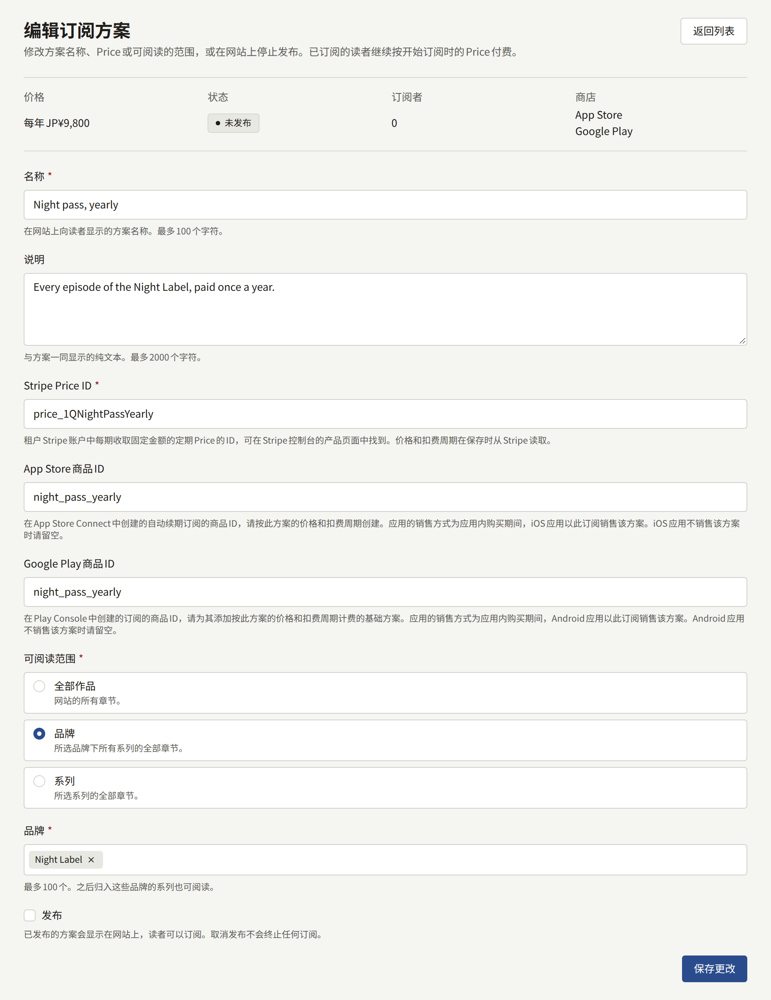
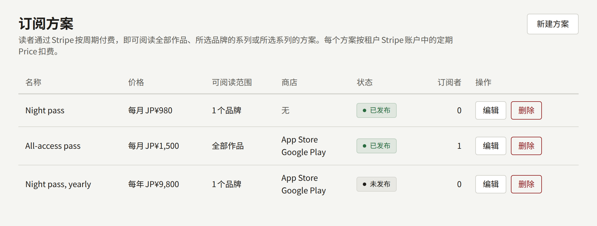

订阅方案让读者通过Stripe按期付款，无需逐个购买，即可阅读方案涵盖的所有章节。销售方案需要三样东西彼此吻合，与销售章节所需的三样相同：租户Stripe账户中的定期Price、租户控制台中指定该Price的方案，以及Stripe用来告知安装实例读者已订阅、付款、续订、欠费或取消的Webhook。向读者收费的是Stripe，但只有Webhook才会向读者开放方案的章节并再次关闭它们。因此三者中任何一个设置有误，都会出现收了读者的钱、章节却仍然锁定的情况，或者让已停止付款的读者仍能阅读章节。本页按这一顺序逐一说明这三项，最后通过一次测试订阅来确认三者吻合。

所有方案都通过Stripe在网站上销售，通过PAY.JP收款的租户无法创建方案。方案还可以指定租户的应用在App Store和Google Play中以哪个订阅销售它，详见[创建方案](#创建方案)。当租户的应用通过**网页结账**销售时，应用会将想要订阅方案的读者引导到网站的方案页面，详见[应用内购买和登录](../5-mobile-app/5-purchases-and-sign-in.md#在应用中销售章节)。

**支付** › **订阅方案**面向**租户管理员**；编辑和审计员看不到该页面。

## 开始之前

租户需要通过Stripe收款，并且**支付** › **支付方式**上的**支付设置**显示**就绪**，详见[销售章节](./4-selling-episodes.md#stripe)。控制台会从那里保存的secret key所属的Stripe账户读取每个方案的Price，因此在此之前无法保存方案。

除了销售章节所需的事件之外，Stripe的Webhook端点还需要以下事件：

- `customer.subscription.updated`，在订阅续订、付款逾期、被设为取消或更换方案时发送。
- `customer.subscription.deleted`，在订阅结束时发送。
- `invoice.payment_failed`，在Stripe未能收取续订款项时发送。
- `invoice.paid`，在Stripe收到订阅账单的付款时发送，包括第一笔和每次续订。

缺少`customer.subscription.updated`、`customer.subscription.deleted`和`invoice.payment_failed`时，订阅会在其结账付款时被记录，之后却不再跟随Stripe的变化：所支付的期间结束时章节就会关闭，即使读者的续订已经成功；而取消了订阅的读者则可以一直阅读到那一天。缺少`invoice.paid`时，不会记录任何付款，因此方案的收入不会出现在任何销售额数字中，也不会出现在任何版税明细上，详见[付款如何支付给作者](#付款如何支付给作者)。在添加该事件之前进行的付款，之后也不会被记录。请将这些事件添加到测试模式的端点，并在上线前再次添加到正式模式的端点。

## 在Stripe中创建Price

在Stripe控制台中，在与secret key相同的账户和模式下：

1. 在产品目录中为方案添加一个产品。其名称就是Stripe在结账页面和读者的账单上向读者显示的名称。
2. 为其设置一个固定金额的**Recurring**价格，并选择计费周期：每天、每周、每月、每年，或自定义周期，例如每3个月。
3. 打开该价格，复制以`price_`开头的ID。

控制台会拒绝不是每期固定金额的Price：一次性价格、按用量或计量计费的价格、阶梯价格，以及让客户自行选择支付金额的价格。已归档的Price也会被拒绝。方案按该Price规定的金额、货币和计费周期收费，网站也以该货币标示方案的价格，因此请以租户的货币创建Price。Price的金额在Stripe中永远不会改变：如果要收取不同的金额，请创建一个新的Price并在方案上填写其ID，详见[更改、取消发布和删除方案](#更改取消发布和删除方案)。

测试模式和正式模式的Price是分开的，各有自己的ID。切换到正式密钥时，请在正式模式下再次创建Price，并在方案上填写其ID，详见[上线前的测试](#上线前的测试)。

### 客户门户

订阅者在Stripe的客户门户中更换银行卡或取消订阅，网站上的**管理付款**会打开该门户。门户在租户自己的Stripe控制台的账单设置中配置，控制台中无需对其进行任何设置：请打开其设置并保存，在测试模式下保存一次，在正式模式下再保存一次，这样Stripe才有可用于打开门户的配置。在那里可以选择读者能否取消订阅，以及取消是立即生效还是在其已付费的期间结束时生效。

在租户的应用中通过App Store或Google Play订阅的读者，需要在商店中更改和取消该订阅。Stripe的门户无法打开这类订阅，**个人中心**也不会为其提供**管理付款**，而是提供**在App Store中管理**或**在Google Play中管理**，打开读者在其商店账户中管理订阅的页面。

门户还可以让读者切换到另一个产品的价格。切换到租户另一个方案所收费的Price的读者，从那时起会被记录在该方案上，并可以阅读该方案开放的内容。在门户中只提供某个方案所收费的Price：切换到没有任何方案收费的Price的读者，仍留在其订阅的方案上，但按新价格付款。

## 创建方案

在**支付** › **订阅方案**上选择**新建方案**，填写表单，然后选择**创建方案**：

- **名称**是读者在网站上看到的方案名称，最多100个字符。
- **说明**是与方案一同显示的纯文本，最多2000个字符。
- **Stripe Price ID**是上面复制的`price_`ID。方案的价格和计费频率会在保存方案时从Stripe读取，控制台按Stripe的规定显示它们。
- **App Store商品ID**和**Google Play商品ID**指定租户的应用在各商店中以哪个订阅销售该方案，两者都可以留空。只有当**应用的销售方式**为**应用内购买**，并且方案指定了某个商店的商品时，应用才会通过该商店销售方案。请在商店中按方案的价格和计费周期创建商品：在App Store Connect中创建为自动续期订阅，在Play Console中创建为带有基础方案的订阅，详见[各商店为应用内购买所需的内容](../5-mobile-app/5-purchases-and-sign-in.md#各商店为应用内购买所需的内容)。控制台不会向商店核对该ID，因此背后没有商品的ID会在第一次购买时失败，应用会将其报告为不销售。
- **可阅读范围**决定方案开放哪些章节：
  - **全部作品**：网站的所有章节。
  - **书系**：您所选书系（最多100个）下所有系列的所有章节。之后归入其中某个书系的系列也会开放。
  - **系列**：您所选系列（最多100个）的所有章节。
- **发布**会将方案列在网站上，读者可以在那里订阅。如果想在提供方案之前先做准备，请不要勾选。

当Stripe中该ID下没有每期固定金额的Price，或者另一个方案已经在使用该Price收费时，表单会指出需要更正的字段：每个方案使用自己的Price收费，因此同一金额的第二个方案需要在Stripe中有第二个Price。商店商品ID同样只属于一个方案，表单会标出已被另一个方案用于销售的ID所在的字段，以及包含商店不接受的字符的ID所在的字段：App Store商品ID可以包含字母、数字、下划线和句点，Google Play商品ID可以包含小写字母、数字、下划线和句点，并且必须以字母或数字开头。只要Stripe不是租户已启用支付的支付服务商，表单就会拒绝任何方案。一个租户最多可以有20个方案。

## 方案列表

**支付** › **订阅方案**按创建顺序列出所有方案，显示每期的价格、可阅读范围、通过应用销售该方案的**商店**、是**已发布**还是**未发布**，以及有多少**订阅者**。订阅者是指对该方案的订阅已付清，或Stripe仍在尝试收取其续订款项的读者。**编辑**会打开方案的表单，表单上方显示其价格、状态、订阅者和商店。

## 更改、取消发布和删除方案

对方案**名称**、**说明**或**可阅读范围**的更改会立即影响所有订阅者：从保存的那一刻起，方案开放的内容就是其每位订阅者可以阅读的内容。

新的**Stripe Price ID**会改变此后订阅的读者需要支付的价格。已经订阅的读者继续按其开始时的Price付款，并留在该方案上。如果要更改他们支付的金额，请在Stripe控制台中更改他们的订阅。

取消勾选**发布**会将方案从网站上撤下：它不再被列出，任何锁定的章节也不再提供它。取消发布不会终止任何订阅。在每位订阅者自行取消之前，他们会继续阅读方案开放的内容，Stripe也会继续向他们收费；如果要自行终止他们的订阅，请在Stripe控制台中取消。

**删除**会移除没有任何人订阅过的方案。只要有任何读者订阅过该方案，无论是现在还是过去，它都会作为读者所付费内容的记录而保留，控制台会要求您改为取消发布。某位读者最近一次结账所针对的方案也是如此，无论该结账是否已付款。

## 方案开放的内容

只要Stripe报告订阅状态良好且其当前期间尚未结束，订阅就会在网站和租户的应用中开放其方案涵盖的章节：

- **有效**或处于试用中，在其期间内。被设为在期间结束时取消的订阅，在那之前仍然开放。
- **逾期**，在Stripe重试未能收取的续订款项期间。这是给读者修正银行卡的宽限期，其长度取决于租户Stripe账单设置中的重试计划；该设置还决定Stripe放弃后订阅变为什么状态：已取消或未付款。

已取消、未付款、已暂停或首次付款始终未成功的订阅不开放任何内容。

订阅者另外购买过的章节仍列为其购买，在订阅结束后，仍在其阅读期限内归读者所有。读者同一时间只能持有一个订阅。

## 付款如何支付给作者

Stripe为方案收取的每一笔付款，包括第一笔和每次续订，都会在`invoice.paid`通知到达安装实例时被记录。它在付款当天计入租户的销售额，与购买分开计算；在Stripe控制台中进行的退款会从退款当天扣除。

付款所支付的期间在哪个月结束，该月的版税明细就会将这笔付款分配给订阅者在该期间读完的方案章节，并将每个章节的份额按作者的分成比例支付给其作者。订阅者没有读完任何章节的付款不分配给任何人，全部归出版社所有。具体规则以及结算后的退款如何收回，见[报表与版税](./6-reports-and-royalties.md#订阅付款)。

## 读者看到的内容

网站的方案页面`https://<tenant-domain>/plans`列出已发布的方案，显示每个方案每期的价格、说明，以及网站上显示的其涵盖的书系或作品。读者可以从**订阅**进入该页面（当某个已发布的方案涵盖锁定的章节时，该章节会在购买选项旁提供此按钮），也可以从**个人中心**上的**查看方案**进入。网站上没有其他地方链接到该页面，因此在向读者介绍方案时，请自行加上链接。

1. 读者在某个方案上选择**订阅**。未登录的读者会看到**登录后订阅**；已经持有方案的读者会被告知是哪个方案，并被引导到**个人中心**。如果该方案通过App Store或Google Play收费，提示中会写明是哪个商店。
2. Stripe的结账页面收取付款，与章节一样，如果读者有优惠码也可以使用。离开该页面会将读者带回方案页面，页面会告诉读者没有被扣款。
3. 付款后，读者回到**个人中心**，页面会向读者致谢，并说明付款确认后方案就会显示。当Webhook的通知到达安装实例时，方案的章节就会开放，通常只需几秒钟。

首次付款确认后，网站还会像发送购买收据一样以租户的名义向读者发送邮件，不受读者通知设置的影响。邮件会写明方案、支付金额以及该笔付款涵盖的期间，告知读者在该期间结束前可以阅读方案的章节，届时除非读者取消，方案将续订，并附上前往**个人中心**的链接。此后Stripe每收取一次付款、方案续订到新的期间时，网站都会以同样的方式发送邮件：邮件写明方案、支付金额以及新的期间，并告知读者在该期间结束前可以阅读方案的章节。在Stripe测试模式下开始或续订的订阅，邮件会说明未产生任何扣款。

Stripe未能收取续订款项时，网站也会在每次收款失败后以同样的方式向读者发送邮件，不受读者通知设置的影响：邮件写明方案和应付金额，说明Stripe何时再次尝试或不再尝试，告知读者最晚在当前期间结束前仍可阅读方案的章节（详见[方案开放的内容](#方案开放的内容)），并请读者在**个人中心**的**管理付款**中更新付款方式，附上前往个人中心的链接。如果某次失败后订阅不再开放任何内容，例如重试计划在最后一次失败后取消订阅，则不会为这次失败发送邮件。在Stripe测试模式下失败的尝试，邮件会说明不会产生任何扣款。

只有当租户在Stripe控制台中开启了Stripe的客户邮件时，Stripe才会另外发送自己的收据和付款失败通知；开启后，读者会收到两次同样的通知。在应用中通过App Store或Google Play购买的方案由商店通知读者，网站不会为此发送邮件。

此后，**个人中心**会以**您的方案**开头：显示方案名称，并根据订阅所处的状态，显示续订时间、取消后的结束时间、需要处理的付款，或订阅已结束。**管理付款**会打开Stripe的客户门户，读者可以在那里更新银行卡、查看账单或取消订阅，在那里所做的更改会通过Webhook反映到网站上。在应用中订阅的读者会看到哪个商店为该方案收费，并看到**在App Store中管理**或**在Google Play中管理**，而不是**管理付款**。付款未成功或方案处于暂停状态时，会提示该读者在商店中更新付款方式，而不是在**管理付款**下更新。已结束的方案会提供**查看方案**，与Stripe收费的方案一样。商店订阅已结束的读者可以在网站上订阅：方案页面列出网站销售的方案，并提供**订阅**。

当**支付设置**不是**就绪**时，方案页面会说明网站目前无法接受订阅，任何锁定的章节也不会提供方案。选择PAY.JP作为支付服务商会删除Stripe的凭据：网站随即停止销售方案，Stripe关于已售订阅的通知会被拒绝，而Stripe仍会继续向这些读者收费，因此请在切换之前在Stripe控制台中取消这些订阅。

删除读者账户会立即在Stripe中取消其订阅，且不会退还其已付费的期间，详见[读者账户](./2-readers/1-accounts.md#删除读者)。

## 订阅未跟随Stripe变化时

与购买一样，Stripe控制台中为Webhook端点列出的投递会显示原因，各状态的含义见[付款后章节没有打开时](./4-selling-episodes.md#付款后章节没有打开时)。有四种原因是订阅特有的：

- **读者已付款，但个人中心没有显示方案**。`checkout.session.completed`的投递失败了。修正问题并重新发送该投递后，订阅就会被记录，其章节也会开放。
- **续订、取消或付款失败没有显示在个人中心上**。端点没有发送`customer.subscription.updated`、`customer.subscription.deleted`或`invoice.payment_failed`。请添加这些事件。每当有关于某个订阅的通知到达时，安装实例都会从Stripe读取整个订阅，因此下一个通知会让每个订阅都更新到最新状态。
- **续订付款失败的读者没有收到邮件**。端点没有发送`invoice.payment_failed`，或其投递失败了。请添加该事件，并重新发送失败的投递：无论通知到达多少次，每次失败的尝试只会发送一封邮件；在订阅不再开放章节之后重新发送的尝试，不会发送邮件。
- **某笔付款不在任何销售额数字中，也不在任何版税明细上**。端点没有发送`invoice.paid`，或其投递失败了。请添加该事件，并重新发送失败的投递：无论通知到达多少次，一笔付款只会被记录一次。

## 上线前的测试

在读者可以订阅之前，请在Stripe的测试模式下测试整个设置。只有一次订阅才能证明Webhook有效，也只有一次取消才能证明它之后会跟随Stripe的变化。

1. 使用Stripe的**测试**secret key进行设置，并按上面的说明将销售章节所需的事件和本页列出的事件全部添加到测试模式的端点。确认**支付设置**显示**就绪**。
2. 在测试模式下创建定期Price，并保存客户门户的设置。
3. 为测试创建一个系列，显示位置为**网页和应用**或**仅网页**，并立即发布，在其中放一个付费章节，立即发布并在网页上销售，与[上线前的测试](./4-selling-episodes.md#上线前的测试)中对销售的说明相同。
4. 使用测试Price创建一个开放该系列的方案，并勾选**发布**。
5. 在网站上，用不持有任何控制台角色的读者账户登录：工作人员可以免费阅读所有已发布的章节，因此章节不会向他们提供任何选项。打开该付费章节，选择**订阅**。
6. 在方案页面上选择**订阅**，用测试卡`4242 4242 4242 4242`、任意未来的有效期和任意三位安全码付款。
7. 回到**个人中心**后，等待**您的方案**显示该方案及其续订时间，然后打开该章节：无需购买即可阅读。读者的邮箱会收到一封告知订阅已开始的邮件，邮件中写明的付款涵盖期间在**您的方案**显示的续订日期结束。如果一分钟内方案没有显示，请按[订阅未跟随Stripe变化时](#订阅未跟随stripe变化时)的说明，在Stripe控制台中查看投递情况。
8. 选择**管理付款**，在门户中取消订阅。回到**个人中心**后，**您的方案**会显示取消情况：结束日期，或者如果门户立即取消，则显示已结束。如果订阅仍在进行，也请在Stripe控制台中取消它，然后重新加载章节：它再次被锁定。

测试通过后，在测试方案上取消勾选**发布**，并将测试系列的**显示位置**设为**不在任何位置显示**。测试方案的历史中现在有一位订阅者，因此无法删除；它会以未发布的状态留在列表中。然后将测试secret key替换为正式密钥，添加带有相同事件的正式模式端点，填写其签名密钥，并保存。在正式模式下再次创建方案的Price，在正式模式下保存客户门户的设置，并使用正式的Price创建读者将要订阅的方案。
