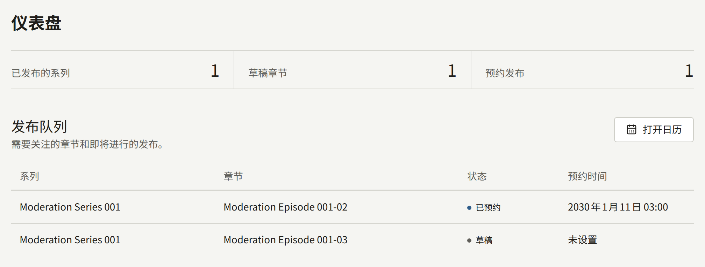
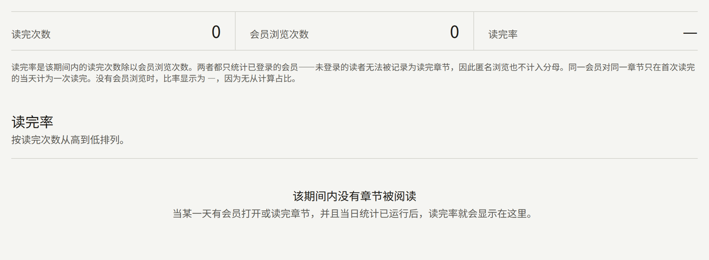
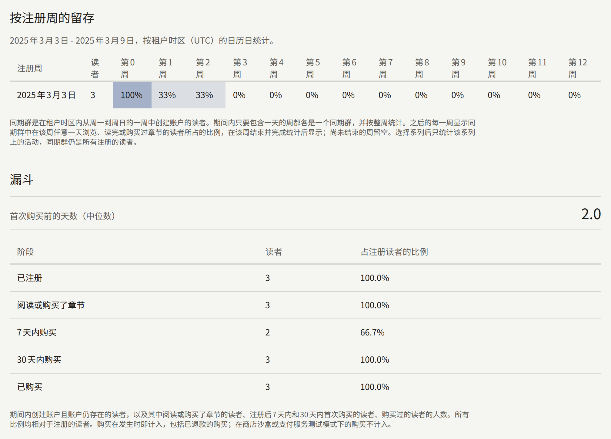
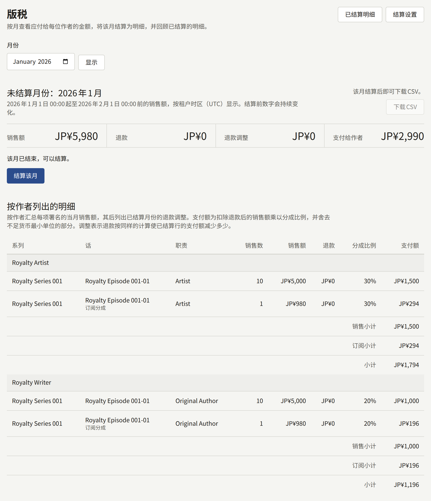
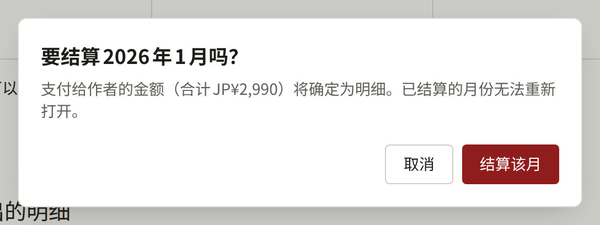
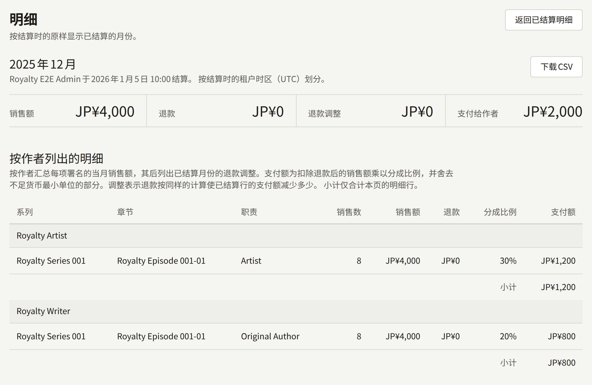
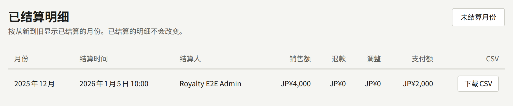
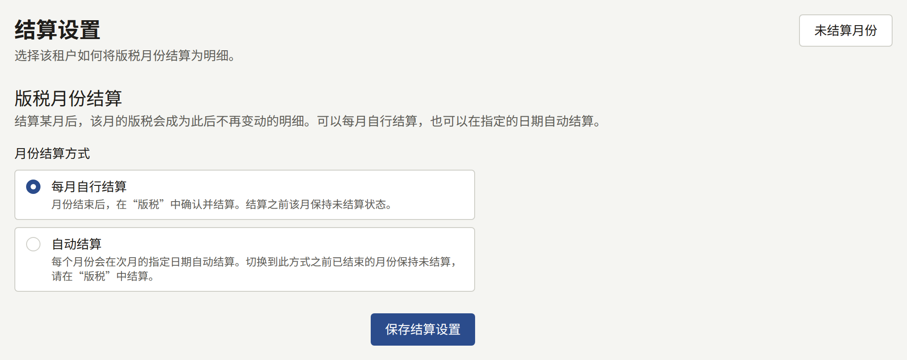

控制台中有几个页面会把网站上发生的事情转化为数字。**仪表盘**显示作品的发布进展。在**分析**下，**销售额**显示卖出了什么；**读者反响**显示读者如何关注、阅读和回应每个系列；**章节**显示会员把每个章节读到了哪里，以及读者在哪一页离开；**同期群**显示每周注册的读者如何持续回访，以及其中有多少人购买。**报表**下的**版税**计算租户在一个月的销售中应付给每位作者的金额，然后将该月结算为一份永不改变的明细。

所有工作人员都能看到**仪表盘**、**读者反响**、**章节**和**同期群**。只有**租户管理员**能看到**销售额**、**版税**以及**同期群**上的**漏斗**，能将报表或明细下载为CSV，能结算月份，也能更改月份的结算方式；对其他人而言，这些页面和控件并不存在。

## 销售或阅读计入哪一天

这些页面统计时使用的每个日期，都是租户时区中的日历日，时区在**设置** › **常规** › **时区**中设置。从未设置时区的租户使用安装实例的默认时区，由运营人员选择。一天是该时区中从午夜到午夜，一个月是从当月第一天的00:00到下个月第一天的00:00。东京时间4月1日08:30进行的销售，对时区为`Asia/Tokyo`的租户属于4月；而对时区为`UTC`的租户则属于3月，因为那时仍是3月31日23:30。

- 销售计入购买被记录的时刻；对于便利店支付等事后结算的付款，则是款项到账的时刻。
- 阅读计入会员打开或读完章节的那一天。
- 关注计入其发生的时刻，其结束计入读者取消关注或删除账户的时刻。
- 明细保留其月份划分时使用的时区，并在月份下方显示“**按结算时的租户时区（…）划分。**”

在结算明细之后更改时区，该明细保持结算时的样子。其后一个月从该明细结束的时刻开始，即旧时区的午夜，并在新时区的午夜结束，因此在两个午夜之间的几个小时内进行的销售只计算一次，计入旧时区将其归入的那个月。此后的每个月都按新时区从午夜到午夜计算。每日统计已经统计过的日期（**读者反响**和**章节**读取这些统计）不会重新统计；更改从下一个统计日开始生效。**销售额**以及**读者反响**上的关注者数是直接从销售和关注本身读取的，因此会立即按新时区计算。

## 仪表盘

**仪表盘**是控制台的第一个菜单项，概览作品的发布情况，而不是销售或阅读情况。其数字统计整个租户，不限日期范围：

| 数字 | 统计内容 |
| --- | --- |
| **已发布的系列** | 已发布的系列 |
| **草稿章节** | 保存为草稿的章节 |
| **预约发布** | 发布日期尚未到来的章节 |
| **待审核** | 等待租户管理员决定的预约章节，仅在租户[要求审核](./1-catalog/2-episodes.md#发布前审核)时显示 |

**发布队列**最多列出十个这样的章节：预约章节在前，按发布时间由近到远排列；然后是草稿，按从新到旧排列。**预约时间**按租户的时区显示，没有日期的草稿显示**未设置**。在租户要求审核期间，等待决定的预约章节会在其状态旁标记**审核中**，被退回的标记**已退回**。旁边的**打开日历**会打开[日历](./1-catalog/2-episodes.md#何时发布什么)，按发布日期显示每个预约和已发布的章节。

当工作人员保存系列或章节时，以及预约章节自动上线时，页面会立即更新，上线的章节随即离开队列。

## 分析

**销售额**、**读者反响**、**同期群**和章节的流失情况，各自报告租户日期中的一段期间。用**开始**、**结束**和**应用**选择期间，最长366天。未选择时，页面显示截至昨天（含）的28天，日期下方的一行会写明期间和时区。**重置**会回到这28天。

页面开头是该期间的合计和按日显示的图表，下方是一个表格。**按日**、**按系列**和**按章节**选择表格的行是什么；选择某列的标题会按该列排序，再次选择则反向排序。期间、行和排序都包含在页面地址中，因此书签或链接会重新打开同一份报表。

来自每日统计的数字，在某一天结束后才会包含该天。`publira worker`在租户时区的午夜之后，于下一次每小时运行时统计前一天，因此今天的阅读明天才会显示。worker进程停止期间不会统计新的日期，重新启动后会补统计错过的日期。保持`publira worker`运行的方法见[概览](../2-deployments/1-overview.md)。

### 销售额

**销售额**以租户的货币显示该期间卖出了什么。

| 数字 | 统计内容 |
| --- | --- |
| **购买次数** | 该期间内的购买，包括已退款的购买 |
| **总销售额** | 这些购买支付的金额 |
| **退款额** | 退还给这些购买的读者的金额：退款，以及租户败诉的争议 |
| **订阅** | 订阅者在该期间为租户的[订阅方案](./5-subscription-plans.md)支付的金额 |
| **订阅退款额** | 这些付款中退还的金额：退款，以及租户败诉的争议 |
| **净销售额** | **总销售额**减去**退款额**，加上**订阅**减去**订阅退款额**：租户留下的金额 |

只有在该期间内有订阅付款时，才会显示**订阅**和**订阅退款额**，因此不销售方案的租户只会看到其他四个数字。这样的期间，图表会将每天扣除退款后的订阅付款，以较浅的颜色叠加在购买的净销售额之上，图表下方会注明该颜色；**按日**的表格也会为这两个数字各设一列。付款计入Stripe收到款项的那一天，其退还的金额与购买的退款一样从那一天扣除。租户败诉的争议会收回整笔付款；仍在进行中的争议或租户胜诉的争议不收回任何金额。付款不属于任何系列，因此**按系列**和**按章节**的表格不包括它，其**净销售额**只是购买的净销售额。使用Stripe测试密钥进行的付款不计入任何数字。

图表显示每天的净销售额。销售计入其发生的那一天，其退还的金额也从同一天扣除，无论多久之后才退还，因此已经报告过的某一天之后可能会下降，而退还多于卖出的某一天会画在零线以下。仍在进行中的争议在败诉之前不收回任何金额。购买卷或系列的剩余章节，算作对其打开的每个章节的销售，金额为该章节所占的价格部分，即版税明细计入的部分；同时以全部金额算作对其系列的销售。以租户当前货币以外的货币支付的购买不计入任何数字。用租户代币支付的章节，按其代币的购买价算作销售，即版税明细计入的金额；而代币包的购买不计入任何数字：其金额随着代币被花费而计入，代币包的全额退款或争议会从其已花费代币产生的销售中扣除。销售额直接读取购买本身，因此刚刚进行的销售也已经包含在内。

### 读者反响

**读者反响**显示该期间内读者如何关注、阅读和回应租户的系列。

| 数字 | 统计内容 |
| --- | --- |
| **关注者** | 期间结束时正在关注的读者。关注一发生就被计入，在读者取消关注或删除账户时结束 |
| **浏览次数** | 系列页面及其章节的浏览次数，包括所有读者，无论是否登录 |
| **读完次数** | 会员首次读完其中某个章节的次数 |
| **回应** | 按下章节的回应控件、使读者对该章节的评分增加的次数 |

图表显示每天结束时的关注者数。**按系列**列出每个系列，以及该期间内新增和结束的关注，还有其**评分**和**评分读者**：即系列当前的评分，也就是其页面上显示的评分，基于它所收到的所有回应，而不只是该期间的回应。没有读者评分的系列显示`—`。

### 章节

**章节**显示会员打开的每个章节中有多少人读完。其数字涵盖租户时区中截至昨天（含）的最近28天，与其他页面显示的期间无关；标题下方的一行写明日期和时区。

| 数字 | 统计内容 |
| --- | --- |
| **读完次数** | 会员读完章节的次数。每位会员对每个章节只计一次，计入其首次读完的那一天，无论之后重读多少次 |
| **会员浏览次数** | 已登录会员打开章节的次数。一位会员对同一章节的打开，在时钟的每个半小时（:00到:29，以及:30到:59）内只计一次，因此在同一个半小时内再次打开不会增加计数，而在10:29打开、10:30再次打开则计为两次 |
| **读完率** | **读完次数**除以**会员浏览次数**，没有浏览时显示为`—` |

只统计已登录的会员。未登录的读者无法被记录为读完章节，因此其浏览也不计入。会员以何种方式阅读章节没有区别：购买的、用券打开的或免费的章节都同样计算，而仅仅购买不会计入任何数字。

**读完率**列表列出该期间内被阅读的每个章节，读完次数多的在前，每页二十个。顶部的合计涵盖整个期间，无论显示的是哪一页。

#### 流失

在**读完率**中选择一个章节，会打开其**流失**：在一段期间内，读者在该章节中逐页读到了哪里。

| 数字             | 统计内容               |
| ---------------- | ---------------------- |
| **读者**         | 读到第一页的读者       |
| **读到最后一页** | 读到章节最后一页的读者 |
| **页数**         | 章节当前的页数         |

图表从第一页逐级下降到最后一页，表格为每一页列出读到该页的读者数、他们占读到第一页的读者的比例，以及在该页离开的读者数：即读到该页但没有读到下一页的读者。按**在此离开**排序，会把离开读者最多的页面排在最前面。读者按其在章节中的阅读位置在当天结束时所在的页计入，因此在期间内多天阅读的读者，每天各计一次。超过章节最后一页、标记为“**（已删除）**”的页，是在章节删除页面之前读到的。

### 同期群与漏斗

**同期群**追踪在期间内每一周注册的读者。这里的读者是指租户网站的账户；工作人员自己的账户不包括在内。

**按注册周的留存**为期间内包含某一天的每一周设一行，按租户时区从周一到周日，因此第一行可能在**开始**之前开始，最后一行可能在**结束**之后结束。每一行给出该周、在该周创建账户的读者数，以及在**第0周**到**第12周**下，这些读者中在注册周及其后十二周的每一周内，于任意一天浏览、读完或购买过章节的比例。读者无论在一周内回访多少天，都只在该周计一次。单元格的颜色越深，比例越大。一周在结束且其各天统计完成后才会进入表格，因此仍在进行中的一周为空白；没有人注册的一周所在的行显示`—`。

在**系列**下选择一个系列，就只统计该系列的阅读和购买。行仍然是所有注册的读者，因此比例显示的是该周的新读者中有多少人继续阅读了该系列。

**漏斗**向**租户管理员**显示，统计在期间内注册的读者以及他们走到了哪一步：

| 步骤                 | 统计内容                                           |
| -------------------- | -------------------------------------------------- |
| **已注册**           | 在期间内创建账户且账户仍然存在的读者               |
| **阅读或购买了章节** | 其中在任何已统计的日期浏览、读完或购买过章节的读者 |
| **7天内购买**        | 其中首次购买发生在账户创建后不到7天的读者          |
| **30天内购买**       | 同上，30天内                                       |
| **已购买**           | 其中有过任何购买的读者                             |

**占注册读者的比例**是每个计数除以**已注册**。“**首次购买前的天数（中位数）**”是在已购买的读者中，从账户创建到首次购买所等待天数的中位数；在有读者购买之前为`—`。购买一发生就会计入，包括已退款的购买，而在商店沙盒或支付服务商测试模式下进行的购买不计入。

被删除的账户会立即从其所在的行以及所有包含它的计数中移除。这些页面统计的阅读和购买，从安装实例开始保存它们的那一天起保存；对于升级到新增**同期群**的版本的安装实例，这一天是升级时仍保存着分析事件的最早日期：在那之前的一周会显示在该周注册的读者，但不显示他们的任何行为，之后也永远不会补上。

### 将报表下载为CSV

**销售额**、**读者反响**和**流失**的表格旁边的**下载CSV**，会下载页面所显示期间的该表格报表：与表格一样按日、按系列或按章节。文件包含报表的所有行，不受表格排序的影响，按报表本身的顺序排列：日期按时间顺序，**销售额**的系列或章节按净销售额、**读者反响**的系列按关注者数从高到低，流失的页面按顺序。**章节**上的**读完率**和**同期群**没有下载功能。

文件以报表、租户和期间命名，例如`revenue-by-series-<tenant>-2025-03-03--2025-03-09.csv`，流失则为`drop-off-<tenant>-<episode>-<from>--<to>.csv`。文件为UTF-8编码，带有字节顺序标记以便Excel正确读取，在标题行下为报表的每一行写一行，没有合计行。其列为：

| 报表 | 列 |
| --- | --- |
| 按日的销售额 | `date`, `purchase_count`, `gross_amount`, `refunded_amount`, `net_amount`, `subscription_amount`, `subscription_refunded_amount`, `currency` |
| 按系列的销售额 | `start_date`, `end_date`, `series_id`, `series_title`, `purchase_count`, `gross_amount`, `refunded_amount`, `net_amount`, `currency` |
| 按章节的销售额 | `start_date`, `end_date`, `series_id`, `series_title`, `episode_id`, `episode_title`, `purchase_count`, `gross_amount`, `refunded_amount`, `net_amount`, `currency` |
| 按日的读者反响 | `date`, `follower_count`, `followed_count`, `unfollowed_count`, `view_count`, `complete_count`, `reaction_count`, `reaction_points` |
| 按系列的读者反响 | `start_date`, `end_date`, `series_id`, `series_title`, `follower_count`, `followed_count`, `unfollowed_count`, `view_count`, `complete_count`, `reaction_count`, `reaction_points`, `rating_average`, `rating_count` |
| 流失 | `start_date`, `end_date`, `episode_id`, `page_index`, `reader_count` |

`date`、`start_date`和`end_date`是租户的日期，格式为`YYYY-MM-DD`；后两者是下载的期间，每一行都相同。`subscription_amount`是订阅者当天为租户的[订阅方案](./5-subscription-plans.md)支付的金额，与购买分开计算；`subscription_refunded_amount`是这些付款中退还的金额，包括退款和租户败诉的争议（争议按整笔付款计算），与购买的退款一样从付款当天扣除；使用Stripe测试密钥进行的付款不计入两者。付款不属于任何系列，因此按系列和按章节的报表不包含付款。与页面上的**净销售额**不同，`net_amount`只是购买的净销售额。金额以货币的最小单位表示，JPY为日元，USD为美分，`currency`是租户的货币。`rating_average`保留一位小数，没有读者评分的系列为`0.0`。`page_index`从`0`开始计数第一页，`reader_count`是读到该页的读者数。标题使用租户的默认语言，ID则让每一行在重命名后仍与其系列或章节对应。电子表格会解读为公式的单元格，会以保持为文本的方式写入。

报表在下载时读取，因此包含今天的期间之后下载可能会得到不同的数字。每次下载都会在**审计日志**中记录为**下载了分析CSV**。

## 版税

**版税**按月计算每位作者在其署名章节的销售中，以及在分配给这些章节的订阅付款中应得的金额。月份在结算之前保持未结算状态，其数字随每一笔销售、退款和分成比例的更改而变化。结算会生成一份永不再改变的明细。明细是租户向作者付款的依据：Publira不向任何人付款，明细是应付金额的记录。

### 作者应得的金额

作者获得其署名的每个章节的一定分成。分成比例在署名上设置，为章节销售额的百分比，章节上各分成比例分配后剩余的部分归出版社所有：

- **在系列表单上**，**作者**在**作者1的分成**等字段中设置每项署名的分成比例。这些署名是创建新章节时使用的模板；更改它们不会影响现有章节。
- **在章节上**，**作者**更改该章节自己的署名和分成比例，**保存作者**会保存它们。
- **在系列的章节列表上**，**署名** › **设置分成**会一次更改多个章节上某项署名的分成比例。

分成比例在0到100%之间，最多两位小数，一个章节上的分成比例合计不超过100。分成比例为0时，作者获得署名但不获得报酬。编辑也可以设置分成比例，因为他们编辑作品。

对每项署名，一个月的支付额为：

> （该月章节的销售额 − 这些销售的退款）× 分成比例，向下取整到租户货币的最小单位，例如1日元或1美分

一个月的销售包括：

- 在网站上通过Stripe或PAY.JP购买该章节，按读者在Stripe结账页面输入的[优惠码](./4-selling-episodes.md#优惠码)扣除折扣之前的价格计算：促销是租户提供的，因此由租户承担该折扣。优惠码使其免费的购买，也按该价格算作销售。在安装实例开始保存使用优惠码之前的价格之前记录的购买，按读者支付的价格算作销售。
- 在网站上购买包含该章节的卷，每次都算作该章节的一笔销售，金额为该章节在卷的使用任何优惠码之前的价格中所占的部分。该价格按购买被记录时卷中各章节自身价格的比例分配给各章节，所有章节都没有价格时则平均分配，因此在包含有价章节的卷中，免费章节不分得任何部分，也没有销售。各部分在购买时确定：之后更改章节价格或更改卷所包含的内容都不会改变它们。卷的部分退款按同样的比例分配，每个章节的部分向下取整。
- 在网站上购买系列的剩余章节，每次都算作对其打开的每个章节的一笔销售，金额为该章节在读者支付价格中所占的部分。每个章节的部分在读者开始结账时确定：打包优惠按各章节售出价格（活动进行期间为活动价格）的比例分摊到各章节，因此之后更改章节价格或系列的优惠都不会改变它。部分退款按与价格相同的比例分配，每个章节的部分向下取整。
- 在租户的应用中通过App Store或Google Play进行的购买，按章节的价格计算。不扣除商店的佣金。
- 在网站或应用中用租户的代币购买该章节，按所花费代币的购买价计算。代币包中的每枚代币，价值为读者为该代币包支付金额的均等部分，包括赠送的代币，因此赠送部分是租户给予的折扣：以¥1,000购买的1,100枚代币（其中100枚为赠送）的代币包，每枚代币价值¥0.909，100枚代币的章节就是一笔¥90的销售，向下取整到货币的最小单位。不经付款发放的代币没有价值，测试购买的代币或以租户当前货币以外的货币支付的代币包中的代币也没有价值。销售的价值在代币被花费时确定：之后编辑代币包不会改变它。

所有金额都以租户的货币计，已结算的明细保留其结算时的货币。以其他货币支付的购买（只会在读者完成租户更改货币之前开始的付款时发生）会打开章节，但不会成为明细上的销售。

其他都不是销售。代币包的购买不是销售：其金额就是其代币在被花费时产生的销售。阅读券、**等待即可免费**、免费阅读期以及作者阅读自己的章节，都会在没有销售的情况下打开章节。来自App Store沙盒或Play许可测试人员的购买，以及使用Stripe或PAY.JP测试密钥进行的购买，都是测试，不计算在内。

全额退款的购买会从其购买所在的月份中移除。部分退款会保留该笔销售，其金额在**退款**下扣除。对于使用优惠码打折的购买，扣除的金额占使用优惠码之前价格的比例，与退款占读者支付金额的比例相同：¥500的章节支付了¥400，退还其中一半时扣除¥250，向下取整到货币的最小单位。无论哪种情况，只要购买所在的月份尚未结算，退款就计入该月，而不是退款所在的月份。

读者的银行裁定对您不利的Stripe付款[争议](./4-selling-episodes.md#争议)，从Stripe报告该裁定的那一刻起算作全额退款，结算前后都是如此。仍在进行中的争议或裁定对您有利的争议，会保留该笔销售。

全额退款或被提出争议的代币包，会在其已花费代币所支付的每笔购买上，退还这些代币的价值。读者保留其打开的章节，因此每笔购买仍算作销售，并在**退款**下列出该金额：如果该购买所花费的代币全部来自该代币包，则为其全部价格；如果部分来自其他代币包，则为该代币包所占的部分。与任何退款一样，在购买所在的月份结算之前计入该月，结算之后从下一份明细中扣除。

### 订阅付款

Stripe为租户的某个[订阅方案](./5-subscription-plans.md)收取的付款，会在其所支付的期间结束的那个月，分配给其订阅者所阅读内容的作者。付款在订阅者于该期间内读完的方案章节之间平均分配，每个章节的部分按作者的分成比例支付给该章节的作者，与章节的销售一样。各部分向下取整，使其合计恰好等于付款金额，取整后分不到任何金额的章节不分得任何部分。

- 每个章节对每位订阅者只计一次，计入其首次读完该章节的期间。在之后的期间重读的章节，不分得该期间付款的任何部分。
- 订阅者在该期间内没有读完方案中任何章节的付款，不分配给任何人：它不出现在明细上，全部归出版社所有。订阅者此后删除了账户的付款也是如此。
- 付款所分配的章节在月份结算时确定。订阅者在结算之后、在该期间内读完的章节，不会改变已结算的月份。
- 读完记录从内容事件中读取，内容事件的保留期限在[设置 › 限制与保留](./3-setup/1-settings.md#限制与保留)中设置。请让保留期限长于方案的计费周期加上到月份结算为止的时间，否则在结算前被删除的读完记录不会被计算。按年计费的方案需要一年以上。
- 付款的部分退款按同样的比例分配到各章节，每个部分向下取整；全额退款的付款会被移除，与购买一样。使用Stripe测试密钥进行的付款，或以租户当前货币以外的货币进行的付款，不计算在内。
- 读者的银行裁定对您不利的付款争议，算作全额退款并被移除，与全额退款的付款一样。在结算之后败诉的争议，作为全额退款收回。仍在进行中的争议或裁定对您有利的争议，会保留该笔付款。

付款的各部分是单独的行，与章节的销售行分开，位于同一作者、系列、章节和职责之下。在这样的行上，**销售数**是分配给该章节的付款笔数，**销售额**是该章节从这些付款中分得的部分。

### 结算后的退款

在购买所在的月份结算之后记录的退款，无法更改该明细。它会改为从其后结算的下一份明细中扣除，作为一行调整：该行与计入该笔销售的已结算行位于同一作者、系列、章节和职责之下，并写明其所调整的已结算月份。调整位于该月自身的行之后，其数字是变化量，因此在销售行为正数的地方，调整为负数：

- **销售数**是全额退款的购买数量的负数，**销售额**是其价格的负数。
- **退款**是仍算作销售的购买的退款变化量。当结算时已部分退款的购买此后被全额退款时，该值为负数，因为该购买现在改为通过**销售额**扣除。
- **支付额**是退款从已结算行的支付额中扣除的金额：按已结算月份所使用的分成比例、以与之前相同的方式向下取整，对剩余的销售重新计算该行的支付额，再减去原来的支付额。结算后更改的分成比例或结算后新增署名的作者，不会对其产生任何影响。已结算行与其调整合计支付的金额，等于退款发生在结算之前时该行本应支付的金额，因此当该行的每笔销售都被退款时，合计为零。

使用优惠码打折的购买的退款，按与结算前相同的使用优惠码之前价格的比例扣除，因此该购买全额退款后，已结算行与其调整合计仍不支付任何金额。

订阅付款在结算后的退款也以同样的方式扣除：从已结算月份所分配的各章节的订阅行中，各自按其在退款中所占的部分扣除。在结算后败诉的付款争议，作为全额退款扣除。

退款的每个部分只扣除一次。在一次结算后部分退款、在下一次结算后全额退款的购买，会在两次调整中扣除，第二次扣除第一次未涵盖的部分，各份明细合计对其不支付任何金额。

调整只会计入比其所调整月份更晚的月份。不按顺序结算、在较早月份之前结算的月份，不包含该较早月份的退款；在两者之后结算的下一个月份会包含它们。当某个月的调整超过其自身的销售时，其**支付给作者**为负数；当某位作者的调整超过其销售行时，该作者的小计也为负数。

### 查看未结算月份

**版税**打开时显示最新已结算明细的下一个月；如果尚未结算任何月份，则显示上个月。**月份**加上**显示**，可以打开任何其他尚未结算且已经开始的月份。

**未结算月份**给出四项合计：

| 合计 | 内容 |
| --- | --- |
| **销售额** | 该月的每笔销售，按其价格计算，包括没有署名作者的章节的销售，以及该月分配的每笔[订阅付款](#订阅付款) |
| **退款** | 这些销售和付款的退款 |
| **退款调整** | 该月从结算后被退款的已结算月份的销售和订阅付款中收回的金额，详见[结算后的退款](#结算后的退款)，每笔只计一次：为零或负数 |
| **支付给作者** | 该月应付给作者的金额，即下方各行（包括调整）的合计。**销售额**扣除**退款**和**退款调整**后的剩余部分归出版社所有 |

**按作者列出的明细**按作者对该月进行分组，为该月有销售的章节上的每项署名设一行，并为每位作者设一个**小计**。每行给出**系列**、**话**、署名的**职责**、**销售数**、**销售额**、**退款**、**分成比例**和**支付额**。在同一章节上以两种职责署名两次的作者，每种职责各有一行；该月分配了订阅付款的章节，在其销售行旁还有一行订阅付款，在章节名下方注明**订阅分成**。调整位于其作者分组中该月自身的行之后，在章节名下方以“**……的退款调整**”的形式注明已结算的月份，并计入该作者的**小计**。有订阅付款行的作者，在其**小计**上方还有**销售小计**和**订阅小计**，各自合计该类的行及其调整。

合计上方会显示该月所处的状态：

- “**该月仍在进行中。**”在租户时区中该月最后一天结束后即可结算。
- “**该月已结束，可以结算。**”此时可用**结算该月**结算该月。
- “**该月将于**某个日期**自动结算。**”该月由`publira worker`在该日期结算，控制台不提供手动结算的方式。

### 结算月份之前

结算月份会将其固定为当时的状态，之后发生的任何事情都不会影响它。结算前请检查：

- **署名和分成比例**。明细使用结算时的分成比例，而不是章节售出时的分成比例。在结算之前更改分成比例，整个月都按新的分成比例支付；在结算之后更改，则只有未结算的月份按新比例支付。
- **预期的退款**。结算后记录的退款会从下一份明细中扣除，而不是从已结算的月份中扣除，详见[结算后的退款](#结算后的退款)，因此作者会先因该笔销售获得报酬，之后再从后面的月份中扣回。如果知道有退款即将发生，请等待它到来，使其计入所属的月份。
- **该月已经结束**。在该月最后一天深夜进行的销售按租户的时区计算，而租户的时区可能与您的不同。

请按顺序结算月份。正因如此，控制台提供的是最新明细的下一个月；被跳过的月份需要之后用**月份**选择才能结算。

### 结算月份

1. 打开**报表** › **版税**。显示的月份就是接下来要结算的月份。
2. 确认其显示“**该月已结束，可以结算。**”，并通读**按作者列出的明细**。
3. 选择**结算该月**。对话框会说明将要确定的**支付给作者**金额。再次选择**结算该月**进行确认。

控制台随后会打开该月的**明细**，显示结算时间、结算人，以及与未结算月份时相同的合计和各行。结算会在**审计日志**中记录为**结算了版税月份**。

结算后，明细保留结算时每位作者、系列、章节和职责的名称：之后重命名作者、编辑分成比例、为购买退款或删除署名，都不会改变它。之后记录的退款会改为从下一份明细中扣除。已结算的月份无法重新打开，工作人员和运营人员都不行。之后发现的错误需要在Publira之外，在租户支付的金额中更正。

**已结算明细**按从新到旧列出每个已结算的月份，显示结算时间、结算人及其合计。自动结算的月份在**结算人**下显示`—`。

### 将明细导出为CSV

**下载CSV**会下载已结算的明细：可以在**明细**页面本身上下载，也可以在**已结算明细**中该明细所在的行上下载。未结算的月份无法下载，因为其数字仍在变化。

文件名为`royalties-<tenant>-<YYYY-MM>.csv`。文件为UTF-8编码，带有字节顺序标记以便Excel正确读取，在标题行下为明细的每一行写一行，没有合计行。其列为：

| 列 | 内容 |
| --- | --- |
| `period` | 月份，`YYYY-MM` |
| `creator_id`, `creator_name` | 作者 |
| `role_id`, `role_name` | 署名的职责，没有职责的署名为空 |
| `series_id`, `series_title` | 系列 |
| `episode_id`, `episode_title` | 章节 |
| `sale_count` | 销售数量 |
| `gross_amount` | 销售额，以明细货币的最小单位表示：JPY为日元，USD为美分 |
| `refunded_amount` | 其退款，单位相同 |
| `share_percent` | 分成比例，保留两位小数，例如`12.50` |
| `payout_amount` | 支付额，单位相同 |
| `currency` | 明细的货币，例如`USD`：结算时租户的货币，也是明细唯一计入其销售的货币 |
| `adjusted_period` | 对该月自身的销售行为空。对调整，为其收回退款的已结算月份，`YYYY-MM`，其金额为[结算后的退款](#结算后的退款)中说明的负的变化量 |
| `source` | 销售行为`sale`，[订阅付款](#订阅付款)行为`subscription`。调整的来源与其所调整的行相同 |

名称为结算时的名称，ID则让每一行在重命名后仍与其作者和章节对应。电子表格会解读为公式的单元格，会以保持为文本的方式写入。一份明细每次下载的文件都相同，每次下载都会在**审计日志**中记录为**下载了版税明细CSV**。

### 关联读者账户的作者能看到的明细内容

账户已按[作者和作者角色](./1-catalog/4-authors.md#将作者与读者账户关联)的说明关联到某位作者的读者，在租户开启其作者页面并向作者显示其销售情况后，可以查看每份已结算明细中该作者的部分。他们可以看到：

- 每个已结算月份中，该作者自己各行的销售数、销售额、退款和支付额的合计，包括调整。没有为该作者计入任何金额的月份显示为零。
- 某个月中该作者自己的各行，按明细的顺序排列，每行显示系列、章节、职责、销售数、销售额、退款、分成比例和支付额，是销售行还是[订阅付款](#订阅付款)行，以及调整所调整的月份。

他们永远看不到明细的合计、其他作者的行或未结算的月份。与明细上的其他一切一样，各行保持结算时的样子。

某个月上的**下载CSV**会将该作者在该月自己的各行保存为[将明细导出为CSV](#将明细导出为csv)中说明的文件，但省略三列：会在每一行都指明同一位作者的`creator_id`和`creator_name`，以及`role_id`。`series_id`和`episode_id`包含网站地址中使用的ID，而不是控制台文件中包含的内部ID。文件名为`royalties-<author>-<YYYY-MM>.csv`，以作者的公开ID和月份命名。在应用中，某个月上的**分享CSV**会将同样的文件交给设备的分享面板。

### 自动结算月份

**版税**上的**结算设置**选择月份的结算方式：

- **每月自行结算**（默认）：月份保持未结算，直到租户管理员按上面的方式结算。
- **自动结算**：每个月在下个月的**结算日**结算，结算日为租户时区中1到28之间的某一天。

选择**保存结算设置**以应用所选设置；更改会在**审计日志**中记录为**更新了版税结算设置**。

自动结算在结算日午夜之后`publira worker`的第一次每小时运行时进行，与**结算该月**完全相同地结算该月，并且在**结算人**下不记录任何人。如果worker进程在结算日停止，它会在重新启动时按从旧到新的顺序结算所欠的月份。没有运行`publira worker`时，不会自动结算任何月份。

**自动结算**适用于选择它之后结束的月份。切换时已经结束的月份仍需手动结算：请按上面的方式从**版税**结算。请选择一个能为[结算月份之前](#结算月份之前)中的检查留出时间的**结算日**，因为结算前不会询问任何人；请在那一天之前、而不是之后修正分成比例。
