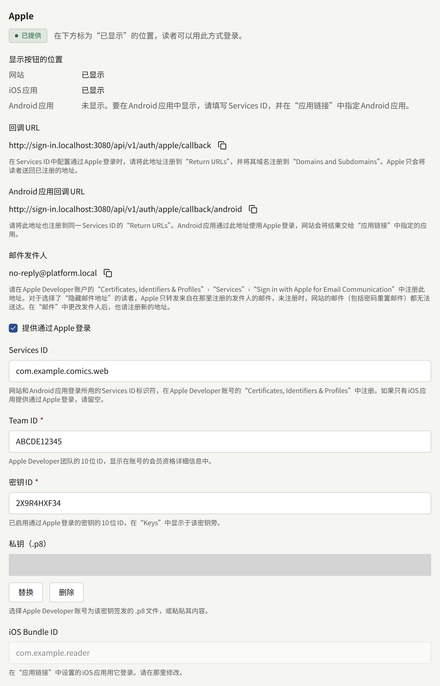
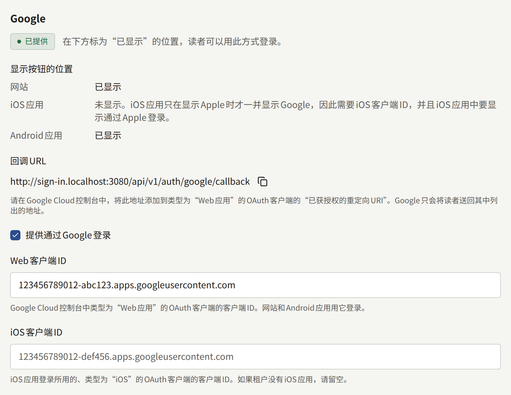

读者使用电子邮件地址和密码登录租户的网站。**集成** › **登录**会在该表单旁添加两个按钮，**通过Apple继续**和**通过Google继续**，让读者可以用已有的账户注册和登录。本页面带领租户管理员完成网站上两种登录方式的设置，并说明启用后读者看到的内容。应用使用相同的设置；只有应用才需要的内容见[应用内购买和登录](../5-mobile-app/5-purchases-and-sign-in.md#通过apple和google登录)。

只有租户管理员能看到**登录**，每次保存都会以**更新了登录方式设置**记录在**审计日志**中。

## 开始之前

- **网站通过自己的域名、以HTTPS提供**。Apple和Google只会把读者送回在它们那里注册过的HTTPS地址，而该地址位于租户公开网站的域名上，而不是控制台的主机上。
- **对于Apple，需要Apple Developer Program的会员资格**，并且属于读者应当看到自己正在登录的那个组织。如果租户有应用，就使用发布该应用的同一会员资格。
- **对于Google，需要一个Google Cloud项目**，同样由出版社拥有。为[推送通知](../5-mobile-app/3-push-notifications.md)创建的Firebase项目也是Google Cloud项目，可以使用。
- **如果租户有应用**，请先按照[应用链接](../5-mobile-app/4-app-links.md)的说明填写**集成** › **应用链接**。通过Apple登录信任其中指定的应用。

打开**集成** › **登录**并保持打开：每种登录方式的区域都会显示一个**回调URL**，并附有复制按钮，您需要在下面的步骤中把它注册到对应的服务商。它基于网站的域名生成：

| 服务商 | 回调URL                                                  |
| ------ | -------------------------------------------------------- |
| Apple  | `https://comics.example.com/api/v1/auth/apple/callback`  |
| Google | `https://comics.example.com/api/v1/auth/google/callback` |

Apple区域还会显示第二个地址，即**Android应用回调URL**，只有Android应用使用它。

如果运营人员之后把租户迁移到另一个域名，这些地址也会随之改变，新的地址需要在两个服务商处重新注册，正如[租户](../3-operations/2-tenants.md)所述。

## 通过Apple登录

Apple一方的所有内容都在Apple Developer账户的**Certificates, Identifiers & Profiles**中创建。

### 在Apple Developer账户中创建的内容

1. **启用了Sign in with Apple的App ID**。在**Identifiers**中，打开租户iOS应用的App ID；如果租户没有应用，就注册一个，然后开启**Sign in with Apple**功能。另外两个标识符都归在这个App ID之下，Apple称之为主App ID（primary App ID）。
2. **一个Services ID**。在**Identifiers**中注册一个Services ID，填写读者可能会看到的描述（例如网站名称），以及类似`com.example.comics.web`的标识符。为它开启**Sign in with Apple**，然后选择**Configure**：
   - **Primary App ID**：第1步的App ID。
   - **Domains and Subdomains**：只填网站的域名，例如`comics.example.com`。
   - **Return URLs**：控制台中Apple的**回调URL**。如果租户有Android应用，也在这里添加**Android应用回调URL**。
3. **一个密钥**。在**Keys**中注册一个开启了**Sign in with Apple**的密钥，并配置为同一个主App ID。下载它提供的`.p8`文件。Apple只提供一次，所以请妥善保存；密钥丢失时，通过注册新的密钥来替换。**Key ID**显示在密钥旁边。
4. **Team ID**，显示在账户的会员资格详细信息中。

### 在控制台中填写

在**集成** › **登录**的**Apple**区域中：

- **Services ID**：Services ID的标识符，例如`com.example.comics.web`。只有填写了此项，网站才会显示Apple按钮。只有在仅由iOS应用提供Apple登录时才留空。
- **Team ID**和**密钥ID**：第4步和第3步中的10位ID。
- **私钥（.p8）**：选择下载的文件，或粘贴其内容。
- **iOS Bundle ID**不在这里填写：它显示的是**应用链接**中指定的iOS应用。

开启**提供通过Apple登录**，然后选择**保存登录方式**。

密钥无法读回：之后再打开时，控制台只显示已保存了一个密钥。**替换**会把它换成新的密钥，**删除**会在保存时将其删除。

## 通过Google登录

Google一方的所有内容都在Google Cloud控制台中、出版社的项目里，于**Google Auth Platform**下创建。

### 在Google Cloud控制台中创建的内容

1. **同意屏幕**。在**Branding**中，填写读者选择账户时看到的名称、支持邮箱，并在**Authorized domains**中填写网站的域名。在**Audience**中选择**External**，让任何Google账户都能登录，然后把应用发布到正式环境。在发布之前，只有其中列出的测试用户才能登录。Publira只向Google请求读者的身份、电子邮件地址和姓名，Google将它们归为非敏感信息，因此发布无需等待对它们的审核。
2. **一个Web应用客户端**。在**Clients**中，创建一个类型为**Web application**的OAuth客户端，并在**Authorized redirect URIs**中添加控制台中Google的**回调URL**。**Authorized JavaScript origins**中不需要填写任何内容。

Google会为新客户端显示一个客户端密钥。Publira不使用它，控制台中也没有填写它的地方。

### 在控制台中填写

在**集成** › **登录**的**Google**区域中：

- **Web客户端ID**：Web应用客户端的客户端ID，以`.apps.googleusercontent.com`结尾。只有填写了此项，网站才会显示Google按钮，Android应用也使用同一个客户端登录。
- **iOS客户端ID**：iOS客户端的客户端ID，只有iOS应用使用它。如果租户没有iOS应用，请留空。

开启**提供通过Google登录**，然后选择**保存登录方式**。

## 确认是否生效

每种登录方式的区域都会显示其状态：

| 状态       | 含义                                         |
| ---------- | -------------------------------------------- |
| **已提供** | 已开启且信息齐全：读者可以用它登录           |
| **未完成** | 已开启，但缺少所需的内容，因此不会向读者提供 |
| **已停用** | 已保存，但已关闭                             |
| **未设置** | 尚未为它保存任何内容                         |

**已提供**的登录方式还会在**显示按钮的位置**下列出读者可能遇到它的每个位置：**网站**、**iOS应用**和**Android应用**。每一项显示**已显示**，或者该位置在显示按钮之前还缺少什么：

|  | Apple | Google |
| --- | --- | --- |
| 网站 | **Services ID** | **Web客户端ID** |
| iOS应用 | **应用链接**中指定的iOS应用 | **iOS客户端ID**，并且iOS应用中显示Apple，因为应用只在显示Apple时才一并提供Google |
| Android应用 | **Services ID**，以及**应用链接**中指定的Android应用 | **Web客户端ID** |

因此，一种登录方式可能显示**已提供**，却仍然表明网站不显示它：没有**Services ID**的Apple，或没有**Web客户端ID**的Google，只为应用而设置。应用一行显示**已显示**，表示设置已涵盖该应用；应用本身也必须为此构建，正如[应用的页面](../5-mobile-app/5-purchases-and-sign-in.md#通过apple和google登录)所述。iOS应用中的Google比其他项更依赖构建，因为只有使用同一个**iOS客户端ID**构建的应用才会显示它，所以这一行显示的是**在使用此iOS客户端ID构建的iOS应用中显示。**

保存更改后不久，网站就会应用它。在隐私窗口中打开网站的登录页面，选择**通过Apple继续**或**通过Google继续**并登录。如果服务商把您送到它自己的错误页面，通常是地址不匹配：请把它报告的地址与**回调URL**逐字比对。

## 读者看到的内容

网站的**登录**页面和注册页面会在电子邮件表单下方显示**通过Apple继续**和**通过Google继续**，中间以**或**分隔。用这种方式注册的读者不需要设置密码，也不需要确认电子邮件地址：服务商已经确认过了。如果网站要求读者同意服务条款或隐私政策，首次登录时会停在**完成注册**，让读者同意后才创建账户。

在所有能使用通行密钥的浏览器中，网站的**登录**页面还会在它们旁边提供**使用通行密钥登录**，这无需在**登录**中做任何设置。持有该网站通行密钥的读者只用通行密钥即可登录，无需输入电子邮件地址或密码：选择该按钮，或者在浏览器于电子邮件字段的建议中提供通行密钥时选择它。为租户控制台创建的通行密钥是另一个通行密钥，不能用于登录网站。如果读者关闭了提示，或网站不接受该通行密钥，页面会给出说明，电子邮件表单保持原样。账户已被暂停的读者，或电子邮件地址从未确认过的读者，也不能使用通行密钥登录。

应用会显示相同的Apple和Google按钮，显示在设置所涵盖的每种手机上，正如[应用的页面](../5-mobile-app/5-purchases-and-sign-in.md#通过apple和google登录)所述；在**应用链接**中指定的应用里还会显示**使用通行密钥登录**，正如该页面的[使用通行密钥登录](../5-mobile-app/5-purchases-and-sign-in.md#使用通行密钥登录)所述。同一个账户在两边都能使用：在网站上用Apple注册的读者可以用Apple登录应用，在网站上添加的通行密钥可以登录应用，反过来也一样。

### 已有账户与通过Apple或Google登录

一个Apple或Google账户关联到租户上的一个读者账户。关联到哪一个，在读者第一次使用它时决定：

- **读者已经有一个电子邮件地址相同的账户**。Apple或Google账户会关联到该账户，读者登录的是自己已有的账户，连同其购买记录和历史记录。没有确认步骤：Apple和Google已经确认过该地址，这与网站自己的确认邮件所要求的证明相同。
- **读者有一个使用该地址的账户，但从未确认过**。Apple或Google账户会接管它：账户被关联，其地址视为已确认，创建时设置的密码会被删除。在无法确认该地址的情况下创建了账户的人，会把账户让给该地址的所有者。
- **没有任何账户使用该地址**。会创建一个新账户，使用服务商提供的地址，没有密码。

在Apple中选择了**Hide My Email**的读者，提供给网站的是`privaterelay.appleid.com`上的地址，而不是自己的地址。它与任何已有账户都不匹配，因此会创建新账户；使用与读者账户不同地址的Google账户也是如此。已经有账户并想继续使用它的读者，应先用电子邮件地址登录，再从**关联账户**把Apple或Google账户关联到该账户，如下所述。

租户在**设置**中拒绝的电子邮件地址不适用于这些登录方式，因为地址由服务商提供。账户已被暂停的读者也不能通过Apple或Google登录。

### 读者可以管理的内容

在网站的**设置** › **安全**中，以及在应用的账户页面中，**关联账户**会列出读者可用于登录的Apple和Google账户，每一项都带有**解除关联**；对于网站或应用提供、但该账户尚未关联的每种服务商，则提供**关联**。**关联**会让读者用该服务商登录，并关联他们登录的那个账户，无论它带有什么地址，因此**Hide My Email**地址也和读者自己的地址一样可以关联。此后，用它登录会打开同一个账户，在网站和应用中都是如此。

以下情况下关联会被拒绝，并在页面上说明原因：该Apple或Google账户已经用于登录网站上的另一个账户，需要先在那个账户上解除关联；或者读者的账户已经关联了该服务商的一个账户，需要先解除关联才能关联另一个。

网站上的同一页面还会列出读者的**通行密钥**，每一个都显示添加时间和最后一次用于登录的时间，并带有**移除**。**添加通行密钥**会向浏览器请求一个新的通行密钥（由设备的屏幕锁、密码管理器或安全密钥保管），然后请读者为它起一个便于区分的名称，读者也可以跳过。此后，**使用通行密钥登录**就能用它登录。无论**登录**中做了什么设置，只要浏览器能使用通行密钥，这一部分就会显示，一个读者最多可以持有20个通行密钥。应用账户页面中的**通行密钥**列出相同的通行密钥，可以添加，也可以对每一个进行重命名和移除。

通过Apple或Google创建的账户没有密码。同一页面会提供**设置密码**，它会发送一封用于设置密码的链接邮件，设置后读者也可以用电子邮件地址登录。在此之前：

- 账户始终保留一种登录方式：在没有通行密钥时，不能解除最后一个关联账户；在没有关联账户时，不能移除最后一个通行密钥。
- 删除账户和更改电子邮件地址时，不用密码确认，而是再次通过Apple或Google登录（**通过Apple确认**或**通过Google确认**），或使用读者的某个通行密钥（**使用通行密钥确认**）来确认，网站和应用都是如此。

### 发送到Hide My Email地址的邮件

Apple只转发出版社在Apple处注册过的发件人发送到`privaterelay.appleid.com`地址的邮件。来自其他发件人的邮件，包括网站自己的密码重置邮件，永远不会送达读者。

**集成** › **登录**的**Apple**区域会以**邮件发件人**显示租户邮件的发件地址，并附有复制按钮：租户通过自己的服务器发送邮件时，它是**集成** › **邮件**中的**发件人邮箱地址**，否则是平台的发件地址。请在Apple Developer账户的**Certificates, Identifiers & Profiles** › **Services** › **Sign in with Apple for Email Communication**中注册它。Apple还会检查发件域名是否通过SPF，具体见该处的说明。如果之后发件人发生变化（例如租户开始或停止通过自己的服务器发送，或更改了地址），也请注册新的发件人。

## 关闭某种登录方式

关闭**提供通过Apple登录**或**提供通过Google登录**，会从网站和应用中移除其按钮，同时保留为它保存的所有内容，因此可以按原样重新开启。读者的关联也会保留。

有密码的读者可以继续用电子邮件地址登录。通过该服务商注册的读者没有密码，在设置密码之前无法登录：通过登录页面上的**忘记密码？**，可以给他们发送一封链接邮件。在关闭某种登录方式之前，请告知这些读者，例如通过公告。使用Hide My Email地址的读者，只有在发件人已在Apple处注册时才能收到该邮件，如上所述。
