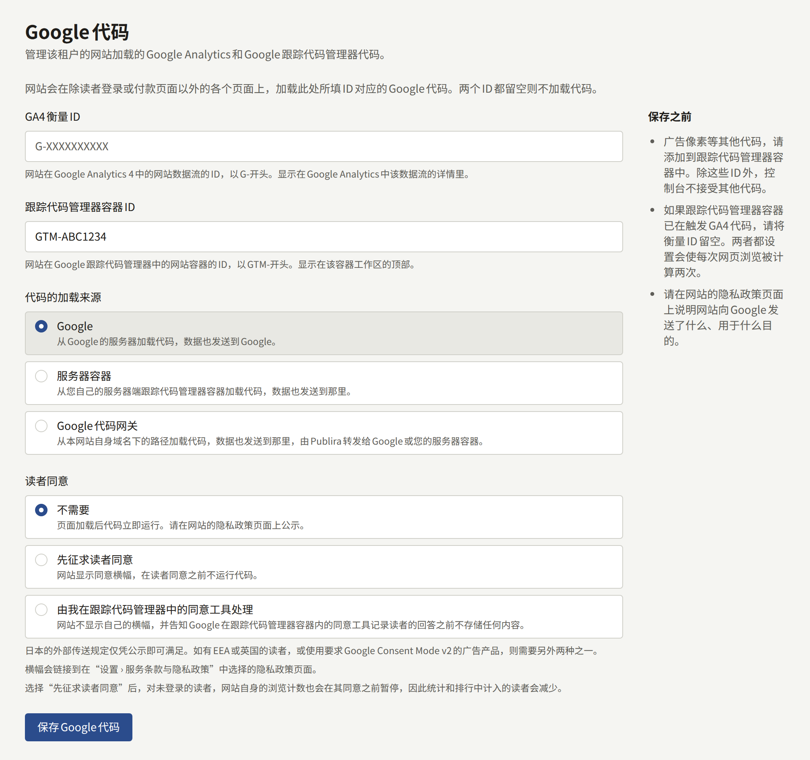
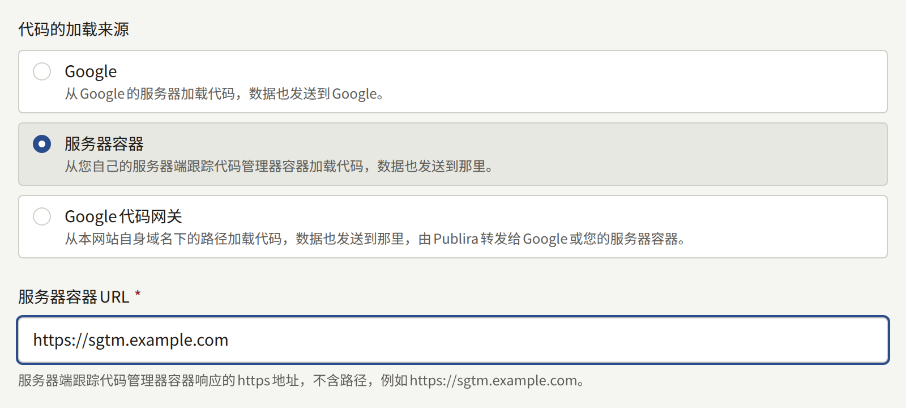
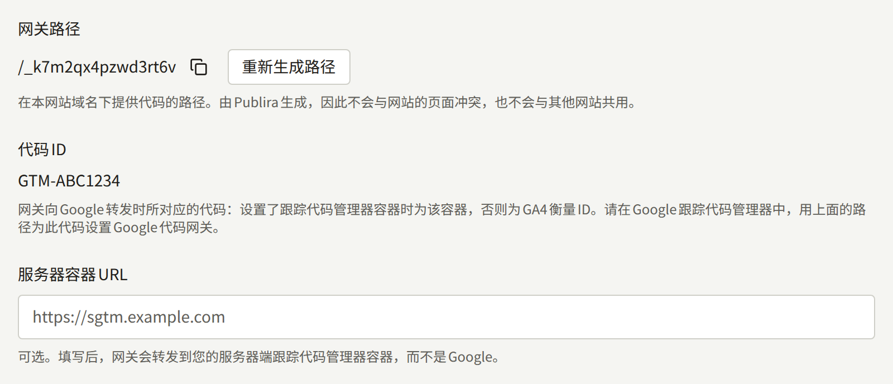
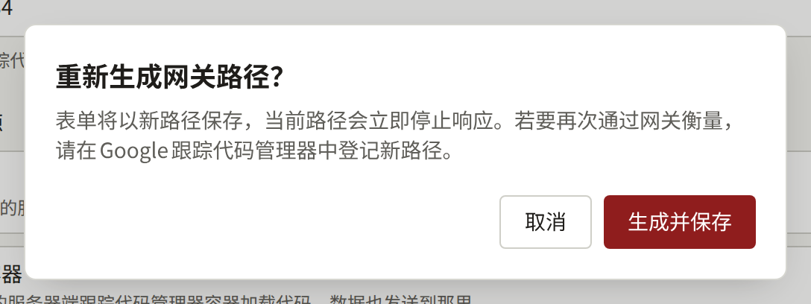
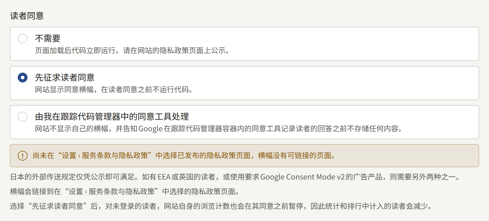

**集成** › **Google代码**让租户的网站加载Google代码：填写衡量ID时加载Google Analytics 4，填写容器ID时加载Google Tag Manager，也可以两者都加载。本页面带领租户管理员了解这些ID、代码可以加载的三种来源、每种来源需要在Google Analytics和Google Tag Manager中进行的设置，以及代码运行前是否征求读者同意。

只有租户管理员能看到**Google代码**，每次保存的更改都会以**更新了Google代码**记录在**审计日志**中。该设置适用于浏览器中的网站。租户的应用不加载任何Google代码。

## 开始之前

- **一个为网站设置了网页数据流的Google Analytics 4媒体资源**，或**一个Google Tag Manager中的网页容器**，由出版社拥有。如下所述，除Google Analytics以外的所有代码都放在容器中。
- **涵盖该代码的隐私政策**。该代码会设置自己的Cookie，并把收集到的内容发送给Google，而Publira自己列出的网站存储内容并不涵盖这些。请在代码上线之前把这些写进隐私政策，具体见[页面](./3-setup/3-pages.md#网站在读者浏览器中存储的内容)。

## ID

- **GA4衡量ID**：网站网页数据流的ID，以`G-`开头。Google Analytics在**Admin** › **Data collection and modification** › **Data streams**中该数据流的详细信息里显示它。以`UA-`开头的Universal Analytics ID会被拒绝，因为Google已不再为它收集数据。
- **跟踪代码管理器容器ID**：网站网页容器的ID，以`GTM-`开头。Google Tag Manager在容器工作区的顶部显示它。

填写用于衡量网站的那一个：

- **只填容器**：当Google Analytics设置在容器内部时。如果容器会触发GA4代码，同时旁边又填写了**GA4衡量ID**，每次网页浏览都会被统计两次，**保存之前**会对此发出警告。
- **只填衡量ID**：当网站没有容器时。
- **两者都填**：只在容器本身不触发GA4时，例如只包含广告代码的容器。

除这两个ID以外，控制台不接收任何其他代码。广告像素、转化代码或其他任何代码都放进Tag Manager容器，网站随后会连同其中的所有内容一起加载该容器。将两个ID都留空并保存，即可停止加载任何代码。

网站在页面之间切换时不会重新加载页面，因此第一次之后的网页浏览，是根据浏览器在其历史记录中记录的变化来统计的。无论GA4代码是由网站加载还是由容器触发，GA4的增强型衡量默认都会统计这些浏览。如果为该数据流关闭了基于浏览器历史记录事件的网页浏览，一次访问只会统计第一个页面。

## 代码的加载来源

**代码的加载来源**决定读者的浏览器从哪里获取代码的脚本，以及代码把收集到的内容发送到哪里：

| 模式 | 代码的加载位置 | 数据的发送目标 | 所需条件 |
| --- | --- | --- | --- |
| **Google** | Google的服务器 | Google | 无需其他设置 |
| **服务器容器** | 租户的服务器端Tag Manager容器 | 服务器容器 | **服务器容器URL**，以及在Tag Manager容器的Google代码上设置的服务器容器URL |
| **Google代码网关** | 网站自己域名上的一个路径 | 同一路径，Publira会将其转发给Google或服务器容器 | 在Google Tag Manager中设置网关 |

**Google**是默认选项，除ID以外无需任何设置。

### 服务器容器

**服务器容器**从出版社运行的服务器端Tag Manager容器加载代码，代码会把数据发送到那里，而不是发送给Google。Publira不运行该容器。

**服务器容器URL**是该容器响应的`https`地址，不含路径，例如`https://sgtm.example.com`。它必须是域名：IP地址会被拒绝。在网站自己域名的子域名上提供该容器，可以让代码保持为第一方，这正是Google在[Map a custom domain](https://developers.google.com/tag-platform/tag-manager/server-side/custom-domain)中推荐的方式。

网站会从该地址、按Google提供脚本的路径加载`gtm.js`和`gtag.js`。因此，该容器除了接收数据，还必须提供Google的脚本，正如Google的[Load Google scripts first-party](https://developers.google.com/tag-platform/tag-manager/server-side/dependency-serving)针对代码服务器所描述的那样。不提供这些脚本的容器不会在网站上加载任何代码，在它提供之前，网站不会衡量任何内容。

数据的去向取决于由哪个ID加载Google Analytics：

- **GA4衡量ID**：网站会让它加载的GA4代码把数据发送到服务器容器。无需其他设置。
- **跟踪代码管理器容器ID**：网站从服务器容器加载容器，但容器内的代码会把数据发送到容器指定的地方，在更改之前就是Google。请在网页容器中，于Google代码上把`server_container_url`设置为**服务器容器URL**，然后发布容器，具体见Google的[Send data to server-side Tag Manager](https://developers.google.com/tag-platform/tag-manager/server-side/send-data?option=GTM)。在此之前，网站会像以前一样衡量，所有命中都直接发送给Google。

### Google代码网关

**Google代码网关**就是Google所说的面向广告客户的Google代码网关（Google tag gateway for advertisers）：代码从网站自己域名上的一个路径加载，也把数据发送到该路径，Publira再把到达那里的内容转发给Google。通常由网站所有者在自己的CDN或负载均衡器上进行这项设置。Publira网站的域名由Publira提供服务，因此这部分由Publira完成，剩下的只是把该路径告诉Google Tag Manager。

- **网关路径**是提供代码的路径，例如`/_k7m2qx4pzwd3rt6v`。在此模式下第一次保存表单时，Publira会生成它，因此它绝不会与网站的页面冲突，也不会与其他任何网站共用。租户切换到其他模式时它会保留，因此切换回来时，代码仍在原来的位置提供。
- **代码ID**是网关代为转发给Google的代码：设置了**跟踪代码管理器容器ID**时就是它，否则是**GA4衡量ID**。容器涵盖它触发的所有代码，因此两者都填写的网站只需针对容器设置一次。
- **服务器容器URL**在这里是可选的。填写后，网关会转发到出版社的服务器容器，而不是Google；这时容器必须自己响应网关路径，正如Google的[Load Google scripts first-party](https://developers.google.com/tag-platform/tag-manager/server-side/dependency-serving)所述。只有当其名称解析为公网地址时，Publira才会连接它，因此无法访问私有网络中的容器。

Publira会把网关路径上的请求按原样（包括路径和查询）转发到`https://<Tag ID>.fps.goog`或服务器容器。在读者的Cookie中，它只传递Google自己的衡量Cookie，例如`_ga`、`_gcl_au`和`FPID`，也只让这些Cookie返回。读者在网站上的登录状态以及网站的其他所有Cookie都不会离开Publira。读者的IP地址会按照Google网关的要求传递。当安装实例的边缘查询读者的国家和地区时，也会传递这些信息，Google会用它们按地区生成报告，并确定特定地区的同意默认值；如果边缘不做这种查询，Google报告通过网关的网站流量时就没有地区信息。请向运行安装实例的人确认是哪一种情况。

#### 在Google Tag Manager中设置

1. 在**Google代码网关**模式下保存表单，并复制它显示的**网关路径**。
2. 对于容器，在Google Tag Manager中打开它，进入**Admin** › **Google tag gateway**。对于没有容器的衡量ID，则改为打开Google代码的设置：在Google Analytics中依次进入**Admin** › **Data collection and modification** › **Data streams**、网站的数据流、**Configure tag settings**，然后进入**Admin** › **Google tag gateway**。
3. 选择**Continue**，并在**Scan your site**中输入网站的地址。
4. Publira不属于Google会代为连接的任何CDN：在**More ways to set up**中选择**Guided**，并把**网关路径**作为衡量路径填写。引导说明随后描述的、从该路径到`fps.goog`的路由，Publira已经在做，无需您进行任何操作。

Google的[设置指南](https://developers.google.com/tag-platform/tag-manager/gateway/setup-guide)为自行处理路由的网站描述了这种路由，从中可以看出Publira代为完成的工作。

#### 确认是否生效

- **路径有响应**。在浏览器中打开`https://comics.example.com/<gateway path>/healthy`，替换为网站的域名和**网关路径**。网关连接到Google后，它会显示`ok`。Google的第二项检查`?validate_geo=healthy`不会显示`ok`，因为Publira不传递读者的国家和地区。
- **命中经过网关**。在Tag Assistant中预览容器并浏览网站。在**Summary** › **Output** › **Hits Sent**中，命中被发送到网关路径。
- **Google能看到它**。在Google通过该路径收到数据之前，Google Tag Manager的**Google tag gateway**页面会把网站的域名显示为**Pending**，之后显示为**First-party**。

#### 重新生成路径

**重新生成路径**会替换**网关路径**。它会以新路径保存表单，当前路径立即停止响应，因此在Google Tag Manager中改为设置新路径之前，网站不会通过网关衡量任何内容。

## 读者同意

**读者同意**决定网站是否在代码运行前征求读者同意。它适用于网站的所有读者，无论他们在哪里阅读。

| 选项 | 网站的行为 | 所需条件 |
| --- | --- | --- |
| **不需要** | 页面加载后立即运行代码 | 在隐私政策页面上公示该代码 |
| **先征求读者同意** | 显示同意横幅，在读者同意之前不运行代码 | 一个供横幅链接的隐私政策页面 |
| **由我在跟踪代码管理器中的同意工具处理** | 不显示自己的横幅，并告诉Google在出版社的同意工具记录读者的回答之前不要存储任何内容 | **跟踪代码管理器容器ID**，以及该容器中的同意工具 |

**不需要**是默认选项。哪种选项合适，取决于网站的读者是谁：

- **只有日本的读者**：在隐私政策页面上公示该代码即符合日本《电气通信事业法》的外部传输规则，因此**不需要**就足够了。
- **EEA或英国的读者**，或者**要求使用Google Consent Mode v2的广告产品**：选择另外两种之一。两者都会根据读者的回答发送Google Consent Mode v2信号。

### 先征求读者同意

读者第一次访问时，窗口底部会显示一个横幅。它说明网站会统计浏览量，并且Google会为出版社衡量网站，同时并排提供**同意**和**不同意**，两者同样醒目。横幅显示期间，页面的其他部分仍可使用，在读者选择**同意**之前，不会加载任何来自Google的内容。

回答会以[页面](./3-setup/3-pages.md#网站在读者浏览器中存储的内容)中列出的Cookie在读者的浏览器中保存六个月，在过期之前横幅不会再次显示。页脚链接末尾的**Cookie设置**会重新显示横幅，让读者可以更改回答。撤回同意会告诉Google不再存储任何内容，但Google代码已经设置的Cookie会保留到过期为止，横幅会把这一点告诉读者。发送Global Privacy Control的浏览器会被视为不同意：既不显示横幅，也不显示**Cookie设置**，也不会为它存储任何内容。

横幅链接到在[设置 › 服务条款与隐私政策](./3-setup/1-settings.md#服务条款与隐私政策)中被选为隐私政策的页面。在那里尚未选择已发布的页面时，如果选择了**先征求读者同意**，表单会警告横幅没有可链接的页面。选择已发布的页面后警告就会消失，无论哪种情况都可以保存设置。

在未登录的读者同意之前，网站也不会统计他们的浏览量；否则网站会使用[页面](./3-setup/3-pages.md#网站在读者浏览器中存储的内容)为未登录读者列出的标识符来统计。已登录读者的浏览量无论他们如何回答，都会计入其账户，因为这不会在他们的浏览器中留下任何新内容。因此，先征求同意的网站，其统计数据和排行榜统计到的读者，会少于同一网站不征求同意时的数量。

### 由我在跟踪代码管理器中的同意工具处理

此选项适用于已经在Tag Manager容器中以代码形式运行同意管理平台的出版社。网站会在容器加载之前把所有Consent Mode v2信号设置为`denied`，由容器中的同意工具显示自己的横幅，并根据读者的回答更新这些信号。

只有填写了**跟踪代码管理器容器ID**时才提供此选项，因为该工具没有其他可运行的地方；在填写之前，表单会在该选项下方说明这一点。保存了此选项时清空容器ID，也会以同样的方式被拒绝，并在ID旁边说明。

## 不加载代码的页面

网站会在每个页面上加载代码，但读者在其中提供密码、通行密钥或邮件中链接的页面除外：

- **登录**以及注册页面。
- 账户邮件引导读者完成的步骤：确认电子邮件地址、重置密码和重新发送确认邮件。
- **设置**及其下的所有页面。

付款在支付服务商的结账页面上进行，该页面不加载网站的任何代码。读者会从那里返回到网站上照常加载代码的页面，因此可以在他们返回的页面上衡量购买。

这些页面也都不显示同意横幅。直接打开或重新加载这些页面之一时，不会加载任何代码。当读者从网站的其他页面移动到这些页面之一时，已经在运行的代码会继续运行，因为网站在两者之间不会重新加载页面。

## 隐私政策需要说明的内容

**保存之前**要求网站的隐私政策页面说明网站向Google发送了什么，以及用于什么目的。该代码会设置Google的Cookie，并把收集到的内容发送给Google或服务器容器，容器触发的每个代码也是如此。[页面](./3-setup/3-pages.md#网站在读者浏览器中存储的内容)列出了Publira自己在读者浏览器中保存的内容，隐私政策还需要在该列表之外，根据Google以及容器中每个代码的文档说明该代码。

无论在[读者同意](#读者同意)中做出哪种选择，隐私政策都要说明代码发送的内容：先征求同意决定的是代码何时运行，而不是它发送什么。

## 更改何时反映到网站

保存更改后不久，网站会在下一次加载页面时应用它。重新生成的网关路径从下一个请求开始就不再响应。
