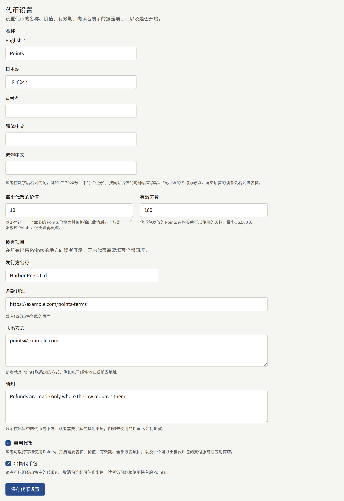
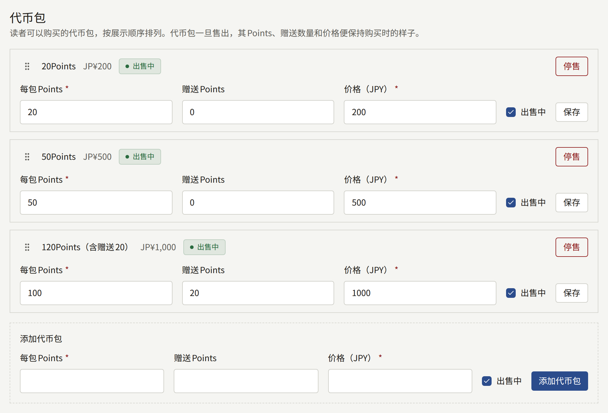
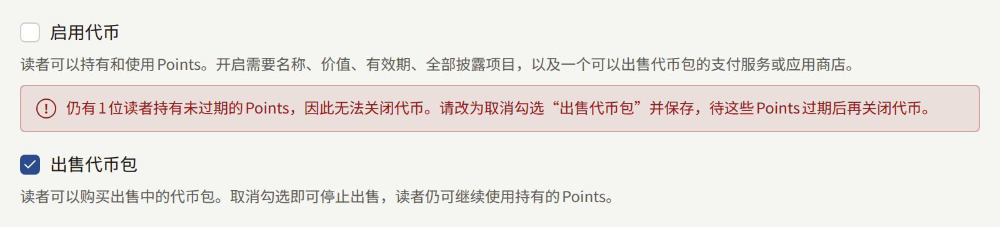

代币让读者可以预先为章节付款：读者一次性购买租户的一个代币包，然后在每个章节上花费几个代币，无需每个章节都经过付款页面。代币由租户发行和命名，并由租户决定一个代币在其货币中值多少、有效期多长，以及出售哪些代币包。代币开启后读者在网站和应用中看到的内容，见[销售章节](./4-selling-episodes.md#使用代币支付)。

**支付** › **代币**面向**租户管理员**；编辑和审计员看不到该页面。

## 开始之前

代币是一种预付支付工具，出售代币的租户就是其发行方。根据租户及其读者所在的地区，有关预付工具、电子货币、资金转移或礼品卡的法律可能适用于代币，这些法律可能要求租户进行申报、缴纳保证金、退还未使用的余额，或在出售代币的地方展示特定信息。租户是否可以发行代币、需要做什么，由租户自行确认。该页面提供开关和披露项目的字段，不再就法律做任何说明。

首先需要满足两个条件：

- **平台允许租户发行代币**。在新的安装实例上它是关闭的。关闭期间，侧边栏中没有**代币**，通过地址打开该页面时会显示平台不允许租户发行代币。运营人员按照[平台默认值与策略](../3-operations/9-platform-policies.md#租户发行的代币)的说明开启它。
- **可以出售代币包**。只有当**支付** › **支付方式**中的某个支付服务商处于**就绪**，或App Store或Google Play处于该状态时，才能开启代币，具体见[销售章节](./4-selling-episodes.md)。页面上的其他内容都可以在此之前填写。

## 三种状态

页面顶部会显示租户代币所处的状态：

| 状态 | 读者看到的内容 |
| --- | --- |
| **关闭** | 看不到任何与代币有关的内容。每个章节都照常不使用代币出售 |
| **开启，出售中** | 以代币标价的章节、读者的余额，以及正在出售的代币包 |
| **开启，已停售** | 与上一项相同，只是不能购买任何代币包：读者可以继续花费手中持有的代币 |

**代币设置**中的**启用代币**和**出售代币包**用于在这些状态之间切换。租户要结束代币，需要先经过**开启，已停售**，具体见[停止](#停止)，因为关闭代币会拿走读者已经付费购买的代币。

## 代币设置

- **名称**是读者在数字后面看到的词，例如`120 Points`中的`Points`，需要为网站提供的每种语言分别填写一次。网站默认语言的名称是必填的，没有填写时保存会被拒绝，并在该字段下方说明。使用留空语言的读者会看到默认语言的名称。名称保存后，页面也会以您阅读控制台所用的语言使用它：代币包的字段会显示为**每包Points**和**赠送Points**。
- **每个代币的价值**是一个代币在租户货币中的价值，例如`10`表示10日元。章节的代币价格等于其价格（促销期间为促销价格）除以该价值后向上取整，因此一个300日元的章节，在每个代币值10日元时需要30个代币。没有第二套价目表：更改章节的价格，其代币价格也随之改变。一旦有任何读者获得了代币，所有余额都以该价值计算，之后就不能再更改。
- **有效天数**是购买代币包后其代币可以使用的天数，最多36,500天。未使用就过期的代币会消失；读者的历史记录会说明这一点。
- **披露项目**会在出售代币的所有地方、在代币包下方向读者显示：**发行方名称**、**条款URL**（载有代币出售条款的页面）、**联系方式**（读者就其代币联系您的方式），以及**须知**（其他需要告知读者的内容，例如未使用的代币如何退款）。

**启用代币**会开启代币，需要默认语言的名称、价值、有效期、全部四个披露项目，以及一种出售代币包的方式。缺少其中任何一项时保存会被拒绝，并指出每个缺少的字段。**出售代币包**会让代币包开始出售，可以在代币保持开启的情况下取消勾选。

## 代币包

**代币包**按网站提供的顺序列出读者可以购买的代币包。每一行以读者看到的形式显示代币包，例如`120Points（含赠送20）`，并显示其价格以及是否正在出售。

- 列表下方的**添加代币包**需要填写代币包授予的代币数、在此之外额外赠送的代币数，以及以租户货币计的价格，价格必须大于零。新的代币包会排在列表末尾。一个租户最多提供20个代币包。
- 代币包的字段在其所在行中编辑，并用该行的**保存**保存。**出售中**可以让单个代币包停止出售或重新出售，而不影响其他代币包。
- 代币包一旦售出，其代币数、赠送数和价格就会保持为购买者所支付的内容。这时该行会以文本形式显示这些值并说明原因，只保留**出售中**。要出售不同的代币包，请添加一个新的代币包，并停售旧的代币包。
- **停售**会在您确认后让代币包永久停止出售。它会从列表中移除，读者保留从中购买的代币。
- 通过拖动行的手柄来更改顺序，也可以用键盘操作：聚焦到手柄，按空格键，用方向键移动，再按一次空格键。

赠送是租户给予的折扣，版税按购买代币时支付的金额计算，具体见[报表与版税](./6-reports-and-royalties.md#作者应得的金额)。

### 应用中的代币包

当租户的应用通过App Store和Google Play销售时，每个代币包都作为单独的商店商品购买，名称为`coins_`后接代币包的ID。**支付** › **支付方式**底部的**商店商品**会在章节价格所需的商品旁边列出每个代币包的商品。请按代币包的价格把每一个都创建为消耗型商品，具体见针对章节的[在应用中销售](./4-selling-episodes.md#在应用中销售)。

## 停止

取消勾选**出售代币包**并保存，会立即停止网站和应用中所有代币包的销售，同时所有读者仍可花费手中持有的代币。状态变为**开启，已停售**。

只要还有读者持有未过期的代币，取消勾选**启用代币**就会被拒绝：页面会显示有多少读者持有，并建议改为停止出售。请等到这些代币中的最后一个过期（最长为最后一个代币包售出后的**有效天数**），然后再关闭代币。

如果运营人员不再允许租户代币，无论租户保存了什么，所有租户的代币都会立即停止：不会出售或花费任何代币，读者保留其余额。租户的设置会保留，运营人员再次允许代币后会重新生效。

每次保存设置，以及每次添加、更改或停售代币包，都会连同执行操作的租户管理员一起记录在[审计日志](./3-setup/8-audit-log.md)中。
