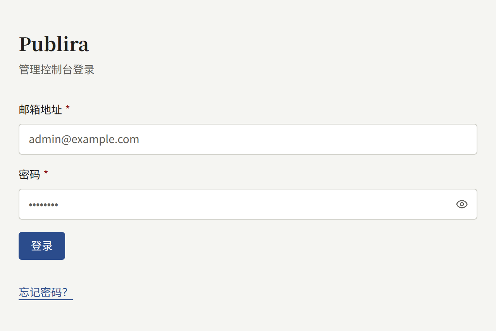
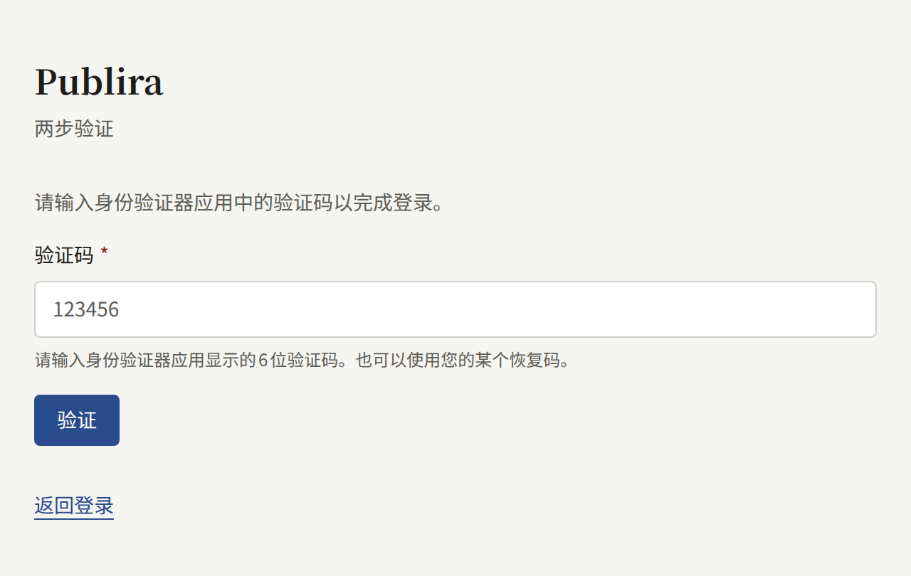
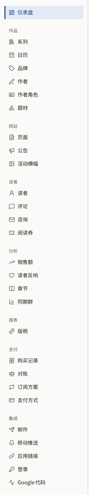

每个租户都有自己的控制台，出版社的工作人员在这里管理网站上的作品、读者和网站设置。本章面向这些工作人员，前提是租户已经存在，并且您已获得访问权限，具体如[租户的工作人员](../3-operations/3-tenant-staff.md)从运营人员一侧所述。

## 登录

控制台位于租户的控制台主机上。除非运营人员另行指定，该主机就是在公开网站的域名前加上`admin.`：网站位于`comics.example.com`时，控制台位于`admin.comics.example.com`。在那里使用您账户的邮箱地址和密码登录。同一界面上的“**忘记密码？**”会发送一封邮件，其中附有设置新密码的链接。

如果您的账户开启了两步验证，控制台接下来会要求输入身份验证器应用中的验证码。运营人员可以要求安装实例上的每位租户管理员都启用两步验证，此时尚未注册身份验证器应用的租户管理员必须先注册一个，才能继续。如何开启两步验证以及手机丢失时该怎么办，请参阅[您的账户](./3-setup/9-your-account.md)。

您的控制台账户同时也是租户网站上的账户：您可以用同一邮箱地址和密码在网站上阅读和购买，控制台只是您的角色在此之上附加的功能。

## 角色

每位工作人员都拥有三种角色之一，控制台只向每个人显示其可以使用的部分：

| 角色 | 可以做什么 |
| --- | --- |
| **租户管理员** | 控制台中的一切：工作人员、租户的所有设置、与邮件、支付、推送通知、登录和Google代码的集成、读者的账户、购买记录、退款及其与支付服务商的对账、订阅方案、代币、版税，以及审计日志 |
| **编辑** | 编写作品目录和网站的页面、公告与活动横幅，并管理评论 |
| **审计员** | 查看编辑所处理的内容以及租户的设置，但不能更改其中任何内容 |

租户管理员在**成员**中为其他工作人员分配角色。各角色的完整说明请参阅[租户的工作人员](../3-operations/3-tenant-staff.md#三种角色)。

## 本章内容

- [发布作品](./1-catalog/index.md)：从空的作品目录到读者可以打开的第一个章节，以及构成作品目录的系列、章节、品牌、作者、作者角色和题材。
- [读者、评论和咨询](./2-readers/index.md)：暂停和删除读者账户、处理评论审核和举报队列、回复咨询，以及用阅读券向读者开放付费章节。
- [设置租户](./3-setup/index.md)：通过设置、品牌、页面、公告、活动横幅、成员、邮件服务器、审计日志和您自己的账户，把新租户打造成具有出版社风格、法律页面和工作人员的网站。
- [销售章节](./4-selling-episodes.md)：为章节定价、通过Stripe或PAY.JP收款、章节在哪里销售、应用内购买、退款，以及正式上线前测试配置。
- [订阅方案](./5-subscription-plans.md)：通过Stripe向读者销售按周期计费的方案，开放整个作品目录、部分品牌或部分系列，它在Stripe中所需的Price和webhook事件，以及订阅者在网站上的操作。
- [报表与版税](./6-reports-and-royalties.md)：仪表盘和分析界面统计的内容、每位作者的版税如何计算、将一个月结算为结算单，以及将其导出为CSV。
- [通过Apple和Google登录](./7-sign-in.md)：让读者用Apple或Google账户登录网站和应用，以及为此需要在Apple和Google的控制台中创建什么。
- [Google代码](./8-google-tag.md)：用Google Analytics或Google Tag Manager统计网站数据、可以加载代码的三个位置，以及为网关在Google Tag Manager中需要设置的内容。
- [代币](./9-coins.md)：为读者预先购买的代币命名、代币附带的说明事项、出售代币的套餐，以及开启、停止销售和关闭代币。

如果您还没有读过Publira是什么，请从[入门](../1-getting-started.md)开始。
