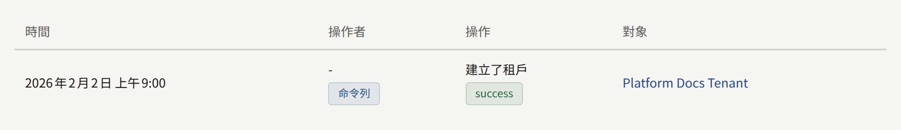
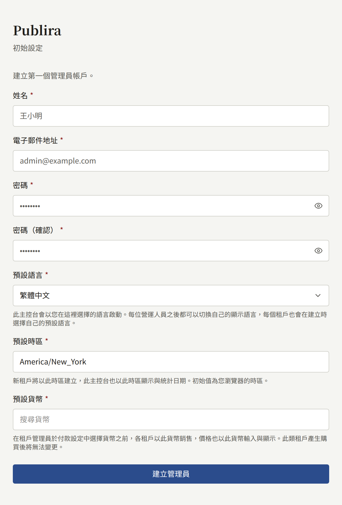
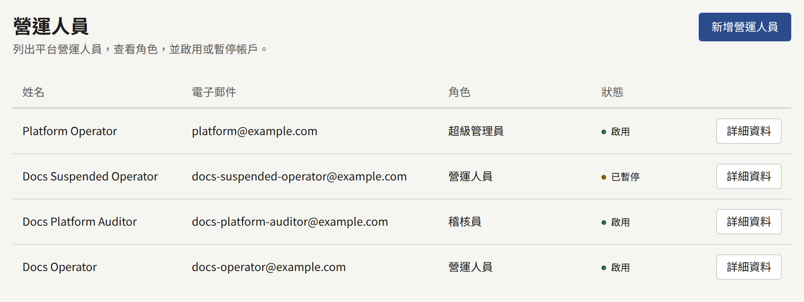
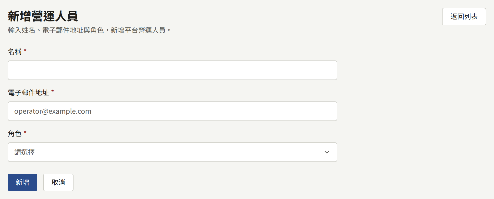
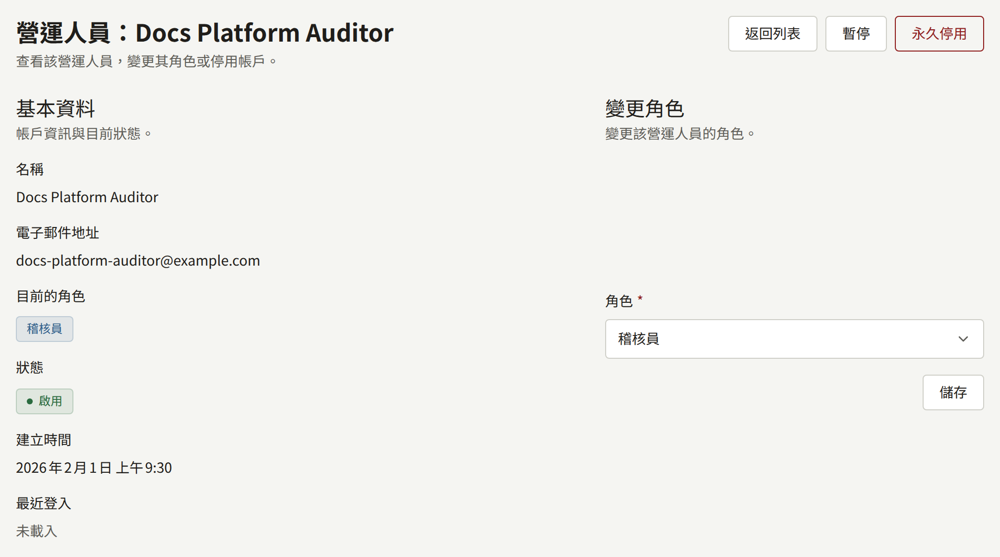
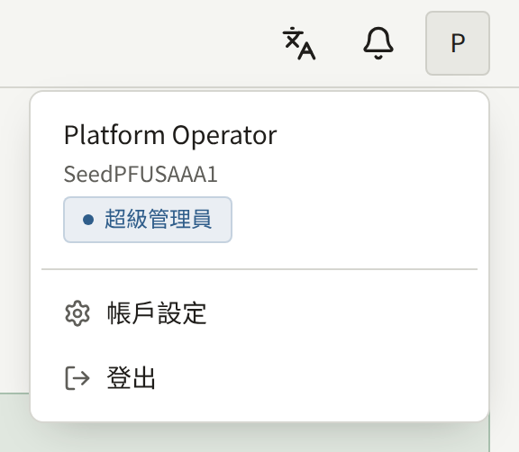
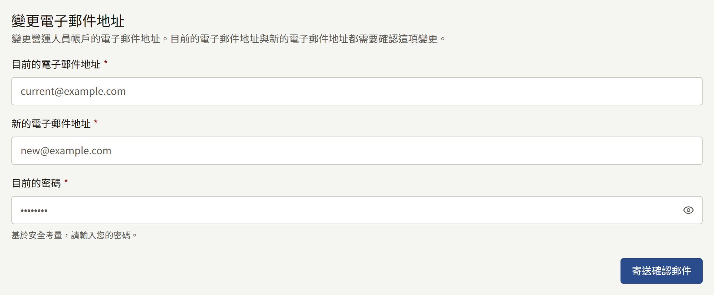
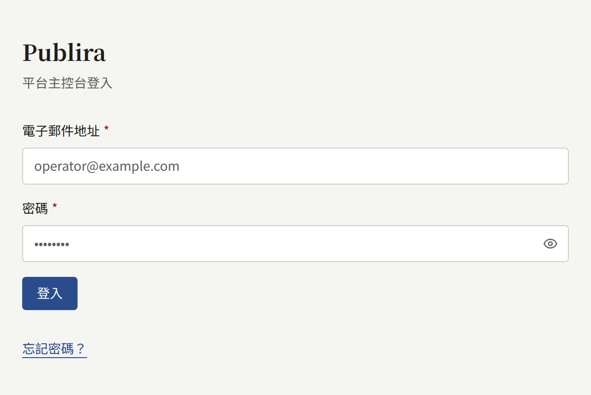

安裝實例可以從兩個地方之一管理，大多數工作在兩邊都能進行。本頁說明兩者的差異、平台主控台如何取得第一位營運人員，以及之後如何新增營運人員並指派角色。

## 在兩者之間選擇

`publiractl`是以安裝實例所執行版本的映像檔執行的指令，如同[安裝](../2-deployments/2-installing.md)中所述；在[Docker Compose](../2-deployments/3-docker-compose.md)安裝實例上，則以`docker compose run --rm publiractl`執行。它以`publira_platform`直接連線到資料庫，因此在沒有執行平台主控台的安裝實例上也能運作，而且除了這個連線之外什麼都不需要：不需要帳戶、不需要瀏覽器，也不需要任何其他處理程序在執行。

平台主控台就是`web-platform`，一個供營運人員登入的Web應用程式。它有自己的帳戶，每個帳戶都有一個角色，因此您可以讓某人查看每個租戶而不讓他變更任何東西，而且它會記錄每項變更是由哪位營運人員做的。

兩者都透過相同的程式碼寫入，因此從其中一方建立的租戶與從另一方建立的租戶完全相同，您也可以在同一個安裝實例上同時使用兩者。差異在於各自提供的工作：

| 工作                             | `publiractl` | 平台主控台 |
| -------------------------------- | ------------ | ---------- |
| 建立、變更與暫停租戶             | 是           | 是         |
| 租戶的成員與管理員邀請           | 是           | 是         |
| 以密碼建立主控台帳戶，不寄送郵件 | 是           | 否         |
| 平台營運人員                     | 否           | 是         |
| 移除營運人員已遺失的兩步驟驗證   | 是           | 否         |
| 平台的預設值、政策與保留期限     | 是           | 是         |
| 每個租戶的讀者                   | 否           | 是         |
| 閱讀稽核記錄                     | 否           | 是         |
| 執行維護工作                     | 是           | 否         |

任一方對租戶或其工作人員所做的每項變更，都會記錄在平台主控台的**稽核記錄**中。從`publiractl`所做的變更在那裡不會指出營運人員：它的執行者是**命令列**。



若您沒有執行平台主控台，只用`publiractl`也足以營運安裝實例。您放棄的是閱讀稽核記錄，以及跨租戶處理讀者的帳戶；每個租戶的管理員仍然可以從租戶主控台管理自己的讀者。

## 第一位營運人員

依[安裝](../2-deployments/2-installing.md#使用web-platform的平台主控台)的說明執行`web-platform`並開啟它。在它擁有營運人員之前，其中的每個位址都會導向**初始設定**畫面，要求填寫：

- **姓名**、**電子郵件地址**與**密碼**，以及**密碼（確認）**：第一位營運人員的帳戶。
- **預設語言**：平台主控台一開始使用的語言。它也會成為平台的預設語言，取代`publiractl setup`所儲存的語言。每位營運人員之後都可以切換自己看到的語言，而每個租戶在建立時都會選擇自己的語言。
- **預設時區**：租戶在建立時未指定時區時一開始使用的時區，也是平台主控台顯示與計算日期所用的時區。它一開始是您瀏覽器的時區，維持不變就會儲存該時區，取代`publiractl setup`所儲存的時區；若要選擇其他時區，請搜尋地區或城市。已經存在的租戶會保留它們自己的時區。
- **預設貨幣**：在租戶管理員儲存自己的**付款設定**之前，每個租戶販售時使用的貨幣。它一開始是`publiractl setup`所儲存的貨幣，因此維持不變就會保留該貨幣；若要尋找其他貨幣，請輸入名稱或ISO 4217代碼，例如`EUR`。一旦以該貨幣販售的租戶有了購買紀錄，這個欄位就會變成唯讀並加以說明，因為該租戶的價格是以這個貨幣計算的金額。若無法讀取已儲存的貨幣，這個欄位也會變成唯讀並加以說明，而設定會保留貨幣不變；之後請從**一般設定**變更。貨幣影響的範圍見[平台預設值](./9-platform-policies.md#平台預設值)。



**建立管理員**會以**超級管理員**角色建立帳戶，並將您帶到登入畫面。從此之後，設定畫面就不會再出現：不會有第二位「第一位營運人員」，`publiractl`中也沒有任何東西可以建立營運人員。之後的每位營運人員，都由超級管理員從**營運人員**新增。

平台主控台的帳戶是它自己的。`publiractl setup`所建立的租戶管理員無法登入平台主控台，營運人員也無法以營運人員帳戶登入租戶的主控台。

## 營運人員的角色

每位營運人員都擁有以下三種角色之一：

| 角色 | 可以做的事 |
| --- | --- |
| **稽核員** | 查看所有內容：儀表板、租戶及其成員、使用者、稽核記錄，以及平台的設定。除了自己的帳戶之外，不能變更任何東西 |
| **營運人員** | 稽核員可以做的所有事，以及變更租戶、其成員與邀請、讀者的帳戶，以及平台的設定與服務 |
| **超級管理員** | 營運人員可以做的所有事，以及新增營運人員、變更他們的角色，以及暫停或永久停用他們 |

平台主控台會向稽核員顯示與營運人員相同的畫面與表單，並在送出時拒絕變更。完整的表格見[`publira server`參考文件](https://github.com/publira/publira/blob/main/server/cmd/publira/README.md#platform-console-role-permissions)。

## 管理營運人員

側邊欄**治理**底下的**營運人員**，會列出每位營運人員及其角色與狀態。只有超級管理員可以在那裡變更任何東西。



### 新增營運人員

**新增營運人員**會要求填寫營運人員的**名稱**、**電子郵件地址**與**角色**，並立即建立帳戶。新的營運人員會收到一封郵件，內含設定帳戶第一個密碼的連結，設定完成後即可以該密碼登入。連結的有效期限為24小時；逾期後，他們可以在登入畫面選擇「**忘記密碼？**」取得新的連結。這封郵件與平台主控台寄送的每封郵件一樣，由`publira worker`以平台所儲存的SMTP設定、使用平台的預設語言寄送。

若該地址已經有一個沒有任何角色的平台主控台帳戶，則會把角色指派給該帳戶，而不會建立新帳戶。它會保留原有的密碼，因此它收到的郵件不含密碼連結，只會告知它現在可以登入。



已經屬於某位營運人員（包括已永久停用者）的地址，無法再次新增。

### 變更營運人員的角色

從**營運人員**開啟該營運人員，並在**變更角色**底下選擇新的角色。任何人都無法變更自己的角色，因此超級管理員永遠無法把自己降級，安裝實例也一定會保留正在操作的那位超級管理員。



### 暫停與永久停用

在同一個畫面上：

- **暫停**會讓營運人員無法登入，並結束他們已開啟的工作階段。**重新啟用**會讓他們可以再次登入。
- **永久停用**會永久結束帳戶。已永久停用的帳戶永遠無法再使用，其地址也無法新增為新的營運人員；它所做的變更會以它的名稱保留在稽核記錄中。

這兩種動作都無法對您自己的帳戶執行。

## 營運人員自己的帳戶

主控台頁首帳戶選單中的**帳戶設定**可以變更您的電子郵件地址。確認連結會寄到目前的地址與新的地址，兩個連結都開啟後，變更才會生效。





### 兩步驟驗證

同一頁上的**兩步驟驗證**，會在您每次登入時、在密碼之後要求輸入驗證器應用程式產生的驗證碼。**開始設定**會顯示供應用程式掃描的QR碼，並為無法掃描的應用程式以文字顯示相同的金鑰；輸入應用程式隨後顯示的六位數驗證碼，再選擇**啟用兩步驟驗證**。接著頁面會顯示十組復原碼，而且只顯示一次：請把它們保存在安全的地方，與手機分開。在無法使用驗證器時，每組復原碼都可以在登入要求驗證碼的任何地方讓您登入一次。


從此之後，登入會在密碼之後停在**兩步驟驗證**，要求輸入驗證碼。以復原碼登入時，會顯示還剩下幾組。開啟期間，同一張卡片上有兩個表單：

- **重新產生復原碼**會以十組新的復原碼取代您持有的所有復原碼，無論是否已使用。它要求的是驗證器的驗證碼，而不是復原碼。
- **關閉兩步驟驗證**接受驗證器的驗證碼或復原碼。您隨時都可以再次設定，若有新的驗證器也可以使用新的。

平台可以要求每位營運人員都使用兩步驟驗證，詳見[安全性](./12-security/2-two-step-verification.md#平台營運人員)。這時，您會在下次登入時被要求設定，設定完成後才會完成登入。

登入期間沒有可以變更密碼的表單。請登出，在登入畫面選擇**忘記密碼？**，再從寄給您的連結設定新密碼；連結的有效期限為24小時。



### 遺失兩步驟驗證

開啟了兩步驟驗證、之後又同時遺失驗證器與所有復原碼的營運人員，無法登入平台主控台，其他營運人員也無法在那裡從他們的帳戶移除兩步驟驗證。請以`publiractl`移除：

```bash
publiractl operator reset-mfa --email operator@example.com
```

也可以用`--user <public ID>`取代`--email`來指定帳戶。這個指令會移除帳戶的驗證器與所有復原碼，除此之外什麼都不動：它的密碼、角色與狀態都維持原樣。之後，該營運人員只以密碼登入，再從**帳戶設定**重新設定兩步驟驗證。若平台要求每位營運人員都使用兩步驟驗證，登入過程會要求他們先完成設定才會完成登入。

由於`publiractl`不需要帳戶就能執行，當遺失兩步驟驗證的營運人員是安裝實例唯一的**超級管理員**時，這也是重新進入的方法。

移除之後，帳戶就只受密碼保護，而這正是持有遭竊密碼的人會提出的要求。執行指令之前，請透過您已經確知屬於該營運人員的管道（而不是請求送達的那個管道），確認請求確實來自該營運人員。

這次移除會記錄在平台主控台的**稽核記錄**中，執行者為**命令列**。
